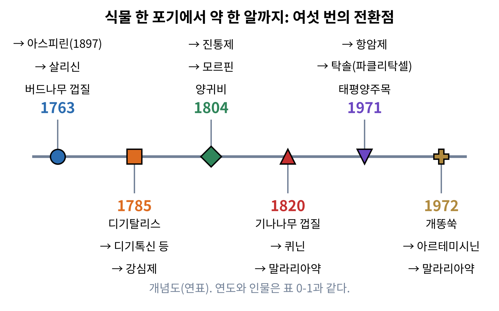
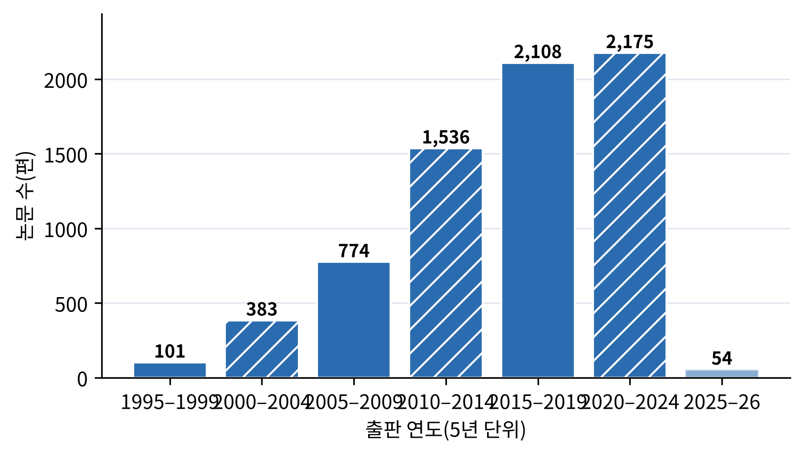
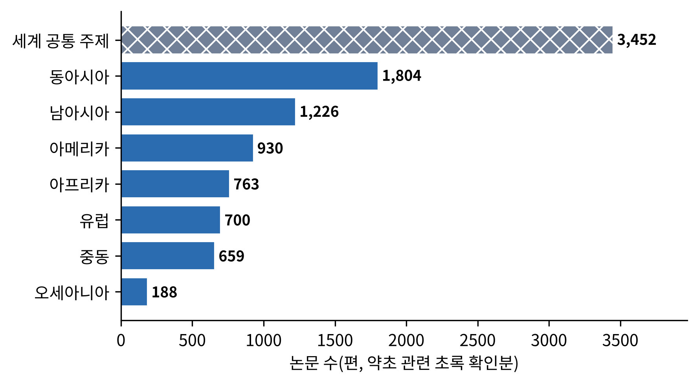

# 서장. 풀이 약이 되기까지

<strong>그림 0-1. 식물 한 포기에서 약 한 알까지: 여섯 번의 전환점.</strong> 가로 선은 시간 순서이고, 각 점은 식물이 성분으로, 성분이 약으로 바뀐 순간이다. 개념도이며, 연도와 인물은 표 0-1과 같다.

<ul class="mini-toc">
<li>이 책이 필요한 이유</li>
<li>책의 구성과 장들의 연결</li>
<li>누가 읽으면 좋은가</li>
<li>이 책의 근거: 논문 12,155편</li>
<li>개똥쑥 한 줌, 노벨상까지</li>
<li>여섯 번의 전환점</li>
</ul>

## 이 장을 읽기 전에

서장은 책 전체의 지도이다. 왜 지금 허브를 과학으로 다시 읽어야 하는지, 열네 개의 장이 어떻게 이어지는지, 이 책의 이야기가 어떤 근거 위에 서 있는지를 먼저 밝힌다. 이 지도를 쥐고 시작하면 뒤의 장들이 각자 따로 놓인 이야기가 아니라 하나의 큰 이야기의 부분이라는 점이 보인다.

이 장에는 세 가지 일이 있다. 첫째, 풀이 약이 된 가장 극적인 사례 하나를 자세히 따라간다. 둘째, 그 사례를 포함한 여섯 번의 전환점을 한 장의 연표로 모은다. 셋째, 이 책을 쓰는 데 쓴 논문 자료가 어떤 것이고 어디까지 믿을 수 있는지를 숫자로 보인다. 과학을 다루는 책이라면 근거를 먼저 보여 주는 것이 독자에 대한 예의라고 생각한다.

## 1. 이 책이 필요한 이유

사람은 아플 때 풀을 찾았다. 생각해 보면 이상한 일이 아니다. 약국도, 병원도, 문자로 적힌 처방도 없던 시절에 몸이 아픈 사람이 손을 뻗을 수 있었던 것은 발밑의 식물이었다. 역사 속 약용식물 사용을 정리한 한 검토 논문은 이를 두고 "약초로 치료하는 일은 인류만큼 오래되었다"고 적는다(Petrovska, 2012). 사람이 질병과 싸우며 껍질, 씨앗, 열매의 몸에서 약을 찾는 법을 배웠고, 그 증거는 문헌과 유적, 심지어 남아 있는 식물 약재 자체에서 확인된다는 것이다.

그 오랜 지식은 지금도 끝나지 않았다. 세계보건기구(World Health Organization, WHO)의 추정을 인용한 한 논문은 전 세계 사람의 80% 이상이 일차 건강관리의 일부를 약초 제품에 기대고 있다고 적는다(Ekor, 2014). 이 수치는 논문이 인용한 추정치이므로 정확한 통계라기보다 규모를 가늠하는 눈금으로 읽는 것이 좋다. 같은 논문은 곧바로 반대쪽 사실도 적는다. 효능이 분명히 확인된 허브 제품도 있지만 작용 기전이나 부작용, 다른 약과의 상호작용을 모르는 채 쓰이는 제품이 많다는 것이다.

여기에 이 책의 자리가 있다. 한편에는 수천 년 쌓인 경험이 있고, 다른 한편에는 지난 이십 년 사이 폭발적으로 늘어난 실험 논문이 있다. 두 세계는 서로의 언어를 잘 알지 못한다. 전통 의학의 책은 "열을 내린다", "기를 보한다" 같은 말로 쓰이고, 실험실의 논문은 "수용체", "농도-반응 곡선", "무작위 대조 임상시험" 같은 말로 쓰인다. 이 책은 그 사이를 통역하려는 시도이다. 전통이 틀렸다고 몰아세우지도, 무조건 옳다고 믿지도 않고, 어떤 허브에 대해 지금까지 과학이 확인한 것과 아직 모르는 것을 구분해서 보여 주려 한다.

과학이 약초에서 얻은 것은 이미 상당하다. 한 역사 개관은 오래전 민간에서 쓰던 물질에서 출발해 오늘의 약 후보로 이어진 천연물의 계보를 정리한다(Dias et al., 2012). 최근의 검토는 오랫동안 합성 화합물 라이브러리에 기울었던 제약 산업이 신약 출시 감소를 겪으면서 식물에서 얻는 천연물에 다시 눈을 돌리고 있다고 진단한다(Atanasov et al., 2015). 풀은 낡은 지식의 저장고가 아니라 아직 다 읽지 못한 도서관이다.

## 2. 책의 구성과 장들의 연결

이 책은 크게 네 덩어리로 되어 있다. 1장과 2장은 허브라는 개념의 뿌리를 다룬다. 사람은 언제부터 어떻게 식물을 약으로 알아보았는가(1장), 식물은 왜 사람에게 약이 되는 물질을 만드는가(2장)를 묻는다. 3장부터 9장까지는 세계를 일곱 지역으로 나누어 돌아본다. 동아시아, 남아시아, 중동, 유럽, 아프리카, 아메리카, 오세아니아의 전통이 각각 어떤 식물을 어떤 이유로 썼고, 그것이 현대 과학에서 어떻게 검증되고 있는지를 본다. 10장부터 13장까지는 지역을 가로지르는 과학의 도구를 다룬다. 작용 기전을 밝히는 약리학, 효과를 가리는 임상시험, 위험을 따지는 안전성, 품질을 맞추는 표준화이다. 마지막 14장은 오늘의 허브와 남은 과제를 정리한다.

<strong>표 0-2. 이 책의 구성과 장별 쪽수</strong>

| 장 | 제목 | 시작 쪽 | 쪽수 | 한 줄 안내 |
|---|---|---|---|---|
| 서장 | 풀이 약이 되기까지 | 9 | 12 | 책의 지도와 근거 |
| 1 | 약초의 기원 | 21 | 11 | 인류와 식물의 가장 오래된 계약 |
| 2 | 식물화학의 세계 | 32 | 12 | 식물은 왜 약을 만드는가 |
| 3 | 동아시아 | 44 | 16 | 본초에서 한약·캄포까지 |
| 4 | 남아시아 | 60 | 16 | 아유르베다에서 약용 식물 데이터베이스까지 |
| 5 | 중동 | 76 | 14 | 그리스의 유산, 아랍·페르시아의 의학 |
| 6 | 유럽 | 90 | 14 | 수도원의 약초원에서 표준화 추출물까지 |
| 7 | 아프리카 | 104 | 14 | 말로 전해진 약초, 병원 대기실의 약초 |
| 8 | 아메리카 | 118 | 14 | 시장에서 실험실로, 원주민의 약초를 묻다 |
| 9 | 오세아니아 | 132 | 15 | 카바와 안전성의 시험 |
| 10 | 약리학 | 147 | 12 | 한 분자에서 네트워크로 |
| 11 | 임상시험 | 159 | 14 | 증거의 등급 |
| 12 | 안전성 | 173 | 14 | 독성, 상호작용, 그리고 제품의 품질 |
| 13 | 표준화와 약전 | 187 | 13 | 병 속의 일관성 |
| 14 | 오늘의 허브와 내일의 과제 | 200 | 12 | 남은 과제 |
| 부록 A | 용어집 | 212 | 4 | 본문에 나온 용어 |
| 부록 B | 허브 도감표 | 216 | 3 | 본문에 나온 식물 |
| 부록 C | 참고문헌 색인 | 219 | 3 | 인용 문헌 찾아보기 |

시작 쪽과 쪽수는 컬러판 PDF(v1) 기준이며 흑백판도 같다. 부분 표지와 장 사이의 빈 면은 앞 장의 쪽수에 들어 있다.

장들은 이렇게 이어진다. 2장의 식물화학이 있어야 3장부터 9장의 각 지역에서 "이 식물에 어떤 성분이 있는가"를 읽을 수 있다. 10장의 약리학은 지역 장에서 소개한 성분이 몸속에서 무엇을 하는지를 설명해 주고, 11장의 임상시험은 그 설명이 실제 사람에게도 맞는지 묻는다. 12장은 맞는 만큼 틀릴 수 있다는 점, 곧 허브도 약이라는 점을 다룬다. 13장은 같은 이름의 허브가 제품마다 다른 문제를 푸는 방법이다. 14장에서 이 모든 이야기가 합쳐진다.

## 3. 누가 읽으면 좋은가

이 책은 전문가가 아니어도 읽을 수 있게 쓰되, 얕게 쓰지는 않았다. 건강식품과 한약, 허브차를 일상에서 접하는 독자에게는 "이게 정말 효과가 있는가"라는 질문에 답하는 길잡이가 될 것이다. 약학, 식품영양, 한의학, 생물학을 공부하는 학생에게는 용어의 정식 명칭과 원 논문의 출처를 따라갈 수 있는 입문서가 될 것이다. 전통 지식이 현대 과학과 만나는 지점에 관심이 있는 연구자에게는 지역별 논문의 지형을 한눈에 보여 주는 지도가 되기를 바란다.

읽는 방법도 세 가지로 제안한다. 처음부터 끝까지 읽으면 허브의 과학사를 한 편의 이야기로 따라갈 수 있다. 관심 있는 지역 장만 골라 읽어도 각 장은 서장과 2장의 약속만 알면 따로 읽히도록 썼다. 근거를 확인하고 싶은 독자는 장 끝의 참고문헌에서 원 논문을 찾으면 된다.

## 4. 이 책의 근거: 논문 12,155편

이 책은 저자의 기억이나 인상이 아니라 모아 둔 논문 자료를 바탕으로 쓴다. 자료는 OpenAlex(오픈알렉스, 학술 논문 서지를 공개하는 무료 데이터베이스)에서 스무 개의 검색 질의로 모았다. 질의마다 인용이 많은 순서로 최대 천 편 안팎을 받았고, 그 결과 초록이 있는 연구 논문 12,155편이 쌓였다. 출판 연도는 1882년부터 2026년까지이다.

다만 이 자료에는 한계가 분명하다. 검색은 영어 낱말을 기준으로 했으므로 영어로 출판된 논문이 압도적으로 많다. 인용이 많은 순서로 받았기 때문에 오래되어 많이 인용된 논문이 유리하고, 최근 논문은 아직 인용이 쌓이지 않았다. 또 낱말이 걸리기만 하면 가져오기 때문에 허브와 관련 없는 논문이 섞여 있었다. 예를 들어 "역사"를 검색하자 허브와 무관한 세계 암 통계 논문이 나왔다. 그래서 제목과 초록에 허브, 약용식물, 민족식물학, 전통 의학, 식물화학 같은 낱말이 있는지를 한 번 더 걸러, 약초와 직접 관련된 7,182편만 책의 근거로 삼았다.

<figure class="fig">

<figcaption><strong>그림 0-2. 약초 관련 논문의 5년 단위 출판 수(1995~2026).</strong> 약초 관련 논문 7,182편 중 1995년 이후 분을 5년 단위로 센 값이다. 2025–26년 막대는 연도가 끝나지 않았고 인용이 쌓이지 않았으므로 옅게 그렸다. 자료: OpenAlex 수집분(2026-10-23), 본 책 집계.</figcaption>
</figure>

그림 0-2를 읽어 보자. 1995~1999년에는 101편이었던 것이 2010~2014년에는 1,536편이 되고, 2015~2019년에는 2,108편, 2020~2024년에는 2,175편에 이른다. 이십 년 사이 스무 배 넘게 늘어난 셈이다. 다만 이것이 허브 연구가 그만큼 폭발했다는 뜻인지, 수집 방식이 인용 많은 최근 논문을 더 많이 담았기 때문인지는 가려 읽어야 한다. 이 그림은 연구의 흐름이 대체로 어느 방향인지를 보여 줄 뿐, 정확한 증가율을 말해 주지는 않는다.

<figure class="fig">

<figcaption><strong>그림 0-3. 지역별 약초 관련 논문 수.</strong> 한 논문이 여러 질의에 걸리면 각 지역에 한 번씩 센다. 막대의 빗금은 지역에 속하지 않는 세계 공통 주제 질의이다. 자료: OpenAlex 수집분, 본 책 집계(약초 관련 7,182편).</figcaption>
</figure>

<strong>표 0-3. 지역별 수집 논문 수와 약초 관련 확인 논문 수</strong>

| 구분 | 수집(편) | 약초 관련(편) | 관련 비율 |
|---|---|---|---|
| 세계 공통 주제 | 5,870 | 3,452 | 59% |
| 동아시아 | 2,883 | 1,804 | 63% |
| 남아시아 | 1,751 | 1,226 | 70% |
| 아메리카 | 1,686 | 930 | 55% |
| 유럽 | 1,000 | 700 | 70% |
| 중동 | 1,000 | 659 | 66% |
| 아프리카 | 999 | 763 | 76% |
| 오세아니아 | 399 | 188 | 47% |

한 논문이 여러 질의에 걸릴 수 있어 지역별 합이 전체 고유 논문 수(12,155편, 관련 7,182편)보다 크다. 자료: 본 책 집계.

표 0-3에서 알 수 있는 것은 두 가지이다. 첫째, 세계 공통 주제와 동아시아, 남아시아에 논문이 많이 몰려 있다. 둘째, 오세아니아는 수집된 논문이 399편뿐이고 그중 약초 관련은 188편이다. 오세아니아 장은 다른 장보다 논문이 얇은 만큼 근거가 얇다는 점을 그 장에서 솔직히 밝히고 쓸 것이다. 아프리카와 남아시아처럼 관련 비율이 높은 지역은 검색어가 연구 주제와 잘 맞았다고 볼 수 있다.

## 5. 개똥쑥 한 줌, 노벨상까지

이제 하나의 이야기를 자세히 따라가 보자. 풀이 약이 되는 과정이 어떤 모습인지를 이만큼 극적으로 보여 주는 사례가 드물다.

1967년 5월, 중국에서는 문화대혁명의 소용돌이 속에서 하나의 비밀 군사 의약 사업이 시작되었다. 사업 이름은 개시일을 따서 '523 프로젝트'라고 불렸다. 목적은 말라리아 약을 찾는 것이었다. 당시 베트남 전쟁 전선의 군인들이 열대 말라리아에 쓰러지고 있었는데, 오래 쓰던 약이 듣지 않는 열원충이 퍼지고 있었다.

1969년, 중의연구원(中醫硏究院, 지금의 중국중의과학원)의 연구자 도유유(屠呦呦, 중국어 발음 투유유로 널리 알려져 있다)가 이 사업에 참여했다. 그녀가 맡은 일은 옛 의서와 민간 처방을 뒤져 말라리아 후보 약초를 찾는 것이었다. 도유유의 회고에 따르면 그녀의 팀은 이천 가지가 넘는 처방을 모았고, 그중 육백마흔 가지를 추려 이백 가지 안팎의 약초에서 삼백팔십 가지 추출물을 만들어 쥐 말라리아에 시험했다(Tu, 2011). 그중 하나가 청호(靑蒿), 곧 개똥쑥이었다.

그런데 결과가 들쭉날쭉했다. 어떤 때는 열원충을 거의 없앴고 어떤 때는 효과가 없었다. 연구자들은 막다른 길에 선 느낌이었을 것이다. 이때 도유유가 다시 펼친 책이 4세기 중반 갈홍(葛洪)이 쓴 『주후비급방(肘後備急方)』이었다. 응급 처방을 모은 이 책에는 열병에 청호를 쓰는 방법이 한 줄 적혀 있었다. 청호 한 줌을 물 두 되에 담갔다가 즙을 짜서 마신다는 내용이다. 도유유는 이 문장에서 중요한 단서를 읽었다. 약초를 끓이지 않고 물에 담가 짜라고 했다는 점이다. 열에 약한 성분이 있다면 끓이는 순간 사라질 수 있다.

그녀는 가열하는 추출을 버리고 낮은 온도에서 끓는점이 낮은 에테르로 추출하는 방법으로 바꾸었다. 1971년 10월 4일에 만든 191번 시료의 중성 추출물이 쥐 말라리아에서 완전한 억제 효과를 보였고, 원숭이 말라리아에서도 같은 결과가 나왔다는 것이 그녀의 기록이다(Tu, 2011). 어려운 약리 실험이 아니라 "끓이지 말라"는 천육백 년 전의 한 줄이 열쇠였던 셈이다.

이후 이야기는 고된 화학의 시간이다. 추출물에서 순수한 물질을 분리해 결정으로 얻고, 구조를 밝히고, 독성을 확인하는 작업이 이어졌다. 이 물질은 아르테미시닌(artemisinin, 중국어로 칭하오쑤 青蒿素)이라고 불리게 되었다. 이 약은 이후 말라리아 치료의 핵심이 되었고, 2015년 도유유는 노벨 생리학·의학상을 받았다. 같은 해의 공동 수상자는 윌리엄 캠벨(William C. Campbell)과 오무라 사토시(大村智)로, 이들은 기생충 감염 치료에 관한 업적으로 상을 받았다.

이 이야기가 이 책 전체에 던지는 질문은 이렇다. 옛 의서의 한 줄은 어떻게 실험실의 방법론을 바꾸었는가. 그리고 같은 방식이 다른 허브에서도 통하는가. 정직하게 답하면 통하는 경우는 드물다. 아르테미시닌은 예외적으로 성공한 사례이고, 옛 처방이 모두 이런 성분 하나로 환원되는 것은 아니다. 그래서 책의 뒤 장들은 성공만이 아니라 환원이 잘 안 되는 이야기, 곧 여러 성분이 함께 작용한다고 여겨지는 복합 처방(10장)과 효과가 확인되지 않은 허브(11장), 해로운 허브(12장)도 같은 무게로 다룬다.

## 6. 여섯 번의 전환점

아르테미시닌 이야기는 혼자가 아니다. 풀에서 약으로 가는 길의 이정표를 연도순으로 모으면 비슷한 구조가 되풀이되는 것이 보인다. 어떤 사람이 민간에서 쓰는 식물을 눈여겨보고, 성분을 분리하고, 약이 된다. 표 0-1은 그 가운데 여섯 이정표를 모은 것이고, 그림 0-1은 같은 내용을 연표로 그린 것이다.

<strong>표 0-1. 식물에서 약으로: 여섯 가지 전환점</strong>

| 연도 | 식물 | 성분 | 약의 쓰임 | 핵심 인물 | 출처 |
|---|---|---|---|---|---|
| 1763 | 버드나무 껍질 | 살리신(후에 아스피린) | 열병(학질)에 보고 | 에드워드 스톤 | Stone (1763) |
| 1785 | 디기탈리스 | 강심배당체 | 부종·심장 질환 | 윌리엄 위더링 | Withering (1785) |
| 1804경 | 양귀비 | 모르핀 | 진통 | 프리드리히 제르튀르너 | 약학사 일반 서술 |
| 1820 | 기나나무 껍질 | 퀴닌 | 말라리아 | 펠르티에·카방투 | 약학사 일반 서술 |
| 1971 | 태평양주목 | 탁솔(파클리탁셀) | 항암 | 월·와니 | Wani et al. (1971) |
| 1972 | 개똥쑥 | 아르테미시닌 | 말라리아 | 도유유 | Tu (2011) |

연도는 해당 성분이 처음 보고되거나 분리된 시점을 기준으로 했다. 모르핀과 퀴닌 행은 약학사의 일반적 서술에 따른 것이며 1차 문헌 확인을 보완할 예정이다.

표 0-1에서 눈에 띄는 것은 거의 모든 줄의 첫 단계가 "민간이나 전통에서 쓰던 식물"이라는 점이다. 1763년 영국의 목사 에드워드 스톤은 버드나무 껍질을 먹어 보고 열병에 대한 효과를 왕립학회에 보고했다(Stone, 1763). 1785년 의사 윌리엄 위더링은 민간 처방에서 디기탈리스를 알아보고 그 사용법을 책으로 정리했다(Withering, 1785). 1971년 탁솔은 태평양주목의 껍질에서 분리된 항암 성분으로 구조가 발표되었다(Wani et al., 1971). 각 단계마다 식물을 지켜본 사람, 성분을 분리한 화학자, 효과를 시험한 의사가 서로 다른 시기에 등장해 바통을 이어받는 모습이다.

이 책이 앞으로 다룰 모든 허브는 어느 정도 이 계보 위에 놓여 있다. 어떤 허브는 이미 약이 되었고, 어떤 허브는 성분 단계에 머물러 있으며, 어떤 허브는 아직 전통의 이야기에 머무른다. 독자는 앞으로 각 허브를 만날 때마다 "이 허브는 지금 이 연표의 어디쯤 와 있는가"를 물어보면 좋다.

## 이 장을 마치며

서장에서 확인한 것을 세 줄로 정리한다. 첫째, 약초 사용은 인류사만큼 오래되었고 지금도 널리 쓰인다. 둘째, 수십 년의 실험 논문이 그 오랜 지식에 근거를 붙이는 중이며, 이 책은 7,182편의 약초 관련 논문 자료를 바탕으로 한다. 셋째, 풀이 약이 되는 길에는 되풀이되는 구조가 있고, 아르테미시닌은 그 가장 선명한 사례이다. 다음 장에서는 이 오랜 계약이 언제 어떻게 시작되었는지를 거슬러 올라간다.

## 참고문헌

- Atanasov, A. G., Waltenberger, B., Pferschy-Wenzig, E.-M., Linder, T., Wawrosch, C., Uhrin, P., Temml, V., Wang, L., Schwaiger, S., Heiss, E. H., Rollinger, J. M., Schuster, D., Breuss, J. M., Bochkov, V., Mihovilovic, M. D., Kopp, B., Bauer, R., Dirsch, V. M., & Stuppner, H. (2015). Discovery and resupply of pharmacologically active plant-derived natural products: A review. *Biotechnology Advances, 33*(8), 1582–1614. https://doi.org/10.1016/j.biotechadv.2015.08.001
- Dias, D. A., Urban, S., & Roessner, U. (2012). A historical overview of natural products in drug discovery. *Metabolites, 2*(2), 303–336. https://doi.org/10.3390/metabo2020303
- Ekor, M. (2014). The growing use of herbal medicines: Issues relating to adverse reactions and challenges in monitoring safety. *Frontiers in Pharmacology, 4*, Article 177. https://doi.org/10.3389/fphar.2013.00177
- Petrovska, B. B. (2012). Historical review of medicinal plants' usage. *Pharmacognosy Reviews, 6*(11), 1–5. https://doi.org/10.4103/0973-7847.95849
- Stone, E. (1763). An account of the success of the bark of the willow in the cure of agues. *Philosophical Transactions of the Royal Society of London, 53*, 195–200. https://doi.org/10.1098/rstl.1763.0033
- Tu, Y. (2011). The discovery of artemisinin (qinghaosu) and gifts from Chinese medicine. *Nature Medicine, 17*(10), 1217–1220. https://doi.org/10.1038/nm.2471
- Wani, M. C., Taylor, H. L., Wall, M. E., Coggon, P., & McPhail, A. T. (1971). Plant antitumor agents. VI. The isolation and structure of taxol, a novel antileukemic and antitumor agent from *Taxus brevifolia*. *Journal of the American Chemical Society, 93*(9), 2325–2327. https://doi.org/10.1021/ja00738a045
- Withering, W. (1785). *An account of the foxglove, and some of its medical uses: With practical remarks on dropsy, and other diseases*. M. Swinney.
