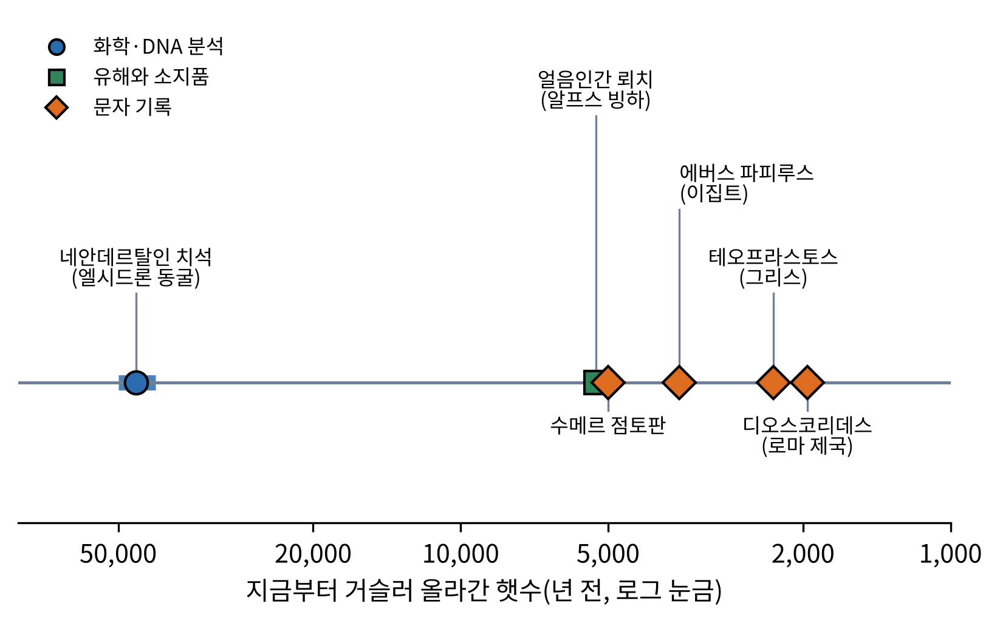
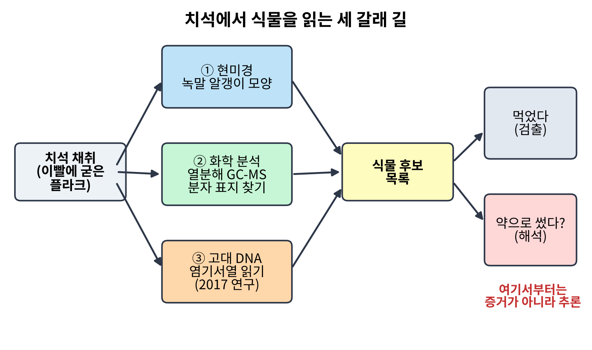
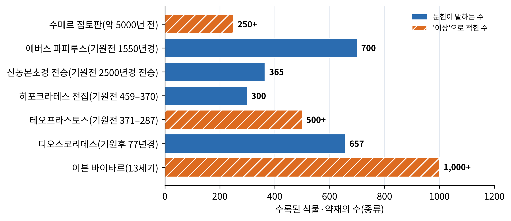

# 1장. 약초의 기원: 인류와 식물의 가장 오래된 계약

<strong>그림 1-1. 약초 사용을 말해 주는 증거의 시간 사다리.</strong> 가로축은 지금부터 거슬러 올라간 햇수이며 로그 눈금이다. 파란 점은 화학·DNA 분석, 초록 네모는 유해와 소지품, 주황 마름모는 문자 기록이다. 막대는 연대의 폭을 뜻한다.

<ul class="mini-toc">
<li>쓴 잎을 삼키는 침팬지</li>
<li>오만 년 전의 치석</li>
<li>얼음 속에서 나온 약상자?</li>
<li>문자가 생기다: 점토판과 파피루스</li>
<li>그리스와 로마: 약초를 분류하다</li>
<li>신농의 이름으로 전해진 지식</li>
<li>증거를 어떻게 읽을 것인가</li>
</ul>

## 이 장을 읽기 전에

사람은 언제부터 풀을 약으로 알아보았을까. 이 질문에는 두 가지 대답이 가능하다. 하나는 글로 남은 기록에서 찾는 대답이고, 다른 하나는 글이 없던 시대의 뼈와 이빨과 흙에서 찾는 대답이다. 앞의 것은 읽기 쉽지만 짧고, 뒤의 것은 길지만 읽기 어렵다. 이 장은 두 가지를 함께 놓고, 증거가 어디까지 말해 주고 어디부터는 말해 주지 않는지를 가려 본다.

이 장은 책의 첫 번째 본문이므로 앞으로 모든 장에 적용될 읽는 방법을 하나 밝혀 둔다. 이 책은 "무엇이 알려졌는가"와 "그것이 어떻게 알려졌는가"를 늘 나란히 적는다. 한 편의 논문이 중요하면 연구자가 무엇을 궁금해했는지, 어떤 시료를 어떤 방법으로 다루었는지, 무엇이 나왔고 그것을 어디까지 믿을 수 있는지를 차례로 풀어 쓴다. 이 장의 네안데르탈인 치석 연구(2절)가 그 첫 번째 본보기이다.

이 장의 연결도 미리 적어 둔다. 여기서 본 오래된 증거는 2장에서 "식물이 왜 약이 되는 물질을 만드는가"라는 물음으로 이어지고, 3장부터 9장까지의 지역별 이야기에서 각 지역의 문헌 전통으로 다시 나타난다. 고대 문헌의 규모를 비교한 그림 1-3와 표 1-3은 뒤의 지역 장들에서 되풀이해 돌아볼 기준표 구실을 한다.

## 1. 쓴 잎을 삼키는 침팬지

약초 사용의 뿌리를 찾으려면 사람보다 먼저 사람 아닌 동물을 보아야 한다. 영장류학자 마이클 허프만(Michael A. Huffman)은 이 주제를 정리한 논문에서 약초 요법의 뿌리가 동물 세계 깊숙이 닿아 있을 가능성이 크다고 적었다. 식물과 동물이 함께 진화하는 초기에 이미 일부 절지동물은 식물의 화학 방어 물질을 가져다 자기 천적과 기생충을 막는 데 썼다는 것이다(Huffman, 2003).

이런 행동을 가리키는 말이 동물약리학(zoopharmacognosy)이다. 동물이 병이나 기생충을 다스리려고 약효가 있는 식물이나 흙을 골라 먹는 행동을 연구하는 분야이다. 이 책에서는 "동물의 자가치료"라는 풀어 쓴 말과 함께 쓴다.

허프만이 소개한 가장 인상적인 관찰은 아프리카 대형 유인원의 것이다. 침팬지(*Pan troglodytes*), 보노보(*Pan paniscus*), 고릴라(*Gorilla gorilla*)는 잎을 씹지 않고 통째로 삼켰다가 거의 그대로 배설하는 행동을 한다. 이 습성은 장 속 기생충을 물리적으로 쓸어 내는 수단임이 밝혀졌다. 또 사람과 같은 지역에 사는 침팬지는 쓴맛이 강한 식물 베르노니아 아미그달리나(*Vernonia amygdalina*)의 속살(pith)을 씹어 장내 선충 감염을 다스린다. 이 식물은 같은 지역 사람들도 약으로 써 온 것으로 알려져 있다(Huffman, 2003).

여기서 눈여겨볼 것은 관찰의 성격이다. 침팬지는 "약효를 안다"고 말한 것이 아니라 아픈 때에 특정한 쓴 식물을 골라 먹는 행동을 보였고, 연구자들은 그 식물에서 생리활성 물질을 확인했다. 행동의 관찰, 식물의 동정, 화학 분석이라는 세 걸음이 이어져야 자가치료라는 해석이 서고, 이 세 걸음은 뒤에서 사람의 경우를 볼 때도 같은 틀로 쓰인다. 논문은 한 걸음 더 나아가 약물 내성이 늘어 가는 요즈음, 동물의 자가치료와 민족의학(ethnomedicine, 한 사회가 전해 온 병과 치료의 지식)을 함께 연구하면 열대 지역 사람과 가축의 기생충을 생태적으로 다스릴 새 길이 열릴 수 있다고 제안한다(Huffman, 2003).

> **용어 풀이** 민족식물학(ethnobotany)은 한 사회가 식물을 어떻게 이름 짓고 쓰는지를 연구하는 학문이고, 민족약리학(ethnopharmacology)은 그중 약으로서의 쓰임과 그 약리 작용을 실험으로 따지는 학문이다. 이 책의 뒤쪽 장에서 가장 자주 만날 두 단어이다.

## 2. 오만 년 전의 치석

### 연구가 시작된 배경

사람과 가장 가까웠던 화석 인류인 네안데르탈인은 약초를 알았을까. 글이 없으니 문헌을 읽을 수는 없다. 그런데 이빨에는 뜻밖의 기록이 남아 있다. 이빨에 붙은 플라크(치태)가 굳은 치석(dental calculus)은 살아 있을 때 입에 들어간 것들을 작은 알갱이 속에 가두어 수만 년 동안 보존한다. 연구자들은 치석을 일종의 "입속 타임캡슐"로 보고 파고들었다.

### 두 편의 연구와 한 번의 논쟁

2012년 카렌 하디(Karen Hardy) 연구팀은 스페인 북부 엘시드론(El Sidrón) 동굴에서 나온 네안데르탈인 5개체의 치석을 분석했다. 방법은 두 가지였다. 하나는 열분해 기체크로마토그래피-질량분석(pyrolysis gas chromatography–mass spectrometry, Py-GC-MS)이다. 시료를 고온에서 태워 쪼갠 뒤 나오는 조각 분자를 분리해 어떤 식물의 분자 표지(molecular marker)인지 판독한다. 다른 하나는 현미경으로 보는 식물 미세 화석, 특히 녹말 알갱이(starch granule)의 모양 분석이다(Hardy et al., 2012).

결과는 몇 갈래로 나왔다. 한 개체의 치석에서 톱풀(yarrow, *Achillea*)과 카모마일(chamomile)에서 오는 것으로 보이는 화합물이 검출되었다. 두 식물은 쓰고 영양가가 거의 없으며 약으로 쓰이는 것으로 알려져 있다. 연구팀은 이 화합물을 아줄렌(azulene)류와 쿠마린(coumarin)류로 보고했다. 이와 함께 녹말 알갱이에서는 익힌 흔적이 보였고, 화학 표지에서는 나무 연기에 노출된 흔적이 나왔다. 이 알갱이는 당시 생화학 검사로 확인된 가장 오래된 녹말 알갱이로 소개되었다(Hardy et al., 2012). 연구팀은 앞선 연구에서 이 네안데르탈인들이 쓴맛을 느끼는 유전자를 지녔음도 보였다.

이 결과는 곧 해석을 두고 갈렸다. 쓴 풀을 먹었다는 것까지는 검출 결과이지만, 그것이 약이었는지 맛을 내려는 양념이었는지는 다른 문제이다. 2013년 하디, 스티븐 버클리(Stephen Buckley), 허프만은 학술지 《안티쿼티》의 토론란에서 이 문제를 다루었다. 이들은 맛내기 가설을 받아들이기 어렵다고 보았다. 맛을 내려면 그럴 만한 정교한 요리 문화가 있어야 하는데 그 증거가 부족하고, 쓴맛 유전자를 지닌 개체가 일부러 쓴 풀을 골랐다면 맛보다 다른 이유를 생각해야 한다는 것이다. 그래서 앞 절에서 본 동물약리학을 행동의 본보기로 삼아 의도적인 자가치료로 보자고 제안했다(Hardy et al., 2013).

2017년에는 DNA가 등장했다. 로라 웨이리치(Laura Weyrich)가 이끈 팀은 벨기에 스피(Spy) 동굴과 엘시드론 동굴의 네안데르탈인 4개체에서 나온 치석의 고대 DNA를 읽었다. 시료의 나이는 4만 2천 년에서 5만 년 전으로 추정되었다. 두 유적의 식단은 뚜렷이 달랐다. 스피의 개체들은 털코뿔소와 야생 양 같은 고기를 많이 먹었고, 엘시드론의 개체에서는 고기의 흔적이 없고 버섯, 잣, 숲 이끼가 나왔다. 이 중 엘시드론의 한 개체는 턱뼈에 치과 농양이 있었고 장내 기생충 엔테로시토준 비에네우시(*Enterocytozoon bieneusi*, 심한 설사를 일으키는 병원체로 알려짐) 감염의 흔적이 있었다. 같은 개체의 치석에서 살리실산(아스피린의 유효 성분)을 함유한 포플러(*Populus*)류의 DNA와 항생 물질의 공급원인 푸른곰팡이(*Penicillium*)의 DNA가 나왔다(Weyrich et al., 2017).

이 연구는 또 오래된 미생물 하나(*Methanobrevibacter oralis*)의 게놈을 복원했다. 당시까지 해독된 가장 오래된 미생물 게놈으로 소개되었고, 네안데르탈인과 현생 인류가 병원체를 주고받았을 가능성도 시사했다(Weyrich et al., 2017).

<figure class="fig">

<figcaption><strong>그림 1-2. 치석에서 식물을 읽는 세 갈래 길.</strong> 현미경, 화학 분석, 고대 DNA는 서로 다른 방법으로 식물 후보 목록을 만든다. 후보 목록은 "먹었다"는 검출까지만 보증하며, "약으로 썼다"는 그 위에 얹는 해석이다.</figcaption>
</figure>

### 이 연구를 어떻게 읽을 것인가

세 편을 겹쳐 놓으면 같은 유적의 같은 부류의 시료에서 방법이 달라지며 질문이 깊어지는 모습이 보인다. 2012년의 방법은 분자 표지와 현미경이었고, 2017년의 방법은 DNA 염기서열이었다. 표 1-1는 세 편의 차이를 한눈에 정리한다.

<strong>표 1-1. 네안데르탈인 치석 연구 세 편의 비교</strong>

| 구분 | Hardy 외(2012) | Hardy 외(2013) | Weyrich 외(2017) |
|---|---|---|---|
| 성격 | 원저 논문 | 토론(논평) | 원저 논문 |
| 유적 | 엘시드론(스페인) | 엘시드론 | 스피(벨기에), 엘시드론 |
| 개체 수 | 5 | 해당 없음 | 4 |
| 방법 | Py-GC-MS, 녹말 현미경 | 문헌 논증 | 고대 DNA |
| 핵심 결과 | 톱풀·카모마일 화합물, 익힌 흔적 | 맛내기 가설 반박 | 포플러·푸른곰팡이 DNA, 식단 차이 |
| 한계 | 한 개체에 치우친 증거 | 의도는 직접 관찰 불가 | 기생충과 곰팡이의 의도적 섭취는 추정 |

출처: Hardy 외(2012, 2013), Weyrich 외(2017). 개체 수는 각 논문의 분석 대상이며 같은 개체가 겹칠 수 있다.

이 연구를 읽는 법은 세 가지이다. 첫째, 검출과 해석을 분리해 읽는다. 어떤 식물의 분자가 치석에 들어 있다는 것은 입에 들어갔다는 사실일 뿐이고, 약으로 썼다는 것은 그 사실에 얹은 추론이다. 둘째, 한 개체의 이야기를 종 전체로 확대하지 않는다. 가장 강한 증거는 몇 개체에 한정된다. 셋째, 서로 다른 방법이 같은 방향을 가리키는지 본다. 쓴 풀의 화합물(2012)과 농양을 앓은 개체의 포플러·푸른곰팡이(2017)는 방법이 다르지만 "아픈 개체가 약이 될 법한 것을 먹었다"는 같은 그림에 모인다. 그렇다고 이것이 의도를 증명하지는 않는다. 2017년 연구도 의도적인 자가치료인지는 해석의 영역으로 남긴다. 이 점이 이 책 전체에서 되풀이될 "증거의 층위" 문제의 첫 사례이다.

## 3. 얼음 속에서 나온 약상자?

1991년 알프스 빙하에서 약 5,300년 전에 살았던 남자의 미라가 발견되었다. 흔히 얼음인간 외치(Ötzi)로 불린다. 그의 소지품에서는 자작나무 버섯인 피프토포루스 베툴리누스(*Piptoporus betulinus*, 지금의 학명은 *Fomitopsis betulina*) 자실체 조각 두 개가 나왔다(Pleszczyńska et al., 2017).

이 버섯이 약이었는지는 논란이 된다. 일부 연구자는 그가 이 버섯을 의료 목적으로 지녔다고 본다. 이탈리아의 연구자 루이지 카파소(Luigi Capasso)는 1998년 짧은 보고에서 그의 창자에서 채찍벌레(*Trichuris*)의 알이 발견되었고, 이 기생충을 다스릴 수 있는 버섯을 지녔다는 가설을 폈다(Capasso, 1998). 그러나 이 해석 역시 논쟁적이다(Pleszczyńska et al., 2017).

이 버섯의 성분이 알려져 있다는 점은 흥미롭다. 이후의 화학 연구는 이 버섯에서 폴리포레닉산(polyporenic acid) 같은 트리테르페노이드(triterpenoid)를 확인했고, 베툴린산, 베툴린, 루페올 같은 성분과 세포벽의 (1→3)-α-D-글루칸이라는 다당류도 보고했다(Pleszczyńska et al., 2017). 오늘의 성분 지식이 5,300년 전의 소지품에 약효의 그림자를 드리우는 셈이다. 하지만 성분이 있다는 것과 그것을 약으로 썼다는 것 사이의 간격은 여전히 남는다. 이는 앞 절의 치석과 같은 구조의 논쟁이다.

## 4. 문자가 생기다: 점토판과 파피루스

글이 생기자 증거의 성격이 바뀐다. 이제 연구자는 "무엇을 먹었는가"가 아니라 "무엇을 어떻게 쓰라고 적었는가"를 읽을 수 있다. 약초 사용의 역사를 정리한 검토 논문은 가장 오래된 기록의 하나로 약 5,000년 전 수메르(Sumer)의 점토판을 든다. 이 점토판에는 약 만드는 법 12가지가 새겨져 있고, 250가지가 넘는 식물이 언급된다고 소개된다(Petrovska, 2012).

가장 유명한 약초 문헌은 에버스 파피루스(Ebers Papyrus)이다. 기원전 1550년경의 것으로, 더 이른 문헌을 베껴 쓴 것으로 여겨진다. 길이는 약 20미터, 110쪽에 달하며 라이프치히 대학 도서관에 보관되어 있다. 수록된 처방과 주문의 수는 자료에 따라 약 700에서 842까지 다르게 보고된다. 그 속에는 몰약, 양파, 사이페루스, 오이꽃, 대추야자, 아카시아, 딱총나무, 생강 같은 식물이 나온다(Petrovska, 2012; Ebers, 1875). 이집트학자 게오르크 에버스(Georg Ebers)가 룩소르에서 이 파피루스를 구입해 1875년 영인본을 펴내면서 학계에 알려졌다. 구입 시기는 자료에 따라 1872년에서 1873~1874년 겨울로 엇갈리는데, 이 책에서는 "1870년대 초"로만 적는다.

<figure class="fig">

<figcaption><strong>그림 1-3. 고대 문헌이 담은 식물·약재의 규모.</strong> 값은 약초 사용사 검토 논문(Petrovska, 2012)의 서술을 따랐다. 주황 빗금 막대는 원문이 "이상"으로 적은 수이다. 신농본초경의 연대는 전승이며, 학술적 편찬 연대와는 다르다(6절).</figcaption>
</figure>

그림 1-3을 읽을 때 조심할 것이 있다. 막대의 길이는 문헌마다 센 방식이 다른 값이다. 에버스 파피루스의 700은 "식물과 약재"를 합친 수이고, 디오스코리데스의 657은 944가지 약재 중 식물에서 온 것의 수이다. 막대의 높낮이를 지식의 크기로 읽지 말고, 문헌이 담으려 한 범위의 대략적인 눈금으로만 읽어야 한다. 또 이 수치들은 원 문헌이 아니라 2차 검토 논문이 전하는 값이므로, 각 지역 장에서 원 문헌과 대조하며 다듬는다.

## 5. 그리스와 로마: 약초를 분류하다

그리스에서 약초 지식은 처음으로 이름 붙이고 분류하는 학문이 되었다. 식물학의 기초를 놓은 테오프라스토스(Theophrastus, 기원전 371~287)는 당시 알려진 약용식물 500종 이상을 분류했다고 전해진다. 히포크라테스(Hippocrates, 기원전 459~370)의 저술에는 약용식물 약 300종이 생리 작용별로 정리되어 있다고 한다(Petrovska, 2012).

이 전통을 한데 모은 책이 디오스코리데스(Pedanius Dioscorides)의 《약물지(De materia medica)》이다. 그리스 출신으로 로마 군대에서 일한 의사였던 그가 기원후 50~70년 사이에 쓴 것으로 알려져 있고, 다섯 권에 걸쳐 약 600종의 식물과 일부 동물·광물, 합쳐서 약 1,000가지의 약을 다룬다. 이 책은 이후 1,500년 넘게 유럽과 중동에서 약물 지식의 기준이 되었다. 512~513년경 콘스탄티노폴리스에서 만든 삽화 필사본(빈 디오스쿠리데스)은 식물 그림이 정확해 종을 식별할 수 있을 정도이다. 9세기 바그다드에서는 후나인 이븐 이스하크(Hunayn ibn Ishaq)와 협력자가 847~861년에 아랍어로 옮겼고, 이 번역이 이슬람 세계 약학의 기초가 되었다(Beck, 2005). 수록 규모를 944가지 약 중 657이 식물이라고 적는 자료(Petrovska, 2012)도 있어, 센 방식에 따라 숫자가 다르다.

로마 시대의 갈레노스(Galen, 기원후 131~200)는 같은 효과를 내는 대용 약재의 목록을 처음 만들었다. 그 가운데는 오늘의 약리학으로 받아들이기 어려운 대용도 있다고 평가된다(Petrovska, 2012). 약초를 분류하고 대용품을 고르고 서로 옮겨 번역하는 이 일련의 작업은 뒤의 5장(중동)과 6장(유럽)에서 약초 교역과 약전의 뼈대로 다시 나온다.

## 6. 신농의 이름으로 전해진 지식

동아시아에서 약초 지식의 시조로 모셔지는 인물은 신농(神農)이다. 한국어 한자음으로 신농, 중국어로 션눙이라 읽는다. 그의 이름이 붙은 책 《신농본초경(神農本草經)》은 365가지의 약물을 다룬 것으로 전해지며, 약초 사용사 검토 논문은 이를 기원전 2500년경으로 소개한다(Petrovska, 2012). 그러나 이 연대는 전승으로 보아야 한다. 신농은 전설 속의 제왕이고, 현전하는 본초서의 편찬은 훨씬 뒤의 일로 학계에서 논의되고 있다. 편찬 시기와 판본 문제는 3장(동아시아)에서 원문 연구에 근거해 다시 다룬다. 이 장의 그림 1-3에서 신농본초경 막대에 "전승"이라는 말을 붙인 이유가 이것이다.

여기서 다시 한 번 증거의 층위를 확인하게 된다. 같은 "기원전 몇천 년"이라는 연대라도 점토판은 실물이 있어 연대를 측정할 수 있고, 신농의 연대는 후대에 구성된 이야기이다. 이 장에서 다룬 증거를 표 1-2에 층위별로 정리한다.

<strong>표 1-2. 약초 사용의 증거 유형과 무엇을 말해 주는가</strong>

| 증거 유형 | 이 장의 사례 | 확실한 것 | 확실하지 않은 것 |
|---|---|---|---|
| 동물 행동 관찰 | 침팬지의 쓴 잎 | 특정 식물을 골라 먹음 | 사람 약초 사용의 직접 기원 |
| 이빨 속 분자·DNA | 네안데르탈인 치석 | 어떤 식물을 먹었음 | 약으로 쓴 의도 |
| 유해와 소지품 | 얼음인간의 버섯 | 소지했음 | 약으로 쓴 용도 |
| 문자 기록 | 점토판, 파피루스 | 쓰라고 적은 처방 | 실제 효과, 식물의 정확한 동정 |
| 전승 | 신농본초경 | 후대가 그렇게 믿음 | 기록의 실제 연대 |

이 표는 이 책 전체에서 쓰는 증거의 층위를 이 장의 사례로 처음 정리한 것이다.

## 7. 증거를 어떻게 읽을 것인가

지금까지의 증거를 한 줄로 모으면 이렇다. 사람 아닌 동물이 쓴 잎을 골라 먹고, 수만 년 전의 화석 인류가 쓴 풀을 입에 넣었으며, 5천 년 전에는 점토판에 약 만드는 법이 새겨졌고, 그 뒤로 문헌이 자꾸 두꺼워졌다. 그러나 이 연속이 곧 "하나의 연속된 지식의 전승"을 뜻하지는 않는다. 네안데르탈인과 수메르 사이에는 직접 이어진 줄이 없다. 이 장이 말할 수 있는 것은 약초 이용이 인류사의 어느 한 시점에서 갑자기 발명된 것이 아니라 여러 곳에서 여러 번 되풀이해 나타난, 오래되고 넓은 현상이라는 점까지이다.

이 점은 2장으로 가는 다리가 된다. 서로 다른 시대와 대륙에서 사람들이 비슷하게 쓴 풀을 고르는 이유를 설명하려면 식물이 왜 그런 물질을 만드는지를 알아야 한다. 이 책이 2장을 식물화학에 할애하는 까닭이다.

<strong>표 1-3. 이 장에서 다룬 약초 증거의 연대순 요약</strong>

| 시기 | 증거 | 지역 | 근거 |
|---|---|---|---|
| 현재 | 침팬지·보노보·고릴라의 잎 삼키기, 쓴 속살 씹기 | 아프리카 | Huffman (2003) |
| 4.2만~5만 년 전 | 네안데르탈인 치석의 식물·DNA | 스페인, 벨기에 | Hardy 외 (2012); Weyrich 외 (2017) |
| 약 5,300년 전 | 얼음인간의 자작나무 버섯 | 알프스 | Pleszczyńska 외 (2017) |
| 약 5,000년 전 | 수메르 점토판(12가지 처방) | 메소포타미아 | Petrovska (2012) |
| 기원전 1550년경 | 에버스 파피루스 | 이집트 | Petrovska (2012); Ebers (1875) |
| 기원전 4~3세기 | 테오프라스토스의 분류 | 그리스 | Petrovska (2012) |
| 기원후 50~70년 | 디오스코리데스 《약물지》 | 로마 제국 | Beck (2005) |
| 9세기 | 약물지의 아랍어 번역 | 바그다드 | Beck (2005) |

전승 연대인 신농본초경은 6절에서 따로 논의했으므로 이 표에서는 뺐다.

## 이 장을 마치며

1장에서 확인한 것을 정리한다. 첫째, 약초 이용의 흔적은 동물 행동, 화석 인류의 치석, 얼음 속 소지품, 문자 기록의 순서로 풍부해지지만, 증거의 층위가 서로 다르다. 둘째, 가장 오래된 증거일수록 "먹었다"까지만 확실하고 "약으로 썼다"는 해석이다. 셋째, 이 책은 앞으로도 검출과 해석을 나누어 쓴다.

다음 장에서는 방향을 바꾸어, 식물이 약이 되는 물질을 어떻게 만들고 왜 만드는지를 본다. 같은 풀을 서로 다른 사람들이 약으로 고른 일이 우연이 아니라는 사실이 그곳에서 보인다.

## 참고문헌

- Beck, L. Y. (Trans.). (2005). *Pedanius Dioscorides of Anazarbus: De materia medica*. Olms-Weidmann.
- Capasso, L. (1998). 5300 years ago, the Ice Man used natural laxatives and antibiotics. *The Lancet, 352*(9143), 1864. https://doi.org/10.1016/S0140-6736(05)79939-6
- Ebers, G. (1875). *Papyros Ebers: Das hermetische Buch über die Arzneimittel der alten Ägypter in hieratischer Schrift*. Wilhelm Engelmann.
- Hardy, K., Buckley, S., Collins, M. J., Estalrrich, A., Brothwell, D., Copeland, L., García-Tabernero, A., García-Vargas, S., de la Rasilla, M., Lalueza-Fox, C., Huguet, R., Bastir, M., Santamaría, D., Madella, M., Wilson, J., Cortés, Á. F., & Rosas, A. (2012). Neanderthal medics? Evidence for food, cooking, and medicinal plants entrapped in dental calculus. *Naturwissenschaften, 99*(8), 617–626. https://doi.org/10.1007/s00114-012-0942-0
- Hardy, K., Buckley, S., & Huffman, M. (2013). Neanderthal self-medication in context. *Antiquity, 87*(337), 873–878. https://doi.org/10.1017/S0003598X00049528
- Huffman, M. A. (2003). Animal self-medication and ethno-medicine: Exploration and exploitation of the medicinal properties of plants. *Proceedings of the Nutrition Society, 62*(2), 371–381. https://doi.org/10.1079/pns2003257
- Petrovska, B. B. (2012). Historical review of medicinal plants' usage. *Pharmacognosy Reviews, 6*(11), 1–5. https://doi.org/10.4103/0973-7847.95849
- Pleszczyńska, M., Lemieszek, M. K., Siwulski, M., Wiater, A., Rzeski, W., & Szczodrak, J. (2017). *Fomitopsis betulina* (formerly *Piptoporus betulinus*): The Iceman's polypore fungus with modern biotechnological potential. *World Journal of Microbiology and Biotechnology, 33*(5), Article 83. https://doi.org/10.1007/s11274-017-2247-0
- Weyrich, L. S., Duchene, S., Soubrier, J., Arriola, L., Llamas, B., Breen, J., Morris, A. G., Alt, K. W., Caramelli, D., Dresely, V., Farrell, M., Farrer, A. G., Francken, M., Gully, N., Haak, W., Hardy, K., Harvati, K., Held, P., Holmes, E. C., … Cooper, A. (2017). Neanderthal behaviour, diet, and disease inferred from ancient DNA in dental calculus. *Nature, 544*(7650), 357–361. https://doi.org/10.1038/nature21674
