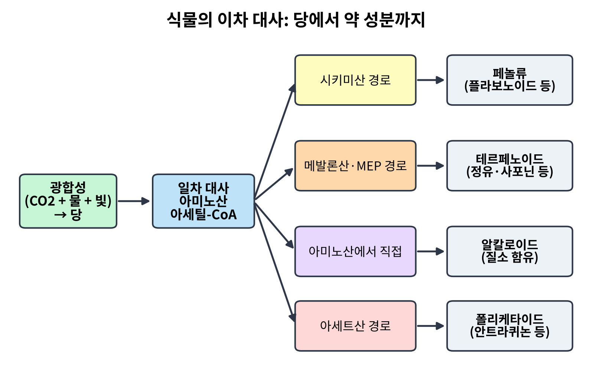
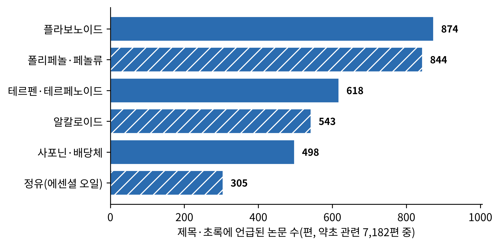
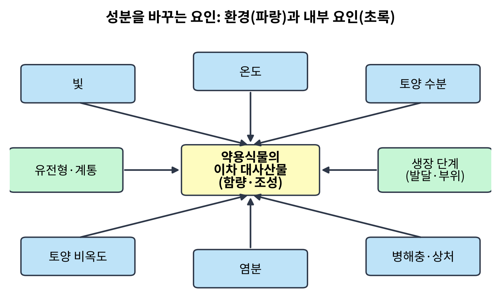

# 2장. 식물화학의 세계: 식물은 왜 약을 만드는가

<strong>그림 2-1. 식물의 이차 대사: 당에서 약 성분까지.</strong> 광합성으로 만든 당이 일차 대사를 거쳐 네 갈래 경로로 나뉘고, 각 경로가 약초의 주요 성분군을 낳는다. 개념도이며 표 2-1에서 계열별 대표 사례를 정리한다.

<ul class="mini-toc">
<li>쓸모없는 찌꺼기가 아니었다</li>
<li>곤충과 식물의 군비 경쟁</li>
<li>약초 성분의 네 갈래</li>
<li>같은 풀, 다른 성분</li>
<li>하나의 분자인가 혼합물인가</li>
<li>한 나라의 약초 열 가지를 쪼개 보면</li>
</ul>

## 이 장을 읽기 전에

1장에서 사람이 오래전부터 풀을 약으로 써 왔다는 증거를 보았다. 그런데 한 걸음 물러서서 보면 이상한 점이 있다. 식물은 사람을 치료하려고 자라는 것이 아니다. 그런데도 어떤 풀의 잎이나 뿌리는 열을 내리고, 어떤 풀의 껍질은 통증을 덜어 준다. 식물은 왜 사람에게 약이 되는 물질을 만드는가. 이 장은 그 물음에 답한다.

답의 윤곽을 미리 적는다. 식물은 움직일 수 없으므로 포식자, 병원균, 가뭄, 강한 햇빛 같은 위협을 화학 물질로 막아야 한다. 이 화학 물질 중 일부가 우연히 사람의 몸에서도 작용하는 것이다. 약이 되는 풀은 사람을 위해 만들어지지 않았지만, 사람과 같은 생화학의 언어를 쓰는 생물을 겨냥한 물질이기 때문에 사람에게도 말이 통한다.

이 장은 책 전체의 화학 기초이다. 3장부터 9장의 지역별 이야기에서 인삼, 감초, 강황, 기나나무 같은 식물의 성분이 나올 때마다 이 장의 틀을 쓴다. 10장(약리학)은 이 분자들이 몸에서 어떻게 작용하는지를, 13장(표준화와 약전)은 같은 풀의 성분이 왜 매번 달라지는지를 다루는데, 그 출발점이 모두 여기에 있다.

## 1. 쓸모없는 찌꺼기가 아니었다

식물이 만드는 화합물은 크게 둘로 나뉜다. 모든 식물이 살아가는 데 반드시 필요한 당, 아미노산, 지방산, 핵산 같은 물질을 만드는 과정을 일차 대사(primary metabolism)라 하고, 그 바깥에서 종마다 다른 특이한 화합물을 만드는 과정을 이차 대사(secondary metabolism)라 한다. 이차 대사로 만들어진 물질이 이차 대사산물(secondary metabolite)이며, 약초의 약효 성분은 대부분 여기에 속한다.

20세기 중반까지 많은 식물학자는 이런 물질을 대사의 폐기물이나 부산물로 보았다. 동물은 오줌과 땀으로 노폐물을 내보내지만 식물에는 그런 통로가 없으니 이차 대사산물이 노폐물 저장고라는 생각이었다. 이 견해를 정면으로 뒤집은 것이 1959년 《사이언스》에 실린 곤충학자 고트프리트 프랭켈(Gottfried S. Fraenkel)의 짧은 논문이다. 제목이 「이차 식물 물질의 존재 이유(The raison d'être of secondary plant substances)」였다. 프랭켈은 식물과 곤충의 관계를 모아 놓고 이 물질들이 곤충을 쫓거나 끌어들이는 신호로서 기능한다고 주장했다(Fraenkel, 1959).

이 논문은 새로운 실험 결과를 내놓은 것이 아니라 흩어진 관찰을 한 줄로 꿰어 질문을 바꾼 논문이다. "이 물질은 무엇의 찌꺼기인가"라는 물음을 "이 물질은 무엇을 위해 있는가"라는 물음으로 바꾼 것이다. 질문이 바뀌자 연구자들은 식물의 쓴맛과 독, 향기와 색이 누구를 겨냥한 것인지 찾기 시작했다. 그 찾는 과정이 훗날 약초 성분을 설명하는 틀이 된다.

## 2. 곤충과 식물의 군비 경쟁

### 문헌만으로 쓴 고전 논문

이 생각을 한 걸음 더 밀고 간 것이 1964년 폴 얼릭(Paul R. Ehrlich)과 피터 레이븐(Peter H. Raven)의 논문 「나비와 식물: 공진화 연구(Butterflies and plants: a study in coevolution)」이다. 두 사람은 나비 애벌레가 어떤 식물을 먹는지에 관한 기존 문헌을 모아 비교했다. 직접 실험을 한 논문이 아니라 문헌 조사 논문이다(Ehrlich & Raven, 1964).

연구가 시작된 질문은 단순했다. 나비의 종류와 애벌레가 먹는 식물의 종류 사이에 왜 이런 짝짓기가 있는가. 모든 식물을 아무 애벌레나 먹지 않고 특정 나비 무리가 특정 식물 무리에 몰려 있다. 두 사람이 모은 자료에서 이 짝짓기의 패턴이 드러났고, 이를 설명하는 가설이 이 논문의 핵심이다. 식물은 이차 대사산물로 곤충의 공격을 막고, 그 방어를 뚫는 능력을 진화시킨 나비 무리가 그 식물을 독점적으로 먹게 되며, 식물은 다시 새로운 방어 물질을 진화시킨다는 것이다. 서로가 서로에게 선택압을 주며 함께 진화한다는 뜻에서 두 사람은 이를 공진화(coevolution)라 불렀다(Ehrlich & Raven, 1964).

### 반세기 뒤의 검증

이 가설은 한참 뒤에 유전체 자료로 검증되었다. 2015년 패트릭 에저(Patrick Edger)가 이끈 국제 연구팀은 양배추·겨자류(십자화과)의 방어 물질인 글루코시놀레이트(glucosinolate, 겨자 특유의 매운맛을 내는 황 함유 화합물)와 이를 해독하는 배추흰나비 무리의 진화를 비교했다. 식물의 계통수를 대표적인 배추흰나비과 나비 9종의 계통수와 나란히 놓고 보니, 글루코시놀레이트 방어는 공룡이 멸종한 시기 무렵에 처음 나타났고, 이후 약 8천만 년 동안 식물의 방어와 나비의 대응이 세 차례 큰 물결로 되풀이되었다(Edger et al., 2015).

<figure class="fig">

<figcaption><strong>그림 2-2. 이 책의 논문 자료에서 성분 계열이 언급된 논문 수.</strong> 약초 관련으로 확인한 7,182편의 제목·초록에서 각 계열의 이름이 나온 논문을 센 값이다. 한 논문이 여러 계열을 언급할 수 있고, 같은 물질이 여러 계열에 걸쳐 있어 합계가 전체 편수와 같지 않다.</figcaption>
</figure>

이 두 논문을 나란히 읽으면 과학이 질문에 답하는 한 방식이 보인다. 1964년의 논문은 문헌의 패턴에서 가설을 세웠고, 2015년의 논문은 유전체라는 새 도구로 같은 가설을 시험했다. 이 책이 약초를 다루는 방식도 그렇다. 전통의 관찰이 가설을 주고, 현대의 도구가 이를 시험한다. 다만 이 장에서 얻을 것은 결론 하나이다. 약초의 쓴맛과 독은 우연한 부산물이 아니라 오랜 선택의 산물이고, 그 선택의 상대는 사람이 아니라 곤충과 곰팡이와 세균이었다.

## 3. 약초 성분의 네 갈래

이차 대사산물은 수만 가지가 알려져 있지만, 만들어지는 길을 기준으로 크게 네 갈래로 나눌 수 있다. 이 구분은 화학 교과서의 일반적인 분류이며, 표 2-1에 갈래별로 정리했다.

첫째, 페놀류(phenolics)이다. 시키미산 경로(shikimate pathway)에서 만들어지며, 벤젠 고리에 수산기가 붙은 구조를 가진다. 플라보노이드(flavonoid), 탄닌(tannin), 강황의 커큐민(curcumin) 같은 폴리페놀(polyphenol)이 여기에 든다. 식물에서 자외선을 막고 병원균을 막는 역할을 하며, 사람에게서는 항산화 작용이 자주 거론된다.

둘째, 테르페노이드(terpenoid)이다. 탄소 다섯 개짜리 조각이 이어 붙어 만들어지며, 정유(essential oil, 식물에서 증류해 얻는 향기 나는 기름)의 대부분과 인삼의 사포닌(saponin, 비눗물처럼 거품을 내는 배당체)이 이 계열이다. 항말라리아제 아르테미시닌(artemisinin)은 세스퀴테르펜 락톤(sesquiterpene lactone)이라는 하위 부류에 속한다. 이 부류는 국화과 식물에 흔하며, 식물에서는 곤충과 미생물과 경쟁 식물을 겨냥한 생태적 역할을 한다고 정리된다(Chadwick et al., 2013). 서장에서 본 항암제 탁솔(taxol)도 이 계열의 분자이다(Wani et al., 1971).

셋째, 알칼로이드(alkaloid)이다. 아미노산에서 만들어지며 질소를 품은 염기성 화합물이다. 양귀비의 모르핀, 기나나무의 퀴닌, 커피의 카페인이 해당한다. 소량으로 신경계에 강하게 작용하는 경우가 많아서 독과 약의 경계에 서 있다. 이 분류의 이름은 "알칼리와 닮은 것"이라는 뜻이다.

넷째, 배당체(glycoside)와 폴리케타이드(polyketide) 같은 나머지 갈래이다. 배당체는 당이 붙은 분자이고, 디기탈리스의 강심배당체(cardiac glycoside)가 대표적이다. 위더링이 1785년 부종 치료에 쓴 풀의 활성 본체가 이 계열이다(Withering, 1785). 대황(rhubarb)의 안트라퀴논(anthraquinone)처럼 아세트산 조각이 이어져 만들어지는 폴리케타이드도 약초에 흔하다.

<strong>표 2-1. 약초 성분의 네 갈래: 경로와 대표 사례</strong>

| 갈래 | 주된 경로 | 대표 성분 | 대표 식물 | 쓰임 |
|---|---|---|---|---|
| 페놀류 | 시키미산 경로 | 플라보노이드, 커큐민 | 강황, 감초 | 항산화·항염 연구 |
| 테르페노이드 | 메발론산·MEP 경로 | 아르테미시닌, 탁솔, 사포닌 | 개똥쑥, 태평양주목, 인삼 | 말라리아, 항암 |
| 알칼로이드 | 아미노산에서 직접 | 모르핀, 퀴닌 | 양귀비, 기나나무 | 진통, 말라리아 |
| 배당체·폴리케타이드 | 당 부착, 아세트산 경로 | 강심배당체, 안트라퀴논 | 디기탈리스, 대황 | 심장 질환, 완하 |

분류는 화학 교과서의 일반 서술이며, 탁솔·아르테미시닌 사례는 Wani 외(1971), Tu(2011)에 근거한다. 메발론산·MEP 경로는 테르페노이드 전구체를 만드는 두 경로이다.

그림 2-2는 이 구분이 오늘의 연구에서 얼마나 쓰이는지 보여 준다. 약초 관련 논문 7,182편에서 플라보노이드와 폴리페놀이 가장 많이 언급되고, 테르펜, 알칼로이드, 사포닌·배당체, 정유가 그 뒤를 잇는다. 이 순서는 약효의 크기가 아니라 연구하기 쉬운 정도와 분석 도구, 그리고 항산화 연구의 유행을 반영한다고 보아야 한다. 항산화 시험은 시험관에서 쉽게 되기 때문에 페놀류 논문이 많다. 이 점은 11장(임상시험)에서 시험관 결과와 사람 결과의 간격을 다룰 때 다시 만난다.

## 4. 같은 풀, 다른 성분

약초를 쓰는 사람이라면 누구나 경험하는 문제가 있다. 같은 이름의 풀인데 해마다, 산지마다 효과가 다르다는 것이다. 이 직관은 식물화학으로 설명된다.

이차 대사산물의 합성과 축적은 식물의 유전형, 발달 단계, 환경 요인에 모두 좌우된다. 한 검토 논문은 빛, 온도, 토양 수분, 토양 비옥도, 염분 같은 요인이 이차 대사산물의 양을 바꾸며, 다른 조건이 같아도 한 요인만 달라지면 함량이 변할 수 있다고 정리한다. 그 목적은 일정한 품질과 많은 양의 활성 성분을 얻는 방법을 찾는 데 있다(Li et al., 2018). 같은 흐름에서 약용식물의 이차 대사산물이 약재 품질의 지표이자 약효의 물질적 바탕이라는 점, 그리고 발달과 유전의 요인이 환경 요인만큼 중요하지만 체계적으로 정리되지 않았다는 점을 지적한 검토도 있다(Li et al., 2020). 또 다른 검토는 이차 대사산물이 식물의 스트레스와 방어 반응 신호에 의해 만들어진다는 증거를 정리했다(Isah, 2019).

<figure class="fig">

<figcaption><strong>그림 2-3. 약용식물의 성분 함량과 조성을 바꾸는 요인.</strong> 파랑은 환경 요인, 초록은 식물 내부의 요인이다. 개념도이며 각 화살표의 방향(늘림·줄임)은 식물과 성분에 따라 다르다. 출처는 Li 외(2018, 2020)와 Isah(2019).</figcaption>
</figure>

<strong>표 2-2. 이차 대사산물의 양을 바꾸는 요인과 약초 사용에서의 의미</strong>

| 요인 | 종류 | 약초 사용에서의 의미 |
|---|---|---|
| 빛, 온도 | 환경 | 재배 지역과 계절에 따라 같은 종의 성분이 달라질 수 있음 |
| 토양 수분, 비옥도, 염분 | 환경 | 재배 방식과 토양 관리가 품질에 영향 |
| 병해충과 상처 | 환경(생물) | 방어 반응으로 특정 성분이 늘 수 있음 |
| 유전형·계통 | 내부 | 같은 학명 안에서도 성분 유형(화학형)이 다를 수 있음 |
| 발달 단계·부위 | 내부 | 뿌리·잎·꽃, 수확 시기에 따라 성분이 다름 |

출처: Li 외(2018, 2020), Isah(2019). 각 요인이 성분을 늘리는지 줄이는지는 식물과 성분에 따라 다르므로 표에서는 방향을 적지 않았다.

여기에는 이 책의 중요한 결론 하나가 들어 있다. 약초의 "약효"는 식물종의 고정된 속성이 아니라, 종과 조건이 함께 만드는 변동하는 값이다. 그래서 전통 약재서는 산지와 채취 시기를 따졌고, 오늘의 약전은 지표 성분의 함량 범위를 규정한다. 13장에서 다룰 표준화의 문제가 바로 이 변동에서 나온다.

## 5. 하나의 분자인가 혼합물인가

식물 하나가 만드는 이차 대사산물은 한 가지가 아니다. 대마(*Cannabis sativa*) 한 종에서 칸나비노이드(cannabinoid), 테르펜, 페놀류가 줄줄이 보고되어 이 식물은 "천하나의 분자를 가진 식물"이라는 별명을 얻었다. 연구자들은 칸나비노이드와 테르펜, 스틸베노이드(stilbenoid)와 리그난(lignan) 같은 페놀류까지 합쳐 그 화합물의 목록과 생합성 경로를 정리하고 있다(André et al., 2016).

이 풍부함은 질문 하나를 낳는다. 약효는 어느 분자 하나에서 나오는가, 아니면 여러 분자가 어울려서 나오는가. 이 물음에 대한 대표적인 가설이 앙상블 효과(entourage effect)이다. 에단 루소(Ethan B. Russo)는 대마의 향기 성분인 테르펜이 THC(테트라히드로칸나비놀) 같은 칸나비노이드와 전구체를 공유하고, 매우 낮은 혈중 농도에서도 동물과 사람의 행동에 작용하며, 따라서 대마 추출물의 효과에 기여할 수 있다고 정리했다(Russo, 2011). 다만 이는 가능성을 구조화해 제시한 검토 논문이며, 가설을 사람에게서 확정한 실험 결과는 아니다.

이 주제를 가장 냉정하게 다룬 것이 2019년 린지 케사르(Lindsay K. Caesar)와 나디아 세흐(Nadja B. Cech)의 검토이다. 두 사람은 천연물 혼합물을 쓰는 쪽에서 "혼합물이 단일 성분보다 낫다"는 시너지(synergy) 주장을 흔히 내놓지만, 한편으로 어떤 성분이 다른 성분의 효과를 가리는 길항(antagonism)도 존재한다는 점을 상기시킨다. 두 현상 모두 엄밀하게 입증하기가 어려운데, 천연물 화학의 표준 방법이 복잡한 혼합물을 단순하게 쪼개 활성 성분 하나를 찾는 쪽으로 짜여 있기 때문이다. 그래서 이 검토는 시너지와 길항을 가려내는 분석 기법과 대규모 자료 접근을 중점적으로 소개한다(Caesar & Cech, 2019). 검토 서두는 미국 인구의 약 18%가 천연물을 쓴다는 2012년 미국 질병통제예방센터(Centers for Disease Control and Prevention, CDC) 조사를 인용하고, 개발도상국에서는 이 비율이 더 높다고 적는다.

이 논쟁은 약초의 본질을 겨눈다. 전통은 "풀 전체"를 쓰라고 하고, 약학은 "활성 성분"을 가려내라고 한다. 둘 중 하나가 옳다고 말하기는 아직 이르다. 이 책은 양쪽을 존중하면서, 어느 주장이 어느 층위의 증거 위에 서 있는지를 장마다 따져 보겠다. 10장의 네트워크 약리학은 이 문제를 계산으로 접근하는 시도이다.

## 6. 한 나라의 약초 열 가지를 쪼개 보면

식물화학 연구의 가장 기본적인 모양을 한 편의 논문으로 보자. 나이지리아의 히라리 에데오가(Hilary O. Edeoga) 연구팀은 2005년 나이지리아에서 민간 약으로 쓰는 식물 열 가지의 성분을 조사했다. 조사 대상은 클레오메 누티도스페르마, 에밀리아 코키네아, 유포르비아 헤테로필라, 피살리스 안굴라타, 스코파리아 둘키스, 시다 아쿠타 등 서로 다른 과에 속한 열 종이다(Edeoga et al., 2005).

연구의 질문은 이 식물들이 어떤 화학 성분군을 가졌는지, 그리고 그 분포가 민간 의학에서의 쓰임과 어떻게 맞는지였다. 연구팀은 알칼로이드, 탄닌, 사포닌, 스테로이드, 테르페노이드, 플라보노이드, 플로바탄닌, 강심배당체의 분포를 평가하고 비교했다. 결과는 열 종 모두 알칼로이드, 탄닌, 플라보노이드를 가졌고, 예외는 시다 아쿠타에서 탄닌이, 스타키타르페타 카옌넨시스에서 플라보노이드가 검출되지 않은 두 경우뿐이었다(Edeoga et al., 2005).

해석에서 주의할 점이 있다. 이 연구는 성분군이 "있다"는 것을 정성적으로 가려낸 것이다. 어떤 성분이 "얼마나", 그리고 "어떤 약효에 기여하는지"는 이 자료만으로 말할 수 없다. 성분군의 존재와 약효 사이에는 여전히 간격이 있다. 이 간격은 1장에서 치석의 "검출"과 "약으로 썼다는 해석" 사이에서 본 것과 같은 구조이다. 이런 성분 조사는 약효의 증명이 아니라 연구의 출발점이다. 이 출발점에서 활성 분자를 가려내고 작용을 설명하기까지 이르러 약이 된 사례가 서장의 아르테미시닌과 탁솔이다.

<strong>표 2-3. 이 장에서 다룬 연구의 연대순 요약</strong>

| 연도 | 연구 | 방법 | 이 장에서 얻은 결론 |
|---|---|---|---|
| 1959 | Fraenkel | 관찰의 종합 | 이차 물질은 폐기물이 아니라 곤충과의 관계에 쓰이는 물질 |
| 1964 | Ehrlich & Raven | 문헌 비교 | 나비와 식물의 공진화 가설 |
| 1971 | Wani 외 | 분리·구조 결정 | 주목에서 탁솔을 분리 |
| 2005 | Edeoga 외 | 성분군 선별 조사 | 열 종 약초의 성분군 분포 |
| 2011 | Russo | 문헌 검토 | 대마 앙상블 효과 가설 |
| 2015 | Edger 외 | 유전체·계통 비교 | 방어와 해독의 약 8천만 년 군비 경쟁 |
| 2018–2020 | Li 외; Isah; Caesar & Cech | 문헌 검토 | 환경에 따른 성분 변동, 시너지와 길항 |

서장의 표 0-1과 겹치는 Wani 외(1971)는 이 장에서 성분 계열 설명에 다시 인용했다.

## 이 장을 마치며

2장에서 확인한 것을 정리한다. 첫째, 약초의 약효 성분은 식물의 이차 대사산물이며, 이는 폐기물이 아니라 방어와 소통의 도구이다. 둘째, 성분은 페놀류, 테르페노이드, 알칼로이드, 배당체 등 몇 갈래로 나뉘고, 같은 식물에서도 환경, 유전, 발달에 따라 달라진다. 셋째, 약효가 한 분자에서 나오는지 여러 분자의 어울림에서 나오는지는 아직 열린 문제이다.

1부는 여기서 끝난다. 1장은 사람이 풀을 약으로 알아본 역사를, 2장은 풀이 약이 되는 화학적 이유를 보였다. 다음 2부는 세계의 약초 전통으로 들어가며, 가장 문헌이 풍부한 동아시아에서 시작한다.

## 참고문헌

- André, C. M., Hausman, J.-F., & Guerriero, G. (2016). *Cannabis sativa*: The plant of the thousand and one molecules. *Frontiers in Plant Science, 7*, Article 19. https://doi.org/10.3389/fpls.2016.00019
- Caesar, L. K., & Cech, N. B. (2019). Synergy and antagonism in natural product extracts: When 1 + 1 does not equal 2. *Natural Product Reports, 36*(6), 869–888. https://doi.org/10.1039/c9np00011a
- Chadwick, M., Trewin, H., Gawthrop, F., & Wagstaff, C. (2013). Sesquiterpenoids lactones: Benefits to plants and people. *International Journal of Molecular Sciences, 14*(6), 12780–12805. https://doi.org/10.3390/ijms140612780
- Edeoga, H. O., Okwu, D. E., & Mbaebie, B. O. (2005). Phytochemical constituents of some Nigerian medicinal plants. *African Journal of Biotechnology, 4*(7), 685–688. https://doi.org/10.5897/ajb2005.000-3127
- Edger, P. P., Heidel-Fischer, H. M., Bekaert, M., Rota, J., Glöckner, G., Platts, A. E., Heckel, D. G., Der, J. P., Wafula, E. K., Tang, M., Hofberger, J. A., Smithson, A., Hall, J. C., Blanchette, M., Bureau, T. E., Wright, S. I., dePamphilis, C. W., Schranz, M. E., Barker, M. S., … Wheat, C. W. (2015). The butterfly plant arms-race escalated by gene and genome duplications. *Proceedings of the National Academy of Sciences, 112*(27), 8362–8366. https://doi.org/10.1073/pnas.1503926112
- Ehrlich, P. R., & Raven, P. H. (1964). Butterflies and plants: A study in coevolution. *Evolution, 18*(4), 586–608. https://doi.org/10.1111/j.1558-5646.1964.tb01674.x
- Fraenkel, G. S. (1959). The raison d'être of secondary plant substances. *Science, 129*(3361), 1466–1470. https://doi.org/10.1126/science.129.3361.1466
- Isah, T. (2019). Stress and defense responses in plant secondary metabolites production. *Biological Research, 52*, Article 39. https://doi.org/10.1186/s40659-019-0246-3
- Li, Y., Kong, D., Fu, Y., Sussman, M. R., & Wu, H. (2020). The effect of developmental and environmental factors on secondary metabolites in medicinal plants. *Plant Physiology and Biochemistry, 148*, 80–89. https://doi.org/10.1016/j.plaphy.2020.01.006
- Li, Y., Wen, K., Ruan, X., Zhao, Y., Wei, F., & Wang, Q. (2018). Response of plant secondary metabolites to environmental factors. *Molecules, 23*(4), Article 762. https://doi.org/10.3390/molecules23040762
- Russo, E. B. (2011). Taming THC: Potential cannabis synergy and phytocannabinoid-terpenoid entourage effects. *British Journal of Pharmacology, 163*(7), 1344–1364. https://doi.org/10.1111/j.1476-5381.2011.01238.x
- Wani, M. C., Taylor, H. L., Wall, M. E., Coggon, P., & McPhail, A. T. (1971). Plant antitumor agents. VI. The isolation and structure of taxol, a novel antileukemic and antitumor agent from *Taxus brevifolia*. *Journal of the American Chemical Society, 93*(9), 2325–2327. https://doi.org/10.1021/ja00738a045
- Withering, W. (1785). *An account of the foxglove, and some of its medical uses: With practical remarks on dropsy, and other diseases*. M. Swinney.
