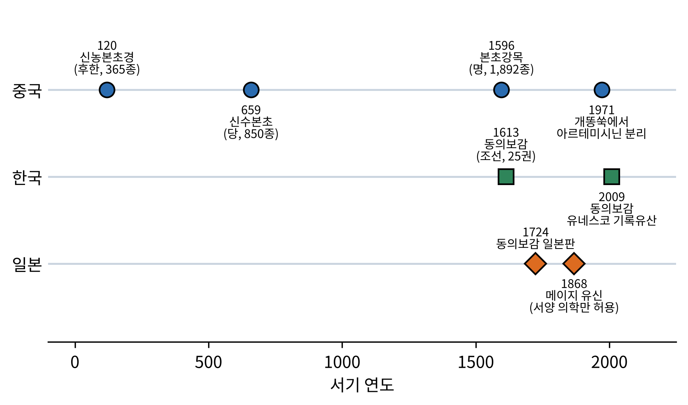
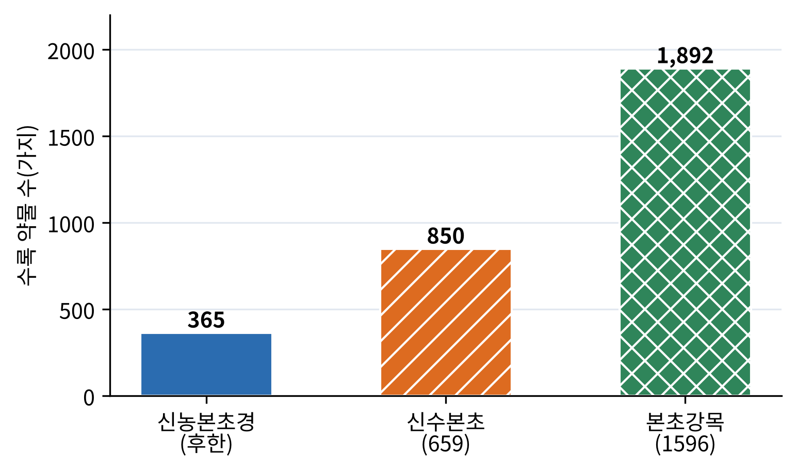
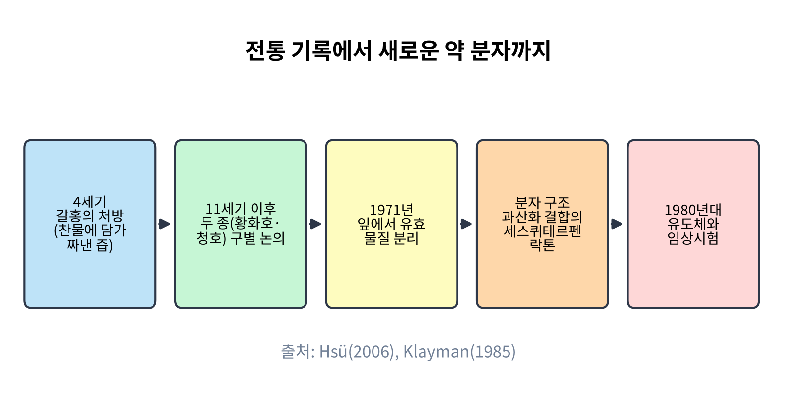
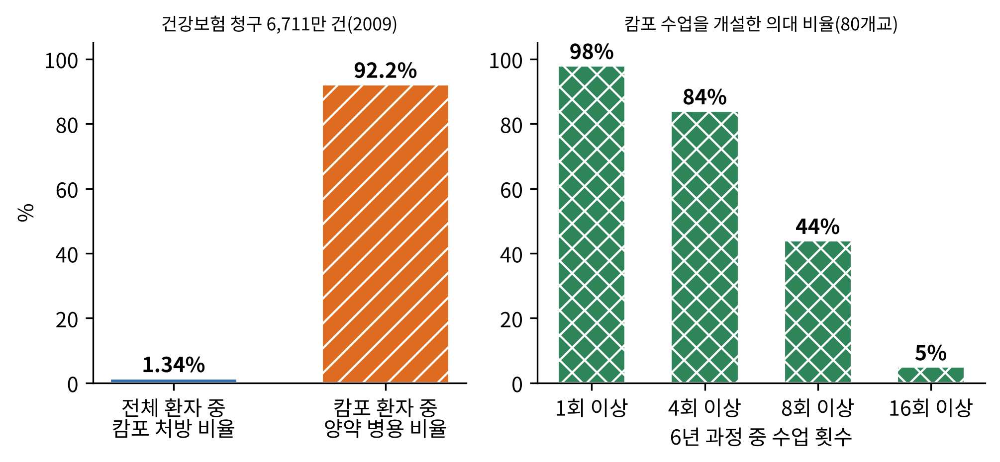
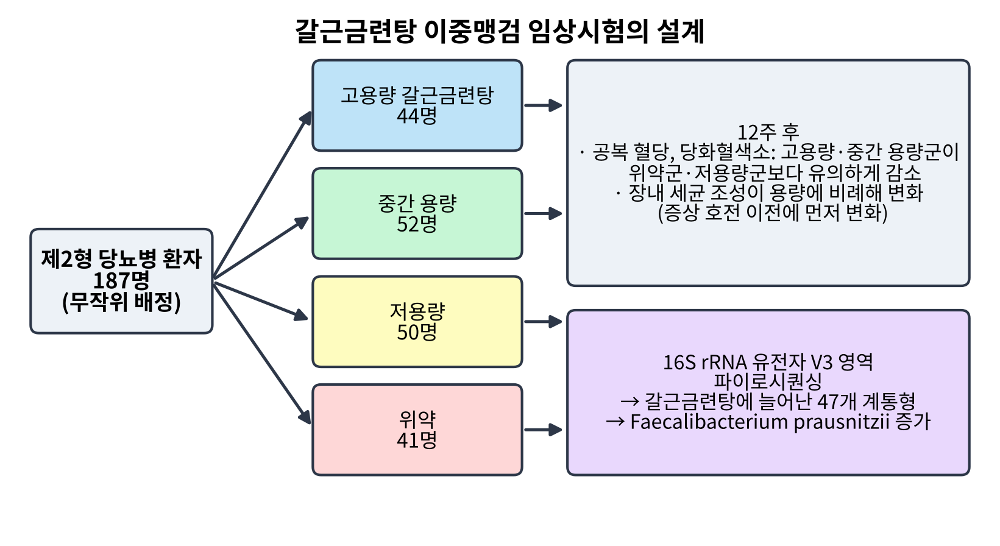
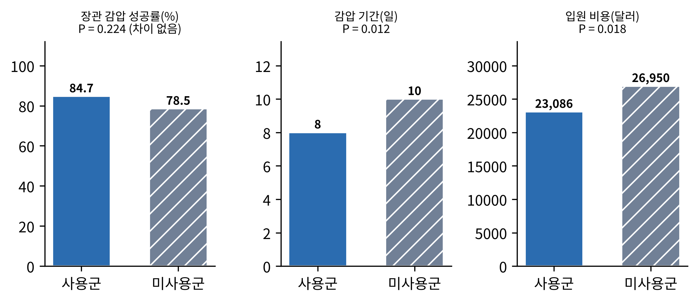
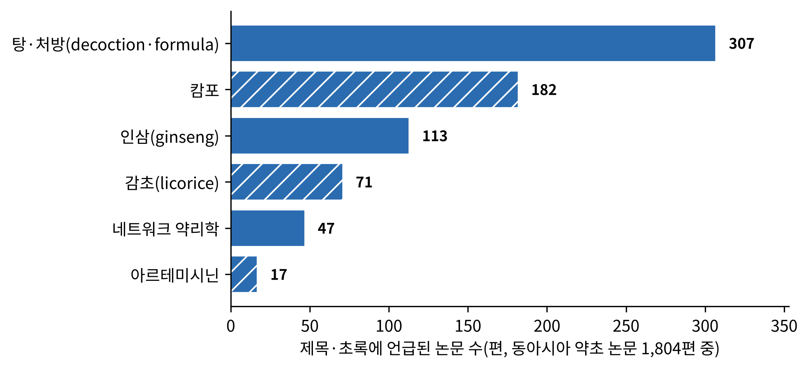

# 3장. 동아시아: 본초에서 한약·캄포까지

<strong>그림 3-1. 동아시아 약초 문헌과 제도의 연표.</strong> 중국, 한국, 일본에서 약초 지식이 책과 제도로 굳어진 주요 시점을 나라별 줄에 놓았다. 연도는 이 장에서 다루는 문헌의 편찬·간행 시점이며, 신농본초경은 후한 시기(25~220년)로 알려져 있어 대략의 연도를 적었다.

<ul class="mini-toc">
<li>신농의 이름을 빌린 책</li>
<li>약을 섞는 법: 상한론과 처방</li>
<li>국가가 만든 약전, 한 사람이 쓴 백과사전</li>
<li>조선의 책, 동의보감</li>
<li>개똥쑥 이야기</li>
<li>일본의 캄포: 끊겼다가 보험이 되다</li>
<li>처방 하나를 시험하다: 갈근금련탕과 대건중탕</li>
<li>같은 말을 쓰기 위하여</li>
</ul>

## 이 장을 읽기 전에

동아시아는 약초를 다루는 이 책의 지역 여행에서 가장 먼저 들르는 곳이다. 이유는 간단하다. 이 지역에는 약초에 관한 문헌이 가장 길고 두껍게 이어져 왔기 때문이다. 1장에서 문자가 생기면서 지식이 기록으로 남았다고 했는데, 동아시아는 그 기록이 약 이천 년 동안 끊기지 않고 책에서 책으로 이어진 드문 지역이다. 책은 앞선 책을 베끼고 고치고 덧붙이며 자랐고, 그 결과 한 번 만들어진 약물 목록은 다음 시대에 더 큰 목록으로 이어졌다.

이 장은 네 가지를 한다. 첫째, 본초(本草)라는 이름의 약물서가 어떻게 자랐는지 중국의 책들을 따라간다. 둘째, 같은 지식이 한국의 『동의보감』과 일본의 캄포(Kampo, 漢方)로 어떻게 다르게 뿌리내렸는지 본다. 셋째, 전통 지식에서 출발해 실제 약이 된 사례인 개똥쑥과, 현대의 방법으로 전통 처방을 시험한 연구 둘(갈근금련탕, 대건중탕)을 실험의 배경부터 해석의 한계까지 따라간다. 넷째, 서로 다른 나라의 전통이 같은 용어로 대화하게 하려는 국제 표준화의 시도를 본다.

이 책에서 한자어 약명은 한국어 한자음으로 적고, 처음 나올 때 한자를 병기한다. 일본의 전통의학은 일본어 이름 그대로 캄포라 부른다. 같은 한자 漢方을 한국에서는 한방이라 읽고 한국 전통의학을 가리키므로, 두 말을 구별하려는 것이다.

## 1. 신농의 이름을 빌린 책

중국 약물학의 가장 오래된 뼈대로 꼽히는 책이 『신농본초경(神農本草經)』이다. 책 이름의 신농은 농사와 약초를 사람에게 가르쳤다는 전설 속의 인물이다. 그러나 이 책을 신농이 썼다고 보는 연구자는 없다. 널리 받아들여지는 견해는 후한(後漢, 25~220년) 무렵에 여러 세대의 지식이 모여 책으로 정리되었다는 것이다. 책 이름에 전설의 인물을 붙이는 것은 지식에 권위를 입히는 오래된 방식이었다.

이 책은 약 365종을 담고 있고, 약물을 상품, 중품, 하품으로 나눈다. 상품은 오래 먹어도 해가 없이 몸을 가볍게 하는 약, 중품은 체질을 살피며 쓰는 약, 하품은 병을 공격하는 힘이 세지만 독이 있어 오래 쓰지 못하는 약이다. 각각 120종, 120종, 125종으로 전해진다. 흥미로운 것은 이 분류의 기준이 효능이 아니라 안전성과 쓰임새라는 점이다. 약물을 '얼마나 독한가'로 줄 세우는 발상은 12장(안전성)에서 다시 만나는, 매우 현대적인 질문의 조상이다.

『신농본초경』 이후 본초서는 시대마다 불어났다. 당(唐) 왕조는 659년에 『신수본초(新修本草)』를 국가 사업으로 펴냈다. 약 850종을 실었고, 국가가 공식으로 반포한 약물서라는 점에서 세계 최초의 국가 약전으로 불리곤 한다. 약전은 약의 이름, 기원, 품질 기준을 국가가 정하는 책이다. 13장(표준화와 약전)에서 다룰 현대 약전의 먼 선조인 셈이다. 그리고 1596년 『본초강목(本草綱目)』이 간행되었다. 이시진(李時珍)이 사반세기 가까이 걸려 썼다고 전해지며 1,892종을 담았다. 표 3-1과 그림 3-2는 이 세 책의 규모를 비교한다.

<strong>표 3-1. 동아시아 대표 약물서의 규모</strong>

| 책 | 시대 | 수록 약물 | 성격 |
|---|---|---|---|
| 신농본초경 | 후한(25~220) | 약 365종 | 상·중·하품 분류, 전설을 빌린 집성 |
| 신수본초 | 당, 659 | 약 850종 | 국가가 반포한 약물서(최초의 국가 약전으로 불림) |
| 본초강목 | 명, 1596 간행 | 1,892종 | 11,096개 처방, 1,160점 도해를 수록한 개인 저술 |
| 동의보감 | 조선, 1613 간행 | 25권 | 내경·외형·잡병·탕액·침구 5편, 임상 중심 |

표를 보면 약물의 수가 시대마다 늘어난다. 그런데 이것이 곧 약효 지식의 증가를 뜻하지는 않는다. 새 책이 이름을 더 많이 담는 이유에는 새로 알려진 외래 약재, 지방마다 달랐던 이름의 정리, 앞 책의 항목을 쪼갠 것이 모두 섞여 있다. 그래서 이 숫자는 '기록이 얼마나 쌓였는가'의 지표이지, '효과가 검증된 약이 얼마인가'의 지표가 아니다. 1장 7절에서 정리한 구분, 곧 기록의 양과 증거의 질은 다르다는 원칙이 여기서도 그대로 적용된다.

<figure class="fig">

<figcaption><strong>그림 3-2. 본초서별 수록 약물 수.</strong> 표 3-1의 수록 약물 수를 막대로 나타냈다. 후한의 약 365종에서 명의 1,892종까지 약 5배가 되었다. 약물 수는 기록의 규모이며 검증된 약효의 수가 아니다.</figcaption>
</figure>

그림 3-2의 막대는 약 1,400년에 걸쳐 다섯 배쯤 자랐다. 읽을 때 주의할 점은 막대의 높이가 곧 약초 지식의 높이는 아니라는 것이다. 이 목록이 불어나는 방식은 새 식물을 발견하는 것만이 아니라 이름을 정리하고 분류하는 작업의 누적이기도 했다. 이시진이 『본초강목』에서 이름의 혼란을 바로잡고 식물을 형태와 서식지에 따라 묶은 것은 이 장의 뒤에서 다룰 표준화 문제, 곧 같은 이름이 다른 풀을 가리키는 혼란을 줄이려는 시도의 한 장면이다.

## 2. 약을 섞는 법: 상한론과 처방

본초서가 '무엇이 약인가'의 목록이라면, 같은 시기에 '어떻게 섞어 쓰는가'를 다룬 책이 있었다. 후한 말 장중경(張仲景)이 지었다고 전해지는 『상한론(傷寒論)』이다. 열병(傷寒)이 진행되는 단계를 여섯 단계로 나누고, 각 단계에서 어떤 증상이 나타나면 어떤 약을 어떻게 섞어 쓸지를 적은 책이다. 전해지는 판본에는 398개 조문과 113개 처방이 있다고 한다.

이 책이 동아시아 약초 이용에서 갖는 의미는 약초를 한 가지씩 쓰는 것이 아니라 여러 가지를 섞은 처방(formula)으로 쓰는 전통을 세웠다는 점이다. 처방은 약재의 종류, 양, 달이는 방법까지 정해진 하나의 단위이다. 같은 약재라도 어떤 약재와 섞이는지에 따라 쓰임이 달라진다. 이 때문에 동아시아의 약초 연구는 서양 약학이 하던 것처럼 '한 식물의 한 성분'을 뽑아 시험하는 방식과 자주 어긋났다. 처방 전체가 하나의 시험 대상이 되는 연구가 따로 필요했고, 이 장 7절과 8절이 그런 연구를 다룬다.

처방과 짝을 이루는 개념이 증(證, 일본에서는 쇼)이다. 증은 환자가 보이는 증상, 맥, 혀의 상태 같은 정보를 종합해 그 사람의 '지금 상태'를 정하는 틀로, 같은 병이라도 증이 다르면 처방이 달라진다. 일본의 문헌은 이 원리를 '증과 처방이 맞는다'는 뜻의 말로 요약해 왔다. 증 판정이 의사마다 달라질 수 있다는 점이 뒤에서 보듯 임상시험 설계를 어렵게 만드는 지점이다.

## 3. 국가가 만든 약전, 한 사람이 쓴 백과사전

659년의 『신수본초』는 한 사람의 저술이 아니라 국가가 학자들을 모아 만든 책이다. 목적은 이름의 혼란을 정리하고 기준을 통일하는 것이었다. 지방마다 다른 이름, 같은 이름의 다른 약재를 표준으로 묶어 약을 전국에서 같은 것으로 부르게 하려는 시도가 이천 년 전에 이미 국가 사업이었다는 점은 인상적이다. 이 목표는 오늘날 약전이 하는 일과 다르지 않다.

반대편 끝에 이시진의 『본초강목』이 있다. 의사였던 이시진은 앞선 본초서를 읽다가 오류와 중복이 많다는 것을 알고 직접 책을 쓰기로 했다고 전해진다. 초고는 1578년에 완성되었고 간행은 1596년에 이루어졌다. 1,892종의 약물, 11,096개의 처방, 1,160점의 그림을 53권에 담았다. 이 책의 특징은 약물을 효능 중심이 아니라 광물, 풀, 나무, 짐승 같은 자연물의 종류에 따라 나누어 배열한 것이다. 효능이 아니라 대상을 기준으로 삼는 분류는 후대 박물학의 모습과 닮았다. 이 책은 동아시아를 넘어 조선과 일본으로, 이후 유럽으로 전해져 약초 지식이 지역을 건너 이동하는 대표적 경로가 되었다.

## 4. 조선의 책, 동의보감

한국의 약초 전통을 대표하는 책은 허준(許浚)의 『동의보감(東醫寶鑑)』이다. 1596년 선조의 명으로 편찬이 시작되어 1610년에 완성되고 1613년에 간행되었다. 25권으로 이루어져 있고 내경(內景), 외형(外形), 잡병(雜病), 탕액(湯液), 침구(鍼灸)의 다섯 편으로 나뉜다. 이 가운데 탕액편이 약물을 다룬다.

『본초강목』이 약물 자체의 백과사전이라면 『동의보감』은 진료 현장을 위한 책이다. 병의 종류별로 증상과 처방을 찾아볼 수 있고, 조선에서 구하기 쉬운 약재를 우리말 이름과 함께 적은 것이 특징으로 꼽힌다. 책은 일본(1724년 판)과 중국(1763년 판)으로 건너가 다시 간행되었고, 2009년에는 유네스코 세계기록유산으로 등재되었다. 동아시아 세 나라가 같은 뿌리의 지식을 서로 주고받았음을 보여 주는 증거이다.

현대의 연구자들은 이런 고전을 데이터로 읽기도 한다. 예컨대 『동의보감』의 처방 기록을 분석해 피부 관리에 쓰인 약재 후보를 추려낸 연구가 있다(Cho et al., 2020). 이런 연구에서 고전은 '답'이 아니라 '가설의 목록'이다. 고전에서 자주 나오는 약재가 곧 효과가 있는 약재는 아니므로, 목록에서 후보를 뽑은 뒤에는 실험과 임상으로 시험해야 한다. 이 순서가 이 장의 나머지를 관통한다.

## 5. 개똥쑥 이야기

전통 기록이 실제 약이 된 가장 유명한 사례가 개똥쑥(Artemisia annua, 한자로는 황화호 黃花蒿)이다. 열이 나는 병에 쑥 종류를 쓴다는 기록은 오래되었다. 4세기 갈홍(葛洪)의 처방서 『주후비급방(肘後備急方)』에는 청호(靑蒿)를 찬물에 담가 즙을 짜서 마시는 방법이 나온다고 전해진다. 이 기록이 중요한 이유는 '달이지 않고 짜낸다'는 방법에 있다. 이후의 연구가 보여 주듯 유효 성분이 열에 약하다면 오래 끓이는 일반적인 탕약 방식은 성분을 파괴할 수 있기 때문이다.

이야기가 진행된 순서는 그림 3-3과 같다. 한 문화 안에서 청호와 황화호를 구별하는 논의가 이어졌고, 1971년에 중국의 화학자들이 개똥쑥의 잎에서 유효 물질을 분리했다. 이 물질이 청호소(青蒿素, 아르테미시닌)이다. 다음 해들에 분자 구조가 밝혀졌고, 유도체가 만들어졌고, 임상에서 시험되었다.

<figure class="fig">

<figcaption><strong>그림 3-3. 개똥쑥에서 약이 되기까지의 단계.</strong> 전통 기록(4세기)에서 분리(1971년), 구조 확인, 유도체와 임상시험(1980년대)까지의 흐름을 개념도로 나타냈다. 각 단계의 연도는 Klayman(1985)의 논문과 Hsü(2006)에 따른 것이다.</figcaption>
</figure>

이 과정을 가장 압축해서 서구에 알린 글이 1985년 《사이언스》에 실린 대니얼 클레이만(Daniel L. Klayman)의 논문 「청호소(아르테미시닌): 중국에서 온 항말라리아제(Qinghaosu (Artemisinin): an Antimalarial Drug from China)」이다. 이 논문은 새 실험을 보고한 것이 아니라, 당시까지 중국에서 이루어진 연구를 서양 독자를 위해 정리한 개관 논문이다.

논문이 놓인 배경은 이렇다. 1980년대 초 열대 지방에서는 기존 말라리아 약인 클로로퀸이 듣지 않는 열대열 말라리아 원충(Plasmodium falciparum)이 퍼지고 있었다. 새로운 계열의 약이 절실했다. 논문의 요점은 세 가지이다. 첫째, 개똥쑥은 수 세기 동안 열병과 말라리아에 쓰여 왔다. 둘째, 1971년 중국 화학자들이 분리한 청호소는 세스퀴테르펜 락톤(sesquiterpene lactone, 2장 표 2-1의 테르페노이드 계열)이며 과산화 결합을 가진다. 이 구조는 말라리아 약의 기존 틀이던 질소 함유 고리 구조와 다르다. 셋째, 수천 명의 환자에게 쓰였고, 클로로퀸에 듣는 원충과 듣지 않는 원충 모두에 효과가 있었으며, 아르테수네이트 같은 유도체가 더 강력해 보인다는 것이다.

여기서 검출과 해석을 나누어 보자. 논문이 확인한 사실은 '분리된 물질의 구조'와 '중국에서 수천 명에게 쓴 경험'이다. 해석은 이 물질이 새로운 계열의 항말라리아제가 될 수 있다는 전망이다. 환자 수는 많았지만 당시 중국의 임상 경험은 대조군을 둔 무작위 시험이 아니었다. 그래서 논문의 어조도 '확정'이 아니라 '가능성(promise)'이다. 이 전망은 이후의 무작위 임상시험과 임상 현장에서 확인되어 아르테미시닌 계열이 세계 말라리아 치료의 중심이 되었다. 이 장면은 전통 기록이 가설을 주고, 화학이 구조를 주고, 임상이 증거를 주는 세 단계가 한 이야기에 모두 나타나는 보기 드문 사례이다.

그러나 이 성공을 '전통은 옳았다'로 일반화하는 데는 신중해야 한다. 개똥쑥에서는 전통 기록의 표현(찬물, 즙)과 실제 성분의 성질이 맞아떨어졌다. 하지만 같은 문헌에 오른 수많은 다른 약재가 모두 이렇게 입증된 것은 아니다. 성공한 사례는 눈에 띄고, 입증되지 않은 사례는 조용히 사라진다는 점을 독자가 기억하기 바란다. 이 책이 사례마다 '무엇이 확인되었고 무엇이 해석인지'를 나누어 적는 이유이다.

## 6. 일본의 캄포: 끊겼다가 보험이 되다

일본은 7~8세기에 중국 의학을 받아들였고, 17~18세기에 이를 일본식으로 다시 쓴 흐름이 나타났다. 이 시기 일본 의사들은 명(明)의 의학 이론을 걷어 내고 『상한론』과 『금궤요략』의 원래 개념으로 돌아가자고 주장했다. 요시마스 도도(吉益東洞, 1702~1773)는 증의 패턴이 확인되면 그에 맞는 처방을 쓸 수 있다고 강조했고, 이 원리가 오늘날까지 캄포의 기본 개념으로 남았다(Yakubo et al., 2014).

그러다 1868년 메이지 유신이 일어났다. 새 정부는 유럽을 따라 서양 의학만 인정하는 방향으로 정책을 바꾸었고, 캄포는 제도적 기반을 잃었다. 되살아난 것은 서양 의학을 배운 의사들이 캄포를 다시 쓰기 시작하면서였다. 이들은 캄포의 증 개념을 서양 의학의 용어와 혼동되지 않게 고쳐 썼다. 1976년에는 캄포 처방이 건강보험에 포함되었다.

보험 편입 이후의 사용 실태를 보여 주는 두 연구가 있다. 가타야마 고토에(Kotoe Katayama) 등은 2009년 일본 후생노동성이 모은 건강보험 청구 기록 67,113,579건을 분석했다(Katayama et al., 2013). 캄포 약은 전체 환자의 1.34%에게 처방되었고, 그 환자의 92.2%는 양약을 함께 받았다. 가장 자주 처방된 처방은 작약감초탕(芍藥甘草湯)이었고, 처방률이 가장 높은 영역은 임신·출산·산욕 관련 질환(4.08%)이었다. 또 아라이 마코토(Makoto Arai) 등은 일본 80개 의과대학 전부를 조사해(Arai et al., 2012), 6년 과정 중 캄포 수업이 최소 1회 있는 학교가 98%, 4회 이상이 84%, 8회 이상이 44%, 16회 이상이 5%임을 확인했다. 전임 교수를 둔 학교는 29%였다.

<strong>표 3-2. 일본 캄포의 사용·교육 현황(두 조사)</strong>

| 지표 | 값 | 조사 |
|---|---|---|
| 분석한 건강보험 청구 기록 | 67,113,579건(2009) | Katayama et al. (2013) |
| 전체 환자 중 캄포 처방 비율 | 1.34% | 같은 조사 |
| 캄포 환자 중 양약 병용 비율 | 92.2% | 같은 조사 |
| 가장 많이 처방된 처방 | 작약감초탕 | 같은 조사 |
| 캄포 수업을 1회 이상 개설한 의대 | 98%(80개교 조사) | Arai et al. (2012) |
| 16회 이상 개설한 의대 | 5% | 같은 조사 |
| 캄포 전임 교수를 둔 의대 | 29% | 같은 조사 |

<figure class="fig">

<figcaption><strong>그림 3-4. 일본의 캄포 사용과 교육 현황.</strong> 왼쪽: 2009년 건강보험 청구 기록에서 캄포 처방을 받은 환자의 비율과 그중 양약을 병용한 비율. 오른쪽: 80개 의과대학 중 6년 과정에서 캄포 수업을 일정 횟수 이상 개설한 학교의 비율. 두 조사는 서로 다른 연구이다.</figcaption>
</figure>

두 연구가 보여 주는 그림은 단순하지 않다. 캄포는 일본에서 제도적으로 인정된 전통이지만, 환자 전체로 보면 처방 비율은 1.34%로 낮다. 같은 연구의 의사 조사 결과로 인용된 '80% 이상의 의사가 일상에서 캄포를 쓴다'는 수치와 나란히 놓으면, 많은 의사가 쓰지만 한 번에 쓰는 환자 수는 적은 사용 방식이 드러난다. 그리고 92.2%가 양약을 함께 받는다는 것은 캄포가 양약을 대체하는 것이 아니라 보완하는 방식으로 쓰임을 뜻한다. 이 해석에는 한계가 있다. 청구 기록은 처방이 있었다는 사실을 보여 줄 뿐 효과를 보여 주지 않고, 두 약을 함께 쓴 이유도 알려 주지 않는다. 교육 현황 역시 수업이 있다는 사실이지 수업의 질이 아니다.

## 7. 처방 하나를 시험하다: 갈근금련탕

그렇다면 전통 처방은 현대의 방법으로 시험할 수 있는가. 갈근금련탕(葛根黃芩黃連湯)은 『상한론』에 실린 처방으로, 갈근, 황금, 황련, 감초 네 가지 약재로 이루어진다. 열과 설사에 쓰이던 이 처방이 제2형 당뇨병에 효과가 있는지를 시험한 연구가 2014년 온라인(2015년 지면) 《ISME 저널》에 실렸다. 제목은 「제2형 당뇨병이 호전되는 동안의 장내 미생물 구조 변화: 한방 처방과 함께(Structural modulation of gut microbiota during alleviation of type 2 diabetes with a Chinese herbal formula)」이다(Xu et al., 2015).

**연구의 배경.** 장내 세균 집단이 비만과 당뇨 같은 대사 질환과 관련이 있다는 가설이 힘을 얻던 때였다. 연구진의 질문은 두 갈래였다. 이 처방이 혈당을 낮추는가. 낮춘다면 장내 세균의 조성이 함께 변하는가.

**연구의 설계.** 그림 3-5와 같이 제2형 당뇨병 환자 187명을 무작위로 네 군으로 나누었다. 고용량군 44명, 중간 용량군 52명, 저용량군 50명, 위약군 41명이었다. 환자도 의사도 누가 어느 군인지 모르는 이중맹검으로 12주 동안 투여했다. 혈당(공복 혈당)과 당화혈색소를 재고, 대변 시료에서 세균의 16S rRNA 유전자 V3 부위를 파이로시퀀싱(pyrosequencing)으로 읽어 세균의 조성을 분석했다.

<figure class="fig">

<figcaption><strong>그림 3-5. 갈근금련탕 이중맹검 임상시험의 설계와 결과.</strong> 187명을 4군에 무작위 배정하고 12주 투여한 뒤 혈당 지표와 장내 세균을 분석했다. 결과 상자는 Xu et al. (2015)의 초록에 보고된 내용을 요약한 것이다.</figcaption>
</figure>

**검출된 것.** 고용량군과 중간 용량군은 위약군과 저용량군에 비해 공복 혈당과 당화혈색소가 의미 있게 더 줄었다. 장내 세균의 조성은 투여량에 비례해 달라졌고, 이 변화는 당뇨 증상이 눈에 띄게 좋아지기 이전에 먼저 나타났다. 통계 분석에서 갈근금련탕에 의해 늘어난 47개의 종 수준 계통형(phylotype)이 확인되었고, 정량 PCR로 확인했을 때 특히 파에칼리박테리움 프라우스니치(Faecalibacterium prausnitzii)가 유의하게 늘었다. 이 세균의 양은 혈당, 당화혈색소와 음의 상관을 보였다.

**해석과 한계.** 이 결과가 말하는 것과 말하지 않는 것을 나누어 보자. 말하는 것은 두 가지이다. 이 처방은 위약보다 혈당 지표를 더 낮추었고, 같은 처방은 용량에 따라 장내 세균 구조를 바꾸었다. 말하지 않는 것은 인과의 방향이다. 세균 변화가 혈당 개선의 원인인지, 혈당이 개선되며 생긴 결과인지, 둘 다 약의 다른 효과인지는 이 설계로 가릴 수 없다. 다만 세균 변화가 증상 개선보다 먼저 나타난 점은 원인일 가능성을 높이는 단서이다. 논문 스스로도 결론을 '장내 세균의 변화가 이 처방의 항당뇨 효과와 연관된다'는 표현에 그쳤다. 또한 이 시험은 네 가지 약재의 혼합물 전체를 시험한 것이므로, 어느 약재의 어느 성분이 효과를 냈는지는 알 수 없다. 혼합물 전체를 시험하는 연구의 장점과 한계가 함께 드러나는 지점이다. 이후 연구에서는 이 처방이 면역 관문 억제제(항 PD-1 항체)의 효과를 높였다는 동물 실험 결과도 보고되었으나(Lv et al., 2019), 이는 다른 질병에서의 후속 가설일 뿐 이 시험의 결론이 아니다.

## 8. 처방 하나를 시험하다: 대건중탕

두 번째 예는 방법이 다르다. 대건중탕(大建中湯)은 산초, 건강, 인삼, 이당(엿)으로 이루어진 처방으로, 일본에서 수술 후 장이 막히거나 움직이지 않을 때 널리 쓰인다. 2011년 야스나가 히데오(Hideo Yasunaga) 등은 이 처방이 대장암 수술 뒤 생긴 유착성 소장 폐색 환자에게 도움이 되는지를 일본의 입원 환자 데이터베이스로 분석했다(Yasunaga et al., 2011).

이 연구는 임상시험이 아니라 후향적 관찰 연구이다. 이미 일어난 진료 기록을 나중에 분석하는 것이라, 약을 쓴 환자와 쓰지 않은 환자가 원래 다를 수 있다는 문제가 있다. 이를 줄이려고 연구진은 성향 점수 맞춤(propensity score matching)을 썼다. 나이, 수술 종류, 병의 정도 같은 조건이 비슷한 환자끼리 짝을 지어 비교하는 방법이다. 그렇게 288명이 선택되었다.

결과는 그림 3-6과 같다. 긴 관을 코로 넣어 장 안의 내용물을 빼내는 장관 감압(long-tube decompression)의 성공률은 사용군 84.7%, 미사용군 78.5%로 통계적으로 차이가 없었다(P = 0.224). 하지만 감압 기간은 8일 대 10일(P = 0.012), 입원 비용은 23,086달러 대 26,950달러(P = 0.018)로 사용군이 짧고 쌌다.

<figure class="fig">

<figcaption><strong>그림 3-6. 대건중탕 사용군과 미사용군의 비교(성향 점수로 짝지은 288명).</strong> 장관 감압 성공률은 차이가 없었고, 감압 기간과 입원 비용은 사용군이 더 낮았다. 출처: Yasunaga et al. (2011).</figcaption>
</figure>

이 결과를 읽는 요령은 성공률에서 차이가 없었다는 점을 숨기지 않는 것이다. 연구의 결론도 '효과가 있다'가 아니라 '감압 기간을 줄이고 비용을 아끼는 데 효과가 있어 보인다'이다. 관찰 연구는 측정되지 않은 요인(예를 들어 의사가 어떤 환자에게 약을 권했는지)을 통제하지 못하므로 인과를 확정할 수 없다. 그럼에도 이런 연구는 중요하다. 무작위 시험을 설계하기 전에 어떤 결과 지표가 의미 있는지를 알려 주기 때문이다. 표 3-3은 이 장에서 본 세 연구가 어떤 질문에 어디까지 답할 수 있는지를 나란히 놓는다.

<strong>표 3-3. 이 장의 세 연구가 답할 수 있는 것</strong>

| 연구 | 설계 | 대상 | 확인된 것 | 확인되지 않은 것 |
|---|---|---|---|---|
| 클레이만 (1985) | 개관 논문 | 중국의 청호소 연구 | 구조, 수천 명 사용 경험 | 대조군을 둔 효과 |
| 쉬 등 (2015) | 무작위 이중맹검 시험 | 당뇨 환자 187명 | 혈당 감소, 장내 세균 변화 | 세균 변화의 인과 |
| 야스나가 등 (2011) | 후향 관찰 연구 | 짝지은 환자 288명 | 감압 기간·비용 감소 | 성공률 개선, 인과 |

## 9. 같은 말을 쓰기 위하여

동아시아 전통의학 연구에는 또 하나의 걸림돌이 있었다. 같은 개념을 나라마다 다른 이름으로 불러 왔다는 것이다. 한국에서는 한의학, 일본에서는 캄포, 중국에서는 중의학이라 하고, 같은 한자어가 나라마다 다른 영어로 번역되었다. 논문을 모으고 비교하려 해도 용어가 맞지 않으면 같은 것을 세는 것이 불가능하다.

세계보건기구(WHO) 서태평양 지역 사무소는 이 문제를 정면으로 다루어 『전통의학 국제 표준 용어(WHO International Standard Terminologies on Traditional Medicine in the Western Pacific Region)』를 펴냈다. 최승훈(Seung-Hoon Choi)과 장일무(Il-Moo Chang)가 이 책을 소개한 논문(Choi & Chang, 2008)에 따르면 이 책은 중국, 일본, 한국, 베트남의 전통의학에서 쓰는 용어 3,259개를 담고 있다. 각 용어에 영어 표기, 원래의 한자, 간단한 영어 정의를 붙였고, 기초 이론과 진단, 질병, 침구 같은 여러 치료법에 이르는 3,106개 용어와 네 나라의 중요 고전 153종의 영어 제목으로 구성된다. 또 분야별로 100 단위의 번호를 매겨 나중에 용어를 더 보태도 체계가 흐트러지지 않게 했고, 이 번호는 논문 검색용 데이터베이스를 만드는 데도 쓸 수 있다.

용어 표준화는 겉으로는 사전을 만드는 일이지만 실제로는 증거를 모을 수 있게 하는 기반 공사이다. 같은 증(證)을 가진 환자를 같은 이름으로 불러야 서로 다른 나라의 임상시험을 합쳐 읽을 수 있다. 이 문제는 11장(임상시험)에서 다시 나온다.

## 10. 인삼: 전통이 말하는 것과 시험이 말하는 것

인삼(人蔘, Panax ginseng)은 동아시아 약초 가운데 가장 많이 연구된 풀 중 하나이다. 2008년 샹야오쭈(Yaozu Xiang) 등은 『식물치료 연구(Phytotherapy Research)』에 인삼의 오래된 쓰임을 현대의 약리 실험 및 임상시험과 비교하는 논문을 실었다(Xiang et al., 2008). 전통 의학에서 인삼은 기력 저하, 식욕 부진, 숨참, 두근거림, 불면, 출혈, 당뇨 등 아주 넓은 병증에 귀하게 쓰였다. 현대 실험에서는 진세노사이드(ginsenoside)를 비롯한 여러 성분이 확인되었고 신경 보호, 면역 조절, 항암 등의 작용이 보고되었다. 그러나 임상시험은 신체·정신 운동 수행, 인지 기능, 면역, 당뇨, 심혈관 위험 요인, 삶의 질 등에서 이루어졌고 결과는 많은 항목에서 엇갈렸다. 저자들은 대부분 임상시험의 질이 낮아 믿을 만한 인체 자료가 아직 부족하다고 결론지었다.

이 논문이 보여 주는 것은 전통의 적용 범위와 시험의 범위 사이의 간극이다. 전통은 '기력이 쇠했다'는 포괄적 상태에 인삼을 썼는데, 시험은 '혈당 수치'나 '인지 검사 점수'처럼 좁게 정의된 결과 지표로 효과를 잰다. 포괄적인 상태를 좁은 지표로 번역하는 과정에서 효과가 보이지 않을 수도 있다. 이것이 인삼이 틀렸다는 뜻인지, 시험이 알맞은 지표를 고르지 못했다는 뜻인지는 별개의 문제이다. 어느 쪽이 맞는지 판가름하는 일이 11장의 핵심 과제이다.

## 11. 논문 속의 동아시아

마지막으로 이 책이 모은 논문 자료에서 동아시아가 어떻게 보이는지 살펴본다. 약초 관련으로 확인한 논문 가운데 동아시아 약초로 분류된 것은 1,804편이다. 이 논문들의 제목과 초록에서 여섯 개 주제의 단어가 몇 편에 언급되었는지 센 결과가 그림 3-7이다.

<figure class="fig">

<figcaption><strong>그림 3-7. 동아시아 약초 논문(1,804편)에서 주제어가 언급된 논문 수.</strong> 제목·초록에 해당 단어가 있는 논문을 센 값이다. 한 논문이 여러 주제어를 가질 수 있어 합계는 전체 편수와 다르며, 이 값은 연구의 비중을 정밀하게 나타내는 것이 아니라 대략의 경향을 보여 준다.</figcaption>
</figure>

그림 3-7에서 가장 많이 언급된 단어는 탕과 처방(307편)이고, 그다음이 캄포(182편), 인삼(113편)이다. 처방이 단일 약초보다 훨씬 많이 언급되었다는 점이 2절에서 본 동아시아의 특징, 곧 혼합물 단위의 전통을 그대로 반영한다. 한편 네트워크 약리학(47편)은 처방 안의 여러 성분이 여러 표적에 작용하는 그물을 계산으로 그려 보려는 새 방법으로, 14장에서 다룬다. 아르테미시닌이 17편에 불과한 것은 이 약이 이미 '약초 연구'가 아니라 '약물 연구'로 분류되었음을 시사한다. 다만 이 숫자는 단어의 철자에 의존하므로(예를 들어 '캄포'를 'Kampo'로 센 것), 같은 개념의 다른 표기를 놓칠 수 있다.

## 이 장을 마치며

3장에서 확인한 것을 정리한다. 첫째, 동아시아에서는 약물서가 이천 년 가까이 이어지며 목록이 5배 가까이 자랐지만, 이는 기록의 양이지 검증된 약효의 양이 아니다. 둘째, 처방(여러 약재의 혼합)이 이 지역 약초 이용의 기본 단위이다. 셋째, 개똥쑥은 전통 기록이 가설이 되어 구조와 임상으로 이어진 드문 성공 사례이다. 넷째, 캄포는 일본에서 제도적으로 인정되지만 처방 비율은 낮고 양약과 함께 쓰는 보완 방식이다. 다섯째, 처방 전체를 시험하는 연구는 무작위 시험이든 관찰 연구든 효과의 방향은 보여 줄 수 있지만 어느 성분이 효과를 냈는지는 알려 주지 못한다. 여섯째, 용어의 표준화는 증거를 모으기 위한 전제이다.

2부는 이어서 4장으로 간다. 동아시아와 거의 같은 시기에 독자적인 약초 체계를 세운 남아시아, 곧 인도의 아유르베다와 그 주변을 다룬다.

## 참고문헌

- Arai, M., Katai, S., Muramatsu, S., Namiki, T., Hanawa, T., & Izumi, S. (2012). Current status of Kampo medicine curricula in all Japanese medical schools. *BMC Complementary and Alternative Medicine, 12*, Article 207. https://doi.org/10.1186/1472-6882-12-207
- Cho, G., Park, H.-M., Jung, W.-M., Cha, W.-S., Lee, D., & Chae, Y. (2020). Identification of candidate medicinal herbs for skincare via data mining of the classic Donguibogam text on Korean medicine. *Integrative Medicine Research, 9*. https://doi.org/10.1016/j.imr.2020.100436
- Choi, S.-H., & Chang, I.-M. (2008). A milestone in codifying the wisdom of traditional oriental medicine: TCM, Kampo, TKM, TVM—WHO international standard terminologies on traditional medicine in the Western Pacific Region. *Evidence-Based Complementary and Alternative Medicine, 5*. https://doi.org/10.1093/ecam/nen083
- Hsü, E. (2006). Reflections on the 'discovery' of the antimalarial qinghao. *British Journal of Clinical Pharmacology, 61*(6), 666–670. https://doi.org/10.1111/j.1365-2125.2006.02673.x
- Katayama, K., Yoshino, T., Munakata, K., Yamaguchi, R., Imoto, S., Miyano, S., & Watanabe, K. (2013). Prescription of Kampo drugs in the Japanese health care insurance program. *Evidence-Based Complementary and Alternative Medicine, 2013*, Article 576973. https://doi.org/10.1155/2013/576973
- Klayman, D. L. (1985). Qinghaosu (artemisinin): An antimalarial drug from China. *Science, 228*(4703), 1049–1055. https://doi.org/10.1126/science.3887571
- Lv, J., Jia, Y., Li, J., Kuai, W., Li, Y., Guo, F., Xu, X., Zhao, Z., Lv, J., & Li, Z. (2019). Gegen Qinlian decoction enhances the effect of PD-1 blockade in colorectal cancer with microsatellite stability by remodelling the gut microbiota and the tumour microenvironment. *Cell Death & Disease, 10*, Article 415. https://doi.org/10.1038/s41419-019-1638-6
- Xiang, Y., Shang, H., Gao, X., & Zhang, B.-L. (2008). A comparison of the ancient use of ginseng in traditional Chinese medicine with modern pharmacological experiments and clinical trials. *Phytotherapy Research, 22*(7), 851–858. https://doi.org/10.1002/ptr.2384
- Xu, J., Lian, F., Zhao, L., Zhao, Y., Chen, X., Zhang, X., Guo, Y., Zhang, C., Zhou, Q., Xue, Z., Pang, X., Zhao, L., & Tong, X. (2015). Structural modulation of gut microbiota during alleviation of type 2 diabetes with a Chinese herbal formula. *The ISME Journal, 9*(3), 552–562. https://doi.org/10.1038/ismej.2014.177
- Yakubo, S., Ito, M., Ueda, Y., Okamoto, H., Kimura, Y., Amano, Y., Togo, T., Adachi, H., Mitsuma, T., & Watanabe, K. (2014). Pattern classification in Kampo medicine. *Evidence-Based Complementary and Alternative Medicine, 2014*, Article 535146. https://doi.org/10.1155/2014/535146
- Yasunaga, H., Miyata, H., Horiguchi, H., Kuwabara, K., Hashimoto, H., & Matsuda, S. (2011). Effect of the Japanese herbal Kampo medicine Dai-kenchu-to on postoperative adhesive small bowel obstruction requiring long-tube decompression: A propensity score analysis. *Evidence-Based Complementary and Alternative Medicine, 2011*, Article 264289. https://doi.org/10.1155/2011/264289
