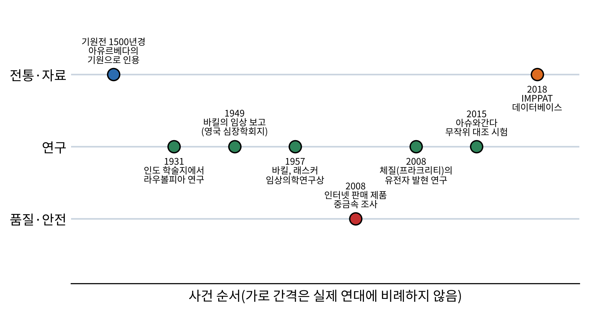
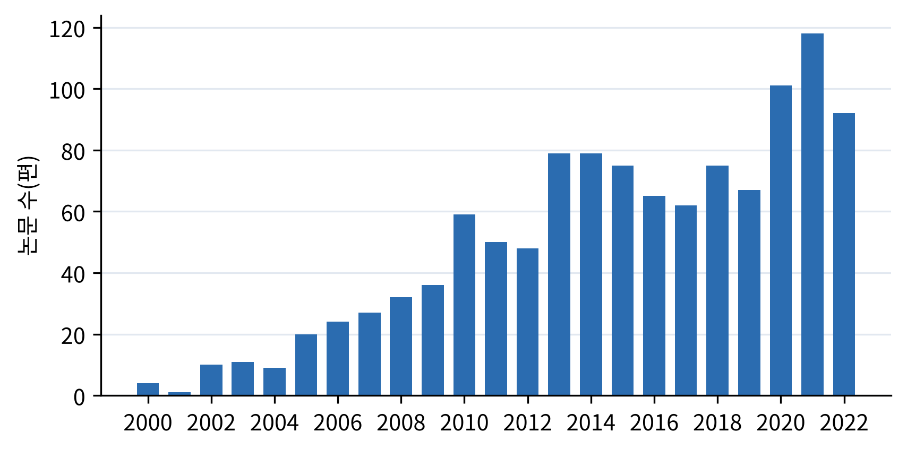
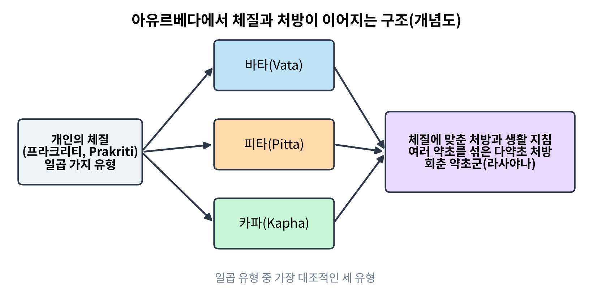
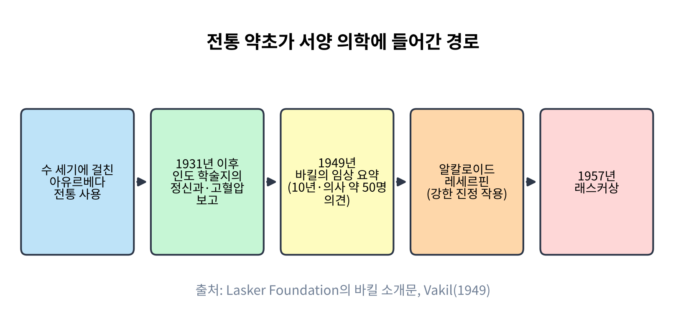
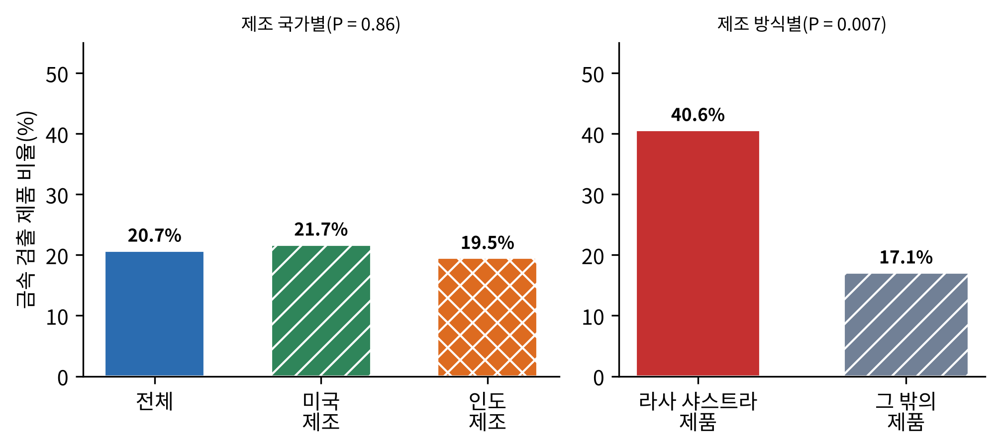
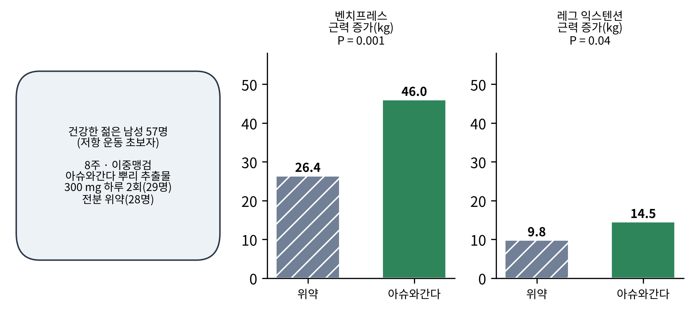
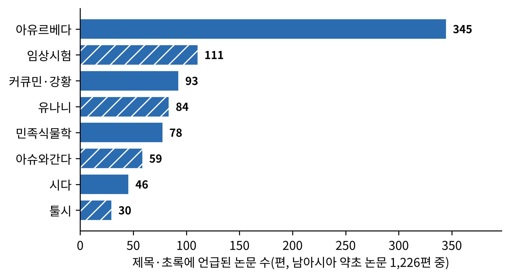

# 4장. 남아시아: 아유르베다에서 약용 식물 데이터베이스까지

<strong>그림 4-1. 남아시아 약초 전통과 연구의 주요 사건.</strong> 이 장에서 다루는 사건을 성격별 세 줄(전통·자료, 연구, 품질·안전)에 놓았다. 가로 간격은 연대에 비례하지 않고 사건의 순서만 나타낸다. 맨 왼쪽의 기원전 1500년경은 연구자들이 아유르베다의 기원으로 인용하는 시기이며 정확한 연대는 논쟁 중이다.

<ul class="mini-toc">
<li>살아 있는 전통들</li>
<li>체질과 처방: 아유르베다의 구조</li>
<li>체질을 유전자로 읽을 수 있는가</li>
<li>뱀뿌리풀에서 레세르핀까지</li>
<li>약에 들어 있는 금속</li>
<li>아슈와간다를 시험하다</li>
<li>강황: 약효와 흡수는 다른 문제</li>
<li>약초를 데이터베이스로 읽다</li>
</ul>

## 이 장을 읽기 전에

3장의 동아시아에서 약초 지식은 책으로 이어졌다. 남아시아, 곧 인도 아대륙에서는 그 지식이 책이면서 동시에 지금도 환자를 보는 현장의 의학이다. 아유르베다(Ayurveda)는 오래전 문헌에서 나온 체계가 오늘날에도 병원과 약국과 가정에서 쓰이는 드문 경우이다. 이 때문에 남아시아의 약초 이야기는 두 가지 질문을 함께 품는다. 하나는 이 전통이 무엇을 알고 있었는가이고, 다른 하나는 그것을 현대의 방법으로 어떻게 시험하고 있는가이다.

이 장은 이 두 질문을 사례로 따라간다. 먼저 남아시아의 약초 전통이 어떤 갈래로 나뉘는지와 아유르베다의 기본 구조(체질과 처방)를 본다. 그다음 중요한 연구 다섯 편을 실험의 배경부터 해석의 한계까지 읽는다. 체질을 유전자 발현으로 검증하려는 연구, 전통 약초가 서양 의학에 들어간 레세르핀의 경로, 시판 제품에서 금속을 검출한 조사, 아슈와간다의 무작위 대조 시험, 강황 성분의 흡수 문제이다. 끝으로 약초와 성분을 데이터베이스로 묶으려는 시도를 소개한다.

이 장의 사례를 읽는 방법은 3장과 같다. 연구가 실제로 확인한 것과 연구자가 그것을 해석한 것을 따로 적는다. 힌두어와 산스크리트어 용어는 한자어가 아니므로 소리나는 대로 적고 처음 나올 때 로마자를 병기한다.

## 1. 살아 있는 전통들

남아시아의 약초 전통은 하나가 아니다. 가장 널리 알려진 것이 아유르베다이고, 이 책이 모은 논문 자료에서는 유나니(Unani)와 시다(Siddha)라는 이름이 아유르베다 다음으로 자주 나온다. 표 4-1은 세 전통을 정리하고, 이 책의 논문 자료에서 각 전통 이름으로 분류된 논문 수를 함께 적는다.

<strong>표 4-1. 남아시아의 세 약초 전통</strong>

| 전통 | 성격 | 이 책 자료의 논문 수 |
|---|---|---|
| 아유르베다 | 인도에서 기원한 전통으로, 문헌상 기원전 1500년경까지 소급되는 것으로 인용된다 | 301편 |
| 유나니 | 그리스·아랍 의학 계통이 남아시아에 정착해 이어진 전통(5장에서 그 뿌리를 다룬다) | 408편(시다와 합산) |
| 시다 | 남인도 타밀 지역에서 발달한 전통 | 위 408편에 포함 |

표의 논문 수는 자료의 태그로 센 값이다. 유나니와 시다는 한 묶음으로 분류되어 있고, 두 전통이 함께 태그된 논문이 61편, 아유르베다와 유나니·시다가 함께 붙은 논문도 있어 합계가 전체와 다르다. 이 장은 문헌과 연구가 가장 풍부한 아유르베다를 중심으로 읽는다.

남아시아는 식물 자원 면에서도 크다. 한 개관 논문에 따르면 인도에는 약 45,000종의 식물이 있고, 그중 약 15,000종이 약용 식물로 기록되었으며 지역 사회가 실제로 병을 고치는 데 쓰는 것은 7,000~7,500종이라고 한다(Parasuraman et al., 2014). 이 수치는 개관 논문이 인용한 추정이므로 정확한 값이라기보다 규모의 감각으로 읽는 것이 맞다.

그렇다면 이 전통은 현대 연구에서 얼마나 다루어지고 있는가. 그림 4-2는 이 책의 자료에서 남아시아 약초 논문이 해마다 몇 편인지 보여 준다.

<figure class="fig">

<figcaption><strong>그림 4-2. 남아시아 약초 논문의 연도별 편수(2000~2022년).</strong> 이 책의 논문 자료에서 남아시아로 분류된 1,226편을 출간 연도별로 센 값이다. 2023년 이후는 자료 수집 시점의 영향으로 불완전하여 제외했다.</figcaption>
</figure>

그림 4-2의 막대는 2000년에 몇 편에 불과하던 논문이 2010년대에 해마다 수십 편으로, 2020년대 초에는 100편 안팎으로 늘었음을 보여 준다. 이 증가는 이 책이 모은 자료의 범위 안에서의 경향이고, 전 세계 논문 전체의 증가세와 분리해서 해석할 수는 없다. 그러나 남아시아 약초가 점점 더 자주 연구 대상이 되고 있다는 방향은 분명하다.

## 2. 체질과 처방: 아유르베다의 구조

아유르베다의 핵심 개념은 체질이다. 개인마다 타고난 체질(프라크리티, Prakriti)이 있고, 이 체질이 어떤 병에 걸리기 쉬운지, 어떤 치료와 생활 방식이 맞는지를 정한다고 본다. 체질은 일곱 가지 유형으로 나뉘며, 그중 가장 대조적인 세 유형이 바타(Vata), 피타(Pitta), 카파(Kapha)이다(Prasher et al., 2008). 이는 3장에서 본 동아시아의 증(證)과 닮은 데가 있다. 병이 아니라 병을 가진 사람의 상태를 먼저 판정하고 처방을 정한다는 점이다.

처방의 단위도 3장과 비슷하다. 아유르베다 문헌 가운데 사랑가다라 상히타(Sarangdhar Samhita)는 여러 약초를 섞는 다약초(polyherbal) 처방의 개념을 강조했고, 한 식물의 성분만으로는 원하는 치료 효과에 이르기 어려우며 약초를 알맞은 비율로 섞으면 효과가 더 좋고 독성이 줄어든다고 설명한다(Parasuraman et al., 2014). 그림 4-3은 체질에서 처방까지 이어지는 구조를 개념도로 나타낸다.

<figure class="fig">

<figcaption><strong>그림 4-3. 아유르베다에서 체질과 처방이 이어지는 구조(개념도).</strong> 개인의 체질을 먼저 판정하고, 그에 맞는 다약초 처방과 생활 지침, 회춘 약초군(라사야나)을 선택한다. 개념을 단순화한 그림이며 실제 진단은 훨씬 많은 요소를 고려한다.</figcaption>
</figure>

처방의 한 갈래로 라사야나(Rasayana)가 있다. 노화를 늦추고 활력을 회복시킨다는 회춘 약초군이다. 1999년 레게(Nirmala N. Rege) 등은 라사야나 계열 약초 여섯 가지(티노스포라 코르디폴리아, 아스파라거스 라세모수스, 에믈리카 오피키날리스, 위타니아 솜니페라, 피퍼 롱검, 터미날리아 체불라)의 표준화한 물 추출물을 실험동물에게 먹인 뒤 여러 스트레스 요인에 노출시키는 실험을 했다(Rege et al., 1999). 이 식물들은 스트레스 반응 지표와 스트레스로 인한 증상 지표 양쪽에서 보호 효과를 보였고, 시스플라틴(cisplatin)으로 변한 위장 운동을 병이 변한 방향과 상관없이 정상으로 되돌리는 효과도 시험되었다. 이 연구가 보여 준 것은 동물 실험 수준의 보호 효과이다. 사람에게서의 효과를 뜻하지는 않는다는 점을 저자들도 문제로 삼아, 인삼을 포함한 세계의 적응소(adaptogen) 후보들이 임상에서 성공적으로 도입된 사례가 아직 없다고 지적했다.

## 3. 체질을 유전자로 읽을 수 있는가

체질이라는 개념은 현대 생물학에서 어떻게 다룰 수 있을까. 2008년 프라셰르(Bhavana Prasher) 등은 『전환 의학 저널(Journal of Translational Medicine)』에 「아유르베다에서 정의한 극단적 체질 유형의 전체 유전체 발현과 생화학적 상관(Whole genome expression and biochemical correlates of extreme constitutional types defined in Ayurveda)」을 실었다(Prasher et al., 2008).

**연구의 배경.** 아유르베다는 개인의 체질이 질병의 소인과 예후, 치료와 생활 방식을 정한다고 본다. 현대 의학에서도 개인차를 설명하는 예측 의학이 주목받고 있었다. 연구진의 질문은 이 전통의 체질 구분이 혈액의 분자 수준 차이와 대응하는가였다.

**연구의 방법.** 인도 인구 중 인도·유럽계 후손에서, 아유르베다가 제시한 표현형 기준으로 가장 대조적인 세 체질(바타, 피타, 카파) 유형의 건강한 사람들을 가려냈다. 이들의 말초 혈액으로 전체 유전체 수준의 유전자 발현량을 측정하고, 생화학 지표(간기능, 지질 프로파일)와 혈액학 지표(헤모글로빈 등)를 함께 쟀다. 그다음 세 유형 사이에서 발현이 다른 유전자들을 골라 이들이 어떤 생물학적 기능에 몰려 있는지를 유전자 온톨로지(Gene Ontology)와 경로 분석으로 살폈다.

**검출된 것.** 세 유형은 생화학·혈액학 지표와 유전체 발현 양쪽에서 뚜렷하게 달랐다. 발현이 다른 유전자들은 물질 수송, 세포 주기 조절(사이클린 의존 단백질 인산화 효소), 면역 반응, 혈액 응고 조절 같은 핵심 생물 과정에 의미 있게 몰려 있었다. 또 기본 대사를 맡는 유전자(하우스키핑 유전자), 질병 관련 유전자, 허브(hub) 유전자가 극단 체질 유형에서 의미 있게 많았다.

**해석과 한계.** 연구진은 이 결과를 체질 구분이 정상인의 시스템 수준 차이를 드러낼 수 있고, 이것이 질병 소인의 차이로 이어질 수 있다는 근거로 해석했다. 그리고 전통 의학의 임상 표현형 원리를 현대 생물학의 말로 푸는 '첫 시도'라고 했다. 이 해석을 읽을 때 구분할 점이 있다. 확인된 것은 전통 기준으로 나눈 집단 사이에 측정 가능한 분자 차이가 있다는 상관이다. 체질 구분이 질병을 예측한다거나 체질에 맞춘 처방이 더 낫다는 것은 이 연구가 시험하지 않았다. 건강한 사람을 한 번 측정한 횡단적 설계이므로, 그 차이가 체질의 원인인지 식습관·환경 같은 다른 요인의 반영인지도 가릴 수 없다. 그래서 이 연구의 가치는 '전통의 개념이 측정 가능한 대상이 될 수 있다'는 가능성을 연 데 있고, 효과의 입증은 그 다음 연구의 몫이다.

## 4. 뱀뿌리풀에서 레세르핀까지

전통 약초가 서양 의학의 약으로 들어간 대표적인 경로가 뱀뿌리풀(Rauwolfia serpentina)이다. 이 식물은 인도의 아유르베다에서 수 세기 동안 쓰였다. 인도의 학술지들은 적어도 1931년부터 이 식물을 정신과 치료와 고혈압 치료에 쓴 보고를 거듭 실었으나, 서양 의학은 이를 오랫동안 눈여겨보지 않았다고 한다.

이 지식을 서양에 알린 사람이 봄베이(지금의 뭄바이)의 의사 루스톰 잘 바킬(Rustom Jal Vakil)이다. 1949년 『영국 심장학회지(British Heart Journal)』에 실은 논문에서 바킬은 자신이 10년 동안 한 연구와 약 50명의 다른 의사의 의견을 요약했다(Vakil, 1949). 이 논문이 뱀뿌리풀을 서양 의학의 시야에 들여놓았다. 그 직후 이 식물의 알칼로이드인 레세르핀(reserpine)이 강력한 진정제로 확인되었고, 클로르프로마진과 함께 정신 질환을 연구하는 새 길을 열었다. 바킬은 이 연구로 1957년 래스커 임상의학연구상(Albert Lasker Clinical Medical Research Award)을 받았다(Lasker Foundation, n.d.). 그림 4-4는 이 경로를 정리한다.

<figure class="fig">

<figcaption><strong>그림 4-4. 전통 약초가 서양 의학에 들어간 경로(뱀뿌리풀과 레세르핀).</strong> 전통 사용에서 인도 학술지의 보고, 바킬의 임상 요약, 활성 알칼로이드의 확인, 수상까지의 흐름이다. 출처: Lasker Foundation의 바킬 소개문, Vakil(1949).</figcaption>
</figure>

이 이야기에서 눈여겨볼 것은 지식의 이동 경로이다. 전통은 가설의 원천이었고, 인도 안의 학술지는 이를 보고했으며, 서양 의학이 받아들인 계기는 한 임상의가 쌓은 경험의 정리였다. 다만 이 장이 근거로 삼은 것은 수상 소개문과 논문 서지의 2차 정보이다. 1949년 논문의 구체적인 환자 수, 용량, 결과는 원문을 직접 확인하지 못했으므로 이 장은 그 수치를 인용하지 않는다. 레세르핀이 이후 고혈압 약으로서의 지위를 잃고 다른 계열의 약에 자리를 내준 과정은 10장(약리학)에서 다룬다.

## 5. 약에 들어 있는 금속

전통 약이 항상 안전하다는 믿음에 정면으로 질문한 연구가 2008년 『미국의사협회지(JAMA)』에 실린 사퍼(Robert B. Saper) 등의 논문이다(Saper et al., 2008). 제목은 「인터넷으로 판매되는 미국산 및 인도산 아유르베다 약의 납, 수은, 비소」이다.

**연구의 배경.** 인도에서 제조된 전통 아유르베다 약의 상당수에서 납, 수은, 비소가 검출된다는 보고가 있었다. 금속이 들어 있는 이유로는 라사 샤스트라(rasa shastra)라는 수련이 지목되었다. 약초를 금속, 광물, 보석과 결합해 약을 만드는 전통이다. 질문은 이 금속이 인도산에만 있는 문제인지, 미국에서 제조된 제품에도 있는지였다.

**연구의 설계.** 5개 인터넷 검색 엔진에 '아유르베다'와 '아유르베다 약'을 입력해 입에 먹는 아유르베다 약초, 처방, 성분을 판매하는 웹사이트 25곳을 찾았다. 식별된 제품 673개 중 230개를 무작위로 골라 2005년 8~10월에 구매했고, 193개가 도착해 분석되었다. 제조국, 라사 샤스트라 여부, '우수 제조 관리 기준(Good Manufacturing Practices, GMP)'을 지켰다는 주장 여부를 기록했다. 금속 농도는 엑스선 형광 분광법(X-ray fluorescence spectroscopy)으로 측정했다.

**검출된 것.** 금속이 들어 있는 제품의 비율은 전체의 20.7%였다. 미국산은 21.7%, 인도산은 19.5%로 차이가 없었다(P = 0.86). 반면 라사 샤스트라 제품은 40.6%, 그렇지 않은 제품은 17.1%로 의미 있게 달랐다(P = 0.007). 중앙값 농도는 라사 샤스트라 제품에서 납이 11.5 µg/g 대 7.0 µg/g, 수은이 20,800 µg/g 대 34.5 µg/g이었다. 금속이 든 제품의 95%는 미국 웹사이트에서 팔리고 있었고, 75%는 GMP를 지켰다고 주장했으며, 모든 금속 함유 제품은 하루 허용 섭취 기준 가운데 하나 이상을 넘었다.

<figure class="fig">

<figcaption><strong>그림 4-5. 인터넷 판매 아유르베다 약에서 금속이 검출된 제품의 비율.</strong> 분석한 193개 제품 가운데 납, 수은, 비소 중 하나 이상이 검출된 비율이다. 왼쪽은 제조 국가별, 오른쪽은 라사 샤스트라 여부별이다. 출처: Saper et al. (2008).</figcaption>
</figure>

<strong>표 4-2. 금속 검출 조사의 핵심 수치</strong>

| 구분 | 값 | 비교 | P |
|---|---|---|---|
| 분석된 제품 | 193개(구매 요청 230개) | | |
| 금속 검출 제품 비율 | 20.7% | 미국산 21.7% 대 인도산 19.5% | 0.86 |
| 라사 샤스트라 여부별 | 40.6% 대 17.1% | 납 중앙값 11.5 대 7.0 µg/g | 0.007, 0.03 |
| 수은 중앙값 | 20,800 대 34.5 µg/g | 라사 샤스트라 대 그 밖 | 0.04 |

**해석과 한계.** 이 조사가 말하는 것은 인터넷으로 살 수 있는 아유르베다 제품의 5분의 1에서 금속이 검출되고, 그 문제가 인도산에만 있지 않다는 것이다. 말하지 않는 것도 있다. 첫째, 연구 대상은 인터넷에서 파는 제품이므로 인도 현지 약국이나 병원에서 처방하는 제품 전체를 대표하지 않는다. 둘째, 엑스선 형광 분광법은 금속의 존재와 농도를 재지만 몸에 들어가 실제로 흡수되는 양은 알려 주지 않는다. 연구진이 기준을 넘는다고 한 것은 설명서대로 복용했을 때의 하루 섭취량에 대한 기준이다. 셋째, 이 결과는 라사 샤스트라가 반드시 해롭다는 판정이 아니다. 전통은 금속을 특정한 정제 과정을 거쳐 쓴다고 주장하므로, 그 정제의 효과를 따로 시험해야 한다. 그럼에도 한 가지는 분명하다. 전통이라는 이름이 안전의 보증이 아니며, 품질 검사가 없으면 같은 이름의 제품이 완전히 다른 위험을 지닐 수 있다는 점이다. 이 문제는 12장(안전성)과 13장(표준화와 약전)에서 다시 다룬다.

## 6. 아슈와간다를 시험하다

아슈와간다(ashwagandha, 위타니아 솜니페라 Withania somnifera)는 아유르베다의 대표적인 라사야나 약초로, 이 책의 논문 자료에서도 남아시아 약초 가운데 가장 자주 언급되는 식물의 하나이다. 2015년 완케데(Sachin Wankhede) 등은 『국제스포츠영양학회지(Journal of the International Society of Sports Nutrition)』에 이 식물의 뿌리 추출물이 근력과 회복에 미치는 영향을 시험한 무작위 대조 시험을 실었다(Wankhede et al., 2015).

**연구의 배경.** 아슈와간다는 전통에서 기력을 보하는 약으로 쓰였고, 이를 현대의 측정 가능한 결과 지표로 옮기려는 시도로 저항 운동을 하는 젊은이의 근력을 선택한 것이다. 3장 10절에서 본 인삼처럼, 포괄적인 '기력'을 좁은 지표로 번역하는 문제가 여기서도 나타난다.

**연구의 설계.** 저항 운동 경험이 적은 18~50세 건강한 남성 57명을 무작위로 두 군으로 나누었다. 처치군(29명)은 아슈와간다 뿌리 추출물 300 mg을 하루 두 번, 대조군(28명)은 전분 위약을 먹었고, 8주 동안 두 군 모두 저항 운동을 했다. 환자와 연구자가 어느 군인지 모르는 이중맹검이었다. 주된 지표는 근력(벤치프레스와 레그 익스텐션의 1회 최대 중량), 부차 지표는 근육 크기, 신체 조성, 혈중 테스토스테론, 근육 손상 지표인 크레아틴 키나아제로 본 회복이었다.

**검출된 것.** 그림 4-6과 같이 두 군 모두 근력이 늘었으나 아슈와간다군이 더 많이 늘었다. 벤치프레스는 위약군 26.4 kg, 아슈와간다군 46.0 kg 증가(P = 0.001), 레그 익스텐션은 위약군 9.8 kg, 아슈와간다군 14.5 kg 증가(P = 0.04)였다. 팔의 근육 크기 증가도 아슈와간다군이 더 컸다.

<figure class="fig">

<figcaption><strong>그림 4-6. 아슈와간다 무작위 대조 시험의 설계와 근력 증가.</strong> 8주 동안 저항 운동을 한 57명에서 위약군과 아슈와간다군의 근력 증가량을 비교했다. 두 군 모두 근력이 늘었다는 점에 주의한다. 출처: Wankhede et al. (2015).</figcaption>
</figure>

**해석과 한계.** 이 시험은 위약 대조와 이중맹검을 갖춘 설계이므로, 같은 운동 조건에서 아슈와간다군이 더 많이 늘었다는 결과는 약의 효과 가능성을 보여 주는 증거이다. 한편 위약군도 벤치프레스에서 26.4 kg이나 늘었다는 점은 근력 증가의 상당 부분이 운동 자체의 효과임을 일깨운다. 위약 대조가 없었다면 이 전체 증가를 약의 효과로 오해했을 것이다. 이 시험의 한계도 뚜렷하다. 대상이 저항 운동 초보인 젊은 남성 57명이라 다른 연령, 여성, 운동 경험자에게 일반화할 수 없고, 기간이 8주에 불과하며, 한 곳의 시험이다. 같은 결과를 독립된 연구진이 반복했는지가 다음 질문이고, 이 장의 자료만으로는 답할 수 없다. 이 시험이 전통에서 말하는 '기력을 보한다'는 포괄적 효능을 검증한 것도 아니다. 근력이라는 좁은 지표에서의 효과를 본 것이다.

## 7. 강황: 약효와 흡수는 다른 문제

강황(Curcuma longa)의 노란 색소 커큐민(curcumin)은 남아시아 약초 가운데 가장 많이 연구된 성분 중 하나이다. 이 책의 자료에서도 남아시아 논문 1,226편 중 93편이 제목이나 초록에서 커큐민 또는 강황을 언급한다. 커큐민은 관절염, 자가면역 질환, 암, 심혈관 질환, 당뇨, 대사 증후군, 신경 질환, 비만, 피부 질환 등 매우 넓은 범위에서 효과가 보고되었다.

그런데 이 넓은 효과에는 걸림돌이 있다. 2023년 헤그데(Mangala Hegde) 등은 『ACS 오메가(ACS Omega)』에 커큐민 제형에 관한 임상시험을 정리한 개관 논문을 실었다(Hegde et al., 2023). 이 논문의 핵심은 커큐민이 물에 거의 녹지 않고, 장에서 잘 흡수되지 않으며, 알칼리성 환경에서 불안정하고, 몸에서 빠르게 대사되기 때문에 입으로 먹는 약으로서의 가능성이 제한된다는 것이다. 실험실의 세포와 동물에서 보인 효과가 사람이 먹었을 때의 효과로 이어지려면 먼저 약이 혈액과 조직에 도달해야 한다. 그래서 흡수를 높이려는 제형이 연구되었다. 후추의 피페린(piperine)과 함께 먹이는 방법, 미셀(micelle), 마이크로·나노 에멀션, 나노 입자, 리포솜, 고체 분산체, 분무 건조, 갈락토만노사이드와의 비공유 복합체 등이다. 연구진은 이런 제형들의 용량, 기간, 작용 기전을 정리하고, 위약이나 표준 치료와 비교한 장단점을 비판적으로 살폈다.

이 사례가 보여 주는 것은 약초 연구의 흔한 함정이다. 어떤 성분이 시험관 속에서 활성을 보인다는 것과 그것이 사람에게 약이 된다는 것 사이에는 흡수와 대사라는 넓은 간격이 있다. 전통은 강황을 후추, 기름, 따뜻한 우유 같은 것과 함께 쓰는 방식을 오래 써 왔는데, 이것이 흡수와 관련이 있는지는 흥미로운 가설이지만 이 장이 근거로 삼은 개관은 이를 직접 다루지 않는다. 이 장은 그 가설을 사실로 적지 않는다. 표 4-3은 이 장의 세 연구가 어떤 질문에 어디까지 답하는지 정리한다.

<strong>표 4-3. 이 장의 세 연구가 답할 수 있는 것</strong>

| 연구 | 설계 | 대상 | 확인된 것 | 확인되지 않은 것 |
|---|---|---|---|---|
| 프라셰르 등 (2008) | 횡단적 비교 | 대조적 세 체질 유형의 건강한 사람 | 유형 간 생화학·유전자 발현 차이 | 질병 예측, 체질별 처방의 효과 |
| 사퍼 등 (2008) | 제품 표본 조사 | 인터넷 판매 제품 193개 | 5분의 1에서 금속 검출 | 현지 약국 제품 전체, 흡수량 |
| 완케데 등 (2015) | 무작위 이중맹검 시험 | 젊은 남성 57명, 8주 | 위약보다 큰 근력 증가 | 다른 집단, 장기 효과, 반복 재현 |

## 8. 약초를 데이터베이스로 읽다

남아시아 약초 지식은 흩어진 문헌과 현장 지식으로 존재해 왔고, 이를 컴퓨터가 읽을 수 있는 형태로 모으려는 시도가 이어졌다. 2018년 모한라지(Karthikeyan Mohanraj) 등은 『사이언티픽 리포트(Scientific Reports)』에 IMPPAT(Indian Medicinal Plants, Phytochemistry And Therapeutics)을 발표했다(Mohanraj et al., 2018). 직접 큐레이션한 데이터베이스로, 인도 약용 식물 1,742종, 식물 화학 성분 9,596종, 치료 용도 1,124가지를 담았고, 식물과 성분의 연결 27,074건, 식물과 치료 용도의 연결 11,514건을 정리했다.

이 데이터베이스의 쓰임은 두 가지이다. 첫째, 약초에 들어 있는 성분마다 표준적인 화학 식별자와 구조를 붙였으므로, 컴퓨터로 성분의 물리·화학적 성질과 흡수·분포·대사·배설·독성(ADMET), 약물 유사성을 계산할 수 있다. 둘째, 이 계산으로 약이 될 가능성이 있는 성분 960종의 부분 집합을 골랐는데, 그 대부분은 승인된 기존 약과 뚜렷한 유사성이 없었다고 한다. 연구진은 이 성분들의 입체 화학적 복잡성과 형태가 상용 화합물 라이브러리와 다르고 다른 천연물 라이브러리와 비슷하다고 보고했다.

여기서도 읽는 방법은 같다. 데이터베이스는 전통 지식의 목록을 컴퓨터가 계산할 수 있는 후보의 목록으로 바꾼다. 하지만 후보가 약이라는 증거는 아니다. 계산이 고른 '약이 될 가능성'은 실험과 임상으로 시험되어야 하는 가설이다. 14장(오늘의 허브와 내일의 과제)에서 이런 데이터베이스가 허브 연구를 어떻게 바꾸고 있는지를 더 본다.

## 9. 논문 속의 남아시아

마지막으로 이 책이 모은 자료에서 남아시아 약초 논문이 무엇을 다루는지 본다. 남아시아로 분류된 1,226편의 제목과 초록에서 여덟 개 주제어가 나온 논문을 센 결과가 그림 4-7이다.

<figure class="fig">

<figcaption><strong>그림 4-7. 남아시아 약초 논문(1,226편)에서 주제어가 언급된 논문 수.</strong> 제목·초록에 해당 단어가 있는 논문을 센 값이다. 한 논문이 여러 주제어를 가질 수 있어 합계는 전체 편수와 다르며, 연구의 비중을 정밀하게 나타내는 것이 아니라 대략의 경향을 보여 준다.</figcaption>
</figure>

가장 많이 언급된 것은 아유르베다(345편)이고, 임상시험(111편), 커큐민·강황(93편), 유나니(84편), 민족식물학(78편), 아슈와간다(59편)이 뒤를 잇는다. 임상시험이 둘째라는 점은 흥미롭다. 이 지역의 연구가 단순히 식물을 기록하는 단계를 넘어 효과를 시험하는 단계로 가고 있음을 뜻한다. 다만 '임상시험'이라는 단어가 초록에 나왔다고 해서 그 논문이 임상시험 자체를 보고하는 것은 아니다. 개관 논문이 임상시험을 정리하는 경우도 섞여 있다. 이 숫자는 단어의 철자로 센 것이므로 같은 개념의 다른 표기를 놓칠 수 있다.

## 이 장을 마치며

4장에서 확인한 것을 정리한다. 첫째, 남아시아의 약초 전통은 문헌이면서 지금도 쓰이는 현장의 의학이며, 아유르베다 외에 유나니와 시다가 있다. 둘째, 체질에 맞추어 여러 약초를 섞는 처방이 아유르베다의 구조이다. 셋째, 체질 구분은 혈액의 분자 수준 차이와 상관을 보였으나, 질병 예측이나 체질별 처방의 효과는 아직 시험되지 않았다. 넷째, 뱀뿌리풀의 경우처럼 전통 약초가 서양 의학에 들어간 경로는 한 임상의의 경험 정리가 열쇠였다. 다섯째, 전통이라는 이름이 안전을 보증하지 않으며, 인터넷 판매 아유르베다 약의 5분의 1에서 금속이 검출되었다. 여섯째, 아슈와간다는 위약 대조 시험에서 근력 증가 효과를 보였으나 대상과 기간이 제한적이다. 일곱째, 강황의 커큐민은 실험실의 활성과 사람 몸에서의 흡수가 별개의 문제임을 보여 준다.

3부에서는 서쪽으로 간다. 5장에서 중동의 약초 전통을, 6장에서 유럽을 다룬다. 이 장에서 본 유나니의 뿌리가 바로 그곳에 있다.

## 참고문헌

- Hegde, M., Girisa, S., BharathwajChetty, B., Vishwa, R., & Kunnumakkara, A. B. (2023). Curcumin formulations for better bioavailability: What we learned from clinical trials thus far? *ACS Omega, 8*(12), 10713–10746. https://doi.org/10.1021/acsomega.2c07326
- Lasker Foundation. (n.d.). *Rustom Jal Vakil* [Award recipient page]. https://laskerfoundation.org/?p=1136
- Mohanraj, K., Karthikeyan, B. S., Vivek-Ananth, R. P., Chand, R. P. B., Aparna, S. R., Mangalapandi, P., & Samal, A. (2018). IMPPAT: A curated database of Indian medicinal plants, phytochemistry and therapeutics. *Scientific Reports, 8*, Article 4329. https://doi.org/10.1038/s41598-018-22631-z
- Parasuraman, S., Thing, G. S., & Dhanaraj, S. A. (2014). Polyherbal formulation: Concept of Ayurveda. *Pharmacognosy Reviews, 8*(16), 73–80. https://doi.org/10.4103/0973-7847.134229
- Prasher, B., Negi, S., Aggarwal, S., Mandal, A. K., Sethi, T. P., Deshmukh, S. R., Purohit, S. G., Sengupta, S., Khanna, S., Mohammad, F., Garg, G., Brahmachari, S. K., & Mukerji, M. (2008). Whole genome expression and biochemical correlates of extreme constitutional types defined in Ayurveda. *Journal of Translational Medicine, 6*, Article 48. https://doi.org/10.1186/1479-5876-6-48
- Rege, N. N., Thatte, U. M., & Dahanukar, S. A. (1999). Adaptogenic properties of six rasayana herbs used in Ayurvedic medicine. *Phytotherapy Research, 13*(4), 275–291. https://doi.org/10.1002/(SICI)1099-1573(199906)13:4<275::AID-PTR510>3.0.CO;2-S
- Saper, R. B., Phillips, R. S., Sehgal, A., Khouri, N., Davis, R. B., Paquin, J., Thuppil, V., & Kales, S. N. (2008). Lead, mercury, and arsenic in US- and Indian-manufactured Ayurvedic medicines sold via the Internet. *JAMA, 300*(8), 915–923. https://doi.org/10.1001/jama.300.8.915
- Vakil, R. J. (1949). A clinical trial of *Rauwolfia serpentina* in essential hypertension. *British Heart Journal, 11*(4), 350–355. https://doi.org/10.1136/hrt.11.4.350
- Wankhede, S., Langade, D., Joshi, K., Sinha, S. R., & Bhattacharyya, S. (2015). Examining the effect of *Withania somnifera* supplementation on muscle strength and recovery: A randomized controlled trial. *Journal of the International Society of Sports Nutrition, 12*, Article 43. https://doi.org/10.1186/s12970-015-0104-9
