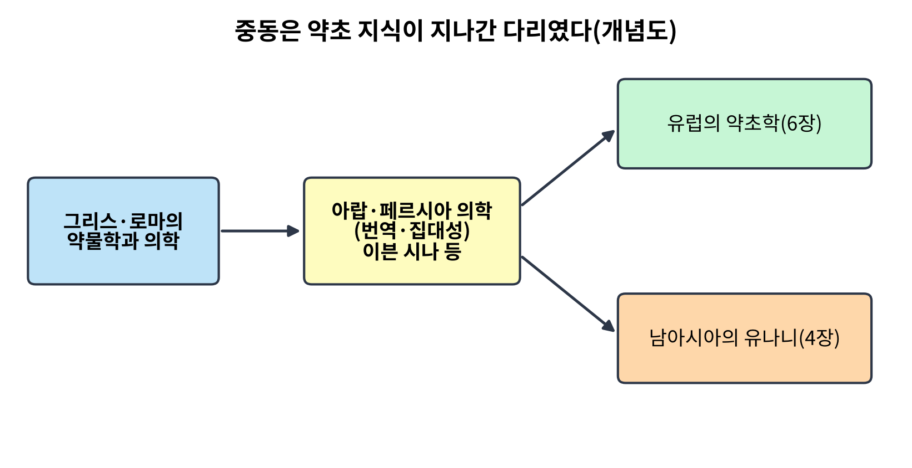
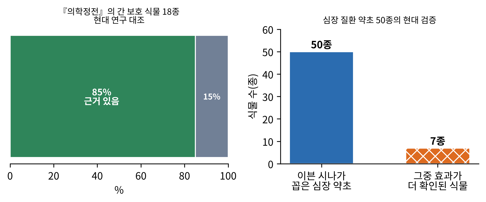
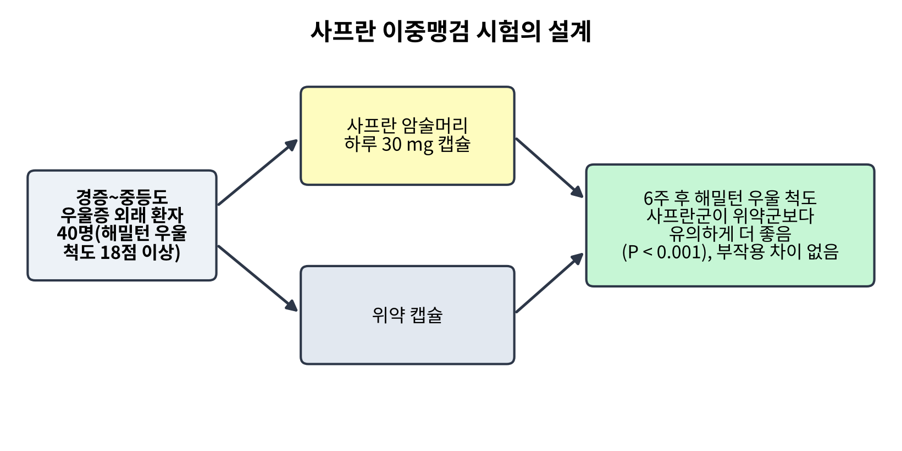
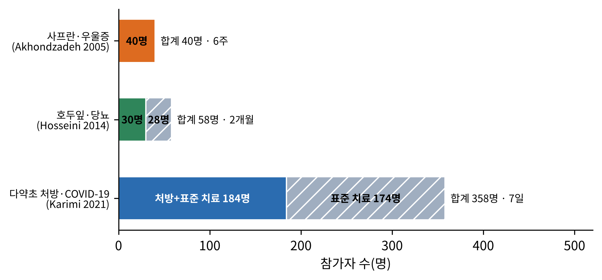
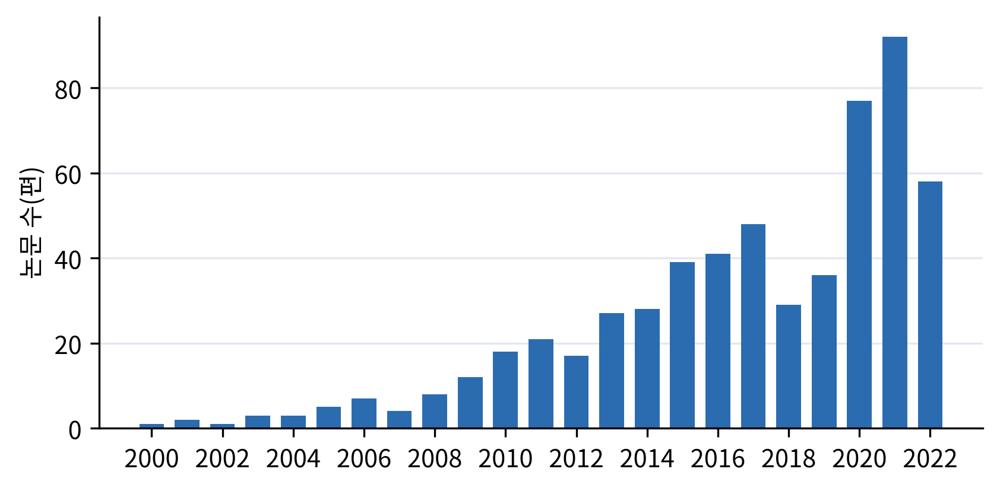
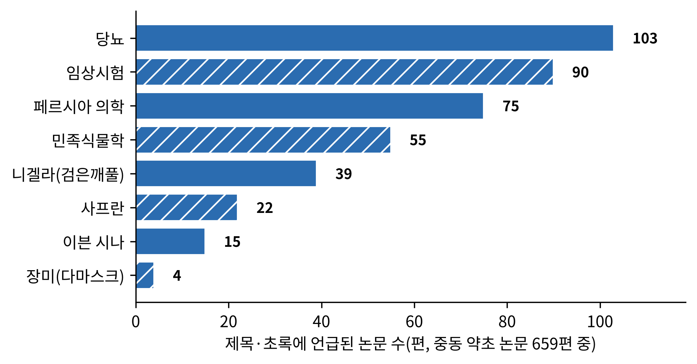

# 5장. 중동: 그리스의 유산, 아랍·페르시아의 의학

<strong>그림 5-1. 중동은 약초 지식이 지나간 다리였다(개념도).</strong> 그리스·로마의 약물학과 의학이 아랍·페르시아 의학으로 번역·집대성되었고, 이 지식이 유럽의 약초학과 남아시아의 유나니로 이어졌다. 개념을 단순화한 그림이며 실제 전달 경로는 더 복잡하다.

<ul class="mini-toc">
<li>다리가 된 땅</li>
<li>이븐 시나의 책을 현대 연구에 대조하다</li>
<li>시장의 약초는 고전의 그 풀인가</li>
<li>사프란과 우울증</li>
<li>호두잎과 복합 처방: 당뇨 시험 둘</li>
<li>다약초 처방과 COVID-19</li>
<li>약과 독의 경계</li>
<li>논문 속의 중동</li>
</ul>

## 이 장을 읽기 전에

3장과 4장에서 본 동아시아와 남아시아는 약초 지식이 한 문명 안에서 자란 곳이었다. 중동은 다르다. 이 지역은 약초 지식을 가장 많이 만들어 낸 곳이라기보다, 여러 문명의 지식을 받아 정리하고 다음 문명에 넘긴 곳이다. 그리스·로마의 약물학이 아랍어와 페르시아어로 옮겨졌고, 그것이 다시 유럽과 남아시아로 퍼졌다. 이 책이 4장에서 본 유나니의 뿌리도 이 지역에 있고, 6장에서 볼 유럽 약초학도 이곳을 거쳐 왔다.

이 장은 세 가지 질문을 다룬다. 첫째, 고전은 어떻게 현대의 눈으로 검증될 수 있는가. 이븐 시나(Ibn Sina, 서양식 이름은 아비센나)의 책에 오른 약초를 현대 연구와 대조한 연구들을 본다. 둘째, 시장에서 파는 약초가 정말 고전에 나오는 그 식물인가라는 동일성 문제를 본다. 셋째, 이 지역의 전통에서 출발한 임상시험(사프란, 호두잎, 복합 처방, 다약초 처방)이 무엇을 확인했고 무엇을 확인하지 못했는지 실험의 설계부터 따라간다.

이 책에서 한자어가 아닌 아랍어와 페르시아어 인명은 널리 쓰이는 한글 표기를 따르고, 처음 나올 때 로마자를 병기한다.

## 1. 다리가 된 땅

약초학을 크게 네 체계로 나눈 개관이 있다. 중국 약초학, 아유르베다, 서양 약초학, 그리고 전통 아랍·이슬람 의학(Traditional Arabic and Islamic Medicine, TAIM)이다. 서양 약초학은 그리스와 로마에서 유럽으로 퍼져 북미와 남미에까지 이르렀다고 설명된다(Azaizeh et al., 2008). 아랍 의학이 근대 유럽 의학의 발전에 크게 기여했고, 유럽의 원래 의학에 가장 가까운 형태의 하나로 남아 있다는 서술도 있다(Saad et al., 2005). 그림 5-1의 구조는 이런 서술을 개념도로 옮긴 것이다.

이 지역의 약초 이용은 지금도 살아 있다. 한 개관은 개발도상국 인구의 70% 이상이 보완·대체 의학 체계에 일차적으로 의존한다고 전하고, 불임, 간질, 정신 신체 질환, 우울증 같은 문제에서 전통 아랍·이슬람 의학을 첫 선택으로 삼는 사람이 많다고 적는다(Azaizeh et al., 2008). 이 수치는 개관 논문이 인용한 추정이므로 정확한 값이라기보다 규모의 감각으로 읽는 것이 맞다. 같은 개관은 효능과 안전의 문제가 병행해서 제기되고 있다고도 덧붙인다. 이 장의 뒷부분이 바로 그 두 문제를 사례로 따라간다.

## 2. 이븐 시나의 책을 현대 연구에 대조하다

중동의 가장 유명한 의학 고전은 이븐 시나가 11세기에 쓴 『의학정전(The Canon of Medicine)』이다. 이븐 시나는 그리스, 페르시아, 이슬람 의학을 아랍어로 가장 잘 모으고 분류한 사람으로 평가된다(Shamsi Baghbanan et al., 2014). 이 책을 약초 연구의 가설 창고로 쓰려는 시도가 있다. 이 절에서는 이븐 시나의 책을 현대 연구와 대조한 두 연구를 본다.

**간 보호 약초를 찾아서.** 2014년 샴시 바그바난(Hamid Shamsi Baghbanan) 등은 『의학정전』에서 간을 보호하는 약초를 가려 현대 연구와 대조했다(Shamsi Baghbanan et al., 2014). 연구의 배경은 이렇다. 간 손상은 심각한 건강 문제인데, 합성 약은 비싸고 때로는 추가 손상을 일으킨다. 한편 약초가 생물학적으로 어떤 효과를 가지는지 연구할 대상을 고르는 한 방법이 고전 의학서를 뒤지는 것이다.

연구진은 『의학정전』의 세 가지 판본을 준비하고, 식물의 학명을 확정하기 위해 세 종류의 식물학 참고서를 활용했다. 그리고 확인한 식물마다 간 보호 효과를 중심으로 현대 연구를 검색했다. 검색어는 '간 보호(hepatoprotective)'였고 범위를 제한하지 않았으며, 코크란 라이브러리, 웹 오브 사이언스, 이란 국내 데이터베이스(SID, Irandoc, IranMedex)를 조회했다. 그렇게 간 보호 식물 18종을 찾았고, 그중 85%(종, 속 또는 과 수준)는 간 보호 효과가 현대 문헌에 보고되었으며 나머지 15%는 보고가 없었다. 꽃과 열매가 가장 많이 쓰인 부분이었다.

**심장 약초 50종.** 2017년 소브하니(Zahra Sobhani) 등은 이븐 시나가 따로 쓴 『심장 약에 대한 논고』에 주목했다(Sobhani et al., 2017). 이 책은 심혈관 질환에 대한 전통 페르시아 의학의 지식을 모은 것으로, 이븐 시나는 심혈관에 작용하는 식물 50종과 그 효능을 적었다. 연구진은 과학 데이터베이스를 검색해 이 식물들의 심혈관 효과를 확인했다. 대부분의 식물에서 여러 기전을 가진 약리 효과가 확인되었고, 그중 사프란, 계피(Cinnamomum cassia), 석류, 바질, 카더멈, 레몬밤(Melissa officinalis), 암라(Phyllanthus emblica)가 더 효과적인 것으로 확인되었다고 한다. 그림 5-2는 두 연구의 결과를 나란히 보인다.

<figure class="fig">

<figcaption><strong>그림 5-2. 이븐 시나의 책 속 약초를 현대 연구와 대조한 결과.</strong> 왼쪽: 『의학정전』의 간 보호 식물 18종 가운데 현대 연구에서 간 보호 효과가 보고된 비율(85%)과 보고가 없는 비율(15%). 오른쪽: 심장 질환 약초 50종과 그중 효과가 더 확인된 7종. 출처: Shamsi Baghbanan et al. (2014), Sobhani et al. (2017).</figcaption>
</figure>

**해석과 한계.** 두 연구의 메시지는 비슷하다. 고전에 오른 약초 대부분이 현대 연구에서도 효과가 보고된다는 것이다. 그러나 이 결과를 '고전이 옳았다'는 증거로 읽을 때는 조심해야 한다. 첫째, 기준선이 없다. 아무 식물이나 무작위로 골라 '간 보호'를 검색해도 어느 정도는 보고가 나오기 마련인데, 이 연구들에는 그 비교가 없다. 85%가 높은 수치인지 낮은 수치인지는 임의 식물의 비율을 알아야 판단된다. 둘째, 현대 문헌에 '보고되었다'는 것은 세포나 동물 실험, 때로는 낮은 질의 연구를 포함하므로 사람에서 간을 보호한다는 증거가 아니다. 셋째, 많이 연구된 식물일수록 어떤 효과든 보고가 있을 가능성이 높다. 그래서 이 연구들의 가치는 고전의 정확성을 증명하는 데 있기보다, 후속 시험의 후보를 효율적으로 고르는 방법을 보여 주는 데 있다. 표 5-1은 고전을 현대 연구로 대조한 세 연구를 정리한다.

<strong>표 5-1. 페르시아 고전을 현대 연구와 대조한 세 연구</strong>

| 연구 | 고전 자료 | 방법 | 확인된 것 |
|---|---|---|---|
| 샴시 바그바난 등 (2014) | 『의학정전』 세 판본 | 식물 학명 확정 후 데이터베이스 검색 | 간 보호 식물 18종, 85%에서 현대 보고 |
| 소브하니 등 (2017) | 이븐 시나의 심장 약 논고 | 50종의 심혈관 효과 검색 | 대부분 효과 보고, 7종이 더 확인됨 |
| 하메디 등 (2013) | 중세 페르시아 문헌 | 약초 기름의 목록과 제법·용도 정리 | 31종 식물로 만든 약초 기름 51가지 |

## 3. 시장의 약초는 고전의 그 풀인가

고전을 현대 연구와 대조하는 일에는 더 근본적인 문제가 있다. 고전에 나오는 이름의 식물이 지금 시장에서 파는 그 식물이라는 보장이 있는가이다. 2006년 아자이제(Hassan Azaizeh) 등은 지중해 동부 지역의 전통 아랍 약초 의학의 현황을 체계적으로 검토했다(Azaizeh et al., 2006). 여러 조사에 따르면 이 지역에서는 약초 200~250종이 사람의 병을 고치는 데 쓰이며 시장에서 거래되는데, 일부는 희귀하거나 멸종 위기에 처한 종이다. 약초 상인과 치료사의 지식 수준은 문제로 지적되었다. 약초가 병의 근본 원인에 대한 이해 없이 증상만 보고 처방되는 경우가 많다는 것이다. 더 중요한 점은 오늘날 쓰이는 약초가 옛 문헌에 기술된 식물과 일치하지 않을 수 있다는 지적이다. 수 세기에 걸쳐 서로 다른 육종 과정을 거쳐 재배된 식물이기 때문이다.

이것은 3장의 청호와 황화호의 구별 문제와 같은 종류의 문제이다. 같은 이름이 시대와 지역에 따라 다른 식물을 가리킬 수 있고, 같은 식물도 재배 과정에서 성분이 달라질 수 있다. 앞 절의 대조 연구들도 이 문제에서 자유롭지 않다. 학명 확정은 식물학 참고서에 의존한 해석이고, 고전의 약초가 지금의 그 종이라는 가정 위에 서 있다.

이 지역의 고전은 약초의 제형에서도 정보를 준다. 하메디(Azadeh Hamedi) 등은 3천 년 이상의 역사를 가진 이란의 약초 기름을 연구했다(Hamedi et al., 2013). 고대와 중세 페르시아 문헌에서 약초 기름의 목록과 제법, 임상 용도를 모으고, 같은 식물의 현대 연구 결과와 비교했다. 중세 페르시아 문헌에서 식물 31종으로 만든 약초 기름 51가지가 확인되었고, 꽃, 열매, 잎이 가장 많이 쓰였다. 기름은 소화기 질환에는 먹고, 근골격계에는 바르고, 신경계에는 코로 넣는 식으로 투여 경로가 질환마다 달랐다. 약초를 달이거나 가루로 먹는 방식 말고 기름이라는 제형이 전통의 한 갈래였음을 보여 준다.

## 4. 사프란과 우울증

이제 이 지역의 전통에서 출발한 임상시험을 본다. 사프란(Crocus sativus)은 이란에서 가장 귀한 약초이자 향신료이다. 한 개관은 사프란이 3천 년 이상 전부터 여러 민족에게 알려져 식품 향료, 염료, 향수, 약초로 쓰였다고 정리한다(Mousavi & Bathaie, 2011). 용도는 눈병에서 비뇨생식기 질환까지 넓고, 강장제와 항우울제로도 쓰였다. 페르시아 전통 의학에서 사프란은 우울증에 쓰인다.

2005년 아콘드자데(Shahin Akhondzadeh) 등은 이 전통을 현대의 방법으로 시험한 논문 「경증~중등도 우울증 치료에서 사프란(Crocus sativus L.): 이중맹검 무작위 위약 대조 시험」을 실었다(Akhondzadeh et al., 2005).

**연구의 배경.** 우울증은 현대 사회의 심각한 장애로, 일부 선진국에서는 평생 유병률이 21%에 이르는 것으로 추정된다. 연구진의 질문은 전통에서 우울증에 쓰던 사프란의 암술머리가 경증에서 중등도의 우울증에 실제로 효과가 있는가였다. 이들은 앞서 2004년에 사프란과 이미프라민(imipramine, 전통적인 항우울제)을 비교하는 예비 이중맹검 시험을 한 바 있다(Akhondzadeh et al., 2004).

**연구의 설계.** 그림 5-3과 같이 정신 질환 진단·통계 편람 4판(DSM-IV) 기준의 주요 우울증으로 진단된 성인 외래 환자 40명이 참여했다. 해밀턴 우울 척도(Hamilton rating scale for depression) 기준점이 18점 이상이어야 했다. 환자를 무작위로 두 군으로 나누어 한 군에는 사프란 30 mg을 하루에 나누어 먹는 캡슐을, 다른 군에는 위약 캡슐을 6주 동안 주었다. 이중맹검이며 한 병원에서 진행한 시험이다.

<figure class="fig">

<figcaption><strong>그림 5-3. 사프란 이중맹검 시험의 설계와 결과.</strong> 우울증 외래 환자 40명을 사프란 캡슐군과 위약군으로 무작위 배정하고 6주 뒤 해밀턴 우울 척도로 비교했다. 출처: Akhondzadeh et al. (2005).</figcaption>
</figure>

**검출된 것.** 6주 뒤 해밀턴 우울 척도에서 사프란군이 위약군보다 유의하게 더 좋았다(자유도 1, F = 18.89, P < 0.001). 부작용을 보인 정도는 두 군 사이에 의미 있는 차이가 없었다.

**해석과 한계.** 연구진은 이 결과가 경증~중등도 우울증에서 사프란의 효능을 나타낸다고 결론지으면서, 같은 문장 끝에 '대규모 시험이 필요하다'고 적었다. 이 단서가 핵심이다. 40명은 작은 표본이고, 한 곳에서 6주만 관찰했으며, 중증 환자는 포함되지 않았다. 효과의 크기와 지속성, 다른 항우울제와의 비교는 이 시험으로 알 수 없다. 그리고 이 시험은 전통이 말하는 '우울증'과 DSM-IV의 '주요 우울증'이 같은 상태라는 가정 위에 서 있다. 전통의 개념을 현대의 진단으로 번역하는 문제는 3장의 인삼과 4장의 아슈와간다에서도 본 것이다. 그럼에도 설계가 위약 대조와 이중맹검을 갖춘 시험이라 효과의 가능성을 보여 주는 증거로서 의미가 있다.

## 5. 호두잎과 복합 처방: 당뇨 시험 둘

이란의 연구진은 당뇨에서도 전통 약초를 시험했다. 두 시험이 같은 질병에서 서로 다른 접근을 보여 준다.

2014년 호세이니(Saeed Hosseini) 등은 호두나무(Juglans regia) 잎 물 추출물을 제2형 당뇨병 환자에게 처음으로 시험했다(Hosseini et al., 2014). 호두잎은 이란 전통에서 당뇨에 써 온 식물이고 동물 실험은 있었으나 사람에서의 연구가 없었다. 이란 남녀 환자 58명을 무작위로 호두잎 추출물군(30명)과 위약군(28명)으로 나누어 2개월 동안 투여하고, 당화혈색소와 공복 혈당을 주된 지표로, 인슐린과 간기능 지표(SGOT, SGPT, ALP)를 부차 지표로 쟀다. 호두잎군은 공복 당화혈색소와 혈당이 유의하게 낮아졌고 인슐린은 높아졌다.

2017년 칼릴리(Nahid Khalili) 등은 한 가지가 아니라 세 약초를 섞은 복합 처방을 시험했다(Khalili et al., 2017). 이란의 당뇨 환자들이 전통적으로 쓰는 엉겅퀴(Silybum marianum, 밀크시슬) 씨, 쐐기풀(Urtica dioica) 잎, 유향(Boswellia serrata) 수지이다. 공복 혈당 150~180 mg/dL, 당화혈색소 7.5~8.5%이고 경구 혈당 강하제를 쓰고 있는 환자 60명을 무작위 이중맹검으로 복합 처방군과 위약군에 배정해 90일 동안 투여했다. 3개월 뒤 처방군의 평균 공복 혈당, 당화혈색소, 중성지방은 위약군보다 유의하게 낮았지만 콜레스테롤과 혈압은 차이가 없었다.

두 시험을 나란히 보면 3장에서 본 단일 약초 대 처방의 구분이 이 지역에서도 나타난다. 다만 이 장의 근거는 초록이므로 구체적인 효과의 크기, 통계 수치, 표본 배정 방법 같은 세부는 확인하지 못했다. 그림 5-4는 이 장에서 다루는 세 임상시험의 규모를 비교하고, 표 5-2는 설계를 정리한다. 시험 규모가 작고 기간이 짧다는 점, 현재 쓰는 혈당 강하제 위에 더한 효과가 어떤지가 확인되지 않았다는 점이 공통의 한계이다.

## 6. 다약초 처방과 COVID-19

세 번째 시험은 규모가 크고 방식이 다르다. 2021년 카리미(Mehrdad Karimi) 등은 『식물치료 연구(Phytotherapy Research)』에 입원한 코로나19 환자에게 전통 페르시아 의학의 약초 처방을 더한 시험을 실었다(Karimi et al., 2021).

**연구의 설계.** 테헤란과 이스파한 주의 5개 병원에서 입원한 성인 환자 358명을 무작위로 나누었다. 174명은 표준 치료만 받았고 184명은 표준 치료에 더해 다약초 달임을 8시간마다, 약초 캡슐 두 알을 12시간마다 7일 동안 받았다. 주된 지표는 입원 기간이고 부차 지표는 환자 자가 평가 설문으로 본 증상 호전이었다. 눈여겨볼 점은 위약을 쓰지 않은 공개(open-label) 시험이라는 것이다. 환자와 의료진 모두 누가 약초를 받는지 알았다.

<figure class="fig">

<figcaption><strong>그림 5-4. 이 장의 세 임상시험의 규모와 기간.</strong> 사프란 시험(40명, 6주), 호두잎 시험(58명, 2개월), 다약초 처방 시험(358명, 7일). 사프란 시험은 군별 인원이 초록에 없어 합계만 표시했다. 출처: Akhondzadeh et al. (2005), Hosseini et al. (2014), Karimi et al. (2021).</figcaption>
</figure>

<strong>표 5-2. 이 장의 네 임상시험 설계 비교</strong>

| 시험 | 대상 | 규모·기간 | 맹검 | 비교 |
|---|---|---|---|---|
| 사프란·우울증 (2005) | 경증~중등도 우울증 외래 환자 | 40명, 6주 | 이중맹검 | 위약 |
| 호두잎·당뇨 (2014) | 제2형 당뇨 환자 | 58명, 2개월 | 무작위(맹검 여부는 초록에 불명) | 위약 |
| 복합 처방·당뇨 (2017) | 약물 치료 중인 제2형 당뇨 환자 | 60명, 90일 | 이중맹검 | 위약 |
| 다약초 처방·COVID-19 (2021) | 입원 성인 환자 | 358명, 7일 | 공개 | 표준 치료 |

**검출된 것.** 초록은 약초 처방을 더한 군에서 입원 기간(또는 호흡곤란의 지속 기간)이 3.291일 대 6.468일로 짧아졌고 증상 호전이 빨랐다고 보고했다. 초록의 문장이 입원 기간과 호흡곤란 기간 중 어느 것을 말하는지 분명하지 않아, 이 장은 해당 수치의 지표를 확정하지 않는다. 마른기침, 호흡곤란, 근육통, 두통, 피로, 식욕 부진, 오한, 콧물, 가래, 어지러움 같은 증상이 처치군에서 더 줄었다는 것이 보고되었다. 허용 가능한 내약성이었다고 한다.

**해석과 한계.** 이 결과를 읽을 때는 설계의 한계를 먼저 본다. 공개 시험에서는 처방을 받는 환자가 호전을 기대하기 쉽고, 특히 부차 지표가 환자 자가 평가 설문이라 이 기대의 영향을 받는다. 위약이 없어 '약초를 먹었다는 사실' 자체의 효과와 약초 성분의 효과를 구분할 수 없다. 또 군 사이 차이가 두 배 가까이 되는 큰 효과가 보고되었는데, 이는 설계의 한계를 감안하면 더 신중히 읽어야 하는 값이다. 결과는 큰 표본의 무작위 시험이라는 점에서 이전 두 시험보다 무게가 있으나, 맹검이 되지 않았다는 점이 그 무게를 줄인다. 연구진은 이 결과가 '유망하다'고 했지만, 이 장은 그보다 한 걸음 물러서서 이 시험을 효과를 시사하는 증거로, 맹검 시험으로 확인해야 할 가설로 읽는다. 표 5-3은 이 장의 시험들이 답할 수 있는 것을 정리한다.

<strong>표 5-3. 이 장의 연구들이 답할 수 있는 것</strong>

| 연구 | 설계 | 확인된 것 | 확인되지 않은 것 |
|---|---|---|---|
| 의학정전 대조 (2014) | 문헌 대조 | 고전 속 식물의 다수가 현대 보고와 일치 | 임의 식물의 기준선, 사람에서의 효과 |
| 사프란 (2005) | 이중맹검 시험, 40명 | 위약보다 나은 우울 점수 | 중증, 장기 효과, 대규모 재현 |
| 호두잎·복합 처방 (2014, 2017) | 무작위 시험, 58·60명 | 혈당 지표 개선 | 효과의 크기, 장기 안전성 |
| 다약초 처방 (2021) | 공개 무작위 시험, 358명 | 증상 호전의 가능성 | 맹검 하의 효과, 개별 약초의 기여 |

## 7. 약과 독의 경계

전통 약초가 안전하다는 믿음은 어디에나 있다. 2006년 사아드(Bashar Saad) 등은 『전통 아랍 약초 의학의 안전성』을 체계적으로 검토했다(Saad et al., 2006). 이 논문의 출발은 오래된 원칙이다. 많은 약초와 약이 어떤 용량에서는 치료가 되고 다른 용량에서는 독이 된다. 지중해 지역과 전 세계에서 전통 약이 인기를 얻으면서 이와 관련된 독성이 점점 더 알려지고 있고, 약초의 독성 보고 가운데에는 간독성이 가장 많으며 신장, 신경계, 혈액, 심혈관, 피부 독성과 돌연변이 유발, 발암성 보고도 있다. 이 논문은 아랍 학자들이 독성학에 기여한 바를 정리하고, 세포·생화학·시험관·동물 실험 같은 현대 방법으로 약초의 안전성을 평가하는 방법도 논의한다.

이 논문이 전하는 것은 두 가지이다. 하나는 안전에 대한 고민이 아랍 전통에서도 오래된 주제였다는 점이다. 이 책이 3장의 신농본초경의 상·중·하품 분류에서 이미 본 질문이기도 하다. 다른 하나는 '자연의 것이니 안전하다'는 믿음이 틀렸다는 점이다. 이 문제는 12장(안전성)의 중심 주제이다.

## 8. 니겔라: 한 씨앗에 모인 기대

중동의 약초 중 가장 넓은 효능이 기대되는 것의 하나가 니겔라 사티바(Nigella sativa, 검은깨풀 또는 블랙 커민)의 씨앗이다. 2019년의 한 개관은 이 씨앗과 주성분 티모퀴논(thymoquinone)이 신경·정신 질환, 심혈관 질환, 암, 당뇨, 염증, 불임, 세균·진균·기생충·바이러스 감염 등 여러 질병에 효과가 있다는 연구를 정리하고, 연구가 제한적인데도 HIV/AIDS 치료의 대안으로 탐구할 가능성이 있다고까지 적는다(Yimer et al., 2019). 이처럼 한 식물이 거의 모든 질병에 효과를 보이는 것으로 보고될 때는 경계가 필요하다. 연구가 시험관과 동물 수준에 머무는 경우가 많고, 효과를 보고한 연구가 더 잘 출간되는 경향 때문에 효과가 부풀려질 수 있다. 이 개관 자체가 '제한된 연구'라는 단서를 스스로 달고 있다. 이 책은 이런 '만병통치' 식의 서술을 사실로 옮기지 않는다.

## 9. 논문 속의 중동

이 책이 모은 논문 자료에서 중동은 659편이다. 그림 5-5는 이 논문들의 출간 연도별 편수를 보이고, 그림 5-6은 제목과 초록에 나온 주제어를 센 결과이다.

<figure class="fig">

<figcaption><strong>그림 5-5. 중동 약초 논문의 연도별 편수(2000~2022년).</strong> 이 책의 논문 자료에서 중동으로 분류된 659편을 출간 연도별로 센 값이다. 2023년 이후는 자료 수집 시점의 영향으로 불완전하여 제외했다.</figcaption>
</figure>

<figure class="fig">

<figcaption><strong>그림 5-6. 중동 약초 논문(659편)에서 주제어가 언급된 논문 수.</strong> 제목·초록에 해당 단어가 있는 논문을 센 값이다. 한 논문이 여러 주제어를 가질 수 있어 합계는 전체 편수와 다르며, 연구의 비중을 정밀하게 나타내는 것이 아니라 대략의 경향을 보여 준다.</figcaption>
</figure>

연도별 편수는 2000년대 초에 한 자릿수이던 것이 2010년대에 수십 편으로, 2020년대 초에는 70~90편으로 늘었다. 주제어에서는 당뇨(103편)와 임상시험(90편)이 가장 많고, 페르시아 의학(75편), 민족식물학(55편), 니겔라(39편), 사프란(22편), 이븐 시나(15편)가 이어진다. 당뇨가 가장 많다는 것은 이 지역 연구가 대사 질환에 쏠려 있음을 시사하고, 임상시험이 둘째라는 것은 이 장의 사례들이 전형적인 경향임을 보여 준다. 다만 '임상시험'이나 '무작위'라는 단어가 초록에 나왔다고 해서 모두 임상시험 보고는 아니며, 이 숫자는 단어의 철자로 센 값이라 같은 개념의 다른 표기를 놓칠 수 있다.

## 이 장을 마치며

5장에서 확인한 것을 정리한다. 첫째, 중동은 그리스·로마의 약물학을 받아 정리하고 유럽과 남아시아에 넘긴 다리였다. 둘째, 이븐 시나의 책 속 약초를 현대 연구와 대조한 결과 다수가 일치하지만, 기준선이 없어 고전의 정확성을 증명한 것은 아니다. 셋째, 고전의 이름과 오늘날 시장의 식물이 일치하는지가 문제이며, 이는 어느 대조 연구의 전제이기도 하다. 넷째, 사프란은 위약 대조 이중맹검 시험에서 우울 점수를 낮추었으나 표본이 작아 대규모 시험이 필요하다. 다섯째, 호두잎과 복합 처방의 당뇨 시험은 혈당 지표 개선을 보였으나 효과의 크기와 장기 안전성은 불명하다. 여섯째, 다약초 처방의 COVID-19 시험은 큰 표본이지만 공개 시험이라 맹검 하의 확인이 필요하다. 일곱째, 전통 약초도 용량에 따라 독이 되며 간독성 보고가 가장 많다.

3부의 다음은 6장, 유럽이다. 그리스에서 시작해 중동을 거쳐 돌아온 지식이 수도원과 약국을 거쳐 현대 식물 요법(phytotherapy)이 되는 이야기를 다룬다.

## 참고문헌

- Akhondzadeh, S., Fallah-Pour, H., Afkham, K., Jamshidi, A. H., & Khalighi-Sigaroodi, F. (2004). Comparison of *Crocus sativus* L. and imipramine in the treatment of mild to moderate depression: A pilot double-blind randomized trial [ISRCTN45683816]. *BMC Complementary and Alternative Medicine, 4*, Article 12. https://doi.org/10.1186/1472-6882-4-12
- Akhondzadeh, S., Tahmacebi-Pour, N., Noorbala, A.-A., Amini, H., Fallah-Pour, H., Jamshidi, A. H., & Khani, M. (2005). *Crocus sativus* L. in the treatment of mild to moderate depression: A double-blind, randomized and placebo-controlled trial. *Phytotherapy Research, 19*(2), 148–151. https://doi.org/10.1002/ptr.1647
- Azaizeh, H., Saad, B., Cooper, E., & Said, O. (2008). Traditional Arabic and Islamic medicine, a re-emerging health aid. *Evidence-Based Complementary and Alternative Medicine, 7*(4), 419–424. https://doi.org/10.1093/ecam/nen039
- Azaizeh, H., Saad, B., Khalil, K., & Said, O. (2006). The state of the art of traditional Arab herbal medicine in the Eastern region of the Mediterranean: A review. *Evidence-Based Complementary and Alternative Medicine, 3*(2), 229–235. https://doi.org/10.1093/ecam/nel034
- Hamedi, A., Zarshenas, M. M., Sohrabpour, M., & Zargaran, A. (2013). Herbal medicinal oils in traditional Persian medicine. *Pharmaceutical Biology, 51*(9), 1208–1218. https://doi.org/10.3109/13880209.2013.777462
- Hosseini, S., Huseini, H. F., Larijani, B., Mohammad, K., Najmizadeh, A., Nourijelyani, K., & Jamshidi, L. (2014). The hypoglycemic effect of *Juglans regia* leaves aqueous extract in diabetic patients: A first human trial. *DARU Journal of Pharmaceutical Sciences, 22*, Article 19. https://doi.org/10.1186/2008-2231-22-19
- Karimi, M., Zarei, A., Soleymani, S., Jamalimoghadamsiahkali, S., Asadi, A., Shati, M., Jafari, M., Rezadoost, H., Kordafshar, G., Naghizadeh, A., Mardi, R., Namiranian, P., Khamechi, S. P., Ansari, N., Adel-Mehraban, M. S., Aliakbarzadeh, H., Khanavi, M., Esmaealzadeh, N., Moravveji, A., . . . Eghbalian, F. (2021). Efficacy of Persian medicine herbal formulations (capsules and decoction) compared to standard care in patients with COVID-19, a multicenter open-labeled, randomized, controlled clinical trial. *Phytotherapy Research, 35*(11), 6295–6309. https://doi.org/10.1002/ptr.7277
- Khalili, N., Fereydoonzadeh, R., Mohtashami, R., Mehrzadi, S., Heydari, M., & Huseini, H. F. (2017). Silymarin, olibanum, and nettle, a mixed herbal formulation in the treatment of type II diabetes: A randomized, double-blind, placebo-controlled, clinical trial. *Journal of Evidence-Based Complementary & Alternative Medicine, 22*(4), 603–608. https://doi.org/10.1177/2156587217696929
- Mousavi, S. Z., & Bathaie, S. Z. (2011). Historical uses of saffron: Identifying potential new avenues for modern research. *Avicenna Journal of Phytomedicine, 1*(2), 57–66.
- Saad, B., Azaizeh, H., & Said, O. (2005). Tradition and perspectives of Arab herbal medicine: A review. *Evidence-Based Complementary and Alternative Medicine, 2*(4), 475–479. https://doi.org/10.1093/ecam/neh133
- Saad, B., Azaizeh, H., Abu-Hijleh, G., & Said, O. (2006). Safety of traditional Arab herbal medicine. *Evidence-Based Complementary and Alternative Medicine, 3*(4), 433–439. https://doi.org/10.1093/ecam/nel058
- Shamsi Baghbanan, H., Sharifian, A., Esmaeili, S., & Minaei, B. (2014). Hepatoprotective herbs, Avicenna viewpoint. *Iranian Red Crescent Medical Journal, 16*(1), Article e12313. https://doi.org/10.5812/ircmj.12313
- Sobhani, Z., Nami, S. R., Emami, S. A., Sahebkar, A., & Javadi, B. (2017). Medicinal plants targeting cardiovascular diseases in view of Avicenna. *Current Pharmaceutical Design, 23*(16), 2428–2443. https://doi.org/10.2174/1381612823666170215104101
- Yimer, E. M., Tuem, K. B., Karim, A., Ur-Rehman, N., & Anwar, F. (2019). *Nigella sativa* L. (black cumin): A promising natural remedy for wide range of illnesses. *Evidence-Based Complementary and Alternative Medicine, 2019*, Article 1528635. https://doi.org/10.1155/2019/1528635
