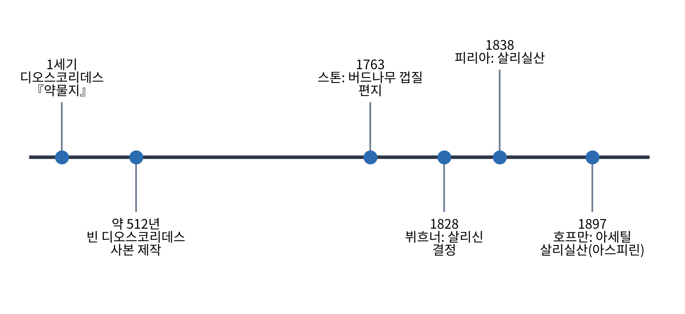
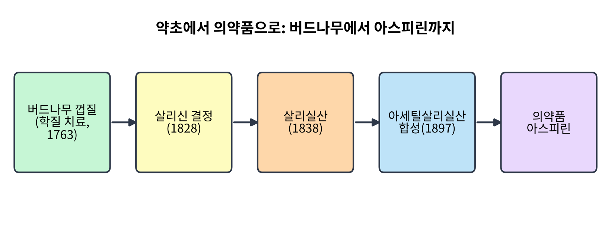
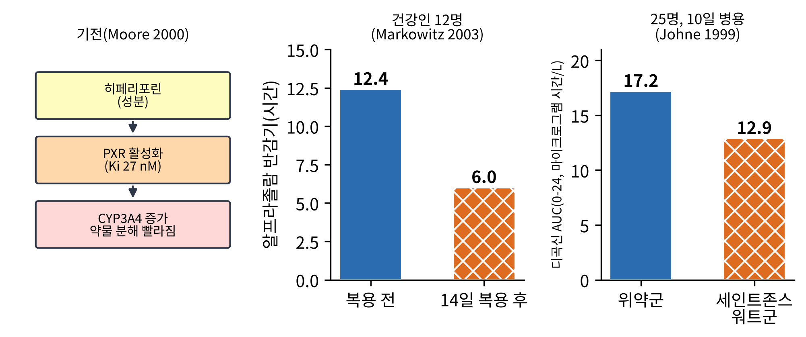
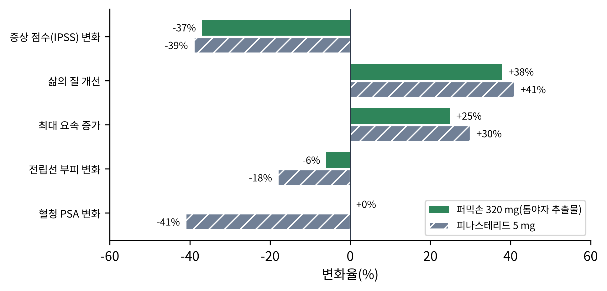
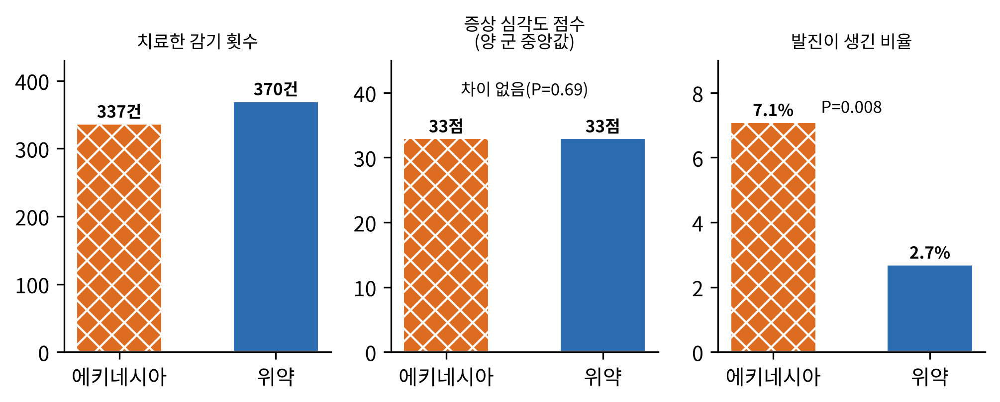
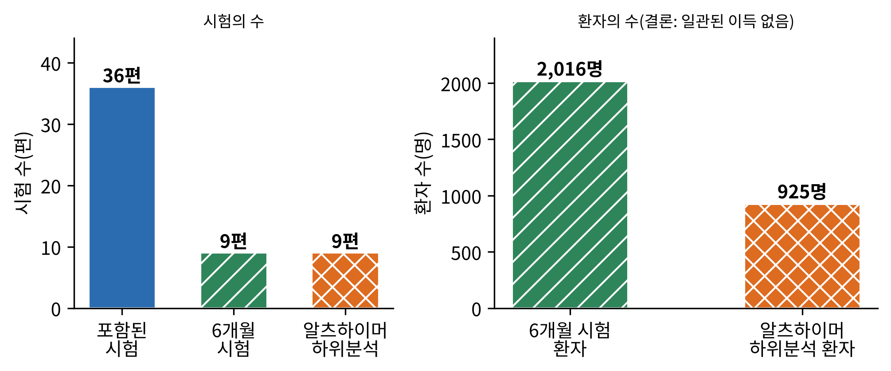
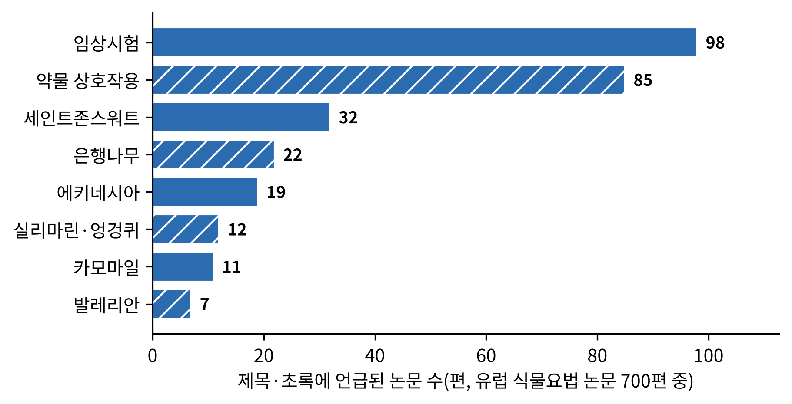

# 6장. 유럽: 수도원의 약초원에서 표준화 추출물까지

<strong>그림 6-1. 유럽 약초학의 주요 이정표.</strong> 1세기의 약물서에서 1897년의 아스피린 합성까지, 이 장에서 따라가는 사건을 연대순으로 놓았다. 연도 사이의 간격은 실제 시간 간격이 아니라 가독성을 위해 조정했다.

<ul class="mini-toc">
<li>고대의 약물서에서 근대 약학까지</li>
<li>버드나무 껍질에서 아스피린까지</li>
<li>약초가 약이 되는 길: 표준화 추출물과 모노그래프</li>
<li>세인트존스워트: 약초가 다른 약의 운명을 바꾸다</li>
<li>톱야자 추출물과 피나스테리드</li>
<li>에키네시아: 어른의 기대, 어린이의 시험</li>
<li>은행나무: 가장 많이 시험된 약초가 보여 준 한계</li>
<li>작은 시험과 복합 제제</li>
<li>제도: 전통 사용 등록</li>
<li>논문 속의 유럽</li>
</ul>

## 이 장을 읽기 전에

앞의 세 장은 문명 안에서 자란 약초 체계를 보았다. 유럽은 조금 다른 이야기를 한다. 유럽에는 이 책이 다룬 지역 가운데 가장 이른 시기에 약초를 화학과 약리학의 언어로 번역한 역사가 있다. 버드나무 껍질이 아스피린이 된 길이 그 대표 사례이다. 그리고 그 길의 반대편에는 약초를 분자 하나로 줄이지 않고 추출물 전체로 시험하려는 현대 식물요법(phytotherapy)이 있다.

이 장은 두 가지를 한다. 먼저 고대의 약물서와 근대 약학이 만나는 줄기를 짧게 훑는다. 그다음, 유럽 식물요법의 대표 약초 몇 가지를 골라 대표 논문의 실험 설계와 결과를 따라간다. 세인트존스워트(St. John's wort, Hypericum perforatum)는 다른 약의 효과를 바꾼다는 점에서, 톱야자 추출물은 표준 약과 직접 비교한 시험이라는 점에서, 에키네시아(Echinacea)는 어린이 시험에서 효과가 확인되지 않았다는 점에서, 은행나무(Ginkgo biloba)는 가장 많이 시험된 약초 가운데 하나가 어떤 한계를 보였는지를 보여 주기 때문에 골랐다. 이 장의 논문 정보는 모두 저자가 확인한 초록에 근거하며, 초록으로 확인되지 않은 세부는 적지 않았다.

## 1. 고대의 약물서에서 근대 약학까지

유럽 약초학의 가장 오래된 뿌리는 1세기 그리스인 의사 페다니오스 디오스코리데스(Pedanius Dioscorides)가 쓴 『약물지(De materia medica)』이다. 이 책은 약재를 식물별로 정리했고, 중동을 거쳐 유럽에 전해진 약초 지식의 중심에 있었다. 5장에서 본 그리스·로마에서 아랍·페르시아로 넘어간 지식 가운데 상당 부분이 이 계통이다.

이 책의 가장 유명한 사본은 지금 오스트리아 국립도서관에 있는 「빈 디오스코리데스(Vienna Dioscurides)」이다. 6세기 초(약 512~515년) 콘스탄티노폴리스에서 비잔틴의 공주 아니키아 율리아나(Anicia Juliana)를 위해 만들어졌다고 설명되며, 현재 남은 것은 491장의 양피지이고 식물 그림은 원래 435점 가운데 383점이 전해진다(Wikipedia contributors, n.d.-b). 사본 하나에 식물 그림이 이만큼 실렸다는 사실은, 약초의 이름과 모양을 맞추는 문제, 곧 5장에서 본 동일성 문제가 이미 그 시기에도 중요했음을 짐작하게 한다. 다만 이 연결은 저자의 해석이며 인용한 자료가 직접 말하는 것은 아니다.

그 뒤 약초 지식은 수도원의 약초원과 약방을 거쳐 이어졌다. 이 시기의 구체적인 저술과 연도는 이 책의 근거 자료에서 확인하지 못했으므로 여기서는 이름을 열거하지 않는다. 확인된 자료로 이야기할 수 있는 다음 큰 전환은 18~19세기이다.

## 2. 버드나무 껍질에서 아스피린까지

1763년 영국의 성직자 에드워드 스톤(Edward Stone)이 왕립학회에 편지를 보냈다. 흰 버드나무 껍질 가루가 간헐열, 곧 학질(ague) 환자를 낫게 한다는 내용이었다. 스톤은 1758년에 이 껍질의 맛을 보았고, 이후 5년 동안 학질 환자 50명가량을 치료했다고 한다(Wikipedia contributors, n.d.-a).

이 이야기는 이 장의 첫 번째 이정표이다. 한 성직자의 관찰이 약초의 약효 후보를 만들었고, 그다음 단계는 화학자들의 몫이었다. 1828년 요한 뷔흐너(Johann Buchner)가 버드나무 껍질에서 비교적 순수한 살리신(salicin) 결정을 얻었고, 1829년 피에르 조제프 르루(Pierre-Joseph Leroux)가 다른 추출법을 개발했다. 1838년에는 라파엘레 피리아(Raffaele Piria)가 살리신에서 더 강한 산 형태를 얻어 살리실산(salicylic acid)이라 불렀다. 그리고 1897년 바이엘(Bayer)의 펠릭스 호프만(Felix Hoffmann)이 살리실산을 아세트산 무수물과 반응시켜 아세틸살리실산(acetylsalicylic acid)을 합성했다(Wikipedia contributors, n.d.-a).

<figure class="fig">

<figcaption><strong>그림 6-2. 버드나무 껍질에서 아스피린까지의 길.</strong> 약초의 사용 관찰(1763)에서 분리된 성분(1828), 개량된 분자(1838), 합성 약(1897)으로 이어지는 단계를 단순화했다.</figcaption>
</figure>

그림 6-2가 보여 주는 단계 구분은 이 책의 뒤쪽 장들(10장 약리학, 13장 표준화와 약전)에서 계속 쓰인다. 사용의 관찰, 활성 성분의 분리, 분자의 개량이라는 세 단계가 약초에서 약으로 가는 하나의 모델이기 때문이다. 이 모델이 유일한 길은 아니라는 점이 이 장의 나머지 절의 주제이다. 유럽 식물요법은 분자 하나를 뽑아내는 대신 추출물 전체를 약으로 삼는 다른 길을 걸었다.

<strong>표 6-1. 유럽 약초학에서 약학으로 가는 연표(이 장에서 확인한 사건)</strong>

| 연도 | 사건 | 의미 |
|---|---|---|
| 1세기 | 디오스코리데스 『약물지』 | 식물별 약재 정리의 원형 |
| 약 512~515년 | 빈 디오스코리데스 사본 제작 | 약초 그림이 실린 대표 사본 |
| 1763년 | 스톤의 버드나무 껍질 편지 | 약초 사용 관찰의 보고 |
| 1828년 | 뷔흐너의 살리신 결정 | 활성 성분 후보의 분리 |
| 1838년 | 피리아의 살리실산 | 분자의 개량 |
| 1897년 | 호프만의 아세틸살리실산 | 합성 의약품 |
| 1999년 | 독일 위원회 E 모노그래프 영문판 | 약초의 효능·안전 평가를 모은 책 |
| 2004년 | EU 지침 2004/24/EC | 전통 약초 의약품 간이 등록 |

## 3. 약초가 약이 되는 길: 표준화 추출물과 모노그래프

유럽 식물요법이 분자 하나가 아니라 추출물을 약으로 삼는다는 말은 정확히 무슨 뜻일까. 에페르트(Thomas Efferth)와 코흐(Egon Koch)는 2010년의 개관에서 그 논리를 이렇게 설명한다. 약초의 치료 효과는 여러 성분의 혼합물이 함께 작용하는 데서 나오며, 성분 사이에 상승 또는 길항 작용이 있을 수 있다. 상호작용의 기전으로는 생체이용률, 세포막 수송 과정에의 간섭, 전구약물의 활성화나 활성 성분의 비활성 대사체로의 전환, 같은 신호 전달 경로의 여러 지점에서의 동시 작용(다중 표적), 표적 단백질 결합의 억제 등이 꼽힌다. 그리고 이런 상승 효과를 풀어내는 데 오믹스(-omics)와 시스템 생물학이 도움이 될 수 있다고 한다(Efferth & Koch, 2010). 이 설명은 개관 논문의 가설적 틀이며, 개별 약초에서 그 기전이 모두 입증되었다는 뜻은 아니다.

이런 접근에서는 추출물의 품질이 곧 약의 정체성이므로 품질 관리와 평가의 틀이 필요하다. 독일 연방 보건 당국 산하의 전문가 위원회인 위원회 E(Commission E)가 펴낸 모노그래프 380편을 영어로 옮긴 책 『The Complete German Commission E Monographs』가 1998년 미국 식물학회(American Botanical Council)에서 나왔고, 한 서평은 이를 약초 의약품의 안전과 효능을 평가한 공식적이고 동료 심사를 거친 안내서로 소개한다(Nathan & Scholten, 1999). 이 한 줄이 유럽 식물요법의 제도적 성격을 잘 보여 준다. 약초는 전승이 아니라 항목별 평가의 대상이 되었다.

## 4. 세인트존스워트: 약초가 다른 약의 운명을 바꾸다

세인트존스워트는 우울증 치료에 널리 쓰이는 유럽의 약초이다. 이 약초의 임상 연구에서 가장 영향이 큰 발견은 우울증에 효과가 있다는 것이 아니라, 다른 약의 대사를 바꾼다는 것이었다. 이 절에서는 세 편의 논문을 한 줄로 이어 읽는다. 순서는 기전, 사람에서의 효과 크기, 다른 약에서의 확인이다.

**기전: 히페리포린은 PXR에 결합한다.** 2000년 무어(Linda Moore) 등은 이 약초의 성분인 히페리포린(hyperforin)이 프레그난 X 수용체(pregnane X receptor, PXR)의 강력한 리간드(Ki = 27 nM)임을 보였다. PXR은 약물 대사 효소 CYP3A4의 발현을 조절하는 핵 수용체이다. 사람 일차 간세포를 이 약초 추출물이나 히페리포린으로 처리하자 CYP3A4 발현이 뚜렷하게 늘었다. CYP3A4는 모든 약의 50% 넘는 것의 산화 대사에 관여하므로, 연구진은 이 약초가 이미 알려진 것보다 더 많은 약과 상호작용할 가능성이 있다고 결론 내렸다(Moore et al., 2000).

**효과 크기: 알프라졸람의 반감기가 반으로 줄었다.** 2003년 마코위츠(John Markowitz) 등은 건강한 자원자 12명(남 6, 여 6, 22~38세)에게 세인트존스워트 300 mg 정제를 하루 3회, 14일간 복용하게 했다. 설계는 개방 교차 시험이며 치료 순서가 고정되어 있었다. CYP3A4의 활성은 알프라졸람(alprazolam)의 약동학으로, CYP2D6의 활성은 덱스트로메토르판의 소변 대사체 비로 가늠했다. 결과, 알프라졸람 혈장 농도-시간 곡선 아래 면적(AUC)이 약 2배 줄고(P<.001) 청소율이 2배 늘었으며, 반감기는 평균 12.4시간에서 6.0시간으로 짧아졌다(P<.001). 반면 CYP2D6 지표는 유의하게 변하지 않았다(P=.26). 연구진은 장기 복용이 CYP3A4 기질 약물의 효과를 낮추거나 필요 용량을 늘릴 수 있다고 해석했다(Markowitz et al., 2003).

**다른 약에서의 확인: 디곡신.** 1999년 욘(Andreas Johne) 등은 디곡신(digoxin)을 이미 정상 상태로 복용 중인 건강인에게 세인트존스워트 추출물 LI160 900 mg/일(13명) 또는 위약(12명)을 10일간 더하는 단일맹검 위약 대조 평행군 시험을 했다. 첫 복용 후에는 디곡신 AUC가 바뀌지 않았다(위약군 18.1, 세인트존스워트군 17.7 마이크로그램·시간/L). 그러나 10일째에는 위약군 17.2에 비해 세인트존스워트군이 12.9로 낮아져 디곡신 AUC가 25% 줄었고(P=.0035), 최저 농도는 33%, 최고 농도는 26% 낮았다. 효과는 병용 기간이 길수록 더 뚜렷했다. 연구진은 P-당단백질(P-glycoprotein) 약물 수송체의 유도를 가능한 기전으로 보았다(Johne et al., 1999).

<figure class="fig">

<figcaption><strong>그림 6-3. 세인트존스워트가 다른 약의 농도를 낮추는 과정과 두 실험의 결과.</strong> 왼쪽은 기전(Moore et al., 2000), 가운데는 알프라졸람 반감기(12명, 복용 전후 비교), 오른쪽은 디곡신 AUC(위약군 12명, 세인트존스워트군 13명, 10일째 비교).</figcaption>
</figure>

**검출과 해석.** 세 논문이 검출한 것은 각각 다르다. 무어 등은 성분이 수용체에 결합하고 효소가 늘어나는 분자 수준의 사건을 검출했다. 마코위츠 등은 효소 지표 약물의 혈중 농도가 짧아지는 사람 수준의 사건을 검출했다. 욘 등은 수송체가 관련된 다른 약, 곧 디곡신에서 농도 저하를 검출했다. 이 결과를 우울증에 대한 효과 판단과 혼동하면 안 된다. 세 논문은 이 약초가 우울증에 듣는가라는 질문에는 답하지 않는다. 답한 것은 이 약초와 함께 먹는 약의 농도가 어떻게 되는가이다. 그림 6-3의 두 막대는 모두 표본이 작은 건강인 시험이고, 마코위츠 시험은 대조군이 없는 개방 설계이므로 이 크기를 환자에게 그대로 옮길 수 없다. 12장(안전성)에서 이 문제를 더 넓게 다룬다.

## 5. 톱야자 추출물과 피나스테리드

식물 추출물이 합성 약과 직접 비교된 시험이 있다. 1996년 카라로(Jean-Christophe Carraro) 등이 낸 이 시험은 양성 전립선 비대증(BPH) 환자 1,098명을 대상으로 6개월간 이중맹검으로 진행되었다. 한쪽은 톱야자 추출물 퍼믹손(Permixon) 320 mg, 다른 쪽은 5α-환원효소 억제제인 피나스테리드(finasteride) 5 mg이었다. 1차 평가는 국제 전립선 증상 점수(IPSS)였고, 시험의 목적은 두 약이 같은 정도로 듣는지 확인하는 동등성이었다.

결과를 보면 두 약 모두 IPSS를 줄였다(퍼믹손 -37%, 피나스테리드 -39%). 삶의 질은 각각 38%와 41% 개선되었고, 최대 요속은 각각 25%와 30% 늘었다. 증상이 3 mL/초 이상 좋아진 반응자 비율에는 통계적 차이가 없었다. 그러나 전립선 부피는 피나스테리드가 18% 줄인 반면 퍼믹손은 6% 줄었고, 혈청 PSA는 피나스테리드가 41% 낮춘 반면 퍼믹손은 변화가 없었다. 성 기능 설문에서는 퍼믹손이 더 낫고, 성욕 감퇴와 발기 부전 호소도 적었다(Carraro et al., 1996).

<figure class="fig">

<figcaption><strong>그림 6-4. 퍼믹손과 피나스테리드의 6개월 효과 비교.</strong> 1,098명 이중맹검 동등성 시험. 증상과 삶의 질, 요속은 비슷하게 개선되었지만 전립선 부피와 PSA에서는 두 약이 다른 모습을 보였다(Carraro et al., 1996).</figcaption>
</figure>

**검출과 해석.** 이 시험이 검출한 것은 증상 점수에서의 동등성과, 호르몬 관련 지표에서의 차이이다. 연구진의 해석은 두 약이 증상을 비슷하게 줄이지만 퍼믹손은 안드로겐 의존 지표에 영향이 적으므로, 다른 경로가 증상에 관여할 수 있다는 것이다. 이 해석은 가설이다. 이 시험은 위약군이 없는 동등성 설계이므로, 퍼믹손이 위약보다 낫다는 직접 증거는 아니다. 초록의 퍼센트 값이 평균의 변화율인지 반응자 비율인지는 초록만으로 구분하기 어렵다. 그림 6-4는 초록에 적힌 수치를 그대로 옮겼다.

## 6. 에키네시아: 어른의 기대, 어린이의 시험

에키네시아는 감기와 상기도 감염에 쓰이는 약초로 가장 널리 알려져 있다. 2003년 테일러(James Taylor) 등은 이 약초를 어린이에서 시험했다. 설계는 무작위 이중맹검 위약 대조 시험이며, 대상은 2~11세의 건강한 어린이이다. 2000~2002년 4개월씩의 기간에 모집했고, 한 어린이가 4개월 동안 최대 3번의 상기도 감염(URI)을 치료받았다. 약은 증상 시작과 함께 먹기 시작해 최대 10일간 계속했다. 1차 평가 항목은 부모가 기록한 증상의 기간과 심한 정도, 이상 반응이었다.

분석 대상은 어린이 407명에게 발생한 상기도 감염 707건으로, 에키네시아로 치료한 것이 337건, 위약이 370건이었다. 증상의 지속 기간은 중앙값 9일(95% 신뢰구간 8~10일)이었고 두 군 사이에 차이가 없었다(P=.89). 증상의 심한 정도도 양 군 모두 중앙값 33으로 차이가 없었다(P=.69). 정점 증상의 강도, 정점 증상 일수, 발열 일수, 부모의 종합 평가에서도 유의한 차이가 없었다. 반면 발진은 에키네시아로 치료한 감염의 7.1%, 위약의 2.7%에서 나타나 차이가 있었다(P=.008). 연구진은 이 시험에서 쓴 용량과 제제로는 2~11세의 상기도 감염 증상에 효과가 없었고 발진의 위험이 높아졌다고 결론 내렸다(Taylor et al., 2003).

<figure class="fig">

<figcaption><strong>그림 6-5. 어린이 에키네시아 시험의 결과.</strong> 치료한 감기 횟수, 증상 심각도 점수(양 군 중앙값), 발진이 생긴 비율을 비교했다. 증상에는 차이가 없었고 발진만 에키네시아 쪽이 많았다(Taylor et al., 2003).</figcaption>
</figure>

**검출과 해석.** 이 시험이 검출한 것은 효과가 없다는 사실이라기보다, 이 용량과 이 제제에서 위약과 구분되는 이득이 보이지 않았다는 점이다. 연구진이 결론에서 쓴 "이 시험에서 쓴 용량으로는(as dosed in this study)"이라는 단서가 중요하다. 에키네시아는 종(angustifolia, pallida, purpurea)과 쓰는 부위, 제제에 따라 성분이 다르기 때문에, 이 시험이 에키네시아 전체에 대한 결론이 될 수는 없다. 이 문제는 13장(표준화와 약전)의 주제이다. 또한 발진은 사건이 드물어 우연일 수 있는 크기이지만, P=.008이라는 값은 어린이에서 주의해야 할 신호로 읽힌다.

## 7. 은행나무: 가장 많이 시험된 약초가 보여 준 한계

은행나무 잎 추출물은 중국의 전통 의학에서 오래 쓰였고, 유럽에서는 표준화한 추출물 형태로 기억과 집중력 문제 등에 널리 처방되었다. 코크란 체계적 문헌고찰이 이 약초를 치매와 인지 장애에서 따졌다.

2009년 개정판에서 버크스(Jacqueline Birks)와 에반스(John Grimley Evans)는 은행나무 추출물을 위약과 비교한 무작위 이중맹검 시험을 선택 기준으로 삼았다. 포함된 시험은 36편이었으나 대부분 규모가 작고 3개월 미만이었다. 6개월 시험 아홉 편(환자 2,016명)은 더 최근의 것으로 규모가 적절하고 수준도 합리적이었으며, 대부분 표준화 추출물 EGb 761을 용량만 달리해 시험했다. 그러나 결과는 인지, 일상 생활 능력, 기분, 우울, 돌봄 부담에서 일관되지 않았다. 최근 시험 네 편 가운데 셋은 위약과 차이가 없었고 하나는 매우 큰 이득을 보였다. 이상 반응은 위약과 차이가 없었으며, 알츠하이머 환자만의 하위 분석(9편 시험, 925명)에서도 일관된 이득의 양상은 없었다. 연구진은 은행나무가 안전해 보이지만, 초기 시험 다수가 방법이 부실하고 작았으며 출판 편향을 배제할 수 없고, 치매나 인지 장애에서 예측 가능하고 임상적으로 의미 있는 이득이 있다는 증거는 일관되지 않고 믿기 어렵다고 결론 내렸다(Birks & Grimley Evans, 2009).

<figure class="fig">

<figcaption><strong>그림 6-6. 은행나무 치매 코크란 고찰의 근거 규모.</strong> 포함된 시험은 36편, 그중 6개월 시험은 9편(환자 2,016명), 알츠하이머 하위 분석은 9편(925명)이다. 규모가 커도 일관된 이득은 확인되지 않았다(Birks & Grimley Evans, 2009).</figcaption>
</figure>

**검출과 해석.** 이 고찰이 검출한 것은 효과 부재가 아니라 증거의 불일치이다. 시험이 많아도 설계가 부실하거나 작으면 판단을 내릴 수 없다는 것이 핵심이다. 이 결과는 약초가 안전하다는 점과 효과가 입증되지 않았다는 점이 함께 성립할 수 있음을 보여 준다.

안전성의 다른 쪽을 보여 주는 보고도 있다. 1996년 로윈(Julie Rowin)과 루이스(Steven Lewis)는 은행나무를 만성적으로 복용한 환자에게서 자발성 양측 경막하 혈종이 생긴 사례를 보고했다. 이 보고는 은행나무의 성분 깅코라이드 B(ginkgolide B)가 혈소판 활성 인자(PAF)의 강력한 억제제라는 배경에서 읽힌다(Rowin & Lewis, 1996). 증례 하나는 인과를 입증하지 못하지만, 약초도 출혈 위험의 질문에서 예외가 아니라는 점을 알려 주었다.

## 8. 작은 시험과 복합 제제

위의 사례가 큰 시험 위주였다면, 아래 둘은 작은 시험과 복합 제제의 모습을 보여 준다.

**페버퓨(feverfew)와 편두통.** 1985년 존슨(Edwin Johnson) 등은 편두통 예방을 위해 이 약초 생잎을 매일 먹던 환자 17명을 대상으로 이중맹검 위약 대조 시험을 했다. 8명은 건조 가루 캡슐을, 9명은 위약을 받았다. 위약을 받은 쪽에서 두통의 빈도와 심한 정도, 구역, 구토가 뚜렷이 늘었고 약 부작용도 나타났다. 페버퓨 쪽은 증상에 변화가 없었다. 연구진은 이를 예방 효과의 증거로 보되, 세스퀴테르펜 락톤 함량이 통제된 제제로 확인 시험이 필요하다고 덧붙였다(Johnson et al., 1985). 이 시험은 이미 이 약초를 먹던 환자가 대상이므로, 새로 시작하는 환자에게 일반화하기 어렵다. 이 시험에서 "효과 없음"은 위약으로 바꾼 쪽이 나빠진 것을 뜻한다.

**STW 5(이베리가스트)와 기능성 소화불량.** 2004년 멜처(Jörg Melzer) 등은 이베리스, 페퍼민트, 카모마일 등을 포함한 복합 제제 STW 5를 메타분석했다. 전자 데이터베이스와 전문가, 제조사에 자문해 무작위 대조 시험 여섯 편을 찾았고, 선택 기준에 맞는 위약 대조 시험 세 편의 원자료를 재분석해 합쳤다. 실약군(138명)이 위약군(135명)보다 가장 불편한 위장 증상의 정도에서 더 효과적이었다(P=0.001, 오즈비 0.22, 95% 신뢰구간 0.11~0.47). 네 번째 시험에서는 시사프리드와 유의한 차이가 없었다. 안전성 분석(STW 5 199명, 대조 198명)에서 이상 반응은 비슷했고 중대한 이상 반응은 없었다(Melzer et al., 2004). 제조사가 자료 수집 과정에 참여했다는 점은 초록에 명시되어 있어, 이 결과를 읽을 때 염두에 둘 사항이다.

<strong>표 6-2. 이 장의 임상 연구 설계 비교</strong>

| 연구 | 대상 | 규모·기간 | 설계 | 비교 |
|---|---|---|---|---|
| 세인트존스워트·알프라졸람 (2003) | 건강인 | 12명, 14일 | 개방 교차, 순서 고정 | 복용 전후 |
| 세인트존스워트·디곡신 (1999) | 건강인 | 25명, 10일 병용 | 단일맹검 평행군 | 위약 |
| 퍼믹손·피나스테리드 (1996) | 양성 전립선 비대증 남성 | 1,098명, 6개월 | 이중맹검 동등성 | 피나스테리드 |
| 에키네시아·어린이 (2003) | 2~11세 건강 어린이 | 407명, 감염 707건 | 이중맹검 | 위약 |
| 은행나무 코크란 고찰 (2009) | 인지 장애·치매 | 36편 시험 | 체계적 문헌고찰 | 위약 |
| 페버퓨·편두통 (1985) | 이미 복용 중인 환자 | 17명 | 이중맹검 | 위약 |
| STW 5 메타분석 (2004) | 기능성 소화불량 | 위약 대조 3편, 273명 | 메타분석 | 위약 |

## 9. 제도: 전통 사용 등록

유럽 식물요법의 마지막 퍼즐은 제도이다. 유럽 의약품청(EMA)에 따르면 지침 2004/24/EC는 2004년 전통 약초 의약품의 간이 등록 절차를 도입했다. 이 절차에서는 충분한 안전성 자료와 그럴듯한 효능이 확인되면 임상 시험을 요구하지 않는다. 조건은 사용 역사가 최소 30년이어야 하고, 그중 최소 15년은 유럽연합 안이어야 하며, 의사의 감독 없이 쓸 수 있고 주사로 투여하지 않는 제품이어야 한다는 것이다. 또 약초 의약품 위원회(HMPC)가 EMA를 대신해 약초 물질과 제제의 과학적 의견을 내며, EU 약초 모노그래프와 EU 약초 목록을 둔다(European Medicines Agency, n.d.).

이 제도는 한 가지 긴장을 품고 있다. 전통적 사용은 효능의 증거가 아니라 그럴듯함의 근거이다. 이 장의 에키네시아와 은행나무 사례가 보여 주듯, 오래 쓰였다는 사실과 시험에서 효과가 확인된다는 사실은 별개이다. 그래서 같은 약초라도 전통 사용 등록 제품과 임상시험으로 효능을 입증한 제품은 구분해서 읽어야 한다. 이 점은 13장에서 다시 다룬다.

<strong>표 6-3. 이 장의 연구들이 답할 수 있는 것과 답할 수 없는 것</strong>

| 연구 | 확인된 것 | 확인되지 않은 것 |
|---|---|---|
| 세인트존스워트 (1999~2003) | 다른 약의 농도 저하, 기전(PXR·CYP3A4) | 환자에서의 임상 결과, 우울증 효과 |
| 퍼믹손 (1996) | 피나스테리드와 증상 개선이 동등 | 위약 대비 효과 |
| 에키네시아 어린이 (2003) | 이 제제·용량에서 증상 개선 없음, 발진 증가 | 다른 제제·성인에서의 효과 |
| 은행나무 (2009) | 안전하나 이득이 일관되지 않음 | 더 큰 시험에서의 결론 |
| 페버퓨 (1985) | 소규모 예방 효과 시사 | 새 환자에서의 효과 |
| STW 5 (2004) | 소화불량에서 위약보다 나음 | 제조사 독립적 재현 |

## 10. 논문 속의 유럽

이 책의 말뭉치에서 유럽 식물요법으로 분류한 논문은 700편이다. 그중 2000년 이후가 649편이다. 제목과 초록에 주제어가 언급된 편수를 세면, 약물 상호작용(85편)과 임상시험(98편)이 두드러진다. 약초별로는 세인트존스워트가 32편으로 가장 많고, 은행나무(22편), 에키네시아(19편), 실리마린·엉겅퀴(12편), 카모마일(11편), 발레리안(7편)이 뒤를 잇는다.

<figure class="fig">

<figcaption><strong>그림 6-7. 유럽 식물요법 논문에서 많이 언급된 주제어.</strong> 말뭉치의 유럽 식물요법 논문 700편 가운데 제목·초록에 주제어가 언급된 편수. 한 논문이 여러 주제어에 걸칠 수 있다.</figcaption>
</figure>

이 집계는 이 책이 모은 말뭉치의 구성을 보여 줄 뿐, 유럽 약초 연구 전체의 비율이 아니다. 그래도 한 가지는 읽힌다. 유럽 식물요법의 논문에서 약초의 효능만큼이나 약물 상호작용과 안전성이 큰 몫을 차지한다는 점이다. 이는 이 지역의 약초가 규제된 의약품 체계 안에서 소비되기 때문에 다른 약과의 병용이 일상적인 질문이 되었기 때문이라고 해석할 수 있으나, 이는 저자의 해석이다.

## 이 장을 마치며

유럽의 약초학은 두 길을 보여 주었다. 버드나무의 길은 약초에서 분자를 뽑아 합성 약으로 가는 길이고, 세인트존스워트·톱야자·에키네시아·은행나무의 길은 추출물을 표준화해 시험하는 길이다. 두 번째 길에서 얻은 결과는 한결같지 않았다. 세인트존스워트는 효과보다 상호작용이 먼저 확인되었고, 톱야자는 표준 약과 동등했으며, 에키네시아는 어린이에서 효과를 보이지 못했고, 은행나무는 많이 시험되었지만 일관된 이득이 확인되지 않았다.

다음 7장에서는 아프리카로 간다. 문자 기록이 적은 대륙에서 약초 지식이 어떻게 전해지고 어떻게 연구되는지 본다.

## 참고문헌

- Birks, J., & Grimley Evans, J. (2009). *Ginkgo biloba* for cognitive impairment and dementia. *Cochrane Database of Systematic Reviews*, (1), Article CD003120. https://doi.org/10.1002/14651858.cd003120.pub3
- Carraro, J.-C., Raynaud, J.-P., Koch, G. G., Chisholm, G. D., Di Silverio, F., Teillac, P., Calais da Silva, F., Cauquil, J., Chopin, D. K., Hamdy, F. C., Hanuš, M., Hauri, D., Kalinteris, A., Marencak, J., Perier, A., & Perrin, P. (1996). Comparison of phytotherapy (Permixon®) with finasteride in the treatment of benign prostate hyperplasia: A randomized international study of 1,098 patients. *The Prostate, 29*(4), 231–240. https://doi.org/10.1002/(sici)1097-0045(199610)29:4<231::aid-pros4>3.0.co;2-e
- Efferth, T., & Koch, E. (2010). Complex interactions between phytochemicals: The multi-target therapeutic concept of phytotherapy. *Current Drug Targets, 12*(1), 122–132. https://doi.org/10.2174/138945011793591626
- European Medicines Agency. (n.d.). *Herbal medicinal products*. https://www.ema.europa.eu/en/herbal-medicinal-products
- Johne, A., Brockmöller, J., Bauer, S., Maurer, A., Langheinrich, M., & Roots, I. (1999). Pharmacokinetic interaction of digoxin with an herbal extract from St John's wort (*Hypericum perforatum*). *Clinical Pharmacology & Therapeutics, 66*(4), 338–345. https://doi.org/10.1053/cp.1999.v66.a101944
- Johnson, E. S., Kadam, N. P., Hylands, D. M., & Hylands, P. J. (1985). Efficacy of feverfew as prophylactic treatment of migraine. *BMJ, 291*(6495), 569–573. https://doi.org/10.1136/bmj.291.6495.569
- Markowitz, J. S., Donovan, J. L., DeVane, C. L., Taylor, R. M., Ruan, Y., Wang, J.-S., & Chavin, K. D. (2003). Effect of St John's wort on drug metabolism by induction of cytochrome P450 3A4 enzyme. *JAMA, 290*(11), 1500–1504. https://doi.org/10.1001/jama.290.11.1500
- Melzer, J., Rösch, W., Reichling, J., Brignoli, R., & Saller, R. (2004). Meta-analysis: Phytotherapy of functional dyspepsia with the herbal drug preparation STW 5 (Iberogast). *Alimentary Pharmacology & Therapeutics, 20*(11–12), 1279–1287. https://doi.org/10.1111/j.1365-2036.2004.02275.x
- Moore, L. B., Goodwin, B., Jones, S. A., Wisely, G. B., Serabjit-Singh, C. J., Willson, T. M., Collins, J. L., & Kliewer, S. A. (2000). St. John's wort induces hepatic drug metabolism through activation of the pregnane X receptor. *Proceedings of the National Academy of Sciences, 97*(13), 7500–7502. https://doi.org/10.1073/pnas.130155097
- Nathan, M., & Scholten, R. (1999). The complete German Commission E monographs: Therapeutic guide to herbal medicines [Book review]. *Annals of Internal Medicine, 130*(5), 459. https://doi.org/10.7326/0003-4819-130-5-199903020-00024
- Rowin, J., & Lewis, S. L. (1996). Spontaneous bilateral subdural hematomas associated with chronic *Ginkgo biloba* ingestion. *Neurology, 46*(6), 1775–1776. https://doi.org/10.1212/wnl.46.6.1775
- Taylor, J. A., Weber, W., Standish, L., Quinn, H., Goesling, J., McGann, M., & Calabrese, C. (2003). Efficacy and safety of echinacea in treating upper respiratory tract infections in children. *JAMA, 290*(21), 2824–2830. https://doi.org/10.1001/jama.290.21.2824
- Wikipedia contributors. (n.d.-a). *History of aspirin*. Wikipedia. https://en.wikipedia.org/wiki/History_of_aspirin
- Wikipedia contributors. (n.d.-b). *Vienna Dioscurides*. Wikipedia. https://en.wikipedia.org/wiki/Vienna_Dioscurides
