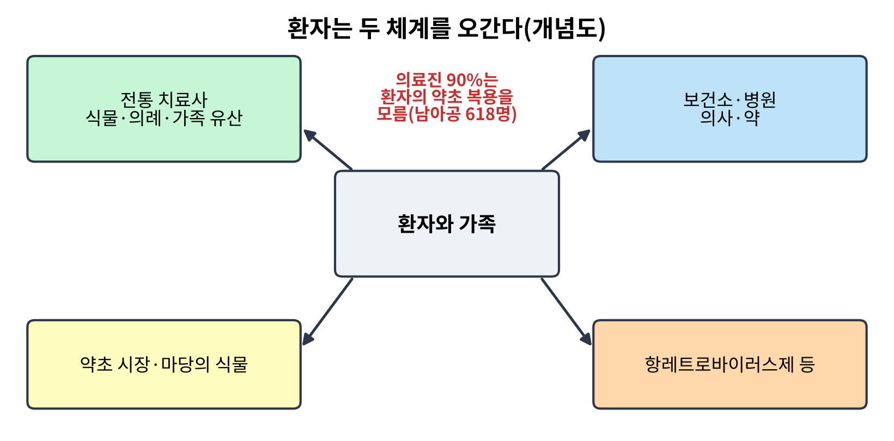
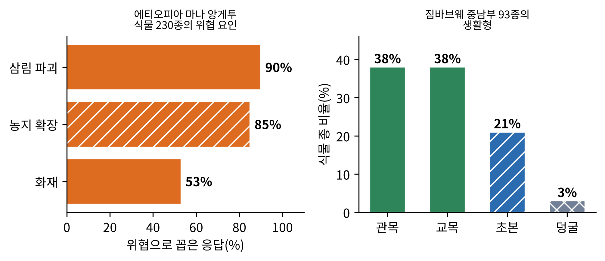
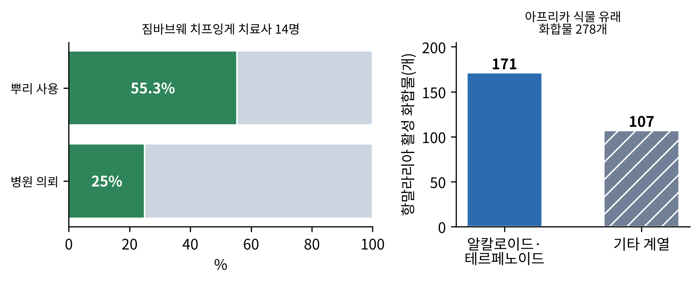
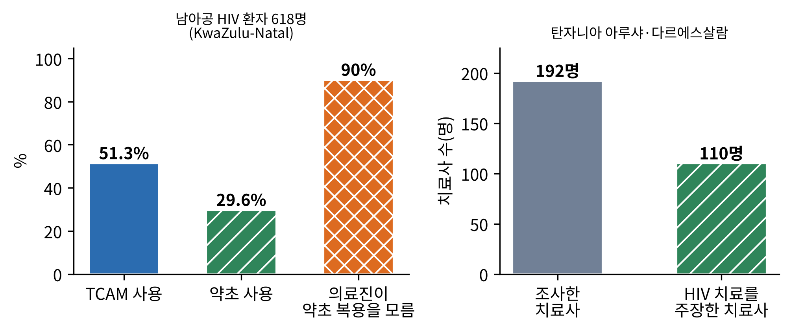
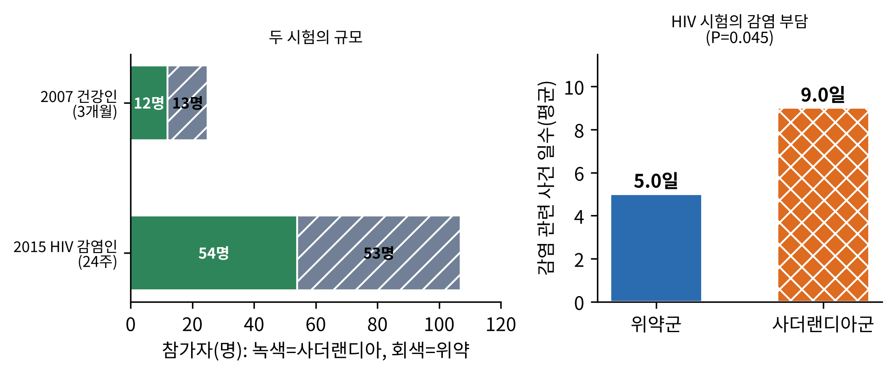
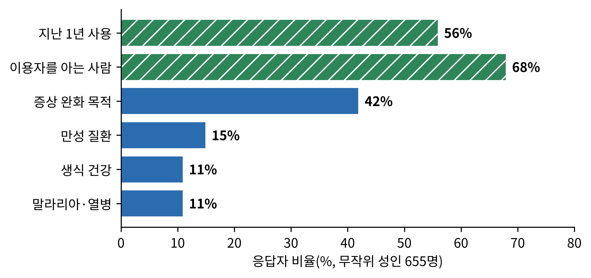
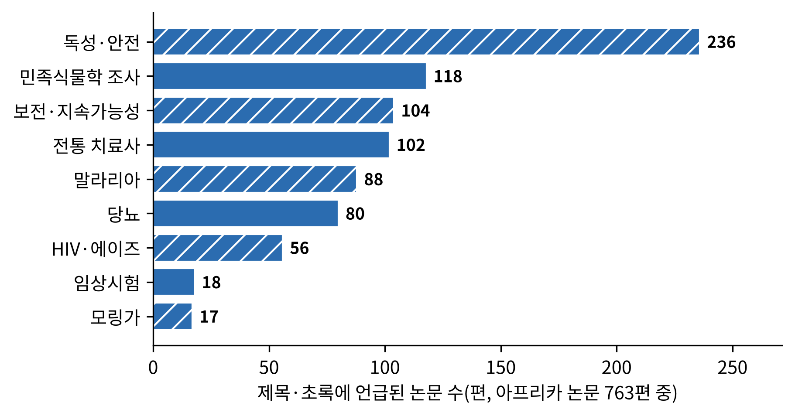

# 7장. 아프리카: 말로 전해진 약초, 병원 대기실의 약초

<strong>그림 7-1. 환자는 전통 치료사와 병원 사이를 오간다(개념도).</strong> 아프리카의 약초 이용은 병원 밖의 일이 아니라, 병원과 나란히 일어난다. 붉은 글씨는 남아프리카공화국 HIV 환자 618명 조사에서 의료진 90%가 환자의 약초 복용을 몰랐다는 결과를 옮긴 것이다(Peltzer et al., 2008).

<ul class="mini-toc">
<li>글자 대신 사람으로 전해진 지식</li>
<li>마을을 걸어 기록하다: 민족식물학 조사</li>
<li>말라리아: 치료사의 식물과 실험실의 화합물</li>
<li>HIV와 전통 치료: 병원 대기실의 약초</li>
<li>사더랜디아: 안전성을 확인한 두 시험</li>
<li>통합의 질문: 누가, 왜 전통 의약을 쓰는가</li>
<li>논문 속의 아프리카</li>
</ul>

## 이 장을 읽기 전에

3장의 본초서와 4장의 아유르베다 경전, 5장의 『의학정전』은 모두 글로 남은 체계였다. 이 장의 대륙은 사정이 다르다. 아프리카 약초 지식의 대부분은 치료사의 기억과 가족의 계보 속에 있다. 그래서 이 장의 연구들은 고전을 현대 연구로 대조하는 방식이 아니라, 마을을 찾아가 묻고 적는 방식으로 시작한다.

이 장은 네 가지를 본다. 첫째, 전통 의약이 이 대륙의 의료에서 어떤 위치에 있는지를 개관 논문으로 확인한다. 둘째, 에티오피아와 짐바브웨의 민족식물학 조사가 무엇을 기록했는지 본다. 셋째, 말라리아와 HIV라는 두 큰 질병을 통해 전통 치료와 병원이 어떻게 겹치는지 본다. 넷째, 남아프리카의 약초 사더랜디아(Sutherlandia, 학명 Lessertia frutescens)를 안전성 관점에서 시험한 두 임상시험을 설계부터 따라간다. 이 장의 수치는 모두 말뭉치에서 확인한 초록에 근거한다.

## 1. 글자 대신 사람으로 전해진 지식

한 개관은 서구 의학이 들어오기 전에 전통 의학이 도시와 농촌을 가리지 않고 수백만 아프리카인이 쓸 수 있는 지배적 의료 체계였다고 서술하고, 유럽인의 도래가 이 전통의 중요한 전환점이었다고 말한다. 같은 개관은 식민 지배가 아프리카 전통 의학에 미친 영향을 따로 다루며, 전통 의사와 근대 의사 사이의 불신을 줄이려면 양쪽이 서로의 강점과 약점을 인정해야 한다고 결론 내린다(Abdullahi, 2011).

오늘의 규모에 대한 서술은 논문마다 비슷한 숫자를 인용한다. 어떤 논문은 전통 아프리카 의학이 아프리카 인구의 80% 이상에 서비스한다고 쓰고(Elujoba et al., 2005), 가나 북부를 다룬 연구는 가나인의 80%가 일차 보건에서 전통 의학에 의존한다고 쓴다(Krah et al., 2017). 이 숫자들은 연구자가 근거를 새로 조사해서 얻은 값이라기보다 널리 인용되는 개략적 추정이므로, 규모의 감각으로만 읽어야 한다.

이 지식의 취약점도 같은 개관들에서 읽힌다. 엘루조바(A. A. Elujoba) 등은 숲이 사라지고 나이 든 전통 치료사가 세상을 떠나는 일이 하나의 시한이 되고 있다고 쓰며, 이 의학적 문화 유산을 배우고 기록해야 한다고 호소한다(Elujoba et al., 2005). 이 호소가 바로 다음 절의 연구들이 하는 일이다.

## 2. 마을을 걸어 기록하다: 민족식물학 조사

**에티오피아 남동부.** 2008년 룰레칼(Ermias Lulekal) 등은 에티오피아 남동부 마나 앙게투(Mana Angetu) 지역에서 2003년 1월부터 2004년 12월까지 조사했다. 방법은 반구조화 면담, 현장 관찰, 선호도 및 직접 행렬 순위법이었고, 대상은 전통 의료 시술자였다. 결과, 식물 230종의 민족 의약적 이용이 기록되었다. 그중 78.7%는 사람의 질병에 쓰였고, 가장 흔한 부위는 뿌리(33.9%)와 잎(25.6%)이었다. 약용 식물의 90.4%는 야생에서 채집되었다. 가장 중요한 종은 올리브의 아종(Olea europaea subsp. cuspidata)이었다. 연구진이 꼽은 위협 요인은 삼림 파괴(90%), 농지 확장(85%), 화재(53%)였다(Lulekal et al., 2008).

**짐바브웨 중남부.** 2013년 마로이(Alfred Maroyi)는 짐바브웨 중남부의 전통 약용 식물을 문헌 고찰로 정리했다. 과학 저널, 도서, 기관 보고서, 학위 논문, 회색 문헌을 대상으로 했고, 식물 93종(41과 77속)이 18개 질환 범주에 쓰이고 있었다. 가장 많은 종이 쓰인 범주는 위장 질환이었고, 성 매개 감염, 감기·기침·인후통, 부인과 질환이 뒤를 이었다. 생활형으로는 관목과 교목이 각각 38%, 초본이 21%, 덩굴이 3%였다. 저자는 이 지역에서 기록된 약효 주장이 문헌으로 잘 뒷받침된다고 평가했다. 82.8%의 종이 짐바브웨의 다른 지역이나 세계 다른 곳에서 비슷한 용도로 쓰였고, 89.2%는 생물학적·약리학적 성질이 문헌에 보고되어 있었다(Maroyi, 2013).

<figure class="fig">

<figcaption><strong>그림 7-2. 두 민족식물학 연구가 기록한 것.</strong> 왼쪽은 에티오피아 마나 앙게투에서 연구진이 꼽은 약용 식물의 위협 요인(Lulekal et al., 2008), 오른쪽은 짐바브웨 중남부 약용 식물 93종의 생활형 구성(Maroyi, 2013).</figcaption>
</figure>

**검출과 해석.** 두 연구가 검출한 것은 약효가 아니라 지식의 목록이다. 어떤 식물이 어떤 병에 쓰이는지, 어느 부위를 쓰는지, 어디에서 채집하는지가 기록되었다. 그림 7-2는 이 기록에서 두 가지 문제를 읽게 한다. 하나는 약용 식물의 90%가 야생에서 채집된다는 점이고, 다른 하나는 그 서식지를 위협하는 요인이 매우 높은 비율로 지적된다는 점이다. 이 책의 말뭉치에서 이 문제는 다음 절들과 함께 반복해서 나온다. 한편 마로이의 문헌 대조는 전통 지식과 현대 문헌의 일치율이 높다는 점을 보여 주지만, 일치는 같은 용도가 다른 곳에서도 보고되었다는 뜻이지 그 용도가 효과적이라는 임상 증거가 아니다.

<strong>표 7-1. 두 민족식물학 연구의 비교</strong>

| 항목 | 에티오피아 마나 앙게투 (2008) | 짐바브웨 중남부 (2013) |
|---|---|---|
| 방법 | 면담, 관찰, 순위법 | 문헌 고찰 |
| 기록된 식물 | 230종 | 93종(41과 77속) |
| 가장 많이 쓰인 부위 | 뿌리 33.9%, 잎 25.6% | (초록에 없음) |
| 채집 | 야생 90.4% | (초록에 없음) |
| 문제로 꼽은 것 | 삼림 파괴, 농지 확장, 화재 | 기록의 부족 |
| 연구의 목적 | 보전·관리 계획의 기초 | 기록, 연구 공백 확인 |

## 3. 말라리아: 치료사의 식물과 실험실의 화합물

말라리아는 이 대륙에서 전통 의학과 현대 약학이 가장 오래 만나 온 질병이다. 이 절에서는 같은 질병을 세 층위에서 본 연구를 이어서 읽는다. 마을의 치료사, 실험실의 추출물, 화합물의 총정리이다.

**치료사가 말한 것.** 2014년 응가리부메(Talkmore Ngarivhume) 등은 짐바브웨 마니칼랜드 주 치핑게(Chipinge) 지역에서 14명의 전통 치료사를 반구조화 면담했다. 연구 배경은 짐바브웨 인구의 약 50%가 해마다 말라리아 감염 위험에 놓인다는 점이었다. 치료사들은 16과 28종의 식물을 쓰고 있었고, 가장 많이 언급된 것은 카시아 압브레비아타(Cassia abbreviata)였다. 사용 부위는 뿌리가 55.3%로 가장 많았으며, 대부분 건조 가루로 병에 보관해 물에 우려 마셨다. 치료사들은 자신의 지식을 영적인 가족 유산으로 여겼다. 치료에 반응하지 않는 환자를 병원에 보내는 치료사는 25%에 그쳤고, 나머지는 악령이 치료를 실패하게 한다고 믿어 다른 식물을 쓰거나 정화 의례를 하는 쪽을 택한다고 답했다(Ngarivhume et al., 2014). 14명의 소규모 탐색 조사이므로, 이 비율을 이 나라 전체의 값으로 읽을 수는 없다.

**실험실이 확인한 것.** 1996년 브누아비칼(Françoise Benoit-Vical) 등은 코트디부아르의 치료사들이 말라리아에 쓰는 일곱 식물(Azadirachta indica, Cinnamomum camphora, Lippia multiflora, Vernonia colorata, Guiera senegalensis, Combretum micranthum, Ximenia americana)의 추출물을 만들어 열대열 말라리아 원충(Plasmodium falciparum) 두 계통에 시험했다. 하나는 클로로퀸 내성 계통(FcB1-Colombia), 다른 하나는 클로로퀸 민감 계통(F32-Tanzania)이었다. 추출은 치료사들이 대부분 쓰는 방식인 침출과 달임으로 했고, 활성은 방사성 하이포잔틴(3H-hypoxanthine)의 원충 내 흡수와 혈액 도말의 현미경 관찰로 평가했다. 일곱 식물 가운데 일부는 시험관에서 원충 성장을 뚜렷이 억제하는 듯 보였고, 일부는 덜 효과적으로 보였다(Benoit-Vical et al., 1996). 시험관 실험이므로 사람에서의 효과를 뜻하지 않는다.

**화합물의 총정리.** 2013년 옹게네(Pascal Amoa Onguéné) 등은 아프리카 식물에서 얻은 순수 화합물 가운데 시험관·동물 실험에서 항말라리아 활성이 보고된 것을 정리했다. 이 시리즈 전체에서 다룬 화합물은 278개이고, 첫 편은 그중 알칼로이드와 테르페노이드 171개를 다룬다. 저자는 아프리카 식물군이 말라리아 치료용 식물 의약품을 개발할 거대한 잠재력을 가진다고 결론 내렸다(Onguéné et al., 2013).

<figure class="fig">

<figcaption><strong>그림 7-3. 말라리아 연구의 두 층위.</strong> 왼쪽은 짐바브웨 치프잉게의 치료사 14명이 답한 것(Ngarivhume et al., 2014). 오른쪽은 아프리카 식물 유래 항말라리아 화합물 278개 가운데 첫 편이 다룬 171개와 나머지(Onguéné et al., 2013).</figcaption>
</figure>

**검출과 해석.** 세 연구는 서로 다른 것을 검출했다. 응가리부메 등은 치료사가 쓰는 식물 목록과 그들의 질병관을 기록했다. 브누아비칼 등은 시험관에서 원충 성장이 줄어드는 현상을, 옹게네 등은 순수 화합물 수준의 활성 보고를 모았다. 이 세 층위는 서로 이어지지만 같은 것이 아니다. 마을에서 쓰는 식물의 물 추출물이 시험관에서 활성을 보였다는 사실은 그 식물이 사람의 말라리아를 치료한다는 증거가 아니다. 마을의 식물이 약이 되려면 그다음 단계(동물 실험, 임상시험)가 필요하며, 이는 10장과 11장에서 다룬다. 또 치료사의 75%가 병원 의뢰를 하지 않는다는 결과는 약초의 효능과 별개로 환자가 치료받을 기회의 문제를 제기한다.

## 4. HIV와 전통 치료: 병원 대기실의 약초

말라리아가 마을의 질병이라면, HIV는 병원과 마을이 가장 직접 맞닿는 질병이다. 두 연구가 이 접점을 환자의 쪽과 치료사의 쪽에서 각각 보여 준다.

**환자의 쪽.** 2008년 펠처(Karl Peltzer) 등은 남아프리카공화국 콰줄루나탈 주 공립병원 세 곳의 외래에서 항레트로바이러스 치료를 시작하기 전의 HIV 양성 환자 618명을 계통 추출하여 설문했다. 지난 6개월 동안 전통 보완·대체 의학(TCAM)을 쓴 사람이 317명(51.3%), 약초만 쓴 사람이 183명(29.6%)이었다. 약초 치료는 한 달 평균 128랜드(약 16달러)로 가장 비싼 선택이었고, 약초는 주로 통증 완화(87.1%)에, 영적 실천이나 기도는 스트레스 완화(77.6%)에 쓰였다. 가장 눈에 띄는 결과는 응답자의 90%가 자신의 의료진이 약초 복용 사실을 모른다고 답한 것이다. 연구진은 항레트로바이러스 치료를 시작하거나 추적할 때 의료진이 TCAM 사용 여부를 일상적으로 물어야 한다고 결론 내렸다(Peltzer et al., 2008).

**치료사의 쪽.** 2007년 카욤보(Edmund Kayombo) 등은 탄자니아 아루샤와 다르에스살람에서 전통 치료사 192명(132명과 60명)을 면담했다. 이 중 110명이 HIV/AIDS를 치료한다고 주장했고, 그들의 75%는 HIV/AIDS의 증상을 알고 있었다. 연구의 목적은 전통 치료사와 전통의학연구소의 지속 가능한 협력을 시작하는 것이었다. 치료사 협회의 지도자들이 좋은 치료사에게 접근하는 관문 역할을 했고, 협의 후 이들이 협력에 응하며 다른 치료사에게 문을 열었다. 그러나 협력에 대한 유보도 남아 있었고, 이는 식민 시기 치료사가 부당한 대우를 받았던 경험에 뿌리를 둔 것이었다. 저자들은 협력을 시작하는 일이 문헌에서 보이는 것처럼 쉽지 않다고 결론 내렸다(Kayombo et al., 2007).

<figure class="fig">

<figcaption><strong>그림 7-4. HIV 치료에서 전통 의학이 놓인 자리.</strong> 왼쪽은 남아공 콰줄루나탈의 HIV 환자 618명 조사(Peltzer et al., 2008), 오른쪽은 탄자니아 치료사 192명 면담에서 HIV 치료를 주장한 치료사 수(Kayombo et al., 2007).</figcaption>
</figure>

**검출과 해석.** 두 연구가 검출한 것은 약초의 효과가 아니라 두 체계의 겹침이다. 환자의 절반이 약초나 전통 의학을 쓰는데 의료진 대부분은 그것을 모른다. 이 간극이 안전성 문제의 출발점이 된다. 약초는 다른 약의 대사에 영향을 줄 수 있고, 이 점은 6장에서 세인트존스워트로 확인한 바 있다. 탄자니아의 연구에서 협력의 장애물이 의학 이론의 차이뿐 아니라 역사적 불신이라는 점도 중요하다. 이 두 연구의 결과를 연결하는 것은 저자의 해석이며, 두 연구가 직접 비교된 것은 아니다.

## 5. 사더랜디아: 안전성을 확인한 두 시험

환자의 절반이 약초를 쓰는데 의료진이 모른다면 가장 먼저 필요한 것은 안전성 자료이다. 남아프리카의 약초 사더랜디아(Sutherlandia frutescens, 현재 학명 Lessertia frutescens)가 이 요구에 답한 시험을 두 번 거쳤다. 이 약초는 남아프리카에서 상업적 보완 의약품과 전통 약으로 널리 쓰인다.

**첫 번째: 건강한 성인 25명.** 2007년 존슨(Quinton Johnson) 등은 이 약초를 건강한 성인에서 시험했다. 설계는 무작위 이중맹검 위약 대조이고, 장소는 남아프리카 벨빌의 카를 브레머 병원이었다. 동의를 한 건강한 성인 25명 가운데 12명은 사더랜디아 잎 가루 400 mg 캡슐을 하루 두 번(800 mg/일), 13명은 위약 캡슐을 3개월간 먹었다. 1차 평가 항목은 이상 반응 빈도, 2차 평가 항목은 신체·활력 징후·혈액·생체 지표의 변화였다. 결과는 일반 이상 반응이나 지표에서 유의한 차이가 없었다(p > 0.05). 다만 식욕이 좋아졌다는 보고는 사더랜디아군에서 더 많았고(p = 0.01), 호흡수·혈소판 수 등에서 약간의 차이가 있었으나 모두 정상 범위 안이어서 임상적 의미가 없었다. 이 약초의 표지 성분인 카나바닌(canavanine)은 참가자 혈장에서 검출되지 않았다. 연구진은 800 mg/일 3개월 복용을 건강한 성인이 견뎠다고 결론 내렸다(Johnson et al., 2007).

**두 번째: HIV 감염 성인.** 2015년 윌슨(Douglas Wilson) 등은 CD4 림프구 수가 350 cells/μL를 넘는 HIV 감염 성인에서 적응형 2단계 무작위 이중맹검 위약 대조 시험을 했다. 1단계에서는 56명을 사더랜디아 400, 800, 1,200 mg(하루 2회) 또는 위약으로 24주간 나누었고, 2단계에서는 77명을 1,200 mg 또는 위약으로 나누었다. 최종 분석은 두 단계를 합쳐 107명(1,200 mg군 54명, 위약군 53명)이었다. 결과, 사더랜디아는 HIV 바이러스 부하를 바꾸지 않았고 24주 CD4 수도 양 군이 비슷했다. 그러나 감염 관련 사건이 있었던 일수로 정의한 감염 부담(BOI)의 평균은 사더랜디아군이 더 컸다(5.0 대 9.0일, p = 0.045). 연구진은 이 차이를 이소니아지드 예방 요법(IPT)을 받던 참가자 두 명의 결핵 발병 때문이라고 보았고, 사더랜디아와 IPT의 상호작용 가능성을 추가로 평가해야 하며 비슷한 항산화 성질을 가진 다른 약초와도 길항 작용이 있을 수 있다고 경고했다(Wilson et al., 2015).

<figure class="fig">

<figcaption><strong>그림 7-5. 사더랜디아 안전성 시험 두 편.</strong> 왼쪽은 두 시험의 참가자 수(Johnson et al., 2007; Wilson et al., 2015), 오른쪽은 HIV 시험의 감염 부담 평균(Wilson et al., 2015). 오른쪽 막대의 방향은 초록의 문장("사더랜디아군에서 더 컸다")에 근거했다.</figcaption>
</figure>

**검출과 해석.** 첫 시험이 검출한 것은 건강인에서의 내약성이다. 두 번째 시험이 검출한 것은 HIV 감염인에서 바이러스 부하와 CD4에는 영향이 없다는 점과, 감염 사건 일수가 더 많았다는 점이다. 연구진은 이를 우연이 아니라 상호작용의 가능성으로 읽고 추가 평가를 제안했지만, 이 해석은 결핵 두 건에 근거한 가설이며 인과가 입증된 것은 아니다. 이 두 시험의 교훈은 약초가 천연이라는 이유로 안전하다고 간주할 수 없고, 환자가 먹는 다른 약과의 조합에서 평가해야 한다는 점이다. 12장(안전성)이 이 문제를 이어받는다.

<strong>표 7-2. 사더랜디아 두 시험의 설계 비교</strong>

| 항목 | 건강인 시험 (2007) | HIV 감염인 시험 (2015) |
|---|---|---|
| 대상 | 건강한 성인 | CD4 350/μL 초과 HIV 감염 성인 |
| 규모 | 25명(12명 대 13명) | 107명 분석(54명 대 53명) |
| 용량 | 800 mg/일 | 1,200 mg 하루 2회(분석군) |
| 기간 | 3개월 | 24주 |
| 설계 | 무작위 이중맹검 위약 대조 | 적응형 2단계 무작위 이중맹검 위약 대조 |
| 1차 평가 | 이상 반응 빈도 | 안전성(바이러스 부하, CD4, 감염 부담 등) |
| 주요 결과 | 이상 반응 차이 없음 | 감염 부담이 사더랜디아군에서 더 큼 |

## 6. 통합의 질문: 누가, 왜 전통 의약을 쓰는가

가나의 연구는 통합의 가능성과 장애를 함께 보고한다. 2017년 크라(Eva Krah) 등은 가나 북부(2013~2014년)에서 질적 연구를 통해 전통 의학과 서양 의학의 통합이 지역 보건의 범위를 넓히고 결과를 개선한다고 주장했다. 통합을 가로막는 다섯 가지 장애로는 전통 의학에 대한 이해 부족, 차별, 의료진의 높은 이직률, 치료 직업에 대한 관심의 감소, 장비 부족이 꼽혔다. 기회로는 전통 의학의 방대한 기반 시설, 협력에 대한 개방성, 풀뿌리 사업이 있었다. 저자들은 가장 중요한 것이 치료사와 의료진 사이의 신뢰 관계라고 말한다(Krah et al., 2017).

탄자니아 북부의 연구는 사용자의 쪽을 보여 준다. 2015년 스태니퍼(John Stanifer) 등은 킬리만자로 지역에서 2013년 12월부터 2014년 6월까지 5개 초점 집단 토론과 27건의 핵심 정보 제공자 면담을 한 뒤, 이를 바탕으로 만든 설문을 무작위 성인 655명에게 시행했다. 응답자의 68%가 전통 의약을 자주 쓰는 사람을 알았고, 56%가 지난 1년 안에 직접 썼다. 가장 흔한 용도는 증상 완화(42%), 만성 질환(15%), 생식 건강 문제(11%), 말라리아·열병(11%)이었다. 연구진은 사용을 이끄는 다섯 요인으로 병원 의료의 제공 방식, 전통 의료의 신뢰성, 강한 문화 정체성, 개인의 건강 상태, 질병에 대한 이해를 꼽았고, 사용이 저소득층이나 농촌에 국한되지 않는다는 점을 발견했다(Stanifer et al., 2015).

<figure class="fig">

<figcaption><strong>그림 7-6. 탄자니아 킬리만자로 지역 성인의 전통 의약 이용.</strong> 무작위 성인 655명 설문. 위의 두 막대(녹색, 빗금)는 이용 경험과 주변 이용자, 아래 막대는 이용 목적의 비율이다(Stanifer et al., 2015).</figcaption>
</figure>

**검출과 해석.** 그림 7-6이 보여 주는 것은 전통 의약이 농촌의 대안이 아니라는 점이다. 이용이 도시와 소득 수준에 관계없이 나타난다는 연구진의 발견은, 병원이 있는 곳에서도 전통 의약이 쓰인다는 그림 7-1의 구조와 맞는다. 만성 질환이 두 번째로 흔한 이용 목적이라는 점은 이 지역에서 비감염성 질환이 늘고 있다는 연구진의 지적과 함께 읽어야 한다. 다만 이 설문은 한 지역의 한 시점 조사이므로 대륙 전체로 일반화할 수 없다.

<strong>표 7-3. 이 장의 연구들이 답할 수 있는 것과 답할 수 없는 것</strong>

| 연구 | 확인된 것 | 확인되지 않은 것 |
|---|---|---|
| 에티오피아·짐바브웨 조사 (2008, 2013) | 약용 식물의 목록, 부위, 위협 요인 | 개별 식물의 효능 |
| 말라리아 치료사 면담 (2014) | 쓰는 식물 28종, 병원 의뢰 25% | 식물의 임상 효과, 전국 규모 |
| 코트디부아르 식물 시험관 실험 (1996) | 일곱 식물의 시험관 활성 | 사람에서의 효과 |
| HIV 환자 설문 (2008) | 약초 사용 29.6%, 의료진 90%가 모름 | 약초와 약의 실제 상호작용 |
| 사더랜디아 시험 (2007, 2015) | 건강인 내약성, HIV 감염인에서 바이러스 부하 불변 | 감염 부담 증가의 원인 |
| 탄자니아 설문 (2015) | 사용 56%, 이용은 도시·농촌 공통 | 이용 결과의 안전성 |

## 7. 논문 속의 아프리카

이 책의 말뭉치에서 아프리카 약초 논문은 763편이다. 연도별로 보면 2008년 이전에는 해마다 10편 안팎이었고, 2010년부터 30편대, 2016년 이후에는 50~60편대로 늘었다. 제목과 초록에서 주제어의 언급 편수를 세면 독성·안전(236편)이 가장 많고, 민족식물학 조사(118편), 보전·지속가능성(104편), 전통 치료사(102편), 말라리아(88편), 당뇨(80편), HIV·에이즈(56편)가 뒤를 따른다. 임상시험은 18편뿐이다.

<figure class="fig">

<figcaption><strong>그림 7-7. 아프리카 약초 논문에서 많이 언급된 주제어.</strong> 말뭉치의 아프리카 논문 763편 가운데 제목·초록에 주제어가 언급된 편수. 한 논문이 여러 주제어에 걸칠 수 있다.</figcaption>
</figure>

이 집계는 이 책의 말뭉치 구성을 보여 줄 뿐 대륙 전체의 연구 비율이 아니다. 그래도 두 가지는 읽힌다. 첫째, 이 대륙의 연구는 효능을 묻기 전에 기록과 안전의 질문에서 출발하는 경우가 많다. 둘째, 임상시험의 비중은 낮아서, 이 장의 사더랜디아 시험 두 편이 예외적으로 드문 사례라는 점이다. 이 두 해석은 저자의 해석이며, 집계 자체는 정규식 일치에 기반한다.

## 이 장을 마치며

아프리카의 약초는 글로 남지 않은 지식이었고, 그래서 연구는 먼저 기록하는 일에서 시작했다. 기록의 다음 단계는 두 길로 갈렸다. 하나는 시험관과 화합물로 가는 길(말라리아)이고, 다른 하나는 환자가 이미 먹고 있는 약초의 안전을 확인하는 길(HIV, 사더랜디아)이었다. 두 번째 길의 교훈은 약초를 병원의 약과 함께 평가해야 한다는 것이다. 이 책의 12장이 그 문제를 이어서 다룬다.

다음 8장에서는 대서양을 건너 아메리카로 간다. 원주민의 약초와 아마존의 식물이 어떤 연구로 이어졌는지 본다.

## 참고문헌

- Abdullahi, A. A. (2011). Trends and challenges of traditional medicine in Africa. *African Journal of Traditional, Complementary and Alternative Medicines, 8*(5S), 115–123. https://doi.org/10.4314/ajtcam.v8i5s.5
- Benoit-Vical, F., Valentin, A., Pélissier, Y., Diafouka, F., Marion, C., Kone-Bamba, D., Koné, M., Mallié, M., Yapo, A. P., & Bastide, J.-M. (1996). In vitro antimalarial activity of vegetal extracts used in West African traditional medicine. *American Journal of Tropical Medicine and Hygiene, 54*(1), 67–71. https://doi.org/10.4269/ajtmh.1996.54.67
- Elujoba, A. A., Odeleye, O. M., & Ogunyemi, C. M. (2005). Traditional medicine development for medical and dental primary health care delivery system in Africa. *African Journal of Traditional, Complementary and Alternative Medicines, 2*(1), 46–61. https://doi.org/10.4314/ajtcam.v2i1.31103
- Johnson, Q., Syce, J., Nell, H., Rudeen, K., & Folk, W. R. (2007). A randomized, double-blind, placebo-controlled trial of *Lessertia frutescens* in healthy adults. *PLoS Clinical Trials, 2*(4), Article e16. https://doi.org/10.1371/journal.pctr.0020016
- Kayombo, E. J., Uiso, F. C., Mbwambo, Z. H., Mahunnah, R. L. A., Moshi, M. J., & Mgonda, Y. H. (2007). Experience of initiating collaboration of traditional healers in managing HIV and AIDS in Tanzania. *Journal of Ethnobiology and Ethnomedicine, 3*, Article 6. https://doi.org/10.1186/1746-4269-3-6
- Krah, E., de Kruijf, J. G., & Ragno, L. P. (2017). Integrating traditional healers into the health care system: Challenges and opportunities in rural northern Ghana. *Journal of Community Health, 43*(1), 157–163. https://doi.org/10.1007/s10900-017-0398-4
- Lulekal, E., Kelbessa, E., Bekele, T., & Yineger, H. (2008). An ethnobotanical study of medicinal plants in Mana Angetu District, southeastern Ethiopia. *Journal of Ethnobiology and Ethnomedicine, 4*, Article 10. https://doi.org/10.1186/1746-4269-4-10
- Maroyi, A. (2013). Traditional use of medicinal plants in south-central Zimbabwe: Review and perspectives. *Journal of Ethnobiology and Ethnomedicine, 9*, Article 31. https://doi.org/10.1186/1746-4269-9-31
- Ngarivhume, T., Van Klooster, C., de Jong, J. T. V. M., & Van der Westhuizen, J. H. (2014). Medicinal plants used by traditional healers for the treatment of malaria in the Chipinge district in Zimbabwe. *Journal of Ethnopharmacology, 159*, 224–237. https://doi.org/10.1016/j.jep.2014.11.011
- Onguéné, P. A., Ntie-Kang, F., Lifongo, L. L., Ndom, J. C., Sippl, W., & Mbaze, L. M. (2013). The potential of anti-malarial compounds derived from African medicinal plants. Part I: A pharmacological evaluation of alkaloids and terpenoids. *Malaria Journal, 12*, Article 449. https://doi.org/10.1186/1475-2875-12-449
- Peltzer, K., Friend-du Preez, N., Ramlagan, S., & Fomundam, H. (2008). Use of traditional complementary and alternative medicine for HIV patients in KwaZulu-Natal, South Africa. *BMC Public Health, 8*, Article 255. https://doi.org/10.1186/1471-2458-8-255
- Stanifer, J. W., Patel, U. D., Karia, F., Thielman, N., Maro, V., Shimbi, D., Kilaweh, H., Lazaro, M., Matemu, O., Omolo, J., & Boyd, D. (2015). The determinants of traditional medicine use in Northern Tanzania: A mixed-methods study. *PLOS ONE, 10*(4), Article e0122638. https://doi.org/10.1371/journal.pone.0122638
- Wilson, D., Goggin, K., Williams, K., Gerkovich, M. M., Gqaleni, N., Syce, J., Bartman, P., Johnson, Q., & Folk, W. R. (2015). Consumption of *Sutherlandia frutescens* by HIV-seropositive South African adults: An adaptive double-blind randomized placebo controlled trial. *PLOS ONE, 10*(7), Article e0128522. https://doi.org/10.1371/journal.pone.0128522
