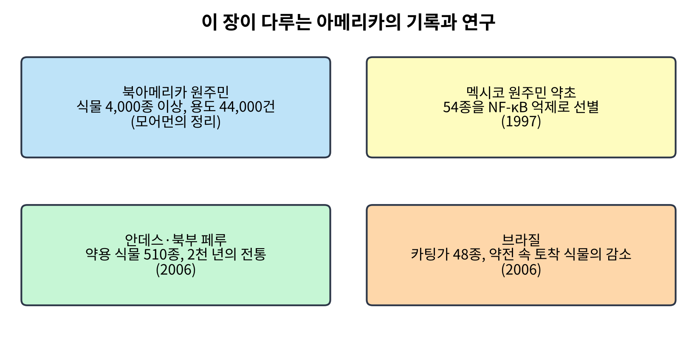
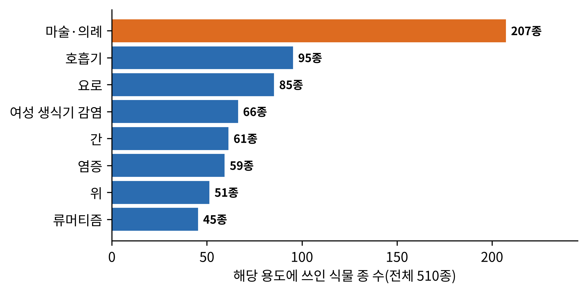
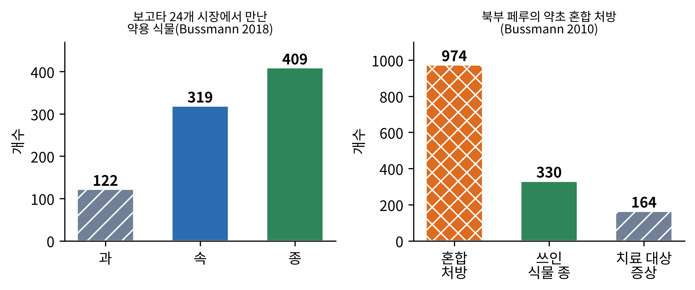
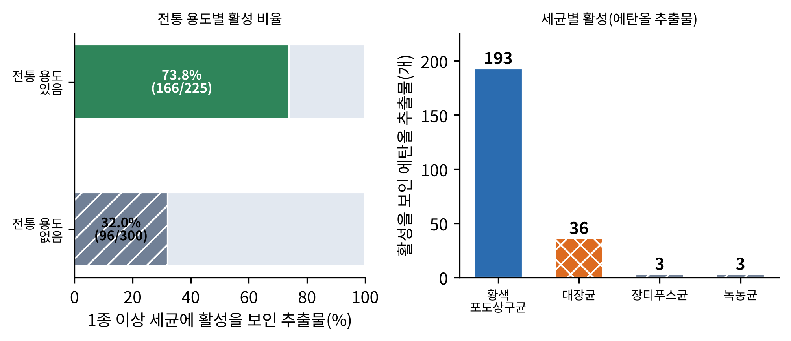
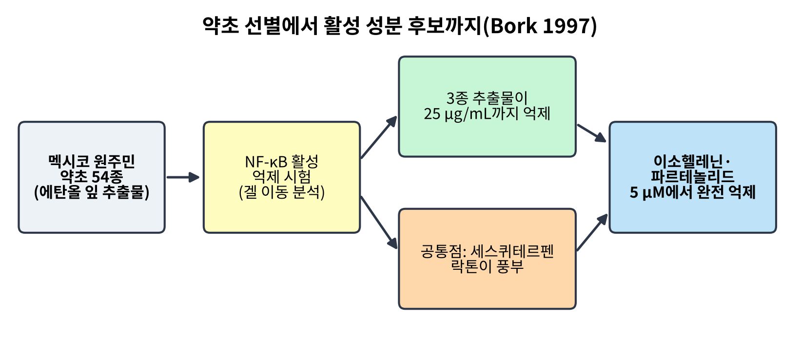
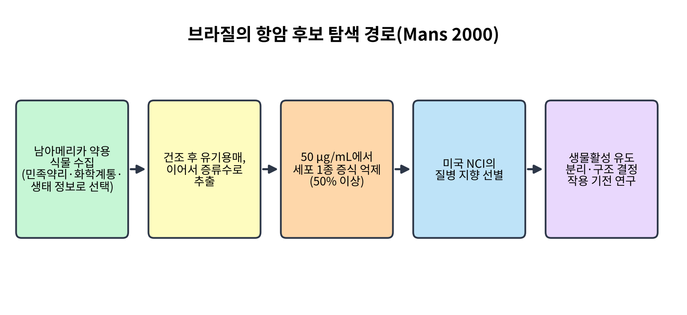
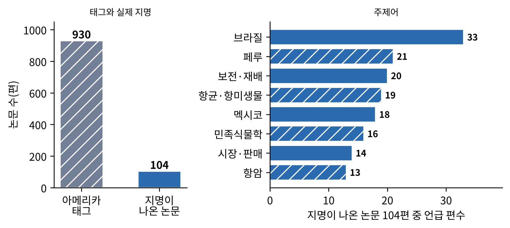

# 8장. 아메리카: 시장에서 실험실로, 원주민의 약초를 묻다

<strong>그림 8-1. 이 장이 다루는 아메리카의 기록과 연구.</strong> 북아메리카 원주민 식물의 방대한 목록, 멕시코 약초의 분자 수준 선별, 안데스의 2천 년 전통, 브라질의 약전과 식물 이용을 한 장에 놓았다. 지역마다 연구의 방식이 다르다.

<ul class="mini-toc">
<li>두 대륙의 기록</li>
<li>북부 페루: 2천 년의 치유 문화</li>
<li>시장과 혼합 처방</li>
<li>전통 지식은 통하는가: 항균 시험</li>
<li>병원과 약초원 사이의 환자</li>
<li>멕시코 약초와 NF-κB</li>
<li>브라질: 약전과 항암 후보 탐색</li>
<li>논문 속의 아메리카</li>
</ul>

## 이 장을 읽기 전에

아메리카는 이 책이 다룬 지역 가운데 약초 지식의 기록 방식이 가장 다양한 곳이다. 북아메리카에서는 한 사람의 인류학자가 25년 동안 원주민 식물 이용을 모아 한 권의 책으로 정리했고, 안데스에서는 연구자들이 시장을 걸으며 식물을 세고, 브라질에서는 약전의 개정판을 비교해 사라진 식물을 찾았다. 약효를 묻는 질문도 지역마다 다르다. 어떤 연구는 전통 지식이 실험실에서 통하는지 보고, 어떤 연구는 분자 수준의 선별로 활성 후보를 찾으며, 어떤 연구는 환자가 실제로 어느 쪽을 택하는지 묻는다.

이 장은 북부 페루의 연구를 중심에 둔다. 이 책의 말뭉치에서 같은 연구진이 같은 지역을 여러 각도에서 반복해 조사한 사례가 가장 풍부하기 때문이다. 이 장의 수치는 모두 말뭉치에서 확인한 초록에 근거한다. 아마존의 약초 가운데 이 말뭉치에서 확인한 초록으로 서술할 수 있는 연구가 적은 점은 이 장의 한계이며, 뒤의 절에서 말뭉치 자체의 문제와 함께 밝힌다.

## 1. 두 대륙의 기록

북아메리카의 기록으로 가장 큰 것은 인류학자 다니엘 모어먼(Daniel E. Moerman)의 『Native American Ethnobotany』이다. 한 서평은 이 책이 북아메리카 원주민이 약, 식량, 섬유, 염료 등으로 쓴 식물을 모은 비범한 편찬이라고 소개하며, 모어먼이 25년 동안 4,000종 이상의 식물에 대한 축적된 민족식물학 지식을 모았고 여러 부족의 용도 44,000건 이상이 기록되어 있다고 적는다. 서평자는 이를 지금까지 시도된 가장 방대한 민족식물학 조사라고 평가했다(Schmid, 1998). 이 책은 이후 많은 약용 식물 연구의 기초 자료로 쓰였다는 일반적 인식이 있으나, 이 장은 그 점을 직접 확인한 자료를 갖지 못했다.

이 목록은 기록이지 효능의 증거가 아니다. 4만 건이 넘는 용도 가운데 어느 것이 약리학적으로 맞는지는 별도의 질문이다. 이 장의 나머지 절은 바로 그 질문, 곧 기록된 전통 지식을 어떻게 시험할 수 있는지를 안데스, 멕시코, 브라질의 사례로 따라간다.

## 2. 북부 페루: 2천 년의 치유 문화

2006년 부스만(Rainer Bussmann)과 샤론(Douglas Sharon)은 페루 북부의 약용 식물 이용을 정리했다. 대상은 피우라, 람바예케, 라리베르타드, 카하마르카, 산마르틴의 다섯 주였다. 이 지역은 에콰도르에서 볼리비아에 이르는 옛 안데스 중부 "건강의 축(Health Axis)"의 중심으로 설명되며, 치유 관행의 뿌리는 적어도 모체(Moche) 시대(기원후 100~800년)까지 거슬러 올라간다. 식민 시기에 보고된 식물의 약 50%가 대중의 약전에서 사라졌지만, 이 지역 사람들의 식물 지식은 안데스의 다른 지역보다 훨씬 폭넓다고 한다.

연구진은 약용 식물 510종을 채집하고 동정했으며, 현지 이름과 전통적 용도를 기록했다. 가장 많이 대표된 과는 국화과(69종), 콩과(35종), 꿀풀과(25종), 가지과(21종)였다. 가장 많은 종이 쓰인 용도는 "마술·의례" 질환(207종)이었고, 호흡기 질환(95종), 요로 문제(85종), 여성 생식기 감염(66종), 간 질환(61종), 염증(59종), 위 문제(51종), 류머티즘(45종)이 뒤를 이었다. 사용된 식물의 83%는 페루 토착종이었다. 이용된 식물의 3분의 2는 야생에서 채집한 생식물이었고, 가장 흔한 사용법은 약초 달인 물을 마시거나 습포로 붙이는 것이었다(Bussmann & Sharon, 2006).

<figure class="fig">

<figcaption><strong>그림 8-2. 북부 페루 약용 식물 510종의 용도별 종 수.</strong> 한 식물이 여러 용도에 쓰일 수 있어 합계는 510종을 넘는다. 가장 많은 종이 쓰인 용도는 마술·의례 질환이다(Bussmann & Sharon, 2006).</figcaption>
</figure>

**검출과 해석.** 이 조사가 검출한 것은 목록과 분포이다. 눈에 띄는 것은 그림 8-2의 가장 긴 막대, 곧 "마술·의례" 질환이 약리학적 질환 범주보다 많은 종을 차지한다는 점이다. 이 분류는 약초가 신체의 약일 뿐 아니라 의례의 일부이기도 한 체계를 보여 준다. 이 점은 7장의 짐바브웨 치료사들이 자신의 지식을 영적 가족 유산으로 여긴다고 한 것과 닮았다. 연구진 해석은 아니며 저자가 두 장을 잇는 관찰이다. 식민 시기 식물의 절반이 사라졌다는 서술은 지식이 해마다 같은 크기로 이어지지 않고 중간에 끊긴다는 것을 보여 주는 사례이다.

## 3. 시장과 혼합 처방

같은 연구진은 이 지식이 시장에서 어떻게 유통되는지도 조사했다.

**트루히요와 치클라요의 시장.** 2007년 부스만 등은 페루 북부 해안 도시 트루히요(마요리스타, 에르메린다 시장)와 치클라요(모델로, 모소케 시장)의 시장에서 가장 인기 있는 식물과 가장 희귀한 식물의 출처를 기록했다. 시장과 노점을 식물 다양성에 따라 군집 분석하자 시장이 네 묶음으로 나뉘었다. 흔한 외래 약용 식물, 일반인이 흔한 병에 자가 투약하는 식물("일상의 약"), 치료사(쿠란데로)가 쓰는 전문 식물, 그리고 마술적 목적에 쓰는 고도로 전문화된 식물이었다. 연구진은 식물 거래가 지역 고객의 보건 수요와 잘 대응하는 것으로 보인다고 해석했다(Bussmann et al., 2007b).

**식물은 어디서 오는가.** 2008년의 후속 연구는 이 시장에 팔리는 식물의 상당 부분이 고지대 카하마르카에서 온다는 점에서 출발했다. 카하마르카의 시장에서는 식물 42종(그중 34종이 토착종)이 팔렸고, 텃밭이나 상인이 재배하는 식물은 76종(외래 25종, 토착 51종)이었다. 그러나 텃밭에서 흔히 재배되는 종은 5종뿐이었고 상인이 재배하는 종은 11종이었으며, 흔히 재배되는 종 중 셋을 뺀 나머지는 외래종이었다. 해안 시장의 수요가 커졌지만 텃밭 재배가 크게 늘지는 않았고, 시장에서 팔리는 식물의 대부분은 야생에서 채집한 것이었다. 이 채집이 지속 가능한지는 자료가 없다고 저자들은 적었다(Bussmann et al., 2008).

**수도의 시장.** 2018년 부스만 등은 콜롬비아 보고타 수도권에서 2014년 12월부터 2016년 2월까지 24개 시장의 식물 상인 38명을 면담했다. 식물 409종(319속 122과)이 확인되었고 19개 질환 범주에서 318가지 용도가 있었다. 종의 구성과 용도는 시장마다 예상보다 훨씬 크게 달랐다. 연구진은 보고타 인구의 출신 지역이 다양하고 그들이 가져온 식물 지식도 다르기 때문이라고 해석했고, 한 시장의 조사로는 대도시의 식물 공급을 파악할 수 없다고 결론 내렸다(Bussmann et al., 2018).

**혼합 처방.** 2010년 부스만 등은 북부 페루의 약초 혼합 처방을 조사해 974가지 처방이 164가지 증상에 쓰이고 있음을 확인했다. 약 30%가 심신 질환 처방이었다. 치료사들은 대개 한 증상에 한두 가지 혼합을 썼지만, 같은 병에 최대 49가지 처방이 쓰이기도 해서 실험이 많이 이루어짐을 시사했다. 혼합에 쓰인 식물은 330종으로 이 지역 약용 식물의 거의 65%였고, 대다수 처방은 2~7종을 섞었으나 가장 극단적인 경우 27종이 들어갔다. 염증, 감염, 혈액 정화, 기침·감기와 호흡기 질환, 요로 감염과 신장 문제에 쓰는 처방은 식물 구성이 서로 비슷했고, 신경계 질환, 불안, 심장 문제 처방도 서로 비슷했다(Bussmann et al., 2010).

<figure class="fig">

<figcaption><strong>그림 8-3. 시장의 다양성과 혼합 처방의 규모.</strong> 왼쪽은 보고타 24개 시장에서 확인된 약용 식물의 과·속·종 수(Bussmann et al., 2018), 오른쪽은 북부 페루의 혼합 처방 974가지, 쓰인 식물 330종, 치료 대상 증상 164가지(Bussmann et al., 2010).</figcaption>
</figure>

**검출과 해석.** 이 세 연구가 검출한 것은 지식이 유통되는 구조이다. 시장은 고객의 건강 수요를 반영해 네 가지 성격으로 나뉘고, 대도시에서는 출신 지역의 다양성이 시장의 다양성으로 이어지며, 공급의 대부분은 야생 채집이다. 이 야생 채집의 지속 가능성은 7장의 에티오피아 조사와 같은 우려를 보여 준다. 혼합 처방에서 구성이 비슷한 처방들이 있다는 점은 치료사들이 증상 범주별로 비슷한 조합을 만든다는 뜻이며, 같은 증상에 49가지 처방이 쓰인다는 사실은 표준이 없다는 점과 함께 읽어야 한다. 이 두 해석은 모두 저자들이 초록에서 밝힌 해석이다.

<strong>표 8-1. 부스만 연구진의 북부 페루·콜롬비아 연구 정리</strong>

| 연구 | 대상 | 방법 | 핵심 수치 |
|---|---|---|---|
| 2006 | 북부 페루 다섯 주 | 채집과 면담 | 식물 510종, 토착 83% |
| 2007 | 트루히요·치클라요 시장 | 시장 목록과 군집 분석 | 시장 4묶음 |
| 2008 | 카하마르카 시장·텃밭 | 시장·텃밭 조사 | 시장 42종, 재배 76종 |
| 2010 | 북부 페루 혼합 처방 | 처방 수집 | 974가지, 164가지 증상 |
| 2018 | 보고타 시장 24곳 | 상인 38명 면담 | 409종, 318가지 용도 |

## 4. 전통 지식은 통하는가: 항균 시험

그렇다면 이 기록된 지식은 실험실에서 통할까. 2011년 부스만 등은 이 질문을 직접 다루었다. 연구의 배경은 세계보건기구(WHO)가 전통 의학에 높은 관심을 보이므로 민간 요법이 실제 치료 활성을 갖는지 과학적으로 보여 줄 필요가 있다는 것이었다.

연구진은 북부 페루의 약용 식물 최소 405종에서 525개 시료를 모아, 트루히요의 사설 병원에서 단순한 한천 확산 시험(agar bioassay)으로 항균 활성을 시험했다. 대상 세균은 황색포도상구균(Staphylococcus aureus), 대장균(Escherichia coli), 장티푸스균(Salmonella enterica Typhi), 녹농균(Pseudomonas aeruginosa)이었다. 결과는 황색포도상구균에 활성을 보인 추출물이 에탄올 추출물 193개, 물 추출물 31개였고(21개는 물 추출물만 활성), 물 추출물은 나머지 세 세균에는 활성이 없었다. 에탄올 추출물도 대장균에는 36개만, 장티푸스균과 녹농균에는 각각 3개만 활성을 보였다.

가장 중요한 비교는 전통 용도에 따른 활성률이다. 세균 감염에 전통적으로 쓰는 식물에서 얻은 추출물 225개 가운데 166개(73.8%)가 적어도 한 세균에 활성이었다. 항균 용도가 없는 식물의 추출물 300개 중에서는 96개(32%)만 활성이었다. 호흡기 질환, 염증·감염, 상처, 설사, 산후 감염 예방에 쓰이는 식물은 시험의 70~88%에서 효과가 있었고, "신장 염증"에 쓰는 식물은 세균에 대한 효능이 훨씬 낮아 다른 신체 질환에 쓰는 식물의 범위 안에 있었다(Bussmann et al., 2011).

<figure class="fig">

<figcaption><strong>그림 8-4. 북부 페루 약용 식물의 항균 시험 결과.</strong> 왼쪽은 전통 항균 용도의 유무에 따른 활성 추출물 비율, 오른쪽은 세균별로 활성을 보인 에탄올 추출물 수이다(Bussmann et al., 2011).</figcaption>
</figure>

**검출과 해석.** 이 시험이 검출한 것은 시험관에서 세균 성장을 억제하는 추출물이다. 해석은 둘로 갈린다. 연구진의 해석은 전통 지식이 통한다는 것, 곧 전통적으로 항균에 쓰인 식물이 그렇지 않은 식물보다 두 배 이상 높은 비율로 활성을 보였다는 점이다. 그러나 이 결과가 말하지 않는 것도 분명하다. 첫째, 한천 확산 시험은 활성 후보를 거르는 단순한 방법이며 최소 억제 농도(MIC)나 독성은 후속 연구가 필요하다고 연구진 스스로 밝혔다. 둘째, 활성은 주로 황색포도상구균에서 나타났고 장티푸스균과 녹농균에서는 거의 나타나지 않았다. 따라서 이 결과를 전통 항균 식물이 감염 질환을 치료한다는 증거로 읽을 수는 없다. 셋째, 항균 용도가 없는 식물에서도 32%가 활성이었으므로, 대조군의 기준선이 낮지 않다는 점도 함께 읽어야 한다.

## 5. 병원과 약초원 사이의 환자

약초가 시험관에서 통하는 것과 환자가 약초를 택하는 것은 다른 이야기이다. 부스만 등은 같은 도시 트루히요에서 서양식 병원과 약초원의 환자를 각각 조사해 비교했다.

2007년 연구는 엘 포르베니르의 클리니카 안티코나(Clinica Anticona)라는 서양식 병원에서 환자가 어떤 약을 선호하고 무엇이 선택을 결정하는지 보았다. 이전 연구들은 약초가 여전히 중요한 역할을 한다고 보여 주었지만, 이 병원의 결과는 약초보다 의약품이 더 큰 역할을 한다는 것이었다. 많은 환자가 의약품이 더 빠르고 효과적이라고 느끼면서도 약초를 흔히 쓰는 사람이 많았다(Bussmann et al., 2007a).

2009년 연구는 약초원인 라보라토리오스 베알(Laboratorios Beal)에서 같은 질문을 던졌다. 결과는 약초원 환자들에서 약초의 역할이 의약품보다 약간 클 뿐이었다. 약초원 환자들도 서양 병원 환자가 약초를 쓰는 만큼 의약품을 쓰고 있었다. 약초원 환자들 다수도 의약품이 더 빠르고 효과적이라고 생각했고, 약초는 더 안전하고 부작용이 없다고 여겼다. 환자 개인의 식물 지식은 서양 병원의 환자와 비슷한 수준이었다(Bussmann et al., 2009).

**검출과 해석.** 두 연구가 검출한 것은 환자의 선택이 장소에 의해 갈리지 않는다는 점이다. 병원에 가는 사람도 약초를 쓰고, 약초원에 가는 사람도 의약품을 쓴다. 7장의 그림 7-1이 아프리카에서 개념도로 보인 구조가 이 두 연구의 결과와 맞는다. 환자들이 약초를 안전하고 부작용이 없다고 여긴다는 인식은 12장(안전성)에서 다룰 문제와 이어진다. 이 두 연구는 초록에 구체적 숫자가 제시되지 않아 이 책은 방향만 서술한다.

## 6. 멕시코 약초와 NF-κB

안데스의 연구가 목록과 시장, 항균 시험이었다면, 멕시코의 연구는 분자 수준으로 내려간다. 1997년 보르크(Peter Bork) 등은 멕시코 원주민의 약용 식물 54종이 전사 인자 NF-κB의 활성화를 억제하는지 시험했다. NF-κB는 염증 반응에서 핵심 역할을 하는 단백질이며, 억제할 수 있는 성분은 항염증 후보가 된다.

겔 이동 분석(band-shift) 결과, 세 식물의 에탄올 잎 추출물이 25 µg/mL까지 NF-κB를 억제했다. 아르테미시아 루도비시아나(Artemisia ludoviciana subsp. mexicana), 칼레아 자카테치코이(Calea zacatechichi), 폴림니아 마쿨라타(Polymnia maculata)였고, 모두 세스퀴테르펜 락톤이 풍부했다. 순수 세스퀴테르펜 락톤 가운데 이소헬레닌(isohelenin)과 파르테놀리드(parthenolide)는 5 µM의 낮은 농도에서 NF-κB 활성화를 완전히 막았다. HeLa 세포를 아르테미시아 추출물, 이소헬레닌, 파르테놀리드로 처리하자 IL-6 프로모터에서의 전사 유도가 막혔다. 연구진은 이 실험으로 유데스마놀리드형과 게르마크라놀리드형 세스퀴테르펜 락톤이 항산화 작용이 아닌 방식으로 NF-κB를 강력하게 억제한다고 결론 내렸다. 활성을 보인 모든 식물은 항염증의 생리적 모델인 HET-CAM 시험에서도 요막의 모세혈관 반응 개시를 지연시켰다(Bork et al., 1997).

<figure class="fig">

<figcaption><strong>그림 8-5. 멕시코 원주민 약초에서 활성 성분 후보까지.</strong> 54종의 선별에서 3종이 활성을 보였고, 그 공통점인 세스퀴테르펜 락톤 가운데 이소헬레닌과 파르테놀리드가 완전한 억제를 보였다(Bork et al., 1997).</figcaption>
</figure>

**검출과 해석.** 이 연구가 검출한 것은 세포와 시험관 수준의 억제이다. 54종 중 활성 식물이 3종이라는 사실은 선별의 효율이 낮지 않음을 시사하지만, 비교할 무작위 식물 기준선이 없어 전통 선택이 선별을 도왔다고 단정할 수는 없다. 흥미로운 연결이 하나 있다. 6장에서 본 페버퓨(feverfew)의 편두통 시험 논문은 이 약초의 세스퀴테르펜 락톤 함량을 통제한 제제로 확인 시험을 해야 한다고 적었다. 파르테놀리드가 페버퓨의 대표적 세스퀴테르펜 락톤이라는 것은 일반적으로 알려진 사실이지만 이 말뭉치의 초록에서 직접 확인하지는 못했으므로, 이 연결은 확인 목록에 올렸다. 대서양 양쪽의 연구가 같은 성분군에 닿는다는 점은 약초 연구가 지역별로 분리된 일이 아니라는 점을 보여 준다.

## 7. 브라질: 약전과 항암 후보 탐색

**약전 속에서 사라진 식물.** 2006년 브란당(Maria Brandão) 등은 브라질 공식 약전(FBRAS)의 네 개정판을 조사해 식물과 식물 제품의 수록 현황을 분석했다. 20세기 후반 제약 산업의 성장이 브라질 공식 의학에 큰 영향을 주었고, 약전에서 토착 약용 식물의 모노그래프가 줄었다. 결과는 토착 아메리카 약용 식물이 산업화된 의약품과 외래 약용 식물로 강하게 대체되었다는 것이며, 연구진은 브라질 토착 식물의 검증 연구에 투자가 필요하다고 결론 내렸다(Brandão et al., 2006).

**카팅가의 지식.** 2006년 알부케르케(Ulysses Albuquerque)는 브라질 북동부 건조지 식생인 카팅가(Caatinga)에서 페르남부쿠 주 농촌 공동체의 성인 31명과 함께 약용 식물 이용을 조사했다. 식물 48종이 약용으로 언급되었고 그중 56.25%가 카팅가 토착종이었다. 알려진 약용 식물과 실제 이용되는 약용 식물 사이에 직접 상관이 없다는 결과가 나왔고, 연구진은 이를 지식의 "침식"으로 해석하는 대신 "대중 지식(mass knowledge)"과 "저장 지식(stock knowledge)"이라는 두 개념을 제안했다. 토착 식물이 현지 약용 식물의 중요한 부분이고, 외래 식물은 특정 건강 문제에 중요하다는 점에서 다양화 가설도 제안되었다(Albuquerque, 2006).

**항암 후보 탐색의 설계.** 2000년 만스(Dennis Mans) 등은 남아메리카 사무소(South-American Office for Anti-Cancer Drug Development)가 시행하는 대규모 사업의 설계를 설명했다. 약용 식물은 민족약리학, 화학계통학, 생태 정보를 참조해 유용한 식물 화학 조성이 기대되는 종을 골라 수집한다. 건조한 시료를 유기용매로, 이어서 증류수로 추출하고, 조추출물을 50 µg/mL에서 세포 한 종의 증식 억제로 평가한다. 50% 이상 억제한 추출물만 미국 국립암연구소(NCI)의 질병 지향 선별에 넘기고, 나머지 시료는 생물활성 유도 분리로 정제한다. 새로운 구조가 예상되는 활성 물질은 화학적으로 구조를 확인하고 기전 연구와 유사체 합성을 한다(Mans et al., 2000).

<figure class="fig">

<figcaption><strong>그림 8-6. 남아메리카 항암 후보 탐색의 단계.</strong> 약용 식물 수집에서 구조 결정과 기전 연구까지의 흐름(Mans et al., 2000). 이 논문은 설계를 서술한 것이며, 이 경로에서 얻은 결과는 포함하지 않는다.</figcaption>
</figure>

**검출과 해석.** 세 연구는 모두 선택과 선별의 문제를 다룬다. 브란당 등은 토착 식물이 약전에서 밀려났다는 제도적 사실을, 알부케르케는 지식의 보유 방식을, 만스 등은 지식을 약물 후보로 연결하는 파이프라인을 서술했다. 만스 등의 논문은 파이프라인의 설계를 설명할 뿐 결과를 보고하지 않으므로, 이 경로가 신약으로 이어졌는지에 대해서는 이 장이 말할 수 있는 것이 없다. 이 절의 세 연구를 하나의 이야기로 묶는 것은 저자의 해석이다. 토착 식물이 약전에서 줄고, 그 식물을 선별하는 사업은 규모를 키우는 중이라는 두 흐름이 같은 시기에 있다.

<strong>표 8-2. 이 장의 연구들이 약초 지식에 던진 질문</strong>

| 질문 | 연구 | 방법 | 층위 |
|---|---|---|---|
| 무엇이 기록되어 있는가 | 모어먼 서평(1998), 북부 페루(2006) | 문헌·채집 | 목록 |
| 지식은 어떻게 유통되는가 | 시장 연구 세 편(2007~2018) | 시장 조사 | 사회 |
| 전통 지식이 통하는가 | 항균 시험(2011) | 한천 확산 시험 | 시험관 |
| 활성 성분은 무엇인가 | NF-κB 선별(1997) | 겔 이동 분석, 세포 | 분자 |
| 환자는 무엇을 택하는가 | 병원·약초원 연구(2007, 2009) | 면담 | 환자 |
| 제도는 어떻게 바뀌었는가 | 브라질 약전(2006) | 문헌 비교 | 제도 |

<strong>표 8-3. 이 장의 연구들이 답할 수 있는 것과 답할 수 없는 것</strong>

| 연구 | 확인된 것 | 확인되지 않은 것 |
|---|---|---|
| 북부 페루 (2006) | 식물 510종, 의례 용도 207종 | 약효, 이 목록의 전 지역 일반화 |
| 시장 연구 (2007~2018) | 시장의 유형, 야생 채집 우세, 지역별 차이 | 채집의 지속 가능성 |
| 항균 시험 (2011) | 전통 용도 식물의 활성 비율 73.8% 대 32% | MIC, 독성, 사람에서의 효과 |
| NF-κB 선별 (1997) | 3종 활성, 두 화합물의 완전 억제 | 사람에서의 항염증 효과 |
| 병원·약초원 (2007, 2009) | 환자의 선택이 장소에 갈리지 않음 | 선택의 수치적 비율 |
| 브라질 약전 (2006) | 토착 식물의 수록 감소 | 감소의 원인 분해 |

## 8. 논문 속의 아메리카

이 책의 말뭉치에서 아메리카로 분류한 논문은 930편이다. 그런데 제목과 초록에 페루, 브라질, 멕시코, 콜롬비아, 북아메리카 원주민 등 아메리카 지명이 실제로 나오는 논문은 104편뿐이다. 나머지 826편은 분류 규칙이 "원주민(indigenous)", "토착(native)" 같은 단어를 아메리카의 표지로 처리하면서 들어온 논문이어서, 네팔, 파키스탄, 나이지리아의 민족식물학 연구 같은 것이 함께 섞여 있다. 그래서 이 장은 아메리카 태그 전체가 아니라 아메리카 지명이 나오는 104편만 지역의 대표로 삼는다. 이 문제는 이 책의 말뭉치 분류를 다시 손봐야 한다는 뜻이며, 이후 작업 목록에 올렸다.

104편 가운데 가장 많이 언급된 지명은 브라질(33편), 페루(21편), 멕시코(18편)였고, 주제어로는 보전·재배(20편), 항균·항미생물(19편), 민족식물학(16편), 시장·판매(14편), 항암(13편)이 나왔다.

<figure class="fig">

<figcaption><strong>그림 8-7. 아메리카로 분류된 논문의 실제 구성.</strong> 왼쪽은 아메리카 태그 930편과 아메리카 지명이 제목·초록에 나온 104편, 오른쪽은 그 104편에서 지명과 주제어가 언급된 편수이다. 한 논문이 여러 항목에 걸칠 수 있다.</figcaption>
</figure>

이 집계는 이 책의 말뭉치 구성을 보여 줄 뿐 아메리카 약초 연구 전체의 비율이 아니다. 말뭉치의 선택 기준이 영어 문헌과 특정 검색식에 치우쳐 있기 때문에, 스페인어와 포르투갈어 문헌, 아마존의 개별 약초 연구는 충분히 포함되지 않았다. 이 장에서 아마존 약초를 깊이 다루지 못한 이유도 여기에 있다.

## 이 장을 마치며

아메리카의 약초 연구는 하나의 방법으로 요약되지 않는다. 북아메리카에서는 방대한 목록이 있고, 안데스에서는 시장과 항균 시험으로 지식을 시험했으며, 멕시코에서는 분자 수준으로 내려갔고, 브라질에서는 약전과 선별 사업이라는 제도의 층위가 나타났다. 이 장의 가장 분명한 결과는 전통적으로 항균에 쓰인 식물이 시험관에서 그렇지 않은 식물보다 두 배 이상의 비율로 활성을 보였다는 것(73.8% 대 32%)과, 그 시험관의 결과가 곧 치료의 증거가 아니라는 점이 함께 성립한다는 것이다.

다음 9장은 태평양으로 간다. 오세아니아와 태평양 섬들의 약초가 어떤 모습으로 연구되고 있는지 본다. 말뭉치에서 이 지역의 논문은 15편뿐이어서 이 책에서 가장 짧은 장이 될 것이다.

## 참고문헌

- Albuquerque, U. P. (2006). Re-examining hypotheses concerning the use and knowledge of medicinal plants: A study in the Caatinga vegetation of NE Brazil. *Journal of Ethnobiology and Ethnomedicine, 2*, Article 30. https://doi.org/10.1186/1746-4269-2-30
- Bork, P. M., Schmitz, M. L., Kuhnt, M., Escher, C., & Heinrich, M. (1997). Sesquiterpene lactone containing Mexican Indian medicinal plants and pure sesquiterpene lactones as potent inhibitors of transcription factor NF-κB. *FEBS Letters, 402*(1), 85–90. https://doi.org/10.1016/s0014-5793(96)01502-5
- Brandão, M. G. L., Cosenza, G. P., Moreira, R. A., & Monte-Mór, R. L. M. (2006). Medicinal plants and other botanical products from the Brazilian Official Pharmacopoeia. *Revista Brasileira de Farmacognosia, 16*(3), 408–420. https://doi.org/10.1590/s0102-695x2006000300020
- Bussmann, R. W., Ashley, G., Sharon, D., Chait, G., Díaz, D., Pourmand, K., Jonat, B., Somogy, S., Guardado, G., Aguirre, C., Chan, R., Meyer, K., Rothrock, A., & Townesmith, A. (2011). Proving that traditional knowledge works: The antibacterial activity of Northern Peruvian medicinal plants. *Ethnobotany Research and Applications, 9*, 67–96. https://doi.org/10.17348/era.9.0.67-96
- Bussmann, R. W., Glenn, A., Meyer, K., Kuhlman, A., & Townesmith, A. (2010). Herbal mixtures in traditional medicine in Northern Peru. *Journal of Ethnobiology and Ethnomedicine, 6*, Article 10. https://doi.org/10.1186/1746-4269-6-10
- Bussmann, R. W., Paniagua-Zambrana, N. Y., Romero, C., & Hart, R. E. (2018). Astonishing diversity: The medicinal plant markets of Bogotá, Colombia. *Journal of Ethnobiology and Ethnomedicine, 14*, Article 43. https://doi.org/10.1186/s13002-018-0241-8
- Bussmann, R. W., & Sharon, D. (2006). Traditional medicinal plant use in Northern Peru: Tracking two thousand years of healing culture. *Journal of Ethnobiology and Ethnomedicine, 2*, Article 47. https://doi.org/10.1186/1746-4269-2-47
- Bussmann, R. W., Sharon, D., & García, M. (2009). From chamomile to aspirin? Medicinal plant use among clients at Laboratorios Beal in Trujillo, Peru. *Ethnobotany Research and Applications, 7*, 399–407. https://doi.org/10.17348/era.7.0.399-407
- Bussmann, R. W., Sharon, D., & Ly, J. (2008). From garden to market? The cultivation of native and introduced medicinal plant species in Cajamarca, Peru and implications for habitat conservation. *Ethnobotany Research and Applications, 6*, 351–361. https://doi.org/10.17348/era.6.0.351-361
- Bussmann, R. W., Sharon, D., & Montoya López, A. E. C. (2007a). Blending traditional and Western medicine: Medicinal plant use among patients at Clinica Anticona in El Porvenir, Peru. *Ethnobotany Research and Applications, 5*, 185–199. https://doi.org/10.17348/era.5.0.185-199
- Bussmann, R. W., Sharon, D., Vandebroek, I., Jones, A., & Revene, Z. (2007b). Health for sale: The medicinal plant markets in Trujillo and Chiclayo, Northern Peru. *Journal of Ethnobiology and Ethnomedicine, 3*, Article 37. https://doi.org/10.1186/1746-4269-3-37
- Mans, D. R. A., da Rocha, A. B., & Schwartsmann, G. (2000). Anti-cancer drug discovery and development in Brazil: Targeted plant collection as a rational strategy to acquire candidate anti-cancer compounds. *The Oncologist, 5*(3), 185–198. https://doi.org/10.1634/theoncologist.5-3-185
- Schmid, R. (1998). [Review of the book *Native American ethnobotany*, by D. E. Moerman]. *Taxon*. https://doi.org/10.2307/1224232
