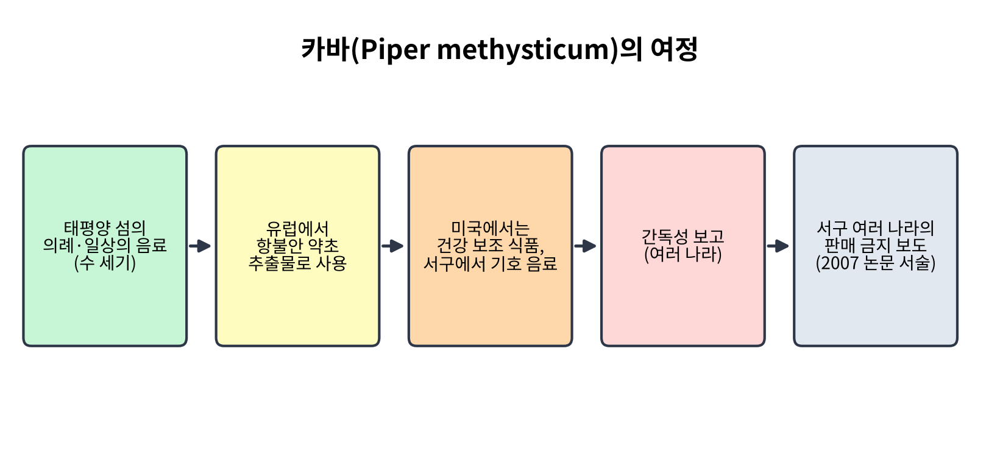
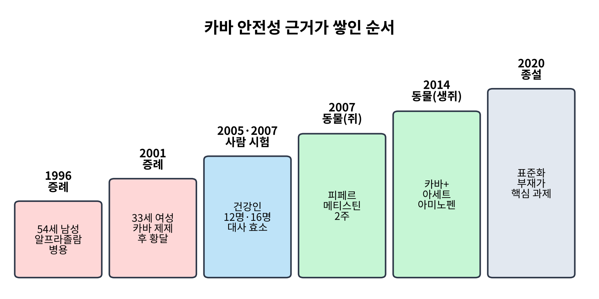
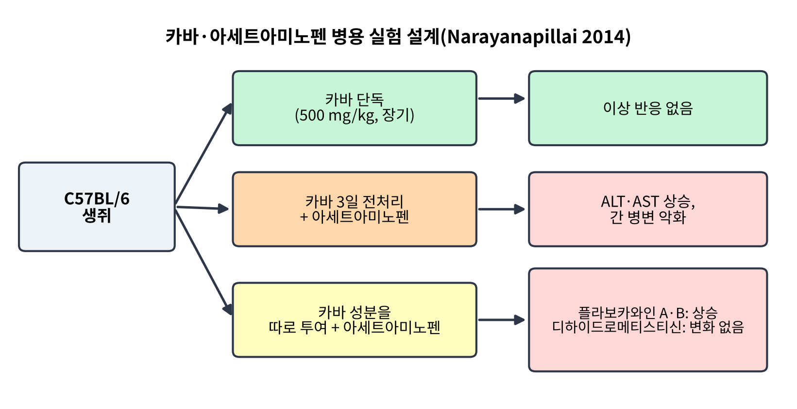
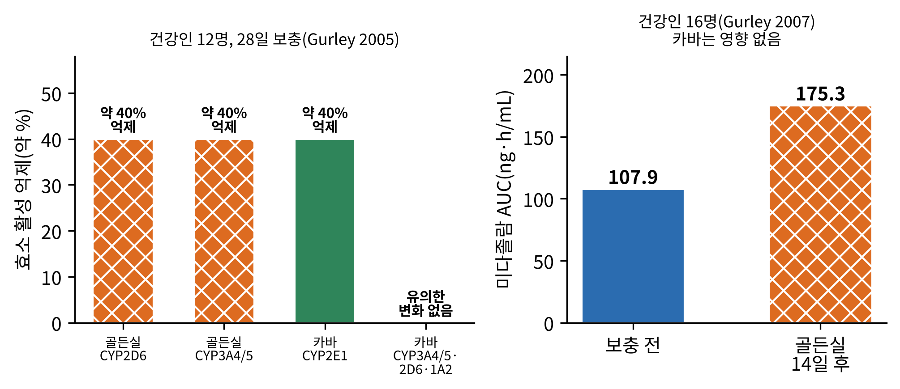
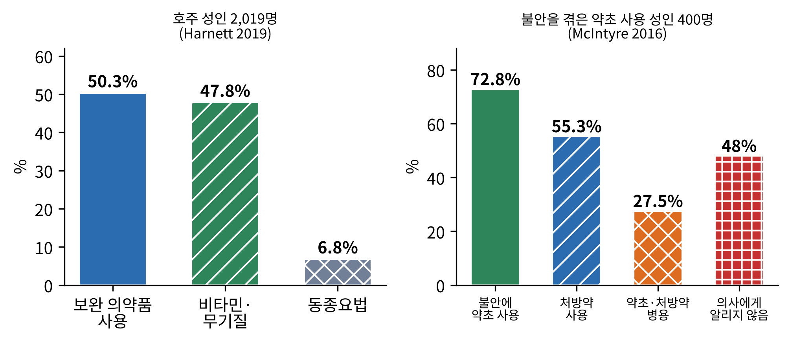
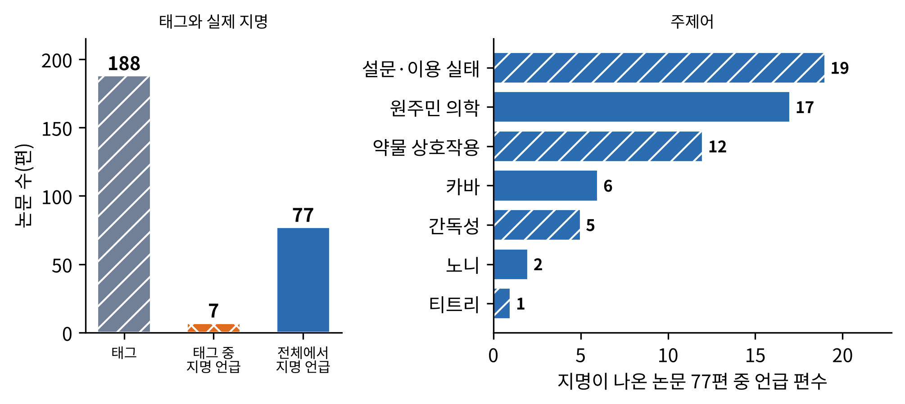

# 9장. 오세아니아: 카바와 안전성의 시험

<strong>그림 9-1. 카바(Piper methysticum)의 여정.</strong> 태평양 섬의 오랜 음료가 유럽의 항불안 약초 추출물로, 미국의 건강 보조 식품으로 퍼지다가 간독성 보고를 계기로 여러 나라에서 문제가 된 과정을 개념도로 옮겼다. 마지막 칸의 판매 금지는 한 논문(Lim et al., 2007)의 서술이다.

<ul class="mini-toc">
<li>의례의 음료에서 약초 추출물로</li>
<li>첫 경고: 건강식품점의 혼수</li>
<li>간독성 보고와 용의 성분 찾기</li>
<li>사람에서 확인한 약물 대사</li>
<li>호주의 약초 이용과 위험</li>
<li>노니와 티트리: 퍼진 약초의 근거</li>
<li>논문 속의 오세아니아</li>
</ul>

## 이 장을 읽기 전에

이 책의 지역 장 가운데 이 장은 연구 근거의 모양이 가장 다르다. 앞선 장들에서는 지역마다 민족식물학 조사와 전통 의학의 개관이 많았다. 오세아니아와 태평양에서는 지역 전통을 직접 다룬 논문이 말뭉치에 거의 없고, 대신 이 지역에서 출발한 약초 하나가 세계로 퍼지며 안전성 논쟁을 일으킨 이야기, 그리고 호주 소비자의 약초 이용 실태가 연구의 중심이다.

이 장은 그래서 카바(kava)를 중심으로 한다. 카바는 하나의 약초가 전통 음료에서 약, 보충제, 금지 대상으로 옮겨 가는 동안 어떤 종류의 근거가 어떤 순서로 쌓이는지를 가장 선명하게 보여 주는 사례이다. 증례 보고, 사람에서의 약물 대사 시험, 동물 실험이 각기 무엇을 확인하고 무엇을 확인하지 못했는지 구분해서 읽는다. 이 장의 수치는 모두 말뭉치에서 확인한 초록에 근거한다.

## 1. 의례의 음료에서 약초 추출물로

카바 음료는 보통 후추과 식물인 피퍼 메티스티쿰(Piper methysticum)의 뿌리로 만들며, 태평양 섬 주민들이 수 세기 동안 마셔 왔다. 카바 추출물 제제는 한때 유럽에서 불안을 치료하는 약초 의약품으로 쓰였고, 미국에서는 건강 보조 식품으로 팔리며, 서구에서는 기호 음료로 인기를 얻고 있다고 한 종설이 정리한다. 같은 종설은 카바와 그 핵심 식물 화합물이 항염증·항암 효과와 잘 알려진 신경학적 이점을 가진다는 최근 연구를 소개하면서, 특정 카바 제제와 연관된 드문 간독성이 있었으나 그 검증이나 일관된 기전은 없다고 적는다. 가장 큰 과제는 카바 제품의 다양성과 표준화의 부재라고 한다(Bian et al., 2020).

이 서술에서 이 장이 따라갈 구조가 나온다. 하나의 식물이 문화적 맥락(음료), 의약 맥락(항불안제), 소비 맥락(보충제)을 오가면 제제가 달라지고, 제제가 달라지면 안전성의 질문도 달라진다. 이 책 13장(표준화와 약전)에서 다룰 문제의 출발점이 여기에 있다.

## 2. 첫 경고: 건강식품점의 혼수

카바에 대한 경고 가운데 말뭉치에서 확인되는 가장 이른 것은 1996년 『Annals of Internal Medicine』에 실린 짧은 서신이다. 알메이다(Joenie Almeida)와 그림슬리(Edwin Grimsley)는 건강식품점에서 산 약초 제품과 처방약의 상호작용으로 의심되는 증례를 보고했다. 54세 남성이 졸리고 방향 감각을 잃은 상태로 입원했다. 복용 중인 약은 알프라졸람(alprazolam), 시메티딘(cimetidine), 테라조신(terazosin)이었다. 활력 징후와 검사 결과는 정상이었고 알코올 검사는 음성이었으며, 약물 선별 검사에서 벤조디아제핀이 양성이었다. 환자는 몇 시간 뒤 더 또렷해졌고, 자신이 "자연" 제품을 먹고 있었다고 말했다. 저자들은 카바와 알프라졸람의 상호작용이 반혼수 상태를 일으켰다고 보고했다(Almeida & Grimsley, 1996). 이 서신은 건강식품점에서 파는 약이 대부분 규제되지 않았고 약물 상호작용의 가능성이 크다는 말로 시작한다.

**검출과 해석.** 이 증례가 검출한 것은 한 사람에서의 시간적 연관이다. 이 서신은 약물 상호작용의 인과를 입증하지 못한다. 환자는 알프라졸람 외에도 두 가지 약을 먹고 있었고, 초록에서 확인되는 서술은 서신의 앞부분뿐이다. 그러나 증례 보고의 가치는 가설을 세우는 데 있다. 이 서신이 제시한 가설, 곧 카바가 벤조디아제핀의 효과를 증폭시킬 수 있다는 가설은 카바가 GABA 수용체에 작용한다는 설치류 연구 몇 편을 참고문헌으로 삼고 있다.

## 3. 간독성 보고와 용의 성분 찾기

이 절과 다음 절이 따라갈 근거의 순서를 먼저 그림 9-2로 보인다.

<figure class="fig">

<figcaption><strong>그림 9-2. 카바 안전성 근거가 쌓인 순서.</strong> 증례 두 편(1996, 2001)이 경고를 낸 뒤, 사람의 약물 대사 시험(2005, 2007)과 동물 실험(2007, 2014)이 기전을 찾았고, 2020년의 종설은 표준화를 핵심 과제로 정리했다.</figcaption>
</figure>

**또 하나의 증례.** 2001년 루스만(Stefan Russmann) 등은 스위스에서 카바 제제에 의한 간 손상으로 의심되는 증례를 보고했다. 33세 여성이 수면과 불안 장애용 카바락톤 제제(라이탄, Laitan; 카바락톤 하루 210 mg)를 3주간 복용했다. 두 달 뒤 다시 복용을 시작했고, 3주 뒤 알코올 60 g을 마신 다음 날 권태감, 식욕 부진, 황달이 생겼다. 아미노전이효소, 빌리루빈, 알칼리 인산분해효소가 올랐다(수치 일부는 초록에서 잘려 확인하지 못했다). 이 약초 제제는 많은 나라에서 처방전 없이 구할 수 있다고 서신은 밝힌다(Russmann et al., 2001).

**여러 나라의 보고.** 이후 간독성 사례가 미국과 유럽에서 여럿 보고되었다고 정리하는 종설이 있다(Pantano et al., 2016). 임상 양상이 일시적인 간 효소 상승에서 전격성 간부전과 사망까지 이르렀고, 일부는 간 이식을 받았다고 한 종설도 있다(Amorim et al., 2007). 2007년의 한 동물 실험 논문은 이런 보고 뒤에 카바가 독일, 프랑스, 스위스, 호주, 캐나다 같은 서구 국가에서 금지되었다고 서술하면서도, 미국에서는 건강식품점과 소수 민족 시장에서 여전히 팔린다고 적었다(Lim et al., 2007). 금지의 구체적 시점과 범위는 이 말뭉치의 초록으로 확인하지 못했으므로 이 책은 이 서술을 해당 논문의 서술로만 옮긴다.

**쥐에서의 시험.** 같은 2007년 논문은 카바에서 어떤 성분이 문제인지를 따졌다. 이전 연구에서 잎과 줄기 껍질에 많은 카바 알칼로이드 피페르메티스틴(pipermethystine, PM)이 간암 세포주 HepG2에서 미토콘드리아 독성을 일으키는 반면, 뿌리줄기에 많은 생리활성 성분 카바락톤은 그렇지 않았다. 이 연구에서는 Fischer-344 쥐에 PM 10 mg/kg 또는 카바 뿌리줄기 추출물(KRE) 100 mg/kg을 2주 동안 투여했다. 간 기능 검사나 지질 과산화, 세포 사멸 표지자에서 뚜렷한 간독성은 나타나지 않았다. 다만 PM 투여 쥐는 간의 글루타티온, 슈퍼옥시드 디스뮤타제, 종양괴사인자 알파 mRNA, 그리고 약물 대사 효소 CYP2E1과 CYP1A2가 늘어, 산화 스트레스에 대한 적응과 약물 간 상호작용의 가능성을 시사했다(Lim et al., 2007).

**생쥐에서의 병용 시험.** 2014년 나라야나필라이(Sreekanth Narayanapillai) 등은 이 질문을 병용 쪽으로 옮겼다. 연구진은 카바가 사람에서 드물지만 심각한 간독성과 연관되는데 동물 모델에서는 이 위험이 포착된 적이 없다는 점에서 출발했다. C57BL/6 생쥐에 카바를 단독으로 투여했을 때는 500 mg/kg의 장기 투여에서도 이상이 없었다. 그러나 카바를 3일 동안 먼저 투여한 뒤 아세트아미노펜(APAP)을 주자 아세트아미노펜에 의한 간독성이 커져서 혈청 ALT와 AST가 오르고 간 병변이 심해졌다. 카바 속 칼콘 계열 성분인 플라보카와인 A와 B(FKA, FKB)가 이 상승 효과를 재현한 반면, 대표적 카바락톤인 디하이드로메티스티신(DHM)은 그런 효과가 없었다. 연구진은 이 결과가 카바와 그 칼콘 성분의 간독성 위험을 처음으로 생체에서 보여 주며, 드문 간독성이 약초와 약의 상호작용으로 설명될 수 있음을 시사한다고 결론 내렸다(Narayanapillai et al., 2014).

<figure class="fig">

<figcaption><strong>그림 9-3. 카바와 아세트아미노펜의 병용 실험 설계와 결과.</strong> 카바 단독 투여는 이상이 없었으나 3일 전처리 후 아세트아미노펜을 주면 간 효소가 올랐고, 이 효과는 칼콘 계열의 플라보카와인 A·B에서 재현되고 카바락톤 디하이드로메티스티신에서는 재현되지 않았다(Narayanapillai et al., 2014).</figcaption>
</figure>

**검출과 해석.** 이 두 동물 실험이 검출한 것은 서로 다르다. 2007년 실험은 PM의 단기 투여가 간 기능 검사를 바꾸지 않으면서 효소(CYP2E1, CYP1A2)를 늘린다는 점을 검출했고, 2014년 실험은 카바 단독이 아니라 병용에서 독성이 나타난다는 점을 검출했다. 해석으로 이어지는 연결은 흥미롭다. 사람에서 드물게 나타나는 간독성은, 단독 독성이 아니라 다른 약(또는 알코올)과의 병용 같은 조건에서 나타날 수 있다는 가설이 가능해진다. 이 장의 2001년 증례에서 환자가 알코올 60 g을 마신 다음 날 증상이 나타났다는 점이 이 가설과 일치하지만, 이 연결은 저자의 해석이며 두 연구가 직접 이어진 것은 아니다. 두 실험 모두 동물 실험이므로 사람의 위험을 직접 보여 주지 않는다.

## 4. 사람에서 확인한 약물 대사

그렇다면 사람에서는 어떨까. 같은 연구자 구스리(Bill Gurley) 등이 두 번의 시험으로 카바의 약물 대사 효소 영향을 직접 측정했다.

2005년 시험은 건강인 12명(여 6)에게 골든실(goldenseal, Hydrastis canadensis), 블랙 코호시(black cohosh), 카바, 발레리안(valerian)을 각각 28일씩 무작위 순서로 투여했다. 각 단계 사이에는 30일의 세척 기간을 두었다. 약물 대사 효소 CYP1A2, CYP2D6, CYP2E1, CYP3A4/5의 활성을 미다졸람, 카페인, 클로르족사존, 데브리소퀸 같은 탐침 약물의 대사체 비율로 측정했다. 골든실은 CYP2D6와 CYP3A4/5 활성을 약 40% 억제했다. 카바는 CYP2E1 활성만 약 40% 줄였고, 다른 효소에는 유의한 변화가 없었다(Gurley et al., 2005).

2007년 시험은 건강인 16명을 골든실군과 카바군으로 나누어 각각 14일 동안 투여하고, 미다졸람(8 mg) 약동학으로 CYP3A 활성을 평가했다. 골든실은 미다졸람 노출을 뚜렷이 늘렸다(AUC 107.9에서 175.3 ng·h/mL로, 청소율은 1.26에서 0.81 L/h/kg으로). 카바는 미다졸람의 체내 처리에 영향이 없었다(Gurley et al., 2007).

<figure class="fig">

<figcaption><strong>그림 9-4. 사람에서 확인한 카바와 골든실의 약물 대사 효소 영향.</strong> 왼쪽은 건강인 12명 28일 보충 시험(약 40% 억제는 초록의 표현), 오른쪽은 건강인 16명 시험에서 골든실 투여 전후의 미다졸람 AUC이다(Gurley et al., 2005, 2007).</figcaption>
</figure>

**검출과 해석.** 두 시험이 검출한 것은 카바의 효소 영향이 선택적이라는 점이다. 6장에서 본 세인트존스워트가 CYP3A4를 유도해 많은 약의 농도를 낮춘 것과 달리, 카바는 CYP3A4/5에 유의한 영향이 없었고 CYP2E1만 약 40% 줄였다. 이 결과는 앞 절의 가설과 연결된다. CYP2E1은 아세트아미노펜의 독성 대사체 생성에 관여하는 효소로 알려져 있으므로, 이 효소의 변화가 병용 독성과 관계가 있을 수 있다는 추측이 가능하다. 그러나 이 연결은 말뭉치의 초록에서 직접 확인되지 않은 일반적 약리학 지식에 근거한 추측이다. 두 시험 모두 건강인에서의 단기 대사 지표 시험이며, 간독성의 위험을 직접 측정한 것은 아니다.

<strong>표 9-1. 카바 안전성 근거의 단계</strong>

| 연도 | 연구 | 종류 | 대상 | 확인된 것 |
|---|---|---|---|---|
| 1996 | Almeida & Grimsley | 증례 | 54세 남성 1명 | 알프라졸람 병용 후 반혼수 |
| 2001 | Russmann 등 | 증례 | 33세 여성 1명 | 카바 제제 후 황달·간 효소 상승 |
| 2005 | Gurley 등 | 사람 시험 | 건강인 12명, 28일 | CYP2E1만 약 40% 감소 |
| 2007 | Gurley 등 | 사람 시험 | 건강인 16명, 14일 | 미다졸람 대사에 영향 없음 |
| 2007 | Lim 등 | 동물 | 쥐, 2주 | 간 검사 정상, 효소 증가 |
| 2014 | Narayanapillai 등 | 동물 | 생쥐, 3일 전처리 | 아세트아미노펜 병용 시 간독성 상승 |
| 2020 | Bian 등 | 종설 | 문헌 | 표준화·품질 관리 부재가 핵심 과제 |

## 5. 호주의 약초 이용과 위험

카바 이야기가 이 지역에서 출발한 약초의 이야기라면, 호주의 연구는 약초를 쓰는 사람들의 이야기이다. 네 연구가 서로 다른 각도에서 이를 보여 준다.

**원주민의 전통 의학.** 2013년 올리버(Stefanie Oliver)는 호주 원주민 사회의 전통 의학이 일차 보건에서 어떤 역할을 하는지 문헌을 고찰했다. 식민화의 영향으로 전통 의학 관행이 사라질 위험에 있고, 식민화 이전에는 전통 치유(치료사, 치유의 노래, 부시 메디신)가 유일한 일차 보건이었다는 점에서 출발했다. 고찰 결과, 학술 문헌은 부족하지만 전통 의학 관행이 여전히 남아 있고 공동체마다 정도가 크게 다르며, 이 차이는 문화와 질병관에 대한 믿음, 질병의 유형, 서양 의학 치료의 성공, 치료사와 부시 메디신에의 접근성에 달려 있었다. 전통 관행은 서양 의료와 순차적으로, 구획 지어, 또는 동시에 쓰이고 있었다(Oliver, 2013).

**이민자의 약초.** 2007년 한(Gil-Soo Han)과 밸리스(Harry Ballis)는 시드니의 한국계 이민자 공동체에서 1995~1997년에 수집한 120건의 면담(서양 의사, 전통 의료인, 공동체 지도자, 이민자)을 바탕으로 한방의 위치를 분석했다. 이민자가 호스트 사회에서 차지하는 사회적 위치가 가져온 문화적 관행을 바꾸거나 재구성한다는 점과, 민족 의학의 유입이 호주의 지배적 의학을 변화시킨다는 점을 보였다(Han & Ballis, 2007). 이 책 3장의 동아시아 전통이 호주로 이동해 새 사회 안에서 변형된다는 보기라고 읽을 수 있다.

**소비자의 이용 실태.** 2019년 하넷(Joanna Harnett) 등은 호주 성인 2,019명의 전국 대표 표본을 온라인으로 조사했다. 보완 의약품(CM) 제품 사용 비율은 50.3%였고, 가장 많이 쓰이는 것은 비타민·무기질 보충제(47.8%), 가장 적게 쓰이는 것은 동종요법 제품(6.8%)이었다. CM 제품을 쓰는 사람 대부분이 약국 의약품도 함께 쓰고 있었다. 여성, 고학력자, 민간 의료 보험이 없는 사람이 CM 제품을 더 많이 썼다. 연구진은 지난 20년 가까이 호주 사용자 수가 비교적 안정적이고 상당한 규모를 유지했다고 결론 내렸다(Harnett et al., 2019).

2016년 매킨타이어(Erica McIntyre) 등은 불안을 겪고 약초를 쓴 호주 성인 400명을 조사했다. 82%가 지난 12개월에 불안 증상을 겪었고 47%는 불안 장애 진단을 받은 적이 있었다. 72.8%가 평생 불안 증상에 약초를 썼고, 55.3%는 처방 의약품을 썼으며, 27.5%는 약초를 처방약과 함께 썼다. 약초 정보의 출처는 인터넷과 가족·친구가 가장 많았고, 48%는 약초 사용을 의사에게 알리지 않았다. 연구진은 약초가 흔히 자가 처방으로 쓰이고 전문가를 찾는 경우가 드물어, 환자가 가장 적절한 치료를 못 받거나 위험할 수도 있다고 우려했다(McIntyre et al., 2016).

<figure class="fig">

<figcaption><strong>그림 9-5. 호주 성인의 보완 의약품과 약초 이용.</strong> 왼쪽은 호주 성인 2,019명의 전국 표본 조사(Harnett et al., 2019), 오른쪽은 불안을 겪은 약초 사용 성인 400명 조사(McIntyre et al., 2016)이다. 두 조사는 대상과 질문이 달라 서로 비교하는 그림이 아니다.</figcaption>
</figure>

**위험에 대한 경고.** 2017년 바이어드(Roger Byard) 등은 『Medical Journal of Australia』에서 전통 약초 제품이 호주 사회에 어떤 위험이 되는지 짚었다. 약초 제품이 처방약보다 안전하다는 믿음이 널리 퍼져 있지만, 일부 전통 약초 제제는 중금속과 독성 화학물질, 천연 독소를 함유하고 급성 간·신부전, 기존 질환의 악화, 사망까지 일으킬 수 있다고 한다. 내용과 품질이 엄격히 관리되지 않아 일부 성분이 표기되지 않거나 농도가 부정확하고, 마황(ephedra)이나 개족도리(Asarum europaeum), 멸종 위기 동물 같은 불법 성분이 들어 있을 수도 있다고 했다. 또 겉보기 효과를 높이려 처방약을 몰래 첨가하기도 한다. 서구에서 전통 약초 제제를 규제하고 감시하는 체계가 없어서 이 제품이 질병과 사망에 기여하는 정도가 알려져 있지 않다는 것이 저자들의 결론이다(Byard et al., 2017).

**검출과 해석.** 이 네 연구가 검출한 것은 효능이 아니라 사용의 구조이다. 호주 성인의 절반이 보완 의약품을 쓰고, 불안을 겪는 약초 사용자의 약 절반이 의사에게 알리지 않으며, 사용자의 상당수가 처방약을 함께 쓴다는 사실은, 이 장 앞부분 카바 사례의 질문이 이 지역에서는 일상의 질문임을 보여 준다. 즉 병용 사실이 보고되지 않으면 상호작용이 있어도 발견되지 않는다. 이 해석은 저자의 해석이다. 바이어드 등의 논문은 위험의 가능성을 경고하는 논평이며, 사건 수나 비율의 자료를 제시하지 않는다.

## 6. 노니와 티트리: 퍼진 약초의 근거

태평양과 호주에서 출발해 세계로 퍼진 약초가 둘 더 있다. 둘 다 이 말뭉치의 초록으로 확인되는 근거가 좁다.

**노니(Morinda citrifolia).** 포테라트(Olivier Potterat)와 함부르거(Matthias Hamburger)는 2007년 노니 열매의 식물 화학, 약리, 안전성을 정리했다. 노니 제품은 1990년대부터 미국에서 시판되었고 전 세계로 퍼졌으며, 노니 열매즙은 2003년 유럽 위원회가 신규 식품(Novel Food)으로 승인했다. 시험관과 일부 생체 실험에서 유익한 효과가 보이지만 임상 자료는 사실상 없고, 실험 약리학의 발견이 임상적으로 의미가 있는지는 현재 명확하지 않다고 했다. 독성학적 평가에서는 노니즙이 안전하다고 보았으나, 최근 간독성 증례가 보고되어 유럽에서 안전성이 재검토되었다. 유럽 식품안전청은 간 이상과 노니즙 섭취 사이의 연관을 보지 못했지만, 계속된 감시와 주의가 바람직하다고 했다(Potterat & Hamburger, 2007). 카바와 같은 안전성 질문이 노니에서도 나타났다는 점이 눈에 띈다.

**티트리 오일.** 호주 토착 식물 멜랄레우카 알테르니폴리아(Melaleuca alternifolia)에서 증류한 티트리 오일(tea tree oil)은 테르피넨-4-올(terpinen-4-ol)을 최소 함량 이상, 1,8-시네올을 최대 함량 이하로 가지는 정유로 정의된다. 2012년 온라인 게재된 파지아르(Nader Pazyar) 등의 피부과 종설은 테르피넨-4-올이 강한 항균·항염 성질을 가지며, 피부와 점막의 세균, 바이러스, 진균, 원충 감염에 광범위한 항균 활성이 보고되었고, 여드름, 지루성 피부염, 만성 치은염에 쓸 수 있다는 연구가 있다고 정리했다(Pazyar et al., 2013). 이 서술은 종설의 개관이며 개별 시험의 수치를 이 책이 확인한 것이 아니므로, 효능은 확인되지 않았다고 읽는 것이 안전하다.

<strong>표 9-2. 호주·태평양 약초 연구에서 이 장이 확인한 사항</strong>

| 주제 | 연구 | 방법 | 핵심 |
|---|---|---|---|
| 원주민 전통 의학 | Oliver (2013) | 문헌 고찰 | 전통 관행이 서양 의료와 병행 |
| 이민자의 한방 | Han & Ballis (2007) | 면담 120건 | 이민 사회에서 의료 선택의 재구성 |
| 보완 의약품 이용 | Harnett 등 (2019) | 성인 2,019명 설문 | 사용 50.3%, 병용 흔함 |
| 불안과 약초 | McIntyre 등 (2016) | 성인 400명 설문 | 48%가 의사에게 알리지 않음 |
| 약초의 위험 | Byard 등 (2017) | 논평 | 품질·표기·불법 성분 우려 |
| 노니 | Potterat & Hamburger (2007) | 종설 | 임상 자료 부족, 간독성 재검토 |
| 티트리 오일 | Pazyar 등 (2013) | 종설 | 항균·항염 보고, 개별 시험은 미확인 |

## 7. 논문 속의 오세아니아

이 책의 말뭉치에서 오세아니아로 분류한 논문은 188편이다. 그런데 제목과 초록에 호주, 뉴질랜드, 태평양, 마오리, 원주민 같은 지명이나 집단 이름이 실제로 나오는 논문은 그중 7편뿐이다. 나머지는 분류 규칙이 광범위한 식물 약리 논문을 이 태그로 걸러 들였기 때문에, 이 지역과 관련이 없는 논문이 대부분이다. 이는 8장에서 아메리카에서 확인한 문제와 같다. 말뭉치 전체(7,182편)에서 같은 지명이 나오는 논문은 77편이며, 이 장은 그 77편을 이 지역의 대표 표본으로 읽었다.

77편의 주제로는 설문·이용 실태(19편), 원주민 의학(17편), 약물 상호작용(12편), 카바(6편), 간독성(5편), 노니(2편), 티트리(1편)가 나왔다. 이 계량은 이 지역의 실제 연구 비중이라기보다 이 책 말뭉치의 구성을 반영한다.

<figure class="fig">

<figcaption><strong>그림 9-6. 오세아니아 논문 말뭉치의 구성.</strong> 왼쪽은 오세아니아 태그 188편, 그중 지명이 제목·초록에 나온 7편, 전체 말뭉치에서 지명이 나온 77편, 오른쪽은 그 77편에서 주제어가 언급된 편수이다. 한 논문이 여러 항목에 걸칠 수 있다.</figcaption>
</figure>

<strong>표 9-3. 이 장의 연구들이 답할 수 있는 것과 답할 수 없는 것</strong>

| 연구 | 확인된 것 | 확인되지 않은 것 |
|---|---|---|
| 카바 증례 (1996, 2001) | 시간적 연관, 가설의 출발 | 인과, 발생률 |
| 카바 사람 시험 (2005, 2007) | CYP2E1 약 40% 감소, CYP3A 무영향 | 간독성 위험 |
| 카바 동물 실험 (2007, 2014) | 병용 시 간독성 상승, 성분 후보 | 사람에서의 기전 |
| 호주 설문 (2016, 2019) | 사용 규모, 병용과 미공개 | 병용의 실제 위해 |
| 노니·티트리 종설 | 근거 범위의 요약 | 임상 효능 |

## 이 장을 마치며

오세아니아에서 이 책이 배우는 것은 약초의 효능이 아니라, 하나의 약초가 문화 속의 음료에서 세계의 제품이 될 때 안전성의 질문이 어떻게 만들어지는지이다. 카바는 증례 보고에서 시작해 사람의 효소 시험과 동물의 병용 시험을 거치며 가설이 하나씩 좁혀졌다. 그러나 이 모든 연구가 공통으로 가리킨 것은 표준화의 부재였다. 호주 소비자의 조사는 다른 쪽의 문제, 곧 약초를 쓰는 사람의 절반 가까이가 의사에게 알리지 않는다는 점을 보여 주었다.

다음 10장부터는 지역을 벗어나 주제로 간다. 먼저 약리학이다. 이 책이 지금까지 본 약초의 효과가 몸속에서 어떤 과정으로 일어나는지를 다룬다.

## 참고문헌

- Almeida, J. C., & Grimsley, E. W. (1996). Coma from the health food store: Interaction between kava and alprazolam. *Annals of Internal Medicine, 125*(11), 940–941. https://doi.org/10.7326/0003-4819-125-11-199612010-00023
- Amorim, M. F. D., Diniz, M. F. F. M., Araújo, M. S. T., Pita, J. C. L. R., Dantas, J. G., Ramalho, J. A., Xavier, A. L., Palomaro, T. V., & Júnior, N. L. B. (2007). The controvertible role of kava (*Piper methysticum* G. Foster) an anxiolytic herb, on toxic hepatitis. *Revista Brasileira de Farmacognosia, 17*(3), 448–454. https://doi.org/10.1590/s0102-695x2007000300020
- Bian, T., Corral, P., Wang, Y., Botello, J., Kingston, R., Daniels, T., Salloum, R. G., Johnston, E., Huo, Z., Lu, J., Liu, A. C., & Xing, C. (2020). Kava as a clinical nutrient: Promises and challenges. *Nutrients, 12*(10), Article 3044. https://doi.org/10.3390/nu12103044
- Byard, R. W., Musgrave, I., Maker, G., & Bunce, M. (2017). What risks do herbal products pose to the Australian community? *Medical Journal of Australia, 206*(2), 86–90. https://doi.org/10.5694/mja16.00614
- Gurley, B. J., Gardner, S. F., Hubbard, M. A., Williams, D. K., Gentry, W. B., Khan, I. A., & Shah, A. (2005). In vivo effects of goldenseal, kava kava, black cohosh, and valerian on human cytochrome P450 1A2, 2D6, 2E1, and 3A4/5 phenotypes. *Clinical Pharmacology & Therapeutics, 77*(5), 415–426. https://doi.org/10.1016/j.clpt.2005.01.009
- Gurley, B. J., Swain, A., Hubbard, M. A., Hartsfield, F., Thaden, J., Williams, D. K., Gentry, W. B., & Tong, Y. (2007). Supplementation with goldenseal (*Hydrastis canadensis*), but not kava kava (*Piper methysticum*), inhibits human CYP3A activity in vivo. *Clinical Pharmacology & Therapeutics, 83*(1), 61–69. https://doi.org/10.1038/sj.clpt.6100222
- Han, G.-S., & Ballis, H. (2007). Ethnomedicine and dominant medicine in multicultural Australia: A critical realist reflection on the case of Korean-Australian immigrants in Sydney. *Journal of Ethnobiology and Ethnomedicine, 3*, Article 1. https://doi.org/10.1186/1746-4269-3-1
- Harnett, J., McIntyre, E., Steel, A., Foley, H., Sibbritt, D., & Adams, J. (2019). Use of complementary medicine products: A nationally representative cross-sectional survey of 2019 Australian adults. *BMJ Open, 9*(7), Article e024198. https://doi.org/10.1136/bmjopen-2018-024198
- Lim, S. T. S., Dragull, K., Tang, C. S., Bittenbender, H. C., Efird, J. T., & Nerurkar, P. V. (2007). Effects of kava alkaloid, pipermethystine, and kavalactones on oxidative stress and cytochrome P450 in F-344 rats. *Toxicological Sciences, 97*(1), 214–221. https://doi.org/10.1093/toxsci/kfm035
- McIntyre, E., Saliba, A. J., Wiener, K. K. K., & Sarris, J. (2016). Herbal medicine use behaviour in Australian adults who experience anxiety: A descriptive study. *BMC Complementary and Alternative Medicine, 16*, Article 60. https://doi.org/10.1186/s12906-016-1022-3
- Narayanapillai, S. C., Leitzman, P., O'Sullivan, M. G., & Xing, C. (2014). Flavokawains A and B in kava, not dihydromethysticin, potentiate acetaminophen-induced hepatotoxicity in C57BL/6 mice. *Chemical Research in Toxicology, 27*(10), 1871–1876. https://doi.org/10.1021/tx5003194
- Oliver, S. J. (2013). The role of traditional medicine practice in primary health care within Aboriginal Australia: A review of the literature. *Journal of Ethnobiology and Ethnomedicine, 9*, Article 46. https://doi.org/10.1186/1746-4269-9-46
- Pantano, F., Tittarelli, R., Mannocchi, G., Zaami, S., Ricci, S., Giorgetti, R., Terranova, D., Busardò, F. P., & Marinelli, E. (2016). Hepatotoxicity induced by "the 3Ks": Kava, kratom and khat. *International Journal of Molecular Sciences, 17*(4), Article 580. https://doi.org/10.3390/ijms17040580
- Pazyar, N., Yaghoobi, R., Bagherani, N., & Kazerouni, A. (2013). A review of applications of tea tree oil in dermatology. *International Journal of Dermatology, 52*(7), 784–790. https://doi.org/10.1111/j.1365-4632.2012.05654.x
- Potterat, O., & Hamburger, M. (2007). *Morinda citrifolia* (Noni) fruit: Phytochemistry, pharmacology, safety. *Planta Medica, 73*(3), 191–199. https://doi.org/10.1055/s-2007-967115
- Russmann, S., Lauterburg, B. H., & Helbling, A. (2001). Kava hepatotoxicity. *Annals of Internal Medicine, 135*(1), 68–69. https://doi.org/10.7326/0003-4819-135-1-200107030-00036
