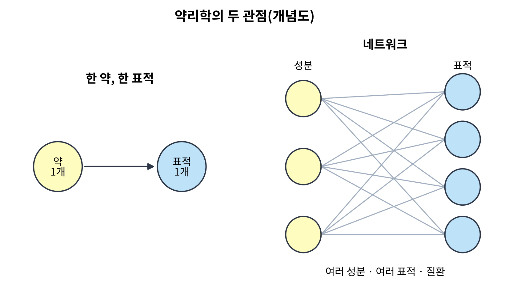
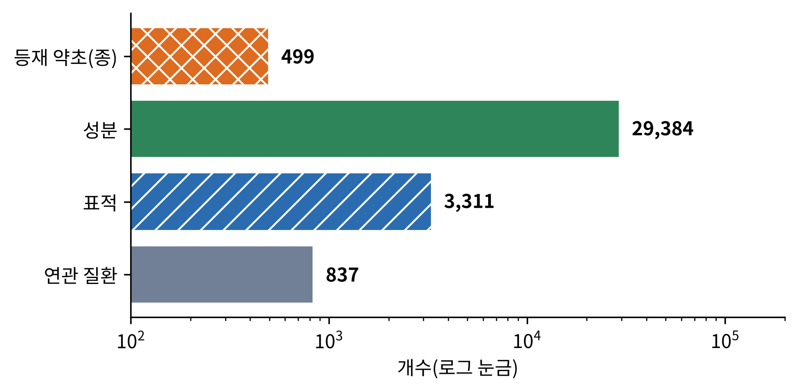
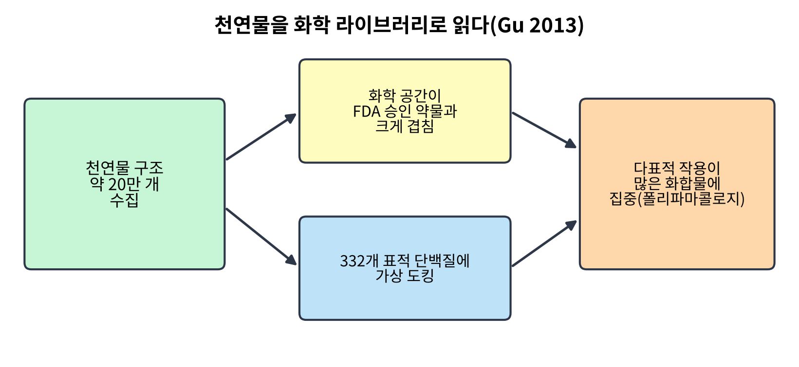
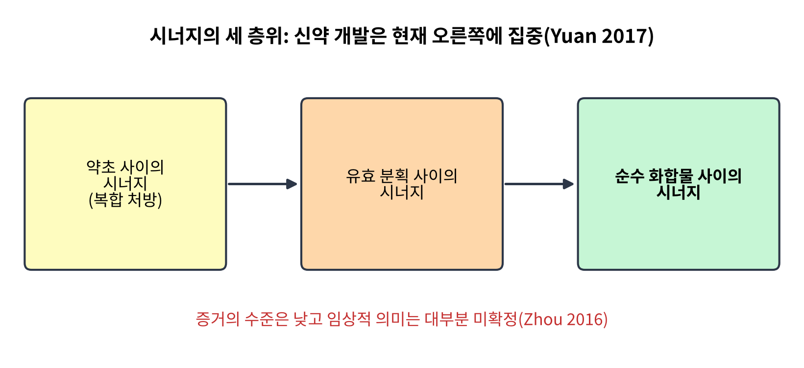
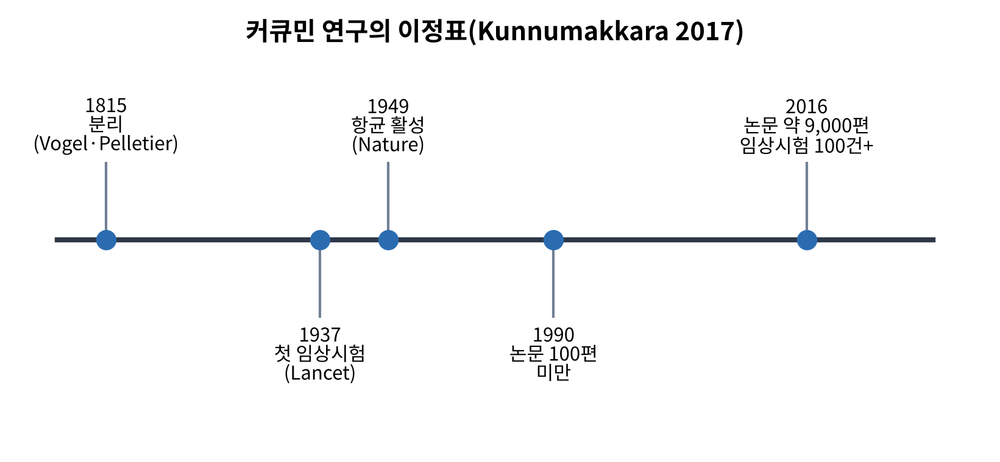
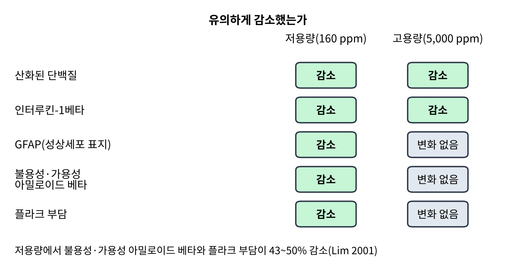
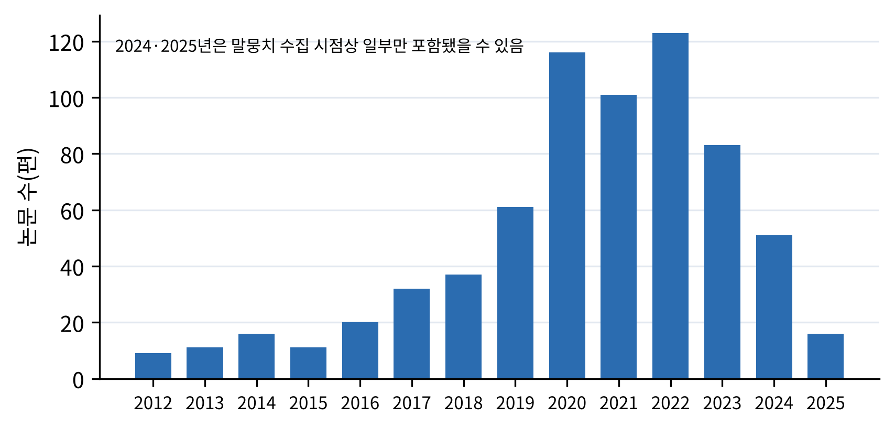

# 10장. 약리학: 한 분자에서 네트워크로

<strong>그림 10-1. 약리학의 두 관점(개념도).</strong> 왼쪽은 한 약이 한 표적에 작용한다는 전통적 모형, 오른쪽은 여러 성분이 여러 표적에 동시에 작용하고 그것이 질환과 이어진다는 네트워크 모형이다. 개념을 단순화한 그림이다.

<ul class="mini-toc">
<li>한 약, 한 표적의 한계</li>
<li>약초를 데이터베이스로 읽다</li>
<li>천연물을 화학 라이브러리로 읽다</li>
<li>시너지는 정말 있는가</li>
<li>커큐민: 다중 표적의 성공과 함정</li>
<li>단샨과 임상의 질</li>
<li>인공지능과 네트워크 약리학</li>
<li>논문 속의 네트워크 약리학</li>
</ul>

## 이 장을 읽기 전에

앞의 아홉 장은 지역을 따라 약초를 보았다. 이제부터는 주제로 간다. 이 장은 약초의 효과가 몸속에서 어떻게 일어나는지를 설명하려는 약리학의 시도를 다룬다. 약리학은 오랫동안 한 가지 모형으로 약을 이해했다. 약은 한 분자이고, 그 분자는 한 표적 단백질에 결합하며, 그 결합이 효과를 낸다는 모형이다. 이 모형은 약물 개발에 큰 성공을 가져왔다. 그러나 약초는 처음부터 이 모형에 맞지 않았다. 약초에는 수십에서 수백 가지 성분이 들어 있고, 전통 처방은 여러 약초를 섞기 때문이다.

이 장의 질문은 세 가지이다. 첫째, 약초의 다성분·다표적 작용을 설명하려는 네트워크 약리학은 무엇을 하는가. 둘째, 약초 성분의 시너지라는 오래된 주장은 얼마나 입증되었는가. 셋째, 이 접근이 가장 널리 연구된 사례인 커큐민에서 어떤 성공과 함정이 나타났는가. 이 장의 수치는 모두 말뭉치에서 확인한 초록에 근거한다.

## 1. 한 약, 한 표적의 한계

장지(Runzhi Zhang) 등은 2019년의 개관에서 시스템 생물학의 발전이 네트워크 약리학이라는 개념을 낳았고, 이것이 "한 표적, 한 약" 모형에서 "네트워크 표적, 다성분 치료" 모형으로 패러다임을 옮겼다고 정리한다. 네트워크 약리학은 "화합물-단백질/유전자-질환" 네트워크를 세워 소분자의 조절 원리를 고속으로 밝히는 방법이며, 약물 조합, 특히 전통 중의학(TCM) 제제의 분석에 강하다고 한다(Zhang et al., 2019).

6장에서 본 에페르트(Thomas Efferth)와 코흐(Egon Koch)의 논의도 같은 방향이다. 이들은 신약 개발이 선택적 리간드를 설계하는 전략으로 많은 성공을 거두었지만, 많은 질환이 단일 원인이 아니라 다인자적이라서 이 전략이 한계를 보인다고 설명하고, 혼합물의 병용 작용에 기반한 식물요법이 새로운 치료 기회를 준다고 주장했다(Efferth & Koch, 2010). 이 논의는 가설적 틀이며, 개별 약초에서의 입증은 이 장의 다음 절들에서 따로 평가한다.

## 2. 약초를 데이터베이스로 읽다

네트워크 약리학을 하려면 먼저 약초의 성분, 표적, 질환을 모은 자료가 필요하다. 이 분야의 대표적 도구가 2014년 루(Jinlong Ru) 등이 만든 TCMSP(Traditional Chinese Medicine Systems Pharmacology Database and Analysis Platform)이다. 연구 배경은 현대 의학이 중의학과 자주 충돌하는데, 약초의 작용 기전이 잘 이해되지 않았기 때문이라는 것이다. TCMSP는 중국 약전에 등재된 약초 499종 전부와 성분 29,384개, 표적 3,311개, 연관 질환 837개를 담았다. 인체 경구 생체이용률, 반감기, 약물 유사성, Caco-2 투과성, 혈액-뇌 장벽, 리핀스키 5원칙 같은 12가지 ADME 관련 성질을 제공하며, 화합물-표적, 표적-질환 네트워크를 자동으로 만들 수 있다(Ru et al., 2014).

<figure class="fig">

<figcaption><strong>그림 10-2. TCMSP 데이터베이스의 규모.</strong> 등재 약초 499종, 성분 29,384개, 표적 3,311개, 연관 질환 837개(로그 눈금)(Ru et al., 2014).</figcaption>
</figure>

이런 데이터베이스는 TCMSP 하나가 아니다. 장지 등은 TCM 연구에 쓰이는 여러 데이터베이스와 도구를 정리하고, 10가지 유명 약초를 두고 각 데이터베이스의 검색 결과를 비교해 평가했다. 결론은 네트워크 약리학이 TCM 연구에 합리적 접근이지만, 강력하고 포괄적인 데이터베이스가 등장했음에도 개선이 필요하다는 것이었다(Zhang et al., 2019). 4장에서 본 아유르베다의 IMPPAT도 같은 유형이다. 데이터베이스는 약초 지식을 질의 가능한 형태로 바꾸는 도구이며, 데이터의 질은 그 안에 넣은 문헌의 질에 의존한다.

## 3. 천연물을 화학 라이브러리로 읽다

2013년 구(Jiangyong Gu) 등은 천연물 구조 약 20만 개(초록의 표기는 "19,7201"로, 197,201개로 읽힌다)를 모아 보고된 생물활성과 가상 선별 결과를 정리했다. 주성분 분석으로 화학 공간을 살펴보니 천연물과 미국 식품의약국(FDA) 승인 약물이 화학 공간에서 넓게 겹쳤다. 이는 천연물이 많은 선도 화합물의 잠재력을 가졌다는 뜻이다. 연구진은 천연물-표적 네트워크의 성질도 살펴, 연결이 많고 매개 중심성이 높은 화합물에 다표적 작용(polypharmacology)이 집중되어 있음을 발견했다. 실험 자료의 부족을 메우려고 모든 천연물을 FDA 승인 약물의 표적 단백질 332개에 가상 도킹하고, 도킹 점수 가중 예측 모형으로 약물 후보와 적응증을 예측했다. 결론은 천연물이 화학적 다양성이 크고 약물 유사 성질이 좋으며 여러 세포 표적 단백질과 상호작용할 수 있다는 것이었다(Gu et al., 2013).

<figure class="fig">

<figcaption><strong>그림 10-3. 천연물을 화학 라이브러리로 읽는 연구의 흐름.</strong> 천연물 구조 약 20만 개를 모아 화학 공간을 FDA 승인 약물과 비교하고, 332개 표적 단백질에 가상 도킹하여 다표적 작용이 많은 화합물을 찾았다(Gu et al., 2013).</figcaption>
</figure>

**검출과 해석.** 이 연구가 검출한 것은 컴퓨터 안에서의 구조적 겹침과 도킹 점수이다. 이 결과는 실험으로 입증된 결합이 아니라 예측이다. 이 책이 이 장에서 가장 조심하려는 점이 이것이다. 네트워크 약리학의 많은 논문은 데이터베이스에서 성분과 표적을 예측하고 네트워크를 그린 뒤, 그 네트워크가 약초의 효과를 설명한다고 결론 내린다. 그러나 예측과 입증 사이에는 단계가 있다. 구 등의 논문이 폴리파마콜로지의 가능성을 보여 준 것과, 특정 약초의 효과가 그 다표적 작용에서 온다는 것을 입증한 것은 다른 이야기이다.

## 4. 시너지는 정말 있는가

약초가 단일 성분보다 낫다는 주장의 핵심에는 시너지가 있다. 이 주장이 얼마나 입증되었는지는 두 개의 비판적 개관이 정리한다.

케사르(Lindsay Caesar)와 세크(Nadja Cech)는 2019년 『Natural Product Reports』에 2000~2019년의 문헌을 비판적으로 검토했다. 천연물 혼합물 사용을 옹호하는 사람들은 정제된 화합물보다 효과가 크다고 "시너지" 상호작용을 들지만, 활성 성분의 효과가 다른 화합물에 가려지는 길항 작용도 일어난다. 시너지와 길항은 엄밀하게 연구하기가 매우 어렵다. 천연물 화학의 방법론은 복잡성을 줄여 단일 활성 성분을 찾는 쪽으로 발달했기 때문이다. 연구진은 분석 화학과 빅데이터 접근, 그리고 시너지가 문서화된 식물 사례를 논의하고, 혼합물의 안전성과 독성 평가 전략이 필요하다고 말했다(Caesar & Cech, 2019).

저우(Xian Zhou) 등은 2016년 중의학의 시너지 연구 방법론을 검토했다. 중의학이 수천 년 동안 둘 이상의 약초를 섞은 복합 처방을 써 왔고, 그 시너지 효과가 약초 안의 여러 생리활성 성분 사이의 복잡한 상호작용에서 나온다는 일반적 가정이 있다. 그러나 이 시너지를 뒷받침하는 근거는 약하고 논쟁적이다. 중의학이 매우 복잡하다는 점, 시너지에 대한 오해, 연구 설계의 방법론적 어려움 때문이다. 이 개관은 시너지의 정의를 명확히 하고, 시너지 연구의 흔한 오류와 검증 방법을 설명했다. 다약초나 약초-약물 조합에서 시너지를 뒷받침하는 일부 과학 자료는 있지만 증거 수준은 낮고 대부분의 임상적 의미는 정해지지 않았다고 결론 내렸다(Zhou et al., 2016).

네트워크 약리학이 시너지 연구에 도움이 될 수 있다는 관점도 있다. 위안(Hai-Dan Yuan) 등은 2017년 전통 의학 처방이 아르테미시닌(artemisinin) 같은 단일 화합물 연구로 큰 성공을 거두었지만, 처방 전체가 치료를 위해서나 독성을 줄이기 위해 시너지를 낸다는 점이 분명해졌다고 쓴다. 네트워크 약리학은 약, 표적, 질환의 연결을 분석해 많은 전통 의학이 여러 수준의 다표적·다경로에 작용하며 시너지를 낸다는 것을 보였다는 설명이다. 시너지에는 약초 사이, 유효 분획 사이, 순수 화합물 사이의 층위가 있는데, 이유가 여럿이라서 현재 신약 개발은 순수 화합물 사이의 시너지에 집중해야 한다고 결론 내렸다(Yuan et al., 2017).

<figure class="fig">

<figcaption><strong>그림 10-4. 시너지의 세 층위와 증거의 수준.</strong> 약초 사이, 유효 분획 사이, 순수 화합물 사이의 시너지 가운데 신약 개발은 현재 순수 화합물 사이에 집중하라는 제안이 있다(Yuan et al., 2017). 시너지를 뒷받침하는 증거 수준은 낮다는 평가가 있다(Zhou et al., 2016).</figcaption>
</figure>

**검출과 해석.** 세 개관이 공통으로 말하는 것은 시너지 주장과 시너지 증거 사이의 간격이다. 케사르와 세크는 시너지만 아니라 길항도 있다는 점을, 저우 등은 증거가 약하고 임상적 의미가 정해지지 않았다는 점을 강조했다. 반면 위안 등은 네트워크 약리학이 이 간격을 좁힐 수 있다고 보았다. 이 세 입장은 서로 모순되지 않는다. 시너지는 가설로서 합리적이고, 이를 검증할 도구가 발달하는 중이지만, 오늘의 증거 수준은 낮다는 것이 공통의 결론이다.

## 5. 커큐민: 다중 표적의 성공과 함정

다표적 작용이라는 개념을 가장 폭넓게 적용해 본 화합물이 커큐민(curcumin)이다. 강황(Curcuma longa)의 노란 색소로, 4장의 아유르베다 장에서도 나왔다.

**연구의 규모.** 쿤누마카라(Ajaikumar Kunnumakkara) 등의 2017년 개관은 커큐민이 1815년 독일 과학자 포겔(Vogel)과 펠르티에(Pelletier)에 의해 처음 분리되었다고 쓴다. PubMed 기준으로 항균제로서 생물활성을 다룬 첫 연구는 1949년 『Nature』에, 첫 임상시험은 1937년 『Lancet』에 실렸다. 논문은 지금 거의 9,000편이지만 1990년까지는 100편이 안 되었다. 분자 수준에서 이 다표적 물질은 NF-κB, STAT3, Nrf2, 활성 산소종, COX-2를 포함한 여러 세포 신호 경로를 억제해 항염 활성을 보인다고 하며, 100건 이상의 임상시험이 완료되어 안전성과 내약성, 여러 만성 질환에서의 효과를 보여 준다고 한다. 그러나 여러 집단에서 더 많은 임상시험이 필요하다고 덧붙인다(Kunnumakkara et al., 2017).

<figure class="fig">

<figcaption><strong>그림 10-5. 커큐민 연구의 이정표.</strong> 1815년의 분리, 1937년의 첫 임상시험, 1949년의 항균 활성 보고, 1990년까지 논문 100편 미만, 2016년 무렵 논문 약 9,000편과 임상시험 100건 이상(Kunnumakkara et al., 2017).</figcaption>
</figure>

**성공: 알츠하이머 생쥐.** 2001년 림(Giselle Lim) 등은 알츠하이머병 모형 생쥐(APPSw, Tg2576)에서 커큐민을 시험했다. 연구의 배경은 비스테로이드 항염제(NSAID)를 오래 쓰면 알츠하이머 위험이 줄어든다는 역학 연구와, NSAID의 위장·간·신장 독성 우려였다. 연구진은 커큐민을 저용량(식이 중 160 ppm)과 고용량(5,000 ppm)으로 먹이고 염증, 산화 손상, 플라크 병리를 보았다. 두 용량 모두 산화된 단백질과 인터루킨-1베타를 뚜렷하게 낮췄다. 그러나 성상세포 표지 GFAP는 저용량에서만 줄었고, 불용성 아밀로이드 베타, 가용성 아밀로이드 베타, 플라크 부담은 저용량에서만 43~50% 줄었다(Lim et al., 2001).

<figure class="fig">

<figcaption><strong>그림 10-6. 알츠하이머 생쥐에서 커큐민 두 용량의 효과.</strong> 산화 손상과 염증 사이토카인은 두 용량 모두에서 줄었으나, 아밀로이드 병리와 GFAP는 저용량에서만 줄었다(Lim et al., 2001).</figcaption>
</figure>

**검출과 해석.** 이 실험이 검출한 것은 용량 반응이 단조롭지 않다는 점이다. 고용량이 저용량보다 더 큰 효과를 내지 않았다. 연구진이 이 점에 대해 초록에서 이유를 제시하지는 않으므로 이 책도 해석하지 않는다. 다만 이 결과는 다표적 작용을 가진 성분에서 용량을 올린다고 효과가 단순히 커지지 않을 수 있음을 알려 준다. 이는 생쥐 실험이며 사람에서의 효과를 직접 보여 주지 않는다.

**함정: 생체이용률.** 커큐민의 가장 큰 함정은 몸에 들어가는 문제이다. 프라사드(Sahdeo Prasad) 등은 2014년 커큐민이 항산화, 항염, 항암, 항바이러스, 항균 활성과 연관되어 6,000건 이상 인용되고 100건 이상의 임상 연구가 있음에도, 가장 큰 문제가 생체이용률로 인식된다고 썼다. 이 개관은 커큐민을 생체 내에서 어떻게 전달할지, 얼마나 생체이용되는지, 얼마나 흡수되고 어떻게 대사되는지를 중심에 두고 현재 쓰이는 여러 제형을 논의한다(Prasad et al., 2014). 즉 시험관과 동물에서의 다표적 작용이 사람의 몸에서 같은 크기로 일어나는지는 별개의 질문이다.

## 6. 단샨과 임상의 질

중국에서 널리 쓰이는 약초 단샨(丹參, 단삼, Salvia miltiorrhiza의 마른 뿌리)은 이 주제의 또 다른 시험대이다. 저우(Limin Zhou) 등은 2005년의 개관에서 단샨이 중국과 일본, 미국, 유럽 일부에서 심혈관·뇌혈관 질환에 쓰이고, 중국에서는 협심증, 고지혈증, 급성 허혈성 뇌졸중에 쓰인다고 정리했다. 이 개관은 전통적 용도, 화학 성분, 약리 활성, 약동학, 임상 적용, 약초-약물 상호작용 가능성을 영어와 중국어 문헌에서 다루었다. 여러 임상시험에서 중국의 일부 단샨 제품이 심혈관 질환 치료에 효과적이고 안전하다고 나타났지만, 대부분은 질이 충분하지 않다. 그래서 안전성과 효과, 작용 기전의 더 나은 이해를 위해 대규모 무작위 임상시험과 추가 과학 연구가 필요하다고 결론 내렸다(Zhou et al., 2005). 이 평가는 11장(임상시험)에서 증거의 등급을 다룰 때 다시 만난다.

## 7. 인공지능과 네트워크 약리학

2023년 장(Peng Zhang) 등은 네트워크 약리학을 인공지능(AI) 관점에서 정리했다. 이들은 네트워크 약리학이 전통 의학을 전체론적 관점에서 이해하는 새로운 방법론이며, AI의 발전과 함께 네트워크 기반 AI 방법이 방대한 오믹스 자료에서 복잡한 질환의 치료 기전을 밝히는 열쇠라고 본다. 사용된 AI 방법을 네트워크 관계 탐색, 네트워크 표적 위치 지정, 네트워크 표적 탐색의 세 범주로 나누고, 한(寒)·열(熱) 증후의 생물학적 기초와 임상적 가치를 밝히는 대표 응용을 소개한다(Zhang et al., 2023). 이 개관이 보여 주는 것은 방법론의 흐름이지 새로운 약효의 입증이 아니다. 한·열 증후를 생물학 언어로 번역하는 시도가 3장에서 본 동아시아 전통과 이어진다는 점이 흥미롭다.

<strong>표 10-1. 이 장에서 다룬 약리학 접근의 비교</strong>

| 접근 | 대표 연구 | 무엇을 하는가 | 한계 |
|---|---|---|---|
| 데이터베이스 | TCMSP (2014) | 약초-성분-표적-질환 네트워크 | 문헌의 질에 의존 |
| 화학 공간 분석 | Gu 등 (2013) | 구조 겹침·가상 도킹 | 예측이며 입증이 아님 |
| 시너지 연구 | Caesar & Cech (2019), Zhou 등 (2016) | 조합 효과의 정의와 검증 | 증거 수준이 낮음 |
| 단일 화합물 다표적 | 커큐민 (2001~2017) | 신호 경로·동물 실험 | 생체이용률, 사람에서의 확인 |
| 임상 평가 | 단샨 (2005) | 임상시험 개관 | 시험의 질이 낮음 |
| AI 방법 | Zhang 등 (2023) | 대규모 오믹스 분석 | 입증이 아닌 방법론 |

## 8. 논문 속의 네트워크 약리학

이 책의 말뭉치에서 네트워크 약리학으로 분류한 논문은 691편이다. 연도별로 보면 2012년에 9편이던 것이 2019년 61편, 2020년 116편, 2022년 123편으로 늘었다. 691편 가운데 551편이 2019년 이후의 논문이다. 제목과 초록의 언급을 세면 분자 도킹이 84편, COVID-19(코로나19)와 SARS-CoV-2가 59편, 시너지가 55편, 생체이용률이 42편이고, 데이터베이스로는 TCMSP가 30편으로 가장 많다.

<figure class="fig">

<figcaption><strong>그림 10-7. 말뭉치의 네트워크 약리학 논문 수(2012~2025년).</strong> 2019년을 지나 가파르게 늘었다. 2024·2025년은 말뭉치 수집 시점상 일부만 포함됐을 수 있다.</figcaption>
</figure>

이 급증이 2020년의 COVID-19와 겹친다는 점은 이 말뭉치에서도 확인되지만, 인과는 이 자료만으로 판단할 수 없다. 그리고 논문 수의 급증은 연구의 질이 같은 비율로 좋아졌다는 뜻이 아니다. 이 장에서 확인한 대로, 네트워크 약리학의 많은 결과는 예측 단계에 머물러 있다.

<strong>표 10-2. 이 장의 연구들이 답할 수 있는 것과 답할 수 없는 것</strong>

| 연구 | 확인된 것 | 확인되지 않은 것 |
|---|---|---|
| TCMSP (2014) | 약초-성분-표적-질환 정보의 구조화 | 개별 약초의 효과 |
| 천연물 화학 라이브러리 (2013) | 화학 공간의 겹침, 다표적 가능성 | 실험적 결합 |
| 시너지 개관 (2016, 2019) | 정의와 방법론, 낮은 증거 수준 | 임상적 의미 |
| 커큐민 생쥐 (2001) | 저용량에서 아밀로이드 병리 감소 | 사람에서의 효과, 용량 반응의 이유 |
| 커큐민 개관 (2014, 2017) | 다표적·임상시험 규모, 생체이용률 문제 | 최적 제형 |
| 단샨 (2005) | 중국 임상시험의 효과·안전성 보고 | 시험의 질 |

## 이 장을 마치며

약리학이 약초에 묻는 질문은 "어느 성분이 어느 표적에 작용하는가"에서 "여러 성분이 여러 표적에서 어떤 네트워크를 이루는가"로 옮겨 갔다. 이 이동은 약초의 특성에 맞는 이동이지만, 이 장에서 확인한 것은 도구의 발달이 증거의 발달보다 빠르다는 점이다. 데이터베이스는 수만 개의 성분과 수천 개의 표적을 담고, 논문은 해마다 늘지만, 시너지의 증거 수준은 낮고 커큐민은 생체이용률의 벽에 막혀 있다.

다음 11장에서는 약초의 효과를 사람에서 시험하는 임상시험으로 간다. 증거의 등급이 어떻게 매겨지는지, 그리고 약초 시험이 어떤 어려움을 겪는지 본다.

## 참고문헌

- Caesar, L. K., & Cech, N. B. (2019). Synergy and antagonism in natural product extracts: When 1 + 1 does not equal 2. *Natural Product Reports, 36*(6), 869–888. https://doi.org/10.1039/c9np00011a
- Efferth, T., & Koch, E. (2010). Complex interactions between phytochemicals: The multi-target therapeutic concept of phytotherapy. *Current Drug Targets, 12*(1), 122–132. https://doi.org/10.2174/138945011793591626
- Gu, J., Gui, Y., Chen, L., Yuan, G., Lu, H., & Xu, X. (2013). Use of natural products as chemical library for drug discovery and network pharmacology. *PLoS ONE, 8*(4), Article e62839. https://doi.org/10.1371/journal.pone.0062839
- Kunnumakkara, A. B., Bordoloi, D., Padmavathi, G., Monisha, J., Roy, N. K., Prasad, S., & Aggarwal, B. B. (2017). Curcumin, the golden nutraceutical: Multitargeting for multiple chronic diseases. *British Journal of Pharmacology, 174*(11), 1325–1348. https://doi.org/10.1111/bph.13621
- Lim, G. P., Chu, T., Yang, F., Beech, W., Frautschy, S. A., & Cole, G. M. (2001). The curry spice curcumin reduces oxidative damage and amyloid pathology in an Alzheimer transgenic mouse. *Journal of Neuroscience, 21*(21), 8370–8377. https://doi.org/10.1523/jneurosci.21-21-08370.2001
- Prasad, S., Tyagi, A. K., & Aggarwal, B. B. (2014). Recent developments in delivery, bioavailability, absorption and metabolism of curcumin: The golden pigment from golden spice. *Cancer Research and Treatment, 46*(1), 2–18. https://doi.org/10.4143/crt.2014.46.1.2
- Ru, J., Li, P., Wang, J., Zhou, W., Li, B., Huang, C., Li, P., Guo, Z., Tao, W., Yang, Y., Xu, X., Li, Y., Wang, Y., & Yang, L. (2014). TCMSP: A database of systems pharmacology for drug discovery from herbal medicines. *Journal of Cheminformatics, 6*, Article 13. https://doi.org/10.1186/1758-2946-6-13
- Yuan, H., Ma, Q., Cui, H., Liu, G., Zhao, X., Li, W., & Piao, G. (2017). How can synergism of traditional medicines benefit from network pharmacology? *Molecules, 22*(7), Article 1135. https://doi.org/10.3390/molecules22071135
- Zhang, P., Zhang, D., Zhou, W., Wang, L., Wang, B., Zhang, T., & Li, S. (2023). Network pharmacology: Towards the artificial intelligence-based precision traditional Chinese medicine. *Briefings in Bioinformatics, 25*(1), Article bbad518. https://doi.org/10.1093/bib/bbad518
- Zhang, R., Zhu, X., Bai, H., & Ning, K. (2019). Network pharmacology databases for traditional Chinese medicine: Review and assessment. *Frontiers in Pharmacology, 10*, Article 123. https://doi.org/10.3389/fphar.2019.00123
- Zhou, L., Zuo, Z., & Chow, M. S. S. (2005). Danshen: An overview of its chemistry, pharmacology, pharmacokinetics, and clinical use. *The Journal of Clinical Pharmacology, 45*(12), 1345–1359. https://doi.org/10.1177/0091270005282630
- Zhou, X., Seto, S. W., Chang, D., Kiat, H., Razmovski-Naumovski, V., Chan, K., & Bensoussan, A. (2016). Synergistic effects of Chinese herbal medicine: A comprehensive review of methodology and current research. *Frontiers in Pharmacology, 7*, Article 201. https://doi.org/10.3389/fphar.2016.00201
