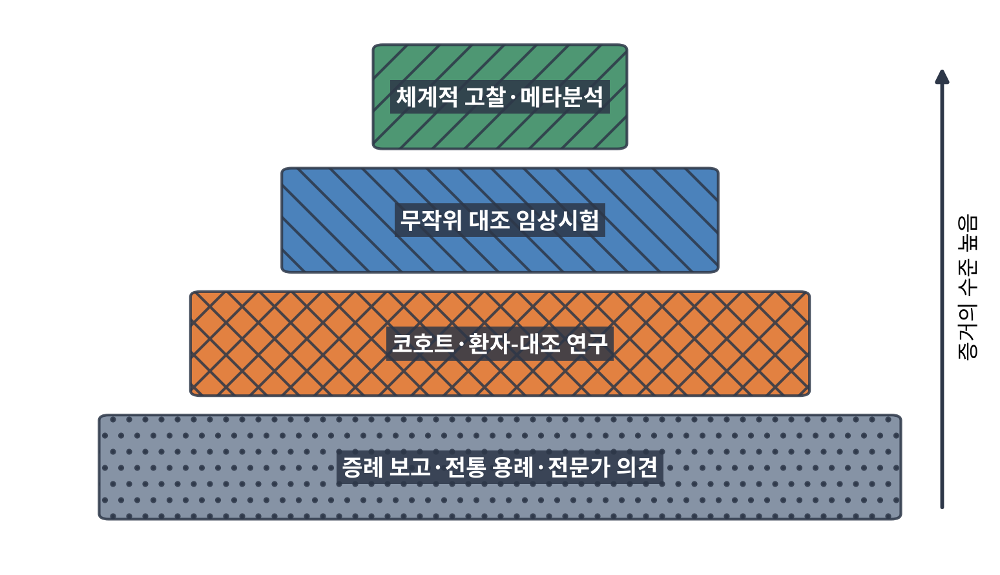
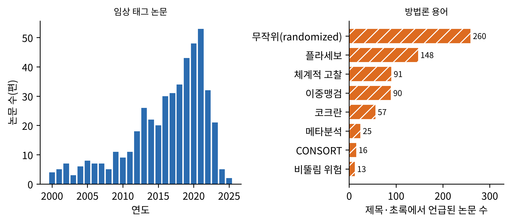
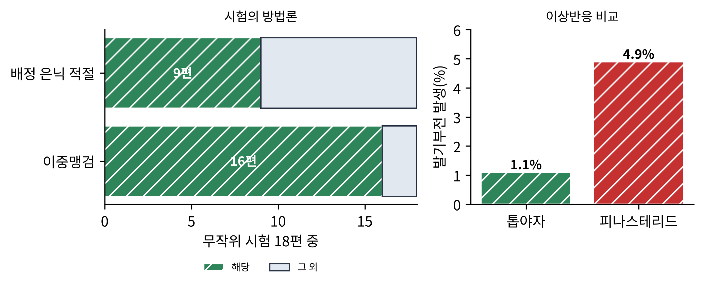
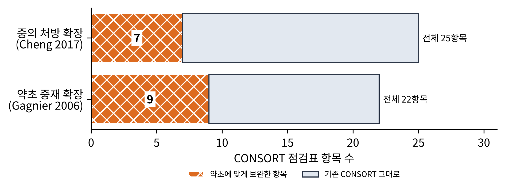
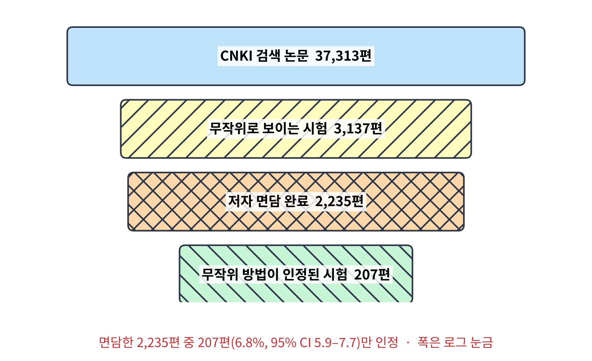
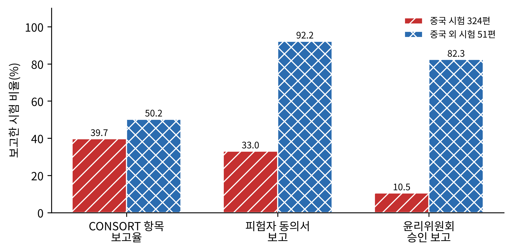
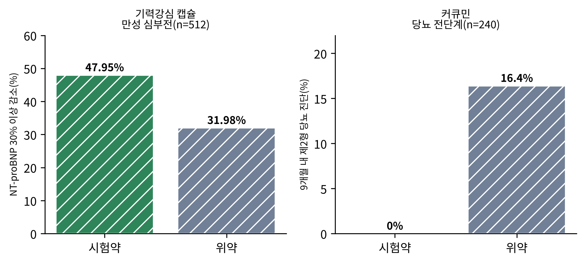
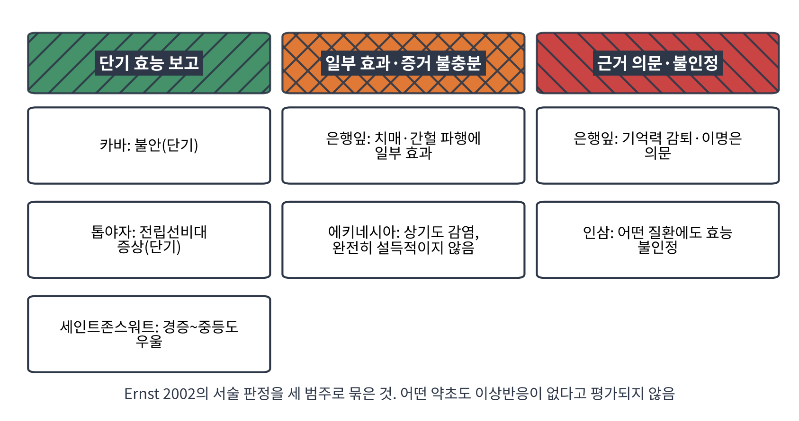

# 11장. 임상시험: 증거의 등급

<strong>그림 11-1. 증거의 사다리(개념도).</strong> 체계적 고찰과 메타분석이 가장 위에, 증례 보고와 전통 용례, 전문가 의견이 가장 아래에 놓인다. 단순화한 개념도이다.

<ul class="mini-toc">
<li>증거에도 등급이 있다</li>
<li>말뭉치 속의 임상 연구</li>
<li>톱야자: 시험 열여덟 편의 종합</li>
<li>약초 시험을 보고하는 법</li>
<li>무작위라는 이름의 함정</li>
<li>양성 결과 읽기</li>
<li>약초별 판정</li>
</ul>

## 이 장을 읽기 전에

앞 장에서 우리는 약초가 몸속에서 어떻게 작용하는지를 설명하려는 시도를 보았다. 그러나 작용 기전을 그럴듯하게 설명하는 것과 사람에게 실제로 효과가 있다는 것은 다른 문제이다. 후자는 임상시험으로만 답할 수 있다. 이 장은 약초의 효과를 사람에게서 시험한 연구들이 어떤 방법으로 만들어지고, 어떻게 평가되며, 오늘 어떤 판정을 받았는지를 다룬다.

이 장의 질문은 세 가지이다. 첫째, 증거의 등급은 어떻게 매겨지는가. 둘째, 약초 시험은 어떤 점에서 일반 약물 시험보다 어렵고, 그 결과 어떤 문제가 드러났는가. 셋째, 유명한 약초들은 지금 어떤 판정을 받고 있는가. 이 장의 수치는 모두 말뭉치에서 확인한 초록에 근거한다.

## 1. 증거에도 등급이 있다

모든 연구가 같은 무게를 갖지는 않는다. 이즈오(Angelo Antonio Izzo) 등은 2016년 『Phytotherapy Research』의 글에서 체계적 고찰과 메타분석이 증거 위계의 맨 위 단계를 이룬다고 썼다(Izzo et al., 2016). 그 아래에 무작위 대조 임상시험이 있고, 그 아래에 코호트와 환자-대조 연구, 가장 아래에 증례 보고와 전문가 의견이 놓인다(그림 11-1).

이 사다리가 필요한 이유는 간단하다. 사람의 몸에서는 약을 먹어서 좋아진 것인지, 시간이 지나 저절로 좋아진 것인지, 기대 때문에 좋아진 것인지를 구별하기 어렵다. 무작위 배정과 위약(플라세보) 대조, 이중맹검은 이 세 가지를 분리하려는 장치이다. 전통 용례의 오랜 사용 기록은 이 사다리에서 가장 아래 칸에 놓인다. 이 말은 전통이 틀렸다는 뜻이 아니라, 전통 용례만으로는 효과의 크기를 알 수 없다는 뜻이다.

## 2. 말뭉치 속의 임상 연구

이 책의 말뭉치에서 '임상' 태그가 붙은 논문은 474편이다. 연도별로 보면 2000년에 4편이던 것이 2013년 26편, 2019년 43편, 2020년 48편, 2021년 53편으로 늘었다. 제목과 초록에 '무작위(randomized)'가 들어간 논문은 260편, 위약(placebo)이 148편, 체계적 고찰이 91편, 이중맹검이 90편, 코크란이 57편이다. 반면 메타분석은 25편, CONSORT는 16편, 비뚤림 위험(risk of bias)은 13편이다.

<figure class="fig">

<figcaption><strong>그림 11-2. 말뭉치의 임상 논문과 방법론 용어.</strong> 왼쪽은 '임상' 태그 논문의 연도별 편수(2000~2025년), 오른쪽은 제목·초록에서 각 용어가 언급된 논문 수이다. 2024·2025년은 수집 시점상 일부만 포함됐을 수 있다.</figcaption>
</figure>

시험을 했다는 논문은 많지만, 시험의 질을 따지는 방법론 논문은 그보다 훨씬 적다. 이 장의 나머지는 이 간격을 다룬다.

## 3. 톱야자: 시험 열여덟 편의 종합

개별 시험이 아니라 시험들을 종합하는 연구가 무엇을 보여 주는지를 톱야자(saw palmetto, Serenoa repens)로 보자. 윌트(Timothy J. Wilt) 등은 1998년 『JAMA』에 양성 전립선비대증 환자에 대한 톱야자 추출물의 효과와 안전성을 체계적으로 고찰하고 가능한 경우 메타분석을 했다. MEDLINE(1966~1997), EMBASE, 코크란 라이브러리 등을 검색해, 30일 이상 치료한 무작위 시험을 골랐다. 두 연구자가 각 논문의 자료를 독립적으로 추출했다. 기준을 충족한 시험은 18편, 대상은 남성 2,939명이었다. 배정 은닉이 적절한 시험은 9편, 이중맹검은 16편, 평균 시험 기간은 9주(4~48주)였다(Wilt et al., 1998).

<figure class="fig">

<figcaption><strong>그림 11-3. 톱야자 메타분석의 방법론과 이상반응.</strong> 무작위 시험 18편 중 이중맹검 16편, 배정 은닉이 적절한 시험 9편. 오른쪽은 발기부전 발생률로 피나스테리드 4.9%, 톱야자 1.1%(P<.001)이다(Wilt et al., 1998).</figcaption>
</figure>

**검출과 해석.** 이 연구가 검출한 것은 위약 대비 배뇨 증상의 개선이다. 야간뇨는 저녁당 0.76회 감소했고(가중평균차 −0.76, 95% 신뢰구간 −1.22~−0.32, 시험 10편), 최대 요속은 초당 1.93 mL 증가했다(95% 신뢰구간 0.72~3.14, 시험 8편). 피나스테리드와 비교한 시험 2편에서는 국제 전립선 증상 점수 개선이 비슷했고, 발기부전은 피나스테리드에서 더 흔했다. 저자들의 해석은 신중하다. 문헌이 시험 기간이 짧고 설계와 제제, 결과 보고가 제각각이라는 한계를 가지지만, 톱야자가 비뇨기 증상과 요속을 개선한다는 근거가 있다는 것이다(Wilt et al., 1998). 6장에서 본 퍼믹손 대 피나스테리드 시험(Carraro et al., 1996)과 같은 유형의 비교가 이 종합에도 들어 있다.

여기서 눈여겨볼 점은 평가의 모양이다. 효과는 있으나 크기는 제한적이고, 기간은 짧으며, 제제는 제각각이다. 약초 시험 종합은 대개 이런 모양을 한다.

## 4. 약초 시험을 보고하는 법

약초 시험은 일반 약물 시험보다 어려운 점이 있다. 약초 제제는 내용물과 품질이 크게 다르기 때문이다. 같은 이름의 제품이라도 추출 방법과 표준화 정도에 따라 성분이 달라진다. 가그니에(Joel Joseph Gagnier) 등은 2006년 이 문제를 겨냥해 무작위 시험 보고 지침인 CONSORT 점검표(22항목)를 약초에 맞게 보완하는 권고를 만들었다. 토론토에서 16명이 참여한 합의 회의와 전화 협의를 거쳐 9개 항목을 약초에 맞게 보완했고, 약초 중재를 다루는 4번 항목이 가장 폭넓게 보완되어야 했다(Gagnier et al., 2006).

2017년에는 한 걸음 더 나아가 중의학 처방을 위한 확장판이 나왔다. 청(Chung Wah Cheng) 등은 중의 처방 시험의 일반적 보고 수준이 실망스럽다고 평가했다. 이들이 만든 CONSORT-CHM 처방 확장판은 중의 변증(pattern)이라는 개념을 도입하고, 25개 항목 중 제목·초록, 배경과 목적, 참여자, 중재, 결과 지표, 일반화 가능성, 해석의 7개 항목을 보완했으며, 키워드 하위 항목을 새로 더했다(Cheng et al., 2017).

<figure class="fig">

<figcaption><strong>그림 11-4. 약초 시험을 위한 CONSORT 확장 지침.</strong> 2006년 약초 확장은 22항목 중 9항목을, 2017년 중의 처방 확장은 25항목 중 7항목을 약초에 맞게 보완했다(Gagnier et al., 2006; Cheng et al., 2017).</figcaption>
</figure>

<strong>표 11-1. 약초 시험의 보고 지침과 보고 수준 점검 연구</strong>

| 연구 | 대상 | 핵심 내용 |
|---|---|---|
| Gagnier 등 (2006) | 약초 무작위 시험 보고 지침 | CONSORT 22항목 중 9항목 보완, 중재 항목이 가장 광범위 |
| Cheng 등 (2017) | 중의 처방 시험 보고 지침 | 25항목 중 7항목 보완, 변증 개념과 키워드 하위 항목 추가 |
| Li 등 (2013a) | 중국어로 발표된 중의 암 치료 대조 임상 연구 | 2,964편(환자 253,434명), 보고의 완성도가 시간이 지나며 개선 |
| Zhong 등 (2010) | 중의 복합 처방 위약 대조 시험 375편 | CONSORT 항목 보고율 중국 39.7%, 중국 외 50.2% |

리(Xun Li) 등이 2013년에 조사한 중국어 문헌은 규모부터 압도적이다. 중국 전자 데이터베이스 네 곳에서 중의학 암 치료 대조 임상 연구 2,964편(환자 253,434명)을 찾았다. 무작위 대조 시험이 2,385편, 비무작위 연구가 579편이었다. 연구의 72%가 중의 치료를 기존 치료와 병용했고, 중재의 90.32%(2,677편)가 약초였다. 보고의 완성도는 시간이 지나며 개선되었으나, 저자들은 CONSORT와 TREND 지침을 따라 보고를 더 개선해야 한다고 결론 내렸다(Li et al., 2013a).

## 5. 무작위라는 이름의 함정

숫자로 가장 충격적인 연구는 2009년 우(Taixiang Wu) 등의 조사이다. 연구 배경은 중국 의학 학술지의 무작위 시험 보고가 대개 양성 결과를 내놓아 질과 진위가 의심받는다는 점이었다. 연구진은 중국 지식 인프라(CNKI) 데이터베이스에서 1994년 1월부터 2005년 6월까지 20가지 흔한 질환의 무작위 시험 논문을 찾았다. 검색된 논문 37,313편 가운데 무작위 시험으로 보이는 것이 3,137편이었고, 이 중 1,452편은 일반 의학, 1,685편은 중의학 연구였다. 훈련받은 조사원 21명이 원저자들을 면담했다. 면담이 이루어진 2,235편 중 인정된 무작위 방법을 지킨 것은 207편, 6.8%(95% 신뢰구간 5.9~7.7)였다. 중의학과 일반 의학 시험 사이에 진위율의 통계적으로 유의한 차이는 없었다(Wu et al., 2009).

<figure class="fig">

<figcaption><strong>그림 11-5. 중국어 학술지 무작위 시험의 진위 조사.</strong> 검색 논문 37,313편 중 무작위로 보이는 시험 3,137편, 면담한 2,235편 중 인정된 무작위 방법을 지킨 시험은 207편(6.8%)이었다. 폭은 로그 눈금이다(Wu et al., 2009).</figcaption>
</figure>

**검출과 해석.** 이 연구가 검출한 것은 '무작위'라고 적힌 논문 가운데 실제로 무작위 방법을 쓴 것의 비율이다. 이 수치를 중의학의 효과에 대한 판정으로 읽어서는 안 된다. 같은 조사에서 일반 의학 시험의 진위율도 차이가 없었다. 저자들이 지적한 원인은 엄밀한 시험 설계에 대한 이해 부족이었다. 흥미로운 점은 시판 전 신약 임상시험으로 수행된 무작위 시험은 모두 진짜였고, 대학 부속 병원의 시험이 진위율이 높았다는 것이다(Wu et al., 2009). 논문의 이름보다 시험을 수행한 체계가 증거의 질을 좌우한다는 뜻이다.

중의 복합 처방의 위약 대조 시험을 직접 점검한 연구도 있다. 중(Yunqing Zhong) 등은 2010년 중국 시험 324편과 중국 외 시험 51편을 수정 CONSORT 점검표로 평가했다. 보고한 CONSORT 항목은 중국 시험 평균 39.7%, 중국 외 시험 50.2%였다. 피험자 동의서 보고는 중국 시험 33.02%와 중국 외 92.16%, 윤리위원회 승인 보고는 각각 10.49%와 82.35%였다. 보고 항목 수는 시간이 갈수록 증가해 두 집단의 격차가 줄었지만, 저자들은 보고 수준이 여전히 좋지 않다고 결론 내렸다(Zhong et al., 2010).

<figure class="fig">

<figcaption><strong>그림 11-6. 중의 복합 처방 위약 대조 시험의 보고 비교.</strong> 중국 시험 324편과 중국 외 시험 51편의 CONSORT 항목 평균 보고율, 피험자 동의서 보고율, 윤리위원회 승인 보고율(Zhong et al., 2010).</figcaption>
</figure>

이 두 연구가 알려 주는 교훈은 분명하다. 약초 임상 문헌의 양은 많지만 그 질은 고르지 않다. 따라서 '시험이 있다'는 사실과 '효과가 입증되었다'는 사실은 같지 않다.

## 6. 양성 결과 읽기

질 높은 시험에서 양성 결과가 나온 약초도 있다. 그러나 양성 결과를 읽을 때는 무엇을 측정했는지를 함께 보아야 한다.

**기력강심(Qili Qiangxin) 캡슐.** 리(Xinli Li) 등은 2013년 『Journal of the American College of Cardiology』에 만성 심부전 환자 512명을 대상으로 한 다기관 이중맹검 위약 대조 시험을 발표했다. 이 캡슐은 중국에서 만성 심부전 치료제로 승인되었지만 효과의 근거가 불분명했다. 환자들은 표준 치료에 더해 시험약이나 위약을 받았다. 일차 평가변수는 12주간 혈장 NT-proBNP(심부전 정도를 반영하는 혈액 표지자)의 감소 또는 변화율이었다. 시험약군에서 감소가 더 컸고(p=0.002), NT-proBNP가 30% 이상 감소한 환자는 시험약군 47.95%, 위약군 31.98%였다(p<0.001). 뉴욕심장협회 기능 분류와 좌심실 박출률, 6분 보행 거리, 삶의 질에서도 시험약이 우월했다(Li et al., 2013b).

**커큐민.** 10장에서 본 커큐민은 임상시험에서도 흥미로운 결과를 냈다. 추엥삼안(Somlak Chuengsamarn) 등은 2012년 당뇨 전단계 240명을 무작위 이중맹검으로 커큐민 또는 위약을 9개월 투여했다. 9개월 뒤 위약군의 16.4%가 제2형 당뇨로 진단되었으나 커큐민군은 한 명도 진단되지 않았다. 인슐린 저항성 지표 HOMA-IR은 커큐민군에서 낮았다(3.22 대 4.04, P<0.001)(Chuengsamarn et al., 2012). 스몰(Gary W. Small) 등은 2017년 비치매 성인 40명을 대상으로 생체이용률을 높인 커큐민(Theracurmin, 90 mg 하루 두 번)을 18개월 투여했다. 기억과 주의 지표가 개선되었으나, 주요 결과의 군간 비교 p값은 0.05 부근이었다(Small et al., 2017).

<figure class="fig">

<figcaption><strong>그림 11-7. 양성 결과를 보인 두 시험.</strong> 왼쪽은 기력강심 캡슐 시험(n=512)에서 NT-proBNP가 30% 이상 감소한 환자 비율(Li et al., 2013b), 오른쪽은 커큐민 시험(n=240)에서 9개월 내 제2형 당뇨로 진단된 비율(Chuengsamarn et al., 2012)이다.</figcaption>
</figure>

<strong>표 11-2. 이 장에서 본 개별 시험의 요약</strong>

| 시험 | 설계 | 규모 | 결과 | 읽을 때 주의할 점 |
|---|---|---|---|---|
| 중의 과민성 장 증후군 (Bensoussan 등, 1998) | 이중맹검 위약 대조 3군, 16주 | 116명 | 환자 평가 P=.03, 의사 평가 P=.001로 증상 개선 | 개별 처방군·표준 처방군·위약군으로 나눈 소규모 시험 |
| 블랙 코호시 (Jacobson 등, 2001) | 무작위 위약 대조, 유방암 병력 여성 | 85명 | 열감 횟수와 강도에서 위약과 유의한 차이 없음 | 음성 결과이며 시험 방법론의 타당성을 보여 줌 |
| 기력강심 캡슐 (Li 등, 2013b) | 다기관 이중맹검, 표준 치료에 추가 | 512명 | NT-proBNP 감소가 더 큼 | 일차 평가변수가 혈액 표지자 |
| 커큐민 (Chuengsamarn 등, 2012) | 이중맹검 위약 대조, 9개월 | 240명 | 당뇨 진단 0% 대 16.4% | 이 초록만으로는 다른 시험의 재현 여부를 알 수 없음 |
| 커큐민 (Small 등, 2017) | 이중맹검 위약 대조, 18개월 | 40명 | 기억·주의 개선, 군간 p값 0.04~0.05 | 소규모, 군간 비교가 경계적 |

양성 결과를 읽는 요령은 세 가지로 요약된다. 하나, 무엇을 측정했는가이다. 기력강심 시험의 일차 평가변수는 혈액 표지자(NT-proBNP)이며, 이 초록에서 사망이나 입원 같은 임상 종점의 결과는 확인되지 않는다. 둘, 얼마나 큰 시험인가이다. 40명 규모의 시험은 군간 p값이 0.05 언저리에 있었다. 셋, 음성 결과도 있는가이다. 블랙 코호시 시험(Jacobson et al., 2001)은 위약과 유의한 차이를 보이지 않았다. 열감 횟수와 강도에서 두 군 모두 감소했고 군간 차이는 없었는데, 위약군에서도 감소가 나타났다는 점이 위약 효과를 고려해야 하는 이유를 보여 준다.

## 7. 약초별 판정

개별 시험을 종합해 약초별로 판정을 내린 개관들이 있다. 언스트(Edzard Ernst)는 2002년 『Annals of Internal Medicine』에서 은행잎, 세인트존스워트, 인삼, 에키네시아, 톱야자, 카바의 위험과 이익을 가능한 한 체계적 고찰에 근거해 정리했다. 그의 판정은 이렇다. 은행잎은 기억 감퇴와 이명에는 의문이고 치매와 간헐 파행에는 일부 효과가 있다. 세인트존스워트는 경증에서 중등도 우울에 효과가 있으나 여러 약물과의 상호작용 우려가 크다. 인삼은 잘 수행된 임상시험이 어떤 질환에도 효능을 뒷받침하지 않는다. 에키네시아는 상기도 감염 치료와 예방에 도움이 될 수 있으나 자료가 완전히 설득적이지는 않다. 톱야자는 단기 시험에서 양성 전립선비대증 증상 감소에 효과가 있다. 카바는 단기 불안 치료에 효과적이다. 그러나 이 약초 가운데 이상반응이 없는 것은 없고, 증거가 불완전해서 위험-이익 평가를 완전히 신뢰하기 어렵다고 덧붙였다(Ernst, 2002).

<figure class="fig">

<figcaption><strong>그림 11-8. 약초별 판정(Ernst, 2002).</strong> 서술형 판정을 단기 효능 보고, 일부 효과·증거 불충분, 근거 의문·불인정의 세 범주로 묶은 그림이다.</figcaption>
</figure>

2016년 이즈오 등의 개관은 판정의 폭을 넓혔다. 체계적 고찰과 메타분석이 예비적이거나 만족스러운 임상 근거를 시사하는 약초로 월경 전 증상의 아그누스 카스투스, 고혈압의 아마씨, 편두통 예방의 피버퓨, 임신성 오심의 생강, 공복 혈당 개선의 인삼, 일부 폐경 증상의 식물성 에스트로겐과 세인트존스워트를 꼽았다. 그러나 확고한 효능 결론은 대체로 내릴 수 없다고 했다. 건선의 알로에 베라, 방광염 예방의 크랜베리, 이명과 간헐 파행의 은행잎, 감기 예방의 에키네시아, 심혈관 질환의 석류에서는 근거가 불충분하거나 결과가 엇갈렸다. 이상반응은 합성 의약품보다 대체로 잘 견뎌졌으나, 임신과 소아에서 특히 주의가 필요하다고 했다(Izzo et al., 2016). 이 개관에는 인삼이 두 번 등장한다. 2002년에는 잘 수행된 시험이 어떤 질환에도 효능을 뒷받침하지 않는다고 했으나, 2016년에는 공복 혈당 개선에서 예비적 근거가 시사되었다. 두 개관은 질환 범위가 다르므로 모순은 아니지만, 판정이 근거의 축적에 따라 갱신된다는 점은 분명하다.

은행잎의 코크란 고찰은 한 약초의 근거가 얼마나 복잡한지를 보여 준다. 버크스(Jacqueline Birks)와 에반스(John Grimley Evans)는 2009년 치매와 인지 장애에 대한 은행잎 시험 36편을 포함했다. 대부분이 작고 3개월 미만이었으며, 6개월 시험은 9편(2,016명)으로 이들이 더 최근의 비교적 적절한 시험이었다. 최근 시험 4편 중 3편은 은행잎과 위약의 차이가 없었고 1편은 은행잎에 유리한 매우 큰 효과를 보였다. 이상반응은 위약과 차이가 없었다. 저자들의 결론은 은행잎이 안전해 보이나, 초기 시험 다수가 불만족스러운 방법을 썼고 출판 편향을 배제할 수 없어, 치매나 인지 장애에 대한 예측 가능하고 임상적으로 유의한 이익의 근거가 일관되지 않고 신뢰하기 어렵다는 것이다(Birks & Grimley Evans, 2009).

세균 감염을 다룬 마틴(Karen W. Martin)의 2003년 개관도 비슷한 이야기를 한다. 대조 임상시험 7편이 기준을 충족했고 그중 무작위 시험은 4편이었으며, 방법론적으로 약한 시험이 대부분이었다. 어떤 약초도 의심의 여지없는 임상 효능이 아직 입증되지 않았다고 결론 내렸다(Martin, 2003).

<strong>표 11-3. 약초 임상 문헌을 읽을 때 던질 질문(이 장의 종합)</strong>

| 질문 | 이 장에서 이 질문이 나온 곳 |
|---|---|
| 시험은 정말 무작위로 배정했는가 | Wu 등 (2009): 인정된 무작위 방법 6.8% |
| 제제가 무엇이고 표준화되었는가 | Gagnier 등 (2006): 중재 항목의 광범위한 보완 |
| 시험이 몇 명 규모이고 얼마나 오래 했는가 | Wilt 등 (1998): 평균 9주 |
| 측정한 것이 임상 결과인가 표지자인가 | Li 등 (2013b): NT-proBNP |
| 음성 결과와 출판 편향을 고려했는가 | Jacobson 등 (2001), Birks & Grimley Evans (2009) |
| 이상반응과 상호작용은 어떠한가 | Ernst (2002), Izzo 등 (2016) |

## 이 장을 마치며

약초의 임상 증거는 흔히 두 극단으로 이야기된다. 전통의 오랜 사용이 곧 입증이라는 주장과, 약초에는 근거가 없다는 주장이다. 이 장이 보여 준 것은 둘 다 아니다. 톱야자와 세인트존스워트, 카바처럼 시험이 효과를 지지한 약초가 있고, 인삼처럼 판정이 시기에 따라 달라진 약초도 있으며, 은행잎처럼 시험 결과가 엇갈리는 약초도 있다. 그리고 시험 자체의 질이 고르지 않다. 중국어 학술지의 '무작위' 시험 중 인정된 무작위 방법을 지킨 것은 6.8%였고, 이는 중의학만의 문제가 아니라 시험 설계에 대한 이해의 문제였다.

증거의 등급은 약초를 깎아내리는 도구가 아니라 약초의 효과를 정직하게 말하게 해 주는 도구이다. 다음 12장에서는 같은 약초의 다른 면, 안전성으로 간다. 독성과 약초-약물 상호작용, 그리고 오염과 위조 문제를 본다.

## 참고문헌

- Bensoussan, A., Talley, N. J., Hing, M. C., Menzies, R. G., Guo, A., & Ngu, M. (1998). Treatment of irritable bowel syndrome with Chinese herbal medicine. *JAMA, 280*(18), 1585–1589. https://doi.org/10.1001/jama.280.18.1585
- Birks, J., & Grimley Evans, J. (2009). Ginkgo biloba for cognitive impairment and dementia. *Cochrane Database of Systematic Reviews, 2009*(1), Article CD003120. https://doi.org/10.1002/14651858.cd003120.pub3
- Carraro, J.-C., Raynaud, J.-P., Koch, G. G., Chisholm, G. D., Di Silverio, F., Teillac, P., Calais da Silva, F., Cauquil, J., Chopin, D. K., Hamdy, F. C., Hanuš, M., Hauri, D., Kalinteris, A., Marencak, J., Perier, A., & Perrin, P. (1996). Comparison of phytotherapy (Permixon®) with finasteride in the treatment of benign prostate hyperplasia: A randomized international study of 1,098 patients. *The Prostate, 29*(4), 231–240. https://doi.org/10.1002/(sici)1097-0045(199610)29:4<231::aid-pros4>3.0.co;2-e
- Cheng, C. W., Wu, T., Shang, H., Li, Y., Altman, D. G., Moher, D., Bian, Z., & the CONSORT-CHM Formulas 2017 Group. (2017). CONSORT extension for Chinese herbal medicine formulas 2017: Recommendations, explanation, and elaboration. *Annals of Internal Medicine, 167*(2), 112–121. https://doi.org/10.7326/m16-2977
- Chuengsamarn, S., Rattanamongkolgul, S., Luechapudiporn, R., Phisalaphong, C., & Jirawatnotai, S. (2012). Curcumin extract for prevention of type 2 diabetes. *Diabetes Care, 35*(11), 2121–2127. https://doi.org/10.2337/dc12-0116
- Ernst, E. (2002). The risk-benefit profile of commonly used herbal therapies: Ginkgo, St. John's wort, ginseng, echinacea, saw palmetto, and kava. *Annals of Internal Medicine, 136*(1), 42–53. https://doi.org/10.7326/0003-4819-136-1-200201010-00010
- Gagnier, J. J., Boon, H. S., Rochon, P. A., Moher, D., Barnes, J., Bombardier, C., & the CONSORT Group. (2006). Reporting randomized, controlled trials of herbal interventions: An elaborated CONSORT statement. *Annals of Internal Medicine, 144*(5), 364–367. https://doi.org/10.7326/0003-4819-144-5-200603070-00013
- Izzo, A. A., Kim, S.-H., Radhakrishnan, R., & Williamson, E. M. (2016). A critical approach to evaluating clinical efficacy, adverse events and drug interactions of herbal remedies. *Phytotherapy Research, 30*(5), 691–700. https://doi.org/10.1002/ptr.5591
- Jacobson, J. S., Troxel, A. B., Evans, J. M., Klaus, L., Vahdat, L. T., Kinne, D. W., Lo, K. M. S., Moore, A. A., Rosenman, P. J., Kaufman, E. L., Neugut, A. I., & Grann, V. R. (2001). Randomized trial of black cohosh for the treatment of hot flashes among women with a history of breast cancer. *Journal of Clinical Oncology, 19*(10), 2739–2745. https://doi.org/10.1200/jco.2001.19.10.2739
- Li, X., Yang, G., Li, X., Zhang, Y., Yang, J., Chang, J., Sun, X., Zhou, X., Guo, Y., Xu, Y., Liu, J., & Bensoussan, A. (2013a). Traditional Chinese medicine in cancer care: A review of controlled clinical studies published in Chinese. *PLoS ONE, 8*(4), Article e60338. https://doi.org/10.1371/journal.pone.0060338
- Li, X., Zhang, J., Huang, J., Ma, A., Yang, J., Li, W., Wu, Z., Yao, C., Zhang, Y., Yao, W., Zhang, B., & Gao, R. (2013b). A multicenter, randomized, double-blind, parallel-group, placebo-controlled study of the effects of Qili Qiangxin capsules in patients with chronic heart failure. *Journal of the American College of Cardiology, 62*(12), 1065–1072. https://doi.org/10.1016/j.jacc.2013.05.035
- Martin, K. W. (2003). Herbal medicines for treatment of bacterial infections: A review of controlled clinical trials. *Journal of Antimicrobial Chemotherapy, 51*(2), 241–246. https://doi.org/10.1093/jac/dkg087
- Small, G. W., Siddarth, P., Li, Z., Miller, K. J., Ercoli, L. M., Emerson, N. D., Martinez, J., Wong, K.-P., Liu, J., Merrill, D. A., Chen, S. T., Henning, S. M., Satyamurthy, N., Huang, S.-C., Heber, D., & Barrio, J. R. (2017). Memory and brain amyloid and tau effects of a bioavailable form of curcumin in non-demented adults: A double-blind, placebo-controlled 18-month trial. *The American Journal of Geriatric Psychiatry, 26*(3), 266–277. https://doi.org/10.1016/j.jagp.2017.10.010
- Wilt, T. J., Ishani, A., Stark, G., MacDonald, R. H., Lau, J. T. F., & Mulrow, C. D. (1998). Saw palmetto extracts for treatment of benign prostatic hyperplasia. *JAMA, 280*(18), 1604–1609. https://doi.org/10.1001/jama.280.18.1604
- Wu, T., Li, Y., Bian, Z., Liu, G., & Moher, D. (2009). Randomized trials published in some Chinese journals: How many are randomized? *Trials, 10*, Article 46. https://doi.org/10.1186/1745-6215-10-46
- Zhong, Y., Fu, J., Liu, X., Diao, X., Mao, B., Fan, T., Yang, H., Liu, G., & Zhang, W. (2010). The reporting quality, scientific rigor, and ethics of randomized placebo-controlled trials of traditional Chinese medicine compound formulations and the differences between Chinese and non-Chinese trials. *Current Therapeutic Research, 71*(3), 141–154. https://doi.org/10.1016/j.curtheres.2010.02.001
