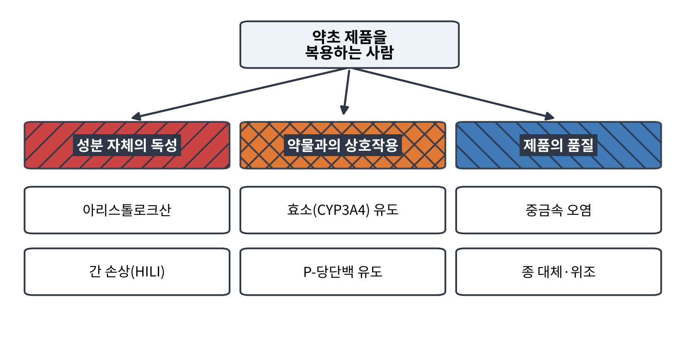
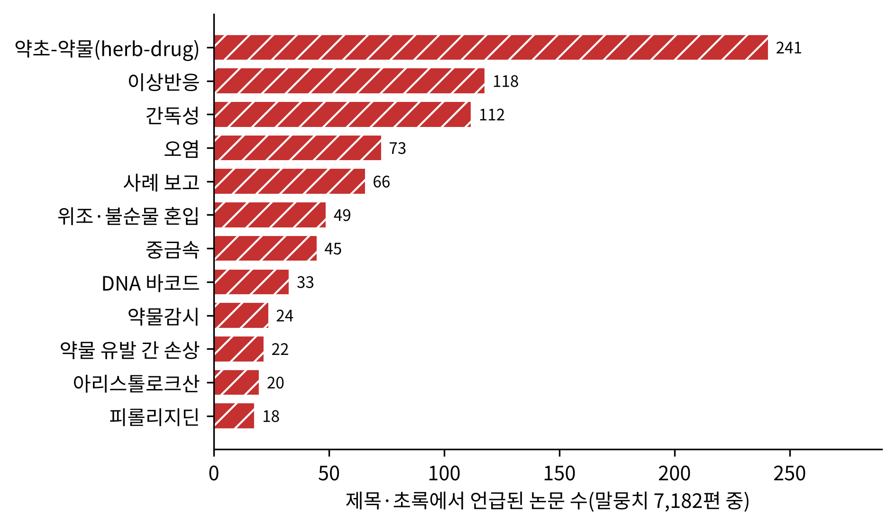
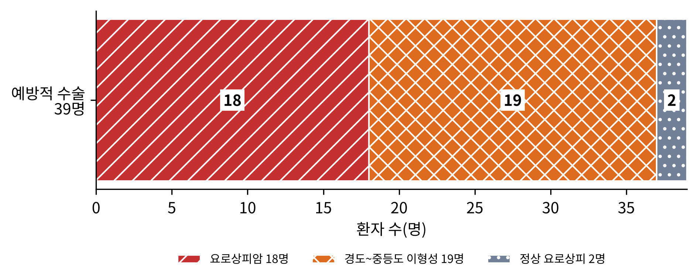
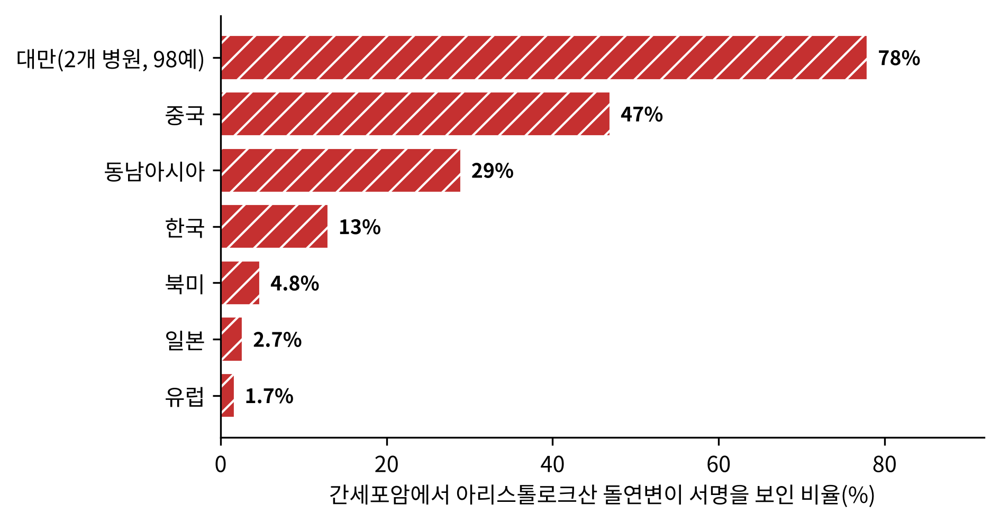
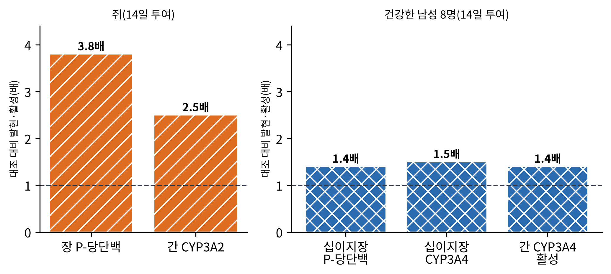
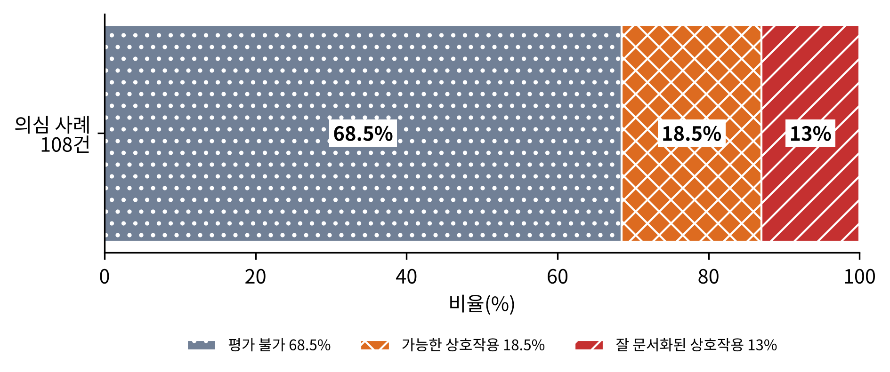
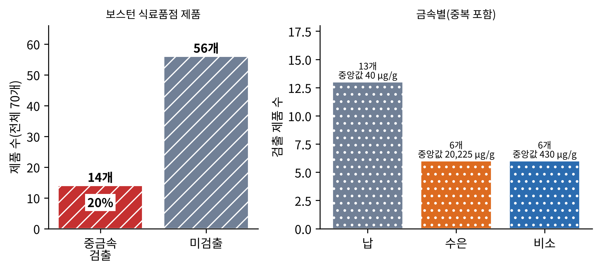
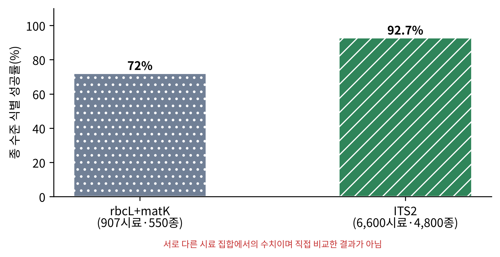

# 12장. 안전성: 독성, 상호작용, 그리고 제품의 품질

<strong>그림 12-1. 약초 제품이 위험해지는 세 갈래(개념도).</strong> 성분 자체의 독성, 약물과의 상호작용, 제품의 품질(오염·대체·위조)로 나누어 본다. 이 장은 갈래마다 대표 사례를 하나씩 따라간다.

<ul class="mini-toc">
<li>자연은 안전한가</li>
<li>말뭉치 속의 안전성 논문</li>
<li>제조 실수가 만든 신장병</li>
<li>약초가 약의 길을 바꿀 때</li>
<li>간 손상과 인과성 판정</li>
<li>제품 속에 든 것</li>
</ul>

## 이 장을 읽기 전에

11장에서 우리는 약초가 효과가 있는지를 물었다. 이 장은 같은 약초가 해를 끼치는지를 묻는다. 약초는 오랫동안 '자연에서 왔으니 안전하다'는 믿음과 함께 쓰였다. 그러나 이 믿음은 앞 장들에서 이미 여러 번 흔들렸다. 9장의 카바는 간 손상 보고로 규제를 받았고, 6장의 세인트존스워트는 효과가 있는 만큼 약물 상호작용이 문제가 되었다.

이 장은 위험을 세 갈래로 나누어 본다. 성분 자체의 독성, 약물과의 상호작용, 제품의 품질이다. 각 갈래에서 이 말뭉치가 보여 주는 가장 분명한 사례를 따라가면서, 어떤 근거가 단단하고 어떤 근거가 약한지를 구분한다. 이 장의 수치는 모두 말뭉치에서 확인한 초록에 근거한다.

## 1. 자연은 안전한가

이즈오(Angelo Antonio Izzo) 등은 2016년의 개관에서 임상 자료를 비판적으로 평가한 결과 약초 제품은 대체로 합성 의약품보다 내약성이 좋았다고 정리했다. 그러면서도 약초-약물 상호작용을 포함한 심각한 이상반응이 보고되어 있으므로, 임신 중이나 소아처럼 특수한 조건에서는 경계가 필요하다고 덧붙였다(Izzo et al., 2016). 11장에서 본 언스트(Edzard Ernst)의 2002년 개관도 같은 결론에 이른다. 다루었던 여섯 약초 가운데 이상반응이 없는 것은 하나도 없었다(Ernst, 2002).

두 문장을 합치면 약초 안전성의 기본 모양이 나온다. 대부분의 사용에서 위험은 크지 않지만, 위험이 없는 것은 아니며, 드물게 닥치는 위험이 매우 크다. 이 장의 나머지는 그 드문 위험들이다.

## 2. 말뭉치 속의 안전성 논문

이 책의 말뭉치에서 '안전성' 태그가 붙은 논문은 523편이다. 제목과 초록에 나타나는 용어를 세면 약초-약물 상호작용(herb-drug)이 241편으로 가장 많고, 이상반응이 118편, 간독성이 112편, 오염이 73편, 사례 보고가 66편이다. 위조·불순물 혼입이 49편, 중금속이 45편, DNA 바코드가 33편, 약물감시가 24편, 약물 유발 간 손상이 22편, 아리스톨로크산이 20편, 피롤리지딘이 18편이다.

<figure class="fig">

<figcaption><strong>그림 12-2. 말뭉치의 안전성 관련 용어 언급 논문 수.</strong> 제목·초록에서 각 용어가 언급된 논문 수이다(말뭉치 7,182편 중, 한 논문이 여러 용어에 중복될 수 있다).</figcaption>
</figure>

논문 수는 연구자의 관심을 보여 줄 뿐 위험의 크기를 보여 주지는 않는다. 아리스톨로크산을 다룬 논문은 20편에 불과하지만, 다음 절에서 볼 것처럼 약초 안전성 역사에서 가장 무거운 사례를 만든 성분이다.

## 3. 제조 실수가 만든 신장병

1990년대 초 벨기에에서는 체중 감량용 환약을 복용한 환자들에게 진행성 신장 섬유화가 나타났다. 노르티에(Joëlle Nortier) 등이 2000년 『New England Journal of Medicine』에 쓴 보고에 따르면, 이 '중국 약초 신증(Chinese-herb nephropathy)'의 원인은 제조 과정의 실수였다. 환약에 들어가야 할 분방기(粉防己, Stephania tetrandra)가 신독성과 발암성이 있는 광방기(廣防己, Aristolochia fangchi)로 잘못 바뀌었다(Nortier et al., 2000).

연구진은 말기 신부전으로 이식이나 투석을 받는 환자들에게 남아 있는 신장과 요관을 예방적으로 절제할 것을 제안했고, 이에 동의한 환자 39명의 조직을 검사했다. 18명(46%, 95% 신뢰구간 29~62%)에서 요로상피암이 발견되었다. 17명은 요관이나 신우, 1명은 방광의 유두종형 종양이었다. 나머지 가운데 19명은 경도에서 중등도의 이형성이, 2명은 정상 요로상피가 확인되었다. 분석한 모든 조직에서 아리스톨로크산 관련 DNA 부가체가 검출되었다. 노출 기간(1990~1992년)에 처방된 아리스톨로키아의 누적 용량이 요로상피암의 유의한 위험 요인이었고, 총 200 g을 넘으면 위험이 더 높았다(Nortier et al., 2000).

<figure class="fig">

<figcaption><strong>그림 12-3. 중국 약초 신증 환자 39명의 예방적 수술 소견.</strong> 요로상피암 18명, 경도~중등도 이형성 19명, 정상 요로상피 2명(Nortier et al., 2000).</figcaption>
</figure>

**검출과 해석.** 이 연구가 검출한 것은 조직 속의 DNA 부가체와 암의 높은 유병률이다. 부가체는 아리스톨로크산에 노출되었다는 생화학적 증거이고, 누적 용량과 암 위험의 관계는 용량 의존성을 시사한다. 한 가지 짚을 점은 대상이 예방적 수술에 동의한 환자 39명이라는 것이다. 이 46%는 말기 신부전에 이른 환자 집단의 수치이며 약을 복용한 사람 전체의 발암 위험이 아니다.

아리스톨로크산이 왜 암을 일으키는지는 분자 수준까지 밝혀져 있다. 알트(Volker M. Arlt) 등은 2002년 개관에서 아리스톨로크산 I과 II가 대사 활성화를 거쳐 DNA 부가체를 만드는 유전독성 돌연변이원이며, 가장 오래 남는 부가체 dA-AAI가 A:T에서 T:A로의 전환(transversion)을 일으킨다고 정리했다. 설치류 종양에서 이 변이는 H-ras 유전자의 61번 코돈에서 높은 빈도로 나타났다. 저자는 이 약초산을 함유하거나 함유가 의심되는 식물 제품을 전 세계 시장에서 금지해야 한다고 결론 내렸다(Arlt et al., 2002).

이 문제는 벨기에의 사고로 끝나지 않았다. 천(Chung-Hsin Chen) 등은 2012년 대만에서 상부 요로 요로상피암 환자 151명을 분석했다. 대만은 이 암의 발생률이 세계에서 가장 높고 아리스톨로키아 약초가 오래 널리 쓰인 곳이다. 환자들의 TP53 돌연변이는 A:T→T:A 전환이 지배적인 같은 서명을 보였고, 이는 환경병인 발칸 풍토 신증에서 관찰되는 것과 동일했다. 이 돌연변이를 가진 환자의 83%에서 신장 피질에 아리스톨락탐-DNA 부가체가 있었다(Chen et al., 2012).

2017년 응(Alvin Wei Tian Ng) 등은 같은 돌연변이 서명을 간암에서 찾았다. 대만 두 병원의 간세포암 98예의 엑솜을 분석하니 78%가 아리스톨로크산 노출의 서명을 보였다. 이어 세계 여러 지역의 간세포암 1,400예에서 이 서명을 찾았더니 중국에서 47%, 동남아시아에서 29%, 한국에서 13%, 일본에서 2.7%, 북미에서 4.8%, 유럽에서 1.7%였다. 저자들은 아리스톨로크산 노출이 지리적으로 널리 퍼져 있다고 보았다(Ng et al., 2017).

<figure class="fig">

<figcaption><strong>그림 12-4. 지역별 간세포암에서 아리스톨로크산 돌연변이 서명을 보인 비율.</strong> 대만은 두 병원 98예, 나머지 지역은 세계 1,400예 분석이다(Ng et al., 2017).</figcaption>
</figure>

**검출과 해석.** 이 연구가 검출한 것은 암 조직의 돌연변이 패턴이며, 서명이 있다는 사실은 과거 노출의 흔적이지 노출 경로의 증명이 아니다. 저자들도 노출이 알려진 약초 경로와 일치한다고 해석했을 뿐이다. 그리고 서명을 보인 비율이 높은 지역과 낮은 지역의 차이는 약초가 쓰이는 방식과 시기의 차이와 맞물려 해석해야 한다. 한 가지 확실한 것은 이 서명 덕분에 암 조직만으로 노출을 거슬러 추적할 수 있게 되었다는 점이다.

<strong>표 12-1. 아리스톨로크산 연구의 흐름</strong>

| 연구 | 대상 | 확인된 것 |
|---|---|---|
| Nortier 등 (2000) | 중국 약초 신증 환자 39명 | 요로상피암 46%, 모든 조직에서 DNA 부가체, 누적 200 g 초과 시 위험 증가 |
| Arlt 등 (2002) | 개관(분자 기전) | 유전독성 돌연변이원, H-ras 61번 코돈 변이, 시장 금지 권고 |
| Chen 등 (2012) | 대만 상부 요로암 151명 | A:T→T:A 돌연변이 서명, 발칸 풍토 신증과 동일, 부가체 83% |
| Ng 등 (2017) | 대만 간세포암 98예, 세계 1,400예 | 대만 78%, 중국 47%, 동남아 29%, 한국 13% 등 |

## 4. 약초가 약의 길을 바꿀 때

두 번째 갈래는 약초 자체가 독이 아니어도 다른 약의 운명을 바꾸는 경우이다. 약물의 대부분은 간과 장의 효소(특히 사이토크롬 P450 3A4, CYP3A4)로 분해되고 장의 수송 단백질(P-당단백)로 몸 밖으로 되돌려진다. 이 효소나 수송체의 양이 늘거나 줄면 같은 용량의 약이 너무 약해지거나 너무 강해진다.

6장에서 본 세인트존스워트가 대표 사례이다. 뒤르(Daniel Dürr) 등은 2000년 쥐와 사람에서 그 기전을 확인했다. 쥐에 추출물을 14일 투여하자 장의 P-당단백 발현이 3.8배, 간의 CYP3A2 발현이 2.5배 늘었다. 건강한 남성 8명에게 14일 투여한 임상 연구에서는 디곡신 0.5 mg 단일 투여 뒤 디곡신 노출이 18% 줄었고, 십이지장의 P-당단백과 CYP3A4 발현이 각각 1.4배와 1.5배, 간 CYP3A4의 기능(에리스로마이신 호흡 검사)이 1.4배 늘었다(Dürr et al., 2000).

<figure class="fig">

<figcaption><strong>그림 12-5. 세인트존스워트의 효소·수송체 유도.</strong> 14일 투여 뒤 대조 대비 배수. 왼쪽은 쥐(장 P-당단백 3.8배, 간 CYP3A2 2.5배), 오른쪽은 건강한 남성 8명(십이지장 P-당단백 1.4배, 십이지장 CYP3A4 1.5배, 간 CYP3A4 활성 1.4배)이다(Dürr et al., 2000).</figcaption>
</figure>

**검출과 해석.** 이 연구가 검출한 것은 유도의 방향과 크기이다. 사람에서 발현은 1.4~1.5배 늘었고 그 결과 디곡신 노출이 18% 줄었다. 효과의 크기는 쥐보다 사람에서 작았다. 이는 세인트존스워트와 여러 약물의 상호작용이 단발성 사건이 아니라 효소 유도라는 공통 기전의 결과임을 설명해 준다.

헨더슨(L. Henderson) 등은 2002년 문헌과 유럽 규제 당국의 자발적 사례 보고를 함께 검토해 임상적으로 중요한 상호작용을 정리했다. 와파린, 페녹시쿠몰, 사이클로스포린, HIV 단백분해효소 억제제, 테오필린, 디곡신, 경구 피임약에서 약물의 농도나 효과가 줄었다. 원인은 CYP3A4, CYP2C9, CYP1A2와 P-당단백의 유도로 추정되었다. 유도의 정도는 제제의 성분 함량과 품질이 달라 예측이 어렵다고 했다. 세로토닌 재흡수 억제제와 트립탄 계열과는 약력학적 상호작용 가능성도 제기되었다. 스웨덴과 영국은 위험이 유의하다고 판단해 의료인과 환자에게 정보를 제공했고 관련 약의 제품 정보를 개정했으며 세인트존스워트 제품에 경고 문구를 붙이게 했다(Henderson et al., 2002).

세인트존스워트만의 일이 아니다. 스파레붐(Alex Sparreboom) 등은 2004년 미국에서 가장 많이 팔리는 약초 15종과 항암제의 상호작용 가능성을 검토했다. 약초 사용 유병률은 암 환자에서 13~63%로 추정된다. 마늘, 은행잎, 에키네시아, 인삼, 세인트존스워트, 카바가 약물대사 효소나 P-당단백을 조절할 가능성이 있다고 정리하고, 치료 반응이 기대에 못 미치는 환자에게 약초 사용 여부를 묻도록 권했다(Sparreboom et al., 2004).

그런데 이 모든 가능성은 얼마나 확인되었는가? 이 물음에 대한 답이 이 장에서 가장 중요한 대목이다. 푸그-버만(Adriane Fugh-Berman)과 언스트는 2001년 약초-약물 상호작용의 사례 보고, 사례 연구, 임상시험을 체계적으로 모아 신뢰도를 점수로 평가했다. 의심 사례 108건 가운데 68.5%가 '평가 불가', 13%가 '잘 문서화된 상호작용', 18.5%가 '가능한 상호작용'으로 분류되었다. 가장 많이 관여한 약은 와파린(18건), 약초는 세인트존스워트(54건)였다. 저자들은 약초-약물 상호작용이 분명히 일어나 사람을 위험에 빠뜨릴 수 있지만 지금의 지식은 불완전하다고 결론 내렸다(Fugh-Berman & Ernst, 2001).

<figure class="fig">

<figcaption><strong>그림 12-6. 약초-약물 상호작용 의심 사례 108건의 신뢰도 평가.</strong> 평가 불가 68.5%, 가능한 상호작용 18.5%, 잘 문서화된 상호작용 13%(Fugh-Berman & Ernst, 2001).</figcaption>
</figure>

비슷한 구도가 와파린 전체에서도 나타난다. 홀브룩(Anne Marie Holbrook) 등은 2005년 와파린과 약물·음식의 상호작용 보고를 모두 모았다. 검색된 642편 중 181편이 120가지 약물이나 음식에 대한 원저 보고였다. 보고의 72%는 와파린 효과의 증강을 기술했으나 84%는 질이 낮았고, 그 가운데 86%는 단일 증례 보고였다. 임상적으로 유의한 출혈 31건은 모두 단일 증례였다. 새로 보고된 상호작용에는 녹차와 단삼(丹參)이 있었다(Holbrook et al., 2005). 10장에서 본 단삼이 여기서 다시 나타난다. 헥(Amy M. Heck) 등은 2000년 와파린과 대체 요법의 상호작용을 정리하며, 정보의 거의 전부가 시험관 자료, 동물 실험, 개별 증례에 기반한다고 지적했다(Heck et al., 2000).

<strong>표 12-2. 약초-약물 상호작용 근거의 질</strong>

| 연구 | 대상 | 확인된 것 | 근거의 한계 |
|---|---|---|---|
| Dürr 등 (2000) | 쥐, 건강한 남성 8명 | 장 P-당단백·CYP3A 유도, 디곡신 노출 18% 감소 | 소규모, 한 약초 |
| Henderson 등 (2002) | 세인트존스워트의 문헌과 자발 보고 | 여러 약물의 농도 저하, 규제 당국의 경고 | 제제 품질에 따른 변이 |
| Sparreboom 등 (2004) | 인기 약초 15종과 항암제 | 6종에서 효소·수송체 조절 가능성 | 문헌 개관, 가능성 수준 |
| Fugh-Berman & Ernst (2001) | 의심 사례 108건 | 68.5% 평가 불가, 13% 잘 문서화 | 보고의 질 |
| Holbrook 등 (2005) | 와파린 상호작용 보고 181편 | 72% 효과 증강, 84% 질 낮음 | 대부분 단일 증례 |

**해석.** 이 절의 결론은 두 겹이다. 하나, 효소 유도처럼 기전이 확인된 상호작용은 실제이고 크기를 잴 수 있다. 둘, 그러나 보고된 약초-약물 상호작용의 대다수는 근거가 약하다. 그래서 '모든 약초와 모든 약의 조합이 위험하다'도, '근거가 약하니 걱정할 필요가 없다'도 틀린 결론이다. 치료역이 좁은 약, 이를테면 와파린, 사이클로스포린, 항암제를 쓰는 사람에게는 신중해야 하고, 그 신중함의 근거는 기전이 확인된 몇 가지 사례에 있다.

## 5. 간 손상과 인과성 판정

세 번째 문제는 간이다. 간 손상은 약초 복용자에게서 가장 자주 우려되는 심각한 이상반응이고, 9장의 카바가 그 예였다. 약초 때문에 간이 나빠졌는지 판단하는 일은 어렵다. 환자는 대개 여러 약과 건강식품을 함께 먹고, 간 손상에는 술이나 바이러스 간염 같은 다른 원인도 많기 때문이다.

그래서 임상에서는 인과성을 점수로 매기는 도구를 쓴다. 다낭(Gaby Danan)과 테슈케(Rolf Teschke)는 2015년 RUCAM(Roussel Uclaf Causality Assessment Method)을 정리했다. RUCAM은 약물 유발 간 손상(DILI)과 약초 유발 간 손상(HILI)에 쓰는 간독성 특화 진단 방법으로, 개별 항목에 점수를 주어 의심되는 약물이나 약초마다 인과성의 등급을 낸다. 20여 년간 의사, 규제 기관, 사례 보고 저자, 제약사가 널리 써 왔고, 이 2015년 갱신은 관찰자 간·관찰자 내 변이를 줄이고 핵심 항목을 더 분명히 정의하는 것을 목표로 했다. 저자들은 임상, 규제, 출판, 전문가 판정에 이 척도를 쓸 것을 권했다(Danan & Teschke, 2015).

**해석.** RUCAM이 필요하다는 사실 자체가 요점이다. 약초가 간 손상의 원인인지는 직관이 아니라 구조화된 평가로 따져야 한다. 말뭉치에서 약물 유발 간 손상을 다룬 논문이 22편, 약물감시를 다룬 논문이 24편, 사례 보고가 66편이라는 숫자(그림 12-2)는 이런 평가가 사례 보고에서 출발하기 때문이다. 앞에서 본 푸그-버만과 언스트의 평가에서 68.5%가 '평가 불가'로 분류된 것도 사례 보고의 정보가 부족했기 때문이다.

## 6. 제품 속에 든 것

세 번째 갈래는 약초 자체나 약물이 아니라 '병 속에 실제로 무엇이 들었는가'의 문제이다. 같은 이름의 제품이라도 성분 함량이 다르고, 종이 바뀌어 있거나, 오염 물질이 섞여 있을 수 있다. 3절의 벨기에 사고는 극단적인 대체 사례였다.

**중금속.** 세퍼(Robert B. Saper)는 2004년 『JAMA』에 보스턴 지역 남아시아 식료품점에서 파는 아유르베다 약초 제품의 중금속을 조사했다. 2003년 4월부터 10월까지 가게마다 방문해 남아시아에서 제조된 제품을 모두 샀고, X선 형광 분광법으로 납, 수은, 비소를 측정했다. 제품 70개 가운데 14개(20%, 95% 신뢰구간 11~31%)에서 중금속이 검출되었다. 납은 13개(중앙값 40 µg/g), 수은은 6개(중앙값 20,225 µg/g), 비소는 6개(중앙값 430 µg/g)에서 검출되었다. 제조사가 권장하는 대로 복용하면 이 14개 모두 규제 기준을 넘는 중금속 섭취가 가능했다. 저자는 아유르베다 제품의 중금속 검사를 의무화해야 한다고 결론 내렸다(Saper, 2004).

<figure class="fig">

<figcaption><strong>그림 12-7. 보스턴 식료품점 아유르베다 제품 70개의 중금속 검출.</strong> 왼쪽은 중금속이 검출된 제품 14개(20%)와 미검출 56개, 오른쪽은 금속별 검출 제품 수와 농도 중앙값(Saper, 2004).</figcaption>
</figure>

**검출과 해석.** 이 연구가 검출한 것은 제품 속의 금속 농도이고, 섭취량은 제조사 권장 용량으로 추정한 값이다. 사람의 혈중 농도나 증상을 측정한 연구가 아니다. 또 표본은 보스턴 지역 상점에서 산 70개 제품이어서 남아시아 제품 전체나 아유르베다 전체의 비율로 일반화하기 어렵다. 이 연구는 제품이 시장에서 어떤 농도로 나타났는지를 측정한 것이며, 아유르베다 처방 전반의 안전성을 판정한 것이 아니다.

**종의 확인.** 제품이 라벨의 종인지를 확인하는 도구로 DNA 바코드가 있다. 천(Shilin Chen) 등은 2010년 약용 식물에서 일곱 가지 후보 바코드 부위를 비교해 증폭 효율, 종 내·종 간 분화, 바코드 간격(barcoding gap)을 기준으로 순위를 매겼다. 핵 리보솜 DNA의 두 번째 내부 전사 스페이서(ITS2)가 가장 적합했다. 4,800종, 753속에 속하는 6,600여 개 시료에서 ITS2의 종 수준 식별 성공률은 92.7%였다. 연구진은 식물 바코드 연합이 권고한 rbcL+matK 두 부위 조합이 907개 시료, 550종에서 72%의 확률로 종을 구별했다고 소개하면서 이 조합이 완벽하지 않다고 보았다(Chen et al., 2010).

<figure class="fig">

<figcaption><strong>그림 12-8. DNA 바코드의 종 수준 식별 성공률.</strong> rbcL+matK 72%(907시료·550종), ITS2 92.7%(6,600여 시료·4,800종). 서로 다른 시료 집합에서의 수치이며 직접 비교한 결과가 아니다(Chen et al., 2010).</figcaption>
</figure>

이 방법을 시장 제품에 적용한 연구가 있었다. 2013년 뉴마스터(Steven G. Newmaster) 등은 북미 시판 약초 제품을 DNA 바코드로 조사해 라벨에 없는 종이 들어 있다고 보고했다. 그러나 말뭉치에 실린 이 논문의 제목에는 '철회된 논문(RETRACTED ARTICLE)'이라고 표시되어 있다. 이 책은 이 논문의 수치를 근거로 쓰지 않는다. 이 사례가 주는 교훈은 거꾸로 방법론적이다. 제품의 품질을 폭로하는 연구도 다른 연구와 똑같은 검증 대상이며, 철회 여부를 확인하지 않고 인용하는 일은 피해야 한다(Newmaster et al., 2013).

<strong>표 12-3. 제품 품질 연구의 요약</strong>

| 연구 | 대상 | 확인된 것 | 읽을 때 주의할 점 |
|---|---|---|---|
| Saper (2004) | 보스턴 상점의 아유르베다 제품 70개 | 14개(20%)에서 납·수은·비소 검출 | 표본이 지역 상점 제품, 섭취량은 추정 |
| Chen 등 (2010) | 약용 식물 시료 6,600여 개 | ITS2 종 식별 92.7% | 방법 검증 연구, 시장 제품 조사가 아님 |
| Newmaster 등 (2013) | 북미 시판 약초 제품 | 철회됨 | 이 책은 수치를 인용하지 않음 |

## 이 장을 마치며

약초의 안전성은 세 층위로 나뉘었다. 성분 자체의 독성에서는 아리스톨로크산처럼 기전과 노출, 암의 연결이 분자 수준까지 확인된 사례가 있다. 약물 상호작용에서는 세인트존스워트처럼 기전이 확인된 사례가 있지만 보고된 상호작용의 대부분은 근거가 약하다. 제품의 품질에서는 중금속 오염이 실제로 측정되었지만 표본의 대표성은 제한적이다.

세 사례에는 공통점이 있다. 위험은 약초가 약초여서가 아니라 구체적 성분과 구체적 제품, 구체적 병용 약물에서 왔다. 그래서 안전성의 답은 '약초는 위험한가'가 아니라 '이 성분, 이 제품, 이 환자에게 위험한가'의 모양을 한다. 이 물음에 답하려면 제품의 성분이 일정해야 하고, 이를 위한 제도가 표준화와 약전이다. 다음 13장에서는 약초 제품의 품질을 규정하는 약전과 규제, 그리고 표준화의 한계를 본다.

## 참고문헌

- Arlt, V. M., Stiborová, M., & Schmeiser, H. H. (2002). Aristolochic acid as a probable human cancer hazard in herbal remedies: A review. *Mutagenesis, 17*(4), 265–277. https://doi.org/10.1093/mutage/17.4.265
- Chen, C.-H., Dickman, K. G., Moriya, M., Zavadil, J., Sidorenko, V. S., Edwards, K. L., Gnatenko, D. V., Wu, L., Turesky, R. J., Wu, X.-R., Pu, Y.-S., & Grollman, A. P. (2012). Aristolochic acid-associated urothelial cancer in Taiwan. *Proceedings of the National Academy of Sciences, 109*(21), 8241–8246. https://doi.org/10.1073/pnas.1119920109
- Chen, S., Yao, H., Han, J., Liu, C., Song, J., Shi, L., Zhu, Y., Ma, X., Gao, T., Pang, X., Luo, K., Li, Y., Li, X., Jia, X., Lin, Y., & Leon, C. (2010). Validation of the ITS2 region as a novel DNA barcode for identifying medicinal plant species. *PLoS ONE, 5*(1), Article e8613. https://doi.org/10.1371/journal.pone.0008613
- Danan, G., & Teschke, R. (2015). RUCAM in drug and herb induced liver injury: The update. *International Journal of Molecular Sciences, 17*(1), Article 14. https://doi.org/10.3390/ijms17010014
- Dürr, D., Stieger, B., Kullak-Ublick, G. A., Rentsch, K. M., Steinert, H. C., Meier, P. J., & Fattinger, K. (2000). St John's wort induces intestinal P-glycoprotein/MDR1 and intestinal and hepatic CYP3A4. *Clinical Pharmacology & Therapeutics, 68*(6), 598–604. https://doi.org/10.1067/mcp.2000.112240
- Ernst, E. (2002). The risk-benefit profile of commonly used herbal therapies: Ginkgo, St. John's wort, ginseng, echinacea, saw palmetto, and kava. *Annals of Internal Medicine, 136*(1), 42–53. https://doi.org/10.7326/0003-4819-136-1-200201010-00010
- Fugh-Berman, A., & Ernst, E. (2001). Herb–drug interactions: Review and assessment of report reliability. *British Journal of Clinical Pharmacology, 52*(5), 587–595. https://doi.org/10.1046/j.0306-5251.2001.01469.x
- Heck, A. M., DeWitt, B. A., & Lukes, A. L. (2000). Potential interactions between alternative therapies and warfarin. *American Journal of Health-System Pharmacy, 57*(13), 1221–1227. https://doi.org/10.1093/ajhp/57.13.1221
- Henderson, L., Yue, Q.-Y., Bergquist, C., Gerdén, B., & Arlett, P. (2002). St John's wort (*Hypericum perforatum*): Drug interactions and clinical outcomes. *British Journal of Clinical Pharmacology, 54*(4), 349–356. https://doi.org/10.1046/j.1365-2125.2002.01683.x
- Holbrook, A. M., Pereira, J. A., Labiris, R., McDonald, H., Douketis, J. D., Crowther, M., & Wells, P. S. (2005). Systematic overview of warfarin and its drug and food interactions. *Archives of Internal Medicine, 165*(10), 1095–1106. https://doi.org/10.1001/archinte.165.10.1095
- Izzo, A. A., Kim, S.-H., Radhakrishnan, R., & Williamson, E. M. (2016). A critical approach to evaluating clinical efficacy, adverse events and drug interactions of herbal remedies. *Phytotherapy Research, 30*(5), 691–700. https://doi.org/10.1002/ptr.5591
- Newmaster, S. G., Grguric, M., Shanmughanandhan, D., Ramalingam, S., & Ragupathy, S. (2013). DNA barcoding detects contamination and substitution in North American herbal products [Retracted article]. *BMC Medicine, 11*, Article 222. https://doi.org/10.1186/1741-7015-11-222
- Ng, A. W. T., Poon, S. L., Huang, M. N., Lim, J. Q., Boot, A., Yu, W., Suzuki, Y., Thangaraju, S., Ng, C. C. Y., Tan, P., Pang, S.-T., Huang, H.-Y., Yu, M.-C., Lee, P.-H., Hsieh, S.-Y., Chang, A. Y., Teh, B. T., & Rozen, S. G. (2017). Aristolochic acids and their derivatives are widely implicated in liver cancers in Taiwan and throughout Asia. *Science Translational Medicine, 9*(412), Article eaan6446. https://doi.org/10.1126/scitranslmed.aan6446
- Nortier, J. L., Muniz Martinez, M.-C., Schmeiser, H. H., Arlt, V. M., Bieler, C. A., Pétein, M., Depierreux, M. F., De Pauw, L., Abramowicz, D., Vereerstraeten, P., & Vanherweghem, J.-L. (2000). Urothelial carcinoma associated with the use of a Chinese herb (*Aristolochia fangchi*). *New England Journal of Medicine, 342*(23), 1686–1692. https://doi.org/10.1056/nejm200006083422301
- Saper, R. B., Kales, S. N., Paquin, J., Burns, M. J., Eisenberg, D. M., Davis, R. B., & Phillips, R. S. (2004). Heavy metal content of Ayurvedic herbal medicine products. *JAMA, 292*(23), 2868–2873. https://doi.org/10.1001/jama.292.23.2868
- Sparreboom, A., Cox, M. C., Acharya, M. R., & Figg, W. D. (2004). Herbal remedies in the United States: Potential adverse interactions with anticancer agents. *Journal of Clinical Oncology, 22*(12), 2489–2503. https://doi.org/10.1200/jco.2004.08.182
