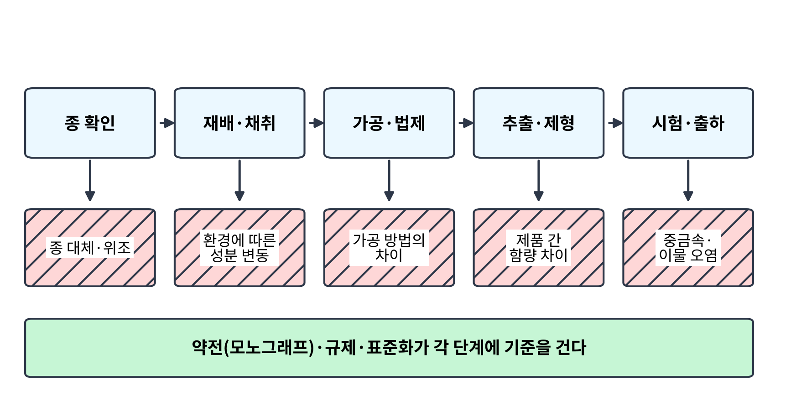
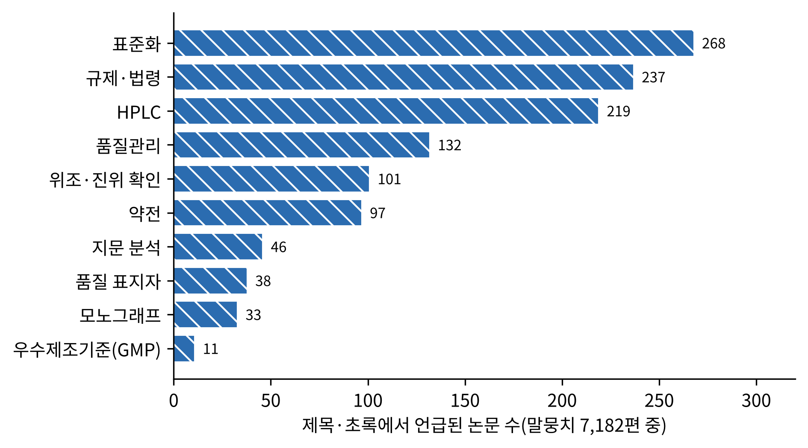
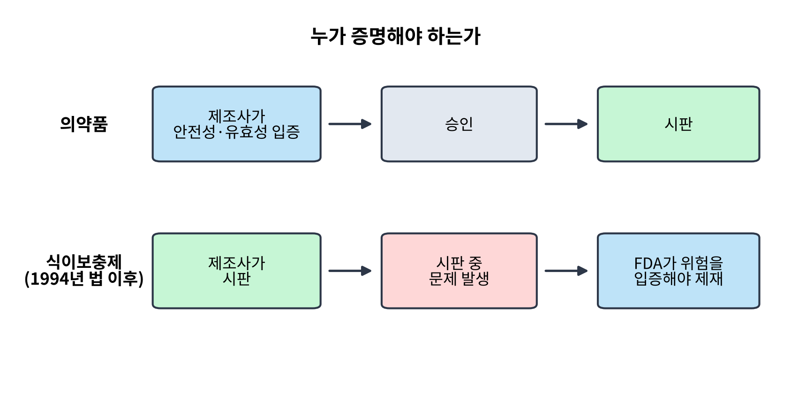
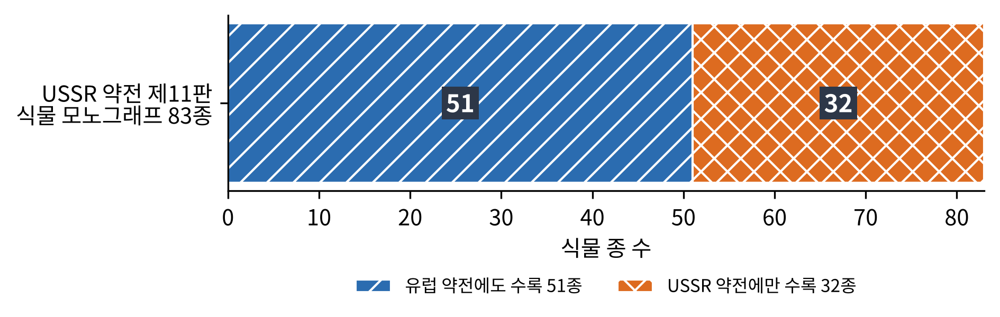
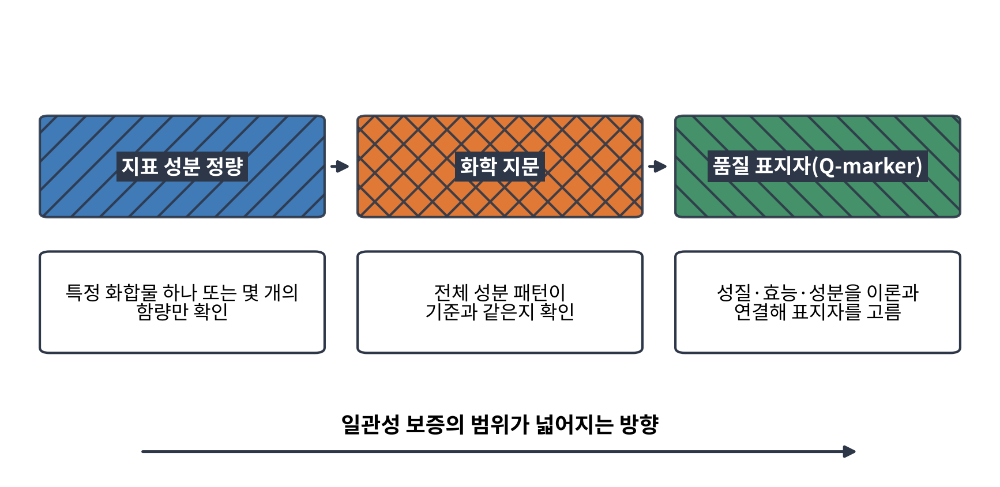
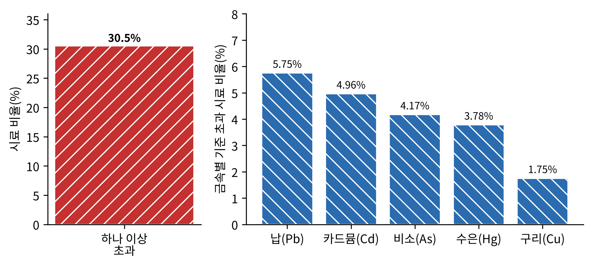
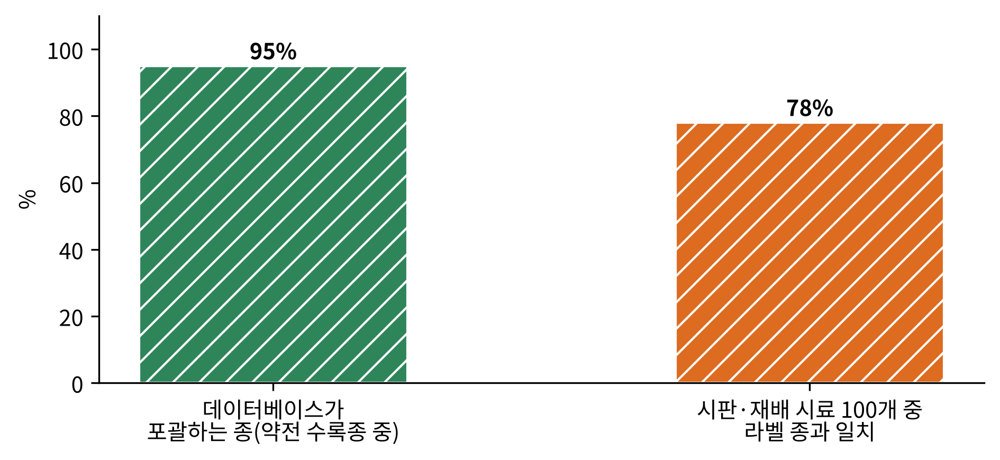

# 13장. 표준화와 약전: 병 속의 일관성

<strong>그림 13-1. 약초 제품의 품질 사슬(개념도).</strong> 종 확인에서 출하까지 다섯 단계마다 품질이 어긋날 수 있는 지점이 있고, 약전·규제·표준화는 각 단계에 기준을 건다.

<ul class="mini-toc">
<li>한 병의 약초가 만들어지기까지</li>
<li>말뭉치 속의 품질 논문</li>
<li>증명의 책임: 규제의 모델들</li>
<li>약전이라는 책</li>
<li>지표 성분에서 화학 지문으로</li>
<li>기준은 지켜지는가</li>
</ul>

## 이 장을 읽기 전에

12장은 같은 이름의 제품이라도 병 속에 든 것이 다를 수 있다는 데서 끝났다. 이 장은 그 틈을 메우려는 제도를 따라간다. 약전(藥典, pharmacopoeia)은 약으로 쓰는 재료의 이름과 기준을 적은 공식 책이고, 표준화(standardization)는 제품이 늘 같은 품질이 되도록 기준과 시험을 정하는 일이다. 규제는 어떤 제품을 어떤 이름으로 팔 수 있는지, 그 책임을 누가 지는지를 정한다.

세 가지는 서로 얽혀 있다. 약전의 기준이 없으면 규제는 무엇을 검사할지 알 수 없고, 규제가 없으면 약전의 기준은 권고에 그친다. 이 장에서는 말뭉치에서 확인한 연구만으로 이 구조를 살펴보고, 기준이 실제로 지켜지는지를 보여 주는 측정 사례 두 가지를 본다.

## 1. 한 병의 약초가 만들어지기까지

약초는 식물이다. 식물의 성분은 같은 종이라도 같지 않다. 리(Yanqun Li) 등은 2020년 개관에서 약용 식물의 이차 대사산물이 약효의 물질적 기초이자 약재 품질의 중요한 지표이지만, 그 합성과 축적이 발생 단계와 유전적 요인, 그리고 빛, 온도, 수분, 염분 같은 환경 요인의 영향을 받는다고 정리했다(Li et al., 2020). 같은 종을 샀다는 사실이 같은 성분을 샀다는 뜻이 아닌 이유이다.

그 다음 단계는 가공이다. 자오(Zhongzhen Zhao) 등은 2010년 중국 본초(Chinese Materia Medica)의 법제(法製, 약재를 목적에 맞게 가공하는 기술)를 표준화의 독특한 문제로 다루었다. 법제의 목적은 효능을 높이거나 독성을 줄이는 것이며, 일부 독성과 부작용은 부적절한 가공이나 부적절한 배합에서 비롯된다. 저자들은 가공 방법의 표준화가 진위 확인만큼 중요하다고 보았다(Zhao et al., 2010). 쿤레(Kunle) 등은 2012년 개관에서 채집, 취급, 가공, 제조에 이르는 단계마다 품질 기준을 세우는 일이 시장의 안전을 위해 필요하다고 주장했다(Kunle et al., 2012).

그림 13-1의 다섯 단계는 이 논의를 한 줄로 묶은 것이다. 12장의 사례를 여기에 얹으면 아리스톨로크산 사고는 첫 단계(종 확인), 중금속 오염은 마지막 단계(시험·출하)에서 일어난 실패였다.

## 2. 말뭉치 속의 품질 논문

이 책의 말뭉치에서 제목이나 초록에 '표준화'가 나오는 논문은 268편, 규제·법령이 237편, HPLC(고성능 액체 크로마토그래피, high-performance liquid chromatography)가 219편이다. 품질관리는 132편, 위조·진위 확인은 101편, 약전은 97편이다. 화학 지문 분석은 46편, 품질 표지자는 38편, 모노그래프는 33편이며, 우수제조기준(GMP, good manufacturing practice)은 11편에 그친다.

<figure class="fig">

<figcaption><strong>그림 13-2. 말뭉치의 품질 관련 용어 언급 논문 수.</strong> 제목·초록에서 각 용어가 언급된 논문 수이다(말뭉치 7,182편 중, 한 논문이 여러 용어에 중복될 수 있다).</figcaption>
</figure>

숫자가 말해 주는 것은 연구의 관심이 분석 기법(HPLC)과 표준화라는 말에 몰려 있다는 점이다. 제조 현장의 기준인 GMP는 이 말뭉치에서 거의 보이지 않는다. 다만 이것은 논문 제목과 초록에 나타난 용어의 빈도이고, 제도의 실제 중요도를 재는 것은 아니다.

## 3. 증명의 책임: 규제의 모델들

약초 제품을 무엇으로 분류하느냐에 따라 제조사가 져야 할 책임이 달라진다. 칼릭스토(João B. Calixto)는 2000년 개관에서 약초 제제(phytotherapeutic agent)를 하나 이상의 식물에서 얻은 복합 혼합물로 정의하고, 이를 규제하는 모델이 처방약, 일반의약품, 전통 의약품, 식이보충제로 나뉜다고 정리했다. 유럽과 미국의 약초 제제 시장이 1999년 각각 약 70억 달러와 50억 달러에 이를 것으로 추산되던 때였다. 그는 약초는 안전하고 부작용이 없다는 생각이 틀렸다고 단언하고, 많은 식물에서 품질과 효능, 안전성을 보증할 자료가 부족하다고 지적했다. 규제의 조화가 필요하며, 독일 위원회 E의 경험, 곧 과학 연구와 전통 지식을 함께 모노그래프로 엮는 방식이 확산하는 경향이라고 썼다(Calixto, 2000).

미국의 모델은 1994년 식이보충제 건강교육법(DSHEA, Dietary Supplement Health and Education Act)이 바꾸었다. 마커스(Donald M. Marcus)와 그롤먼(Arthur P. Grollman)은 2002년 『New England Journal of Medicine』에서 2001년 미국에서 식이보충제에 178억 달러, 그 가운데 약초와 식물성 제품에 42억 달러가 쓰였다고 소개하고, 이 법이 약초 등을 '식이보충제'로 넓게 규정하면서 정의와 기준, 주장에 관한 규율을 크게 바꾸었다고 썼다(Marcus & Grollman, 2002). 슬리프먼(Nancy R. Slifman) 등은 1998년 이 변화의 핵심을 이렇게 풀었다. 보충제 성분은 식품첨가물 규제에서 빠졌고, 시판 중인 보충제가 심각하거나 불합리한 위험을 준다는 것을 FDA가 입증해야 한다. 이는 시판 전에 안전성과 유효성을 보여야 하는 의약품과 대조적이다(Slifman et al., 1998).

<figure class="fig">

<figcaption><strong>그림 13-3. 의약품과 식이보충제에서 입증 책임의 방향(개념도).</strong> 의약품은 시판 전에 제조사가 입증하고, 1994년 이후 미국 식이보충제는 시판 후 위험을 FDA가 입증해야 한다(Slifman et al., 1998).</figcaption>
</figure>

**검출과 해석.** 슬리프먼 등이 다룬 것은 한 환자의 사례에서 시작한 조사였다. 1997년 FDA에 이전에 건강하던 환자가 보충제를 먹은 뒤 독성 수준의 혈중 디곡신 농도로 내원한 사례가 보고되었고, 연구진은 강심배당체 노출의 근원과 해당 원료가 얼마나 오래, 얼마나 넓게 유통되었는지를 조사했다. 논문의 제목은 이 오염의 정체를 'Digitalis lanata'라고 밝힌다. 초록 수준에서 확인되는 사실은 여기까지이며, 오염된 원료의 종류와 유통 범위의 구체적 수치는 이 책에서 인용하지 않는다. 이 사례가 보여 주는 것은 12장의 아리스톨로크산과 같은 구조이다. 문제가 생긴 뒤에야 당국이 찾아 나섰고, 그 사이 제품은 시장에 있었다.

다른 나라의 사정은 다르다. 러시아에서는 식물 요법이 공식적으로 독립된 의학의 한 갈래이고 약초 제제는 공식 의약품으로 간주된다(Shikov et al., 2014). 인도의 바이디야(Ashok D. B. Vaidya)와 데바사가양(T. P. A. Devasagayam)은 2007년 인도 의약품법에 약초 의약품이나 식이보충제라는 별도 범주가 없고, 인구 11억 가운데 70% 이상이 아유르베다, 유나니, 시다 등 서양의학(알로파시)을 제외한 공식 의학 체계를 쓴다고 썼다. 이 체계의 약초 제품은 약전 기준에 따라 조직적인 산업에서 제조된다(Vaidya & Devasagayam, 2007). 유럽연합은 약초 의약품과 전통 약초 의약품을 따로 정의한 통일된 법을 시행하고, 약초 모노그래프를 만드는 유럽의약품청의 약초 의약품 위원회(HMPC)와 유럽 약전이 품질 요건을 맡는 다국적 조화의 모델을 이루었다고 크뇌스(Werner Knoess)와 비스너(Jacqueline Wiesner)는 평가했다(Knoess & Wiesner, 2019). 타카르(Shraddha Thakkar) 등은 2020년 각국의 범위, 요건, 정의, 심지어 용어에 관한 합의가 거의 없다고 정리했다(Thakkar et al., 2020).

<strong>표 13-1. 약초 제품 규제의 여러 모델</strong>

| 지역·모델 | 요점 | 출처 |
|---|---|---|
| 분류의 큰 틀 | 처방약, 일반의약품, 전통 의약품, 식이보충제 | Calixto (2000) |
| 미국 | 1994년 이후 식이보충제 범주, 시판 후 FDA가 위험 입증 | Marcus & Grollman (2002); Slifman 등 (1998) |
| 유럽연합 | 약초 의약품·전통 약초 의약품 정의, HMPC 모노그래프와 유럽 약전 | Knoess & Wiesner (2019) |
| 러시아 | 식물 요법이 공식 의학의 한 갈래, 약초 제제는 공식 의약품 | Shikov 등 (2014) |
| 인도 | 약초 의약품·식이보충제의 별도 범주 없음, 약전 기준에 따라 제조 | Vaidya & Devasagayam (2007) |
| 전 세계 | 범위·정의·용어에 대한 합의가 거의 없음 | Thakkar 등 (2020) |

## 4. 약전이라는 책

약전은 나라마다 다른 책이고, 그 책 안에 어떤 식물이 실리는지는 그 나라의 의학사를 반영한다. 시코프(Alexander N. Shikov) 등은 2014년 러시아가 따르는 구소련 국가 약전 제11판을 검토했다. 이 약전에는 개별 식물 모노그래프 83편이 있고, 그 가운데 51종은 유럽 약전에도 실려 잘 연구되어 있으나 32종은 구소련 약전에만 있다. 러시아 학자들의 많은 논문이 영어로 번역되지 않아 이 지식이 국제 학계에 알려지지 않았다는 것이 저자들의 지적이다(Shikov et al., 2014).

<figure class="fig">

<figcaption><strong>그림 13-4. 구소련 국가 약전 제11판의 식물 모노그래프 83종.</strong> 유럽 약전에도 실린 51종과 구소련 약전에만 실린 32종(Shikov et al., 2014).</figcaption>
</figure>

브라질의 사정은 거꾸로였다. 브랑당(Maria G. L. Brandão) 등은 2006년 브라질 공식 약전 네 개 판을 조사해, 20세기 후반 제약 산업이 성장하면서 자생 약용 식물이 산업화된 의약품과 외래 약용 식물로 대체되는 경향이 강했다고 보고했다. 그래서 자생 식물을 검증하는 연구 투자가 필요하다고 결론 내렸다(Brandão et al., 2006). 약전은 있는 지식을 기록하기도 하고, 지식을 지우기도 한다.

모노그래프는 약전의 하위 단위이다. 독일 위원회 E는 연방 보건 당국 안에서 약초의 안전성과 효능을 평가한 전문가 집단이고, 이 위원회가 낸 380편의 모노그래프가 1998년에 영어로 번역되었다(Nathan & Scholten, 1999). 인삼에도 같은 사례가 있다. 소승호(Seung-Ho So) 등은 2018년 홍삼 모노그래프를 발표했다. 세계보건기구를 포함한 국제 인삼 모노그래프가 백삼 자료에 근거하고 홍삼은 부분적으로만 언급했기 때문에, 홍삼의 성분, 기능성, 주요 효능, 작용 기전, 안전성을 정리한 별도의 문서가 필요하다는 것이었다(So et al., 2018). 같은 식물이라도 가공법에 따라 별개의 모노그래프가 필요할 수 있다는 점에서 1절의 법제 문제와 이어진다.

<strong>표 13-2. 약전과 모노그래프의 사례</strong>

| 사례 | 내용 | 출처 |
|---|---|---|
| 구소련 국가 약전 제11판 | 식물 모노그래프 83종, 유럽 약전과 겹치는 것 51종 | Shikov 등 (2014) |
| 브라질 공식 약전 | 네 개 판에서 자생 식물이 외래 식물과 산업 의약품으로 대체되는 경향 | Brandão 등 (2006) |
| 독일 위원회 E | 380편의 모노그래프, 영어 번역본 | Nathan & Scholten (1999) |
| 유럽 | HMPC 모노그래프와 유럽 약전, 중국 약재 모노그래프 증가 | Knoess & Wiesner (2019) |
| 홍삼 모노그래프 | 백삼 중심의 국제 모노그래프를 보완 | So 등 (2018) |

## 5. 지표 성분에서 화학 지문으로

약전은 어떻게 품질을 확인하라고 하는가? 오랫동안 쓰인 방식은 지표 성분의 정량이다. 한 가지 또는 몇 가지 화합물의 함량이 기준 이상이면 합격이다. 양(Wenzhi Yang) 등은 2017년 이 방식의 한계를 짚었다. 중약 약전의 품질 모노그래프는 사실상 화학 표지자에 근거하므로 지정된 표지자의 일관성만 보증하고, 어느 정도는 중의학의 기본 이론에서 벗어나 있다는 것이다. 그래서 '성질-효능-성분(property-effect-component)' 이론을 따르는 품질 표지자(Q-marker) 개념을 제안했다(Yang et al., 2017).

노비아나(Eka Noviana) 등은 2022년 다른 방향의 대안을 정리했다. 화학 지문(fingerprint) 분석은 한두 가지 표지자 대신 전체 화학 프로필을 평가하고 거기서 공통 패턴을 뽑아 기준으로 삼는다. 약초 의약품은 여러 성분으로 이루어져 있고 그 성분의 존재와 양이 원료의 출처에 따라 다르기 때문이다. 저자들은 다변량 분석(chemometrics)이 복잡한 자료를 처리하는 데 쓰이는 방식과 방법의 검증 상태까지 함께 평가했다(Noviana et al., 2022).

<figure class="fig">

<figcaption><strong>그림 13-5. 품질 확인 방식의 확장(개념도).</strong> 지표 성분 정량에서 화학 지문, 품질 표지자로 갈수록 일관성을 보증하는 범위가 넓어진다(Noviana et al., 2022; Yang et al., 2017).</figcaption>
</figure>

**해석.** 세 방식은 서로 대체재라기보다 같은 문제의 다른 해상도이다. 이 장의 개념도(그림 13-5)에서 오른쪽으로 갈수록 전통 의학 이론과의 연결을 더 많이 담지만 그만큼 확립해야 할 근거도 많아진다. 모스이후잔(Mohammed Mosihuzzaman)과 초드리(Muhammad Iqbal Choudhary)는 2008년 IUPAC(국제순수응용화학연합) 기술 보고서에서 안전성, 효능, 표준화, 기록의 방법을 정리하며, 일관된 품질과 효과를 갖춘 약초 의약품이라는 어려운 목표에 이르는 실용적 접근을 권했다(Mosihuzzaman & Choudhary, 2008). 11장에서 본 임상시험 결과를 쌓아 올리려면 시험에 쓴 추출물이 같아야 한다는 점도 여기서 이어진다.

## 6. 기준은 지켜지는가

기준이 있다는 것과 지켜진다는 것은 다른 이야기이다. 두 연구가 이 간극을 실측했다.

**중금속의 기준 초과.** 루오(Lu Luo) 등은 2021년 중국 약전의 한도를 기준으로 약재 1,773개를 유도결합 플라스마 질량분석(ICP-MS)으로 측정했다. 카드뮴, 납, 비소, 수은, 구리 다섯 가지 금속 가운데 하나 이상이 한도를 넘은 시료가 541개(30.51%)였다. 금속별 초과 비율은 납 5.75%(102개), 카드뮴 4.96%(88개), 비소 4.17%(74개), 수은 3.78%(67개), 구리 1.75%(31개)였다. 위해도 평가에서는 25종의 약재가 허용할 수 없는 위험으로 나타났고, 질경이 전초(Plantaginis herba)는 위험 지수가 11.47로 한도의 11배를 넘었다. 모든 지표에서 가장 큰 위험은 비소였다. 저자들은 약재의 유해 원소에 대한 보편적 기준과 품질 요건이 필요하다고 결론 내렸다(Luo et al., 2021).

<figure class="fig">

<figcaption><strong>그림 13-6. 약재 1,773개의 중금속 기준 초과율.</strong> 왼쪽은 다섯 금속 가운데 하나 이상이 중국 약전 한도를 넘은 시료 비율, 오른쪽은 금속별 초과 비율(Luo et al., 2021).</figcaption>
</figure>

**검출과 해석.** 이 연구가 검출한 것은 시료 속의 금속 농도이고, 기준 초과 여부는 중국 약전의 한도로 판정했다. 건강 위험은 섭취량 가정에서 계산한 추정치이며 사람의 이상반응을 관찰한 것이 아니다. 또 시료 1,773개가 시장 전체를 대표하는지는 이 초록만으로 알 수 없다. 12장의 세퍼(Saper, 2004) 연구가 20%를 보고한 것과 이 연구의 30.51%를 같은 척도에 놓고 비교하면 안 된다. 대상 제품, 측정 기준, 한도가 다르기 때문이다. 두 연구가 함께 말하는 것은 제품에서 기준 초과가 드물지 않게 발견된다는 사실이다.

**종의 확인.** 12장에서 ITS2가 가장 적합한 바코드로 제안되었다고 했다. 이 방법이 약전 안으로 들어간 사례가 일본에 있다. 천(Xiaochen Chen) 등은 2017년 한방(Kampo)에 쓰이는 일본 약전 제16판 생약의 DNA 바코드 감별 시스템을 온라인으로 공개했다. 약전에 수록된 종의 약 95%에 대한 표준 바코드 서열을 담았고, 데이터베이스 구축에는 시료 576개에서 얻은 ITS2 서열(증폭되지 않을 때는 psbA-trnH)을 썼다. 이 시스템에는 채취부터 자료 분석까지의 표준 작업 절차도 포함되었다. 소매점과 재배지에서 모은 시료 100개를 시험한 결과, 78%가 라벨에 적힌 종으로 확인되었다(Chen et al., 2017).

<figure class="fig">

<figcaption><strong>그림 13-7. 일본 약전 생약의 DNA 바코드 시스템.</strong> 데이터베이스가 포괄하는 약전 수록종 약 95%와, 시험 시료 100개 가운데 라벨 종과 일치한 78%(Chen et al., 2017).</figcaption>
</figure>

**검출과 해석.** 78%라는 수치를 시판 약재의 22%가 위조라는 뜻으로 읽을 수는 없다. 초록은 라벨 종과 일치하지 않은 시료가 왜 나왔는지(진짜 대체인지, 서열 기준이 없는 부위나 기원 식물이 여럿인 약재인지)를 구분하지 않는다. 이 연구의 가치는 약전의 종 확인을 DNA 서열로 뒷받침하는 모형 플랫폼을 만들고 다른 나라 약전에도 같은 방식을 적용할 수 있다고 제안한 데 있다.

<strong>표 13-3. 기준 준수를 실측한 연구</strong>

| 연구 | 대상 | 확인된 것 | 읽을 때 주의할 점 |
|---|---|---|---|
| Luo 등 (2021) | 약재 1,773개 | 30.51%가 금속 하나 이상 한도 초과, 비소가 가장 큰 위험 | 위해도는 추정, 시장 대표성은 초록으로 불명 |
| Chen 등 (2017) | 일본 약전 생약, 시험 시료 100개 | 78%가 라벨 종과 일치 | 불일치 원인은 초록에서 구분되지 않음 |
| Slifman 등 (1998) | 보충제 사용자 한 명에서 시작한 조사 | 제품에서 Digitalis lanata 오염 | 사례 조사, 수치는 인용하지 않음 |

## 이 장을 마치며

표준화와 약전은 약초가 약초일 수 있게 하는 최소한의 약속이다. 그러나 이 장에서 본 연구들은 이 약속이 완결되어 있지 않다고 말한다. 규제 모델은 나라마다 다르고, 약전은 있는 지식과 없는 지식을 모두 반영하며, 지표 성분 정량은 전통 의학이 말하는 효능과 거리가 있다. 그리고 실측해 보면 기준 초과와 종 불일치가 드물지 않았다.

그렇다면 이 책이 걸어온 길을 어떻게 한 줄로 정리할 수 있을까? 고대의 처방은 분자로 해석되었고, 분자는 시험관과 임상시험으로 확인되었으며, 확인된 것은 다시 제품의 품질과 안전의 문제에 부딪혔다. 마지막 14장은 이 흐름을 이어받아, 오늘의 허브가 어디에 서 있고 내일의 과제가 무엇인지 정리한다.

## 참고문헌

- Angell, M., & Kassirer, J. P. (1998). Alternative medicine: The risks of untested and unregulated remedies. *New England Journal of Medicine, 339*(12), 839–841. https://doi.org/10.1056/nejm199809173391210
- Brandão, M. G. L., Cosenza, G. P., Moreira, R. A., & Monte-Mór, R. L. M. (2006). Medicinal plants and other botanical products from the Brazilian Official Pharmacopoeia. *Revista Brasileira de Farmacognosia, 16*(3), 408–420. https://doi.org/10.1590/s0102-695x2006000300020
- Calixto, J. B. (2000). Efficacy, safety, quality control, marketing and regulatory guidelines for herbal medicines (phytotherapeutic agents). *Brazilian Journal of Medical and Biological Research, 33*(2), 179–189. https://doi.org/10.1590/s0100-879x2000000200004
- Chen, X., Xiang, L., Shi, L., Li, G., Yao, H., Han, J., Lin, Y., Song, J., & Chen, S. (2017). Identification of crude drugs in the Japanese pharmacopoeia using a DNA barcoding system. *Scientific Reports, 7*, Article 42325. https://doi.org/10.1038/srep42325
- Knoess, W., & Wiesner, J. (2019). The globalization of traditional medicines: Perspectives related to the European Union regulatory environment. *Engineering, 5*(1), 22–28. https://doi.org/10.1016/j.eng.2018.11.012
- Kunle, O. F., Egharevba, H. O., & Ahmadu, P. O. (2012). Standardization of herbal medicines: A review. *International Journal of Biodiversity and Conservation, 4*(3), 101–112. https://doi.org/10.5897/ijbc11.163
- Li, Y., Kong, D., Fu, Y., Sussman, M. R., & Wu, H. D. (2020). The effect of developmental and environmental factors on secondary metabolites in medicinal plants. *Plant Physiology and Biochemistry, 148*, 80–89. https://doi.org/10.1016/j.plaphy.2020.01.006
- Luo, L., Wang, B., Jiang, J., Fitzgerald, M., Huang, Q., Zheng, Y., Li, H., Zhang, J., Wei, J., Yang, C., Zhang, H., Dong, L., & Chen, S. (2021). Heavy metal contaminations in herbal medicines: Determination, comprehensive risk assessments, and solutions. *Frontiers in Pharmacology, 11*, Article 595335. https://doi.org/10.3389/fphar.2020.595335
- Marcus, D. M., & Grollman, A. P. (2002). Botanical medicines: The need for new regulations. *New England Journal of Medicine, 347*(25), 2073–2076. https://doi.org/10.1056/nejmsb022858
- Mosihuzzaman, M., & Choudhary, M. I. (2008). Protocols on safety, efficacy, standardization, and documentation of herbal medicine (IUPAC Technical Report). *Pure and Applied Chemistry, 80*(10), 2195–2230. https://doi.org/10.1351/pac200880102195
- Nathan, M., & Scholten, R. (1999). The complete German Commission E monographs: Therapeutic guide to herbal medicines [Book review]. *Annals of Internal Medicine, 130*(5). https://doi.org/10.7326/0003-4819-130-5-199903020-00024
- Noviana, E., Indrayanto, G., & Rohman, A. (2022). Advances in fingerprint analysis for standardization and quality control of herbal medicines. *Frontiers in Pharmacology, 13*, Article 853023. https://doi.org/10.3389/fphar.2022.853023
- Shikov, A. N., Pozharitskaya, O. N., Makarov, V. G., Wagner, H., Verpoorte, R., & Heinrich, M. (2014). Medicinal plants of the Russian Pharmacopoeia; their history and applications. *Journal of Ethnopharmacology, 154*(3), 481–536. https://doi.org/10.1016/j.jep.2014.04.007
- Slifman, N. R., Obermeyer, W. R., Aloi, B. K., Musser, S. M., Correll, W. A., Cichowicz, S. M., Betz, J. M., & Love, L. A. (1998). Contamination of botanical dietary supplements by *Digitalis lanata*. *New England Journal of Medicine, 339*(12), 806–811. https://doi.org/10.1056/nejm199809173391204
- So, S.-H., Lee, J. W., Kim, Y.-S., Hyun, S. H., & Han, C.-K. (2018). Red ginseng monograph. *Journal of Ginseng Research, 42*(4), 549–561. https://doi.org/10.1016/j.jgr.2018.05.002
- Thakkar, S., Anklam, E., Xu, A., Ulberth, F., Li, J., Li, B., Hugas, M., Sarma, N. D., Crerar, S., Swift, S. N., Hakamatsuka, T., Curtui, V. G., Yan, W., Geng, X., Slikker, W., & Tong, W. (2020). Regulatory landscape of dietary supplements and herbal medicines from a global perspective. *Regulatory Toxicology and Pharmacology, 114*, Article 104647. https://doi.org/10.1016/j.yrtph.2020.104647
- Vaidya, A. D. B., & Devasagayam, T. P. A. (2007). Current status of herbal drugs in India: An overview. *Journal of Clinical Biochemistry and Nutrition, 41*(1), 1–11. https://doi.org/10.3164/jcbn.2007001
- Yang, W., Zhang, Y., Wu, W., Huang, L., Guo, D., & Liu, C. (2017). Approaches to establish Q-markers for the quality standards of traditional Chinese medicines. *Acta Pharmaceutica Sinica B, 7*(4), 439–446. https://doi.org/10.1016/j.apsb.2017.04.012
- Zhao, Z., Liang, Z., Chan, K., Lu, G., Lee, E. L. M., Chen, H., & Lin, L. (2010). A unique issue in the standardization of Chinese materia medica: Processing. *Planta Medica, 76*(17), 1975–1986. https://doi.org/10.1055/s-0030-1250522
