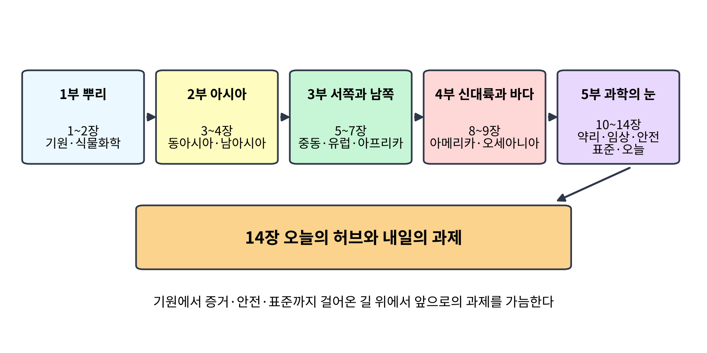
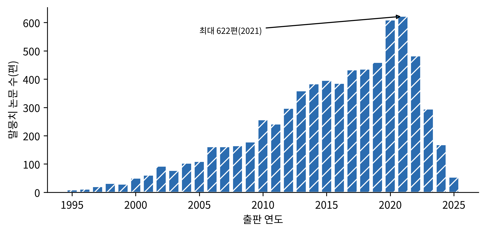
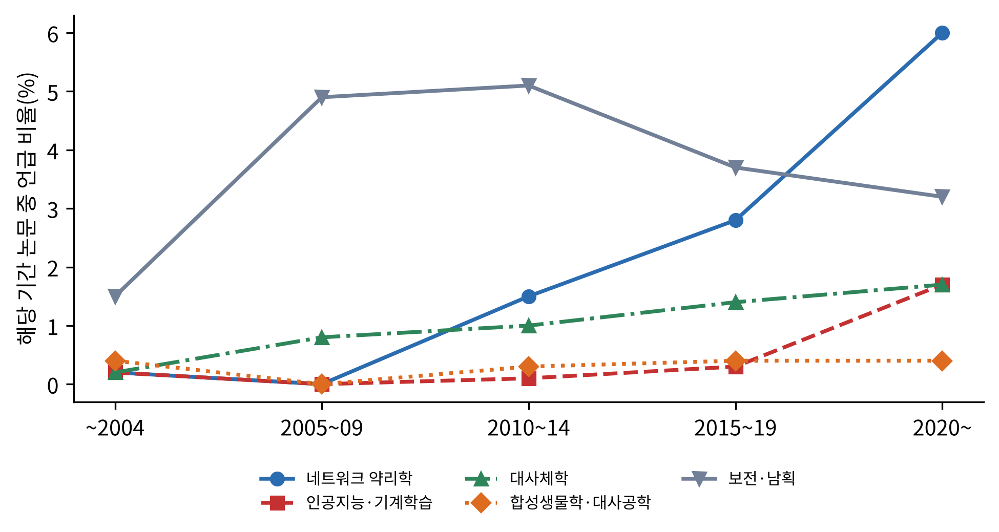
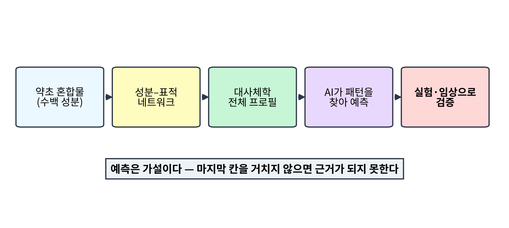
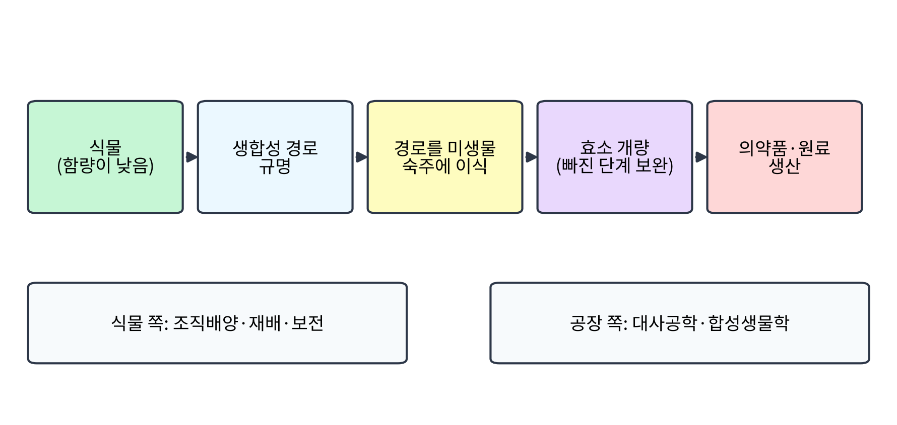
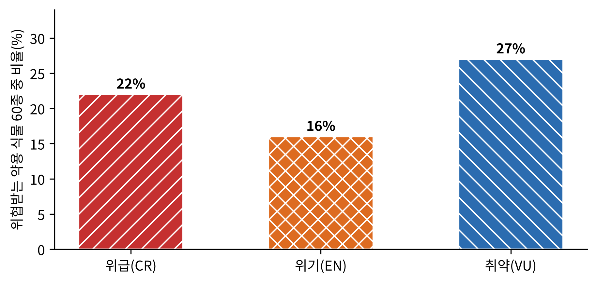
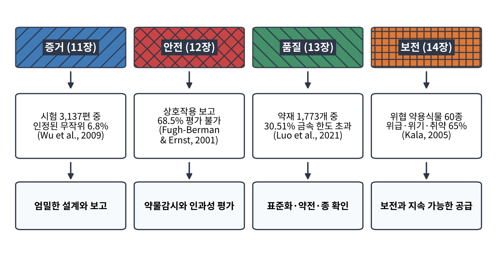

# 14장. 오늘의 허브와 내일의 과제

<strong>그림 14-1. 이 책이 걸어온 길(개념도).</strong> 다섯 부는 기원과 식물화학, 아시아의 전통, 서쪽과 남쪽의 전통, 신대륙과 바다의 전통, 그리고 과학의 눈으로 허브를 읽는 작업으로 이어졌다. 마지막 장은 이 길 위에서 오늘의 연구 방향과 내일의 과제를 가늠한다.

<ul class="mini-toc">
<li>말뭉치가 보여 주는 오늘</li>
<li>혼합물을 읽는 새 방법: 네트워크와 인공지능</li>
<li>식물에서 미생물 공장으로</li>
<li>사라지는 식물</li>
<li>내일의 과제</li>
</ul>

## 이 장을 읽기 전에

앞의 열세 장은 허브가 어디서 왔고(1~2장), 각 지역이 어떤 지식을 쌓았으며(3~9장), 그 지식을 과학이 어떻게 시험해 왔는지(10~13장)를 따라왔다. 마지막 장의 질문은 단순하다. 지금 연구자들은 무엇에 관심을 쏟고 있으며, 앞으로 무엇이 풀려야 하는가?

이 장은 두 가지 눈으로 답한다. 하나는 이 책이 근거로 삼아 온 말뭉치 7,182편이 보여 주는 연구 관심의 변화이고, 다른 하나는 새로운 방법과 보전의 문제를 다룬 개관 논문들이다. 말뭉치는 허브 연구 전체가 아니라 이 책이 수집한 표본이므로, 아래의 추이는 '이 말뭉치 안에서의' 변화로만 읽는다.

## 1. 말뭉치가 보여 주는 오늘

말뭉치에서 출판 연도별 논문 수를 세면 1990년대 후반까지는 해마다 한 자릿수에서 30편 안팎이다. 2000년에 50편이던 것이 2010년에는 256편, 2020년에는 609편, 2021년에는 최대 622편이 된다. 2022년 이후의 감소는 이 책이 말뭉치를 수집한 방식과 시점의 영향일 수 있으므로 연구가 줄어든 증거로 해석하지 않는다.

<figure class="fig">

<figcaption><strong>그림 14-2. 말뭉치의 연도별 논문 수(1995~2025).</strong> 2021년의 622편이 최대이다. 최근 몇 해의 감소는 수집 시점의 영향일 수 있어 해석하지 않는다.</figcaption>
</figure>

더 흥미로운 것은 주제의 변화이다. 제목과 초록에서 용어가 언급된 논문의 비율을 기간별로 보면, 네트워크 약리학은 2010~14년에 1.5%(1,536편 중 23편)에서 2015~19년에 2.8%(2,108편 중 58편), 2020년 이후에 6.0%(2,229편 중 134편)로 늘었다. 인공지능·기계학습은 2015~19년의 0.3%(7편)에서 2020년 이후 1.7%(38편)로 늘었고, 대사체학은 2005~09년의 0.8%(6편)에서 2020년 이후 1.7%(37편)로 완만히 늘었다. 합성생물학·대사공학은 0.3~0.4% 수준에서 크게 달라지지 않았다. 보전·남획을 다룬 논문은 2005~09년에 4.9%, 2010~14년에 5.1%로 가장 높았다가 2020년 이후 3.2%로 낮아졌다.

<figure class="fig">

<figcaption><strong>그림 14-3. 말뭉치 논문 중 주제 용어를 언급한 비율의 추이.</strong> 기간별 전체 논문 수에 대한 비율(%)이다(~2004년 535편, 2005~09년 774편, 2010~14년 1,536편, 2015~19년 2,108편, 2020년 이후 2,229편).</figcaption>
</figure>

**해석.** 이 그림은 말뭉치 안에서 '네트워크 약리학'이라는 말이 가장 가파르게 늘었다는 사실을 보여 줄 뿐이다. 용어를 쓴 논문의 비율이 늘었다고 해서 그 방법이 성과를 낸다는 뜻은 아니다. 보전을 다룬 논문의 비율이 상대적으로 줄어든 것도 문제의 해결을 뜻하지 않는다. 여기서는 말의 빈도가 아니라 각 방법이 실제로 무엇을 약속하고 무엇을 입증했는지를 개관 논문을 통해 확인한다.

## 2. 혼합물을 읽는 새 방법: 네트워크와 인공지능

10장에서 우리는 한 분자가 여러 표적에 닿고 여러 성분이 한 경로에 모이는 모습을 보았다. 이 복잡성을 정면으로 다루려는 방법이 네트워크 약리학이다. 거치(Jürg Gertsch)는 2011년 약리학의 역사를 이렇게 요약했다. 생약학(pharmacognosy)은 수 세기 동안 합리적 신약 개발을 이끌다가 지난 50년간 표적 기반 신약 발견으로 대체되었다. 약초 혼합물이 단일 물질보다 낫다는 시너지 주장은 널리 퍼져 있지만, 이를 뒷받침할 건실한 실험 자료는 여전히 크게 부족하다. 그래서 리간드-표적 네트워크를 연구해야 한다는 것이 그의 강조점이었다(Gertsch, 2011).

대사체학(metabolomics)은 이 문제의 다른 입구이다. 왕(Mei Wang) 등은 2005년 시스템 생물학과 대사체학이 복잡한 혼합물이 복잡한 생물계에서 내는 효과를 연구할 길을 열어, 단일 활성 성분에만 집중한 환원주의적 방법에서 잃어버린 성분 간 상승 효과를 다시 볼 수 있게 한다고 보았다. 이 접근은 중의학 같은 전통 의학과 분자 약리학을 잇는 다리가 될 수 있다는 것이다(Wang et al., 2005).

최근의 흐름은 여기에 인공지능을 더한다. 장(Peng Zhang) 등은 2023년 중의학 네트워크 약리학에 쓰이는 인공지능 방법을 세 갈래, 곧 네트워크 관계 탐색, 네트워크 표적 위치 결정, 네트워크 표적 탐색으로 정리하고, 한열증(寒熱證)의 생물학적 근거를 밝히는 응용 사례를 제시했다(Zhang et al., 2023). 살디바르곤살레스(Fernanda I. Saldívar-González) 등은 2021년 자연어 처리와 기계학습이 천연물 신약 발견의 문제를 푸는 데 쓰이고 있다고 개관하면서, 제약 산업이 천연물에서 대체로 손을 뗐음에도 불구하고 이런 방법이 새로운 기회를 열고 있다고 보았다(Saldívar-González et al., 2021).

<figure class="fig">

<figcaption><strong>그림 14-4. 혼합물을 읽는 새 방법의 흐름(개념도).</strong> 성분–표적 네트워크와 대사체학, 인공지능이 가설을 만들고, 그 가설은 실험과 임상으로 검증되어야 근거가 된다(Gertsch, 2011; Wang et al., 2005; Zhang et al., 2023).</figcaption>
</figure>

**해석.** 이 방법들이 만드는 것은 예측이고 가설이다. 거치가 지적했듯 시너지에 대한 실험적 근거는 아직 부족하며, 11장에서 본 것처럼 임상시험의 질도 풍족하지 않았다. 따라서 네트워크 약리학과 인공지능이 후보를 좁혀 주는 도구라는 점은 분명하지만, 그 예측이 환자에게 효과가 있는지는 마지막 칸, 곧 실험과 임상에서 가려진다.

<strong>표 14-1. 새로운 방법과 그 근거의 수준</strong>

| 방법 | 약속 | 근거 | 아직 남은 문제 |
|---|---|---|---|
| 네트워크 약리학 | 혼합물을 리간드-표적 네트워크로 이해 | Gertsch (2011) | 시너지의 실험적 근거 부족 |
| 대사체학 | 혼합물의 전체 효과를 생물계에서 관찰 | Wang 등 (2005) | 가능성을 제시한 단계의 개관 |
| 인공지능 | 대규모 오믹스 자료에서 작용 기전과 후보 탐색 | Zhang 등 (2023); Saldívar-González 등 (2021) | 예측의 검증이 별도로 필요 |

## 3. 식물에서 미생물 공장으로

두 번째 흐름은 식물이 만드는 분자를 식물 밖에서 만드는 길이다. 3장에서 만난 아르테미시닌의 식물 청호(靑蒿, *Artemisia annua*)는 좋은 사례이다. 브라운(Geoffrey D. Brown)은 2010년 이 식물이 항말라리아제 아르테미시닌의 유일하게 알려진 공급원이며, 1,2,4-트리옥산 고리 구조가 활성의 근원이라고 정리했다. 또 이 식물에서 확인된 천연물이 600종에 가깝다는 점, 그리고 아르테미시닌 자체를 포함한 고도로 산화된 테르펜이 반응성 높은 과산화물 중간체에서 자발적 산화로 만들어질 수 있다는 제안을 소개했다(Brown, 2010).

식물에서 얻는 방식에는 한계가 있다. 모세스(Tessa Moses) 등은 2013년 식물 테르페노이드의 상업화에서 가장 큰 과제로 식물 안에서의 낮은 생산량과 새로운 활성 분자에 대한 산업계의 요구를 꼽고, 합성생물학이 생산을 늘리고 다양화하는 방법을 제시한다고 보았다(Moses et al., 2013). 크레이븐스(Aaron Cravens) 등은 2019년 식물 천연물(PNP)이 의약품, 향료, 방향제에 두루 쓰이지만 전통적으로 만들기 어려웠다고 말한다. 경로를 새 숙주에 넣으려면 숙주를 찾거나 고치고, 생합성 경로를 설계하고, 빠진 단계의 효소를 찾거나 개량해야 한다(Cravens et al., 2019).

<figure class="fig">

<figcaption><strong>그림 14-5. 식물 천연물 생산의 두 갈래(개념도).</strong> 위쪽은 식물에서 의약품·원료 생산까지 경로를 옮기는 단계이고, 아래쪽은 식물 자원을 지키는 쪽과 미생물 공장 쪽의 과제이다(Cravens et al., 2019; Moses et al., 2013).</figcaption>
</figure>

**해석.** 합성생물학이 약초를 대체한다는 뜻은 아니다. 이 방법이 다루는 것은 약초의 많은 성분 가운데 경로가 밝혀진 특정 분자이다. 혼합물로 쓰는 전통 처방의 약효를 그대로 재현하는 문제와는 다르다. 그리고 이 흐름이 잘 작동해도 식물 자원의 보전이라는 다음 문제는 남는다. 말뭉치에서 합성생물학·대사공학의 비율이 0.3~0.4%에 머문 것(그림 14-3)도 이 방법이 아직 약초 연구의 주류가 아님을 보여 준다.

## 4. 사라지는 식물

약초를 쓰는 사람이 늘수록 식물이 줄어드는 문제가 커진다. 판(Si-Yuan Pan) 등은 2014년 세계보건기구 자료로 세계 인구의 75%가 기초 보건에 약초를 쓰고, 약초 의학에 쓰이는 종이 53,000종이 넘으며 그 가운데 상당수가 남획으로 멸종 위협을 받는다고 정리했다(Pan et al., 2014). 콜렛(Richard T. Corlett)은 2016년 육상 식물이 약 50만 종으로 추정되고 아마 3분의 1이 멸종 위기에 있을 것이라고 보았다. 위협 요인은 서식지의 상실·파편화·훼손, 남획, 침입종, 오염, 인위적 기후변화이며, 잘 설계되고 관리되는 보호구역 체계와 서식지 밖 보전이 어디서든 효과가 있을 것이라고 했다(Corlett, 2016).

가장 구체적인 수치는 칼라(Chandra Prakash Kala)의 현장 연구에서 나왔다. 그는 2005년 인도 히말라야의 보호구역 일곱 곳에서 10년 동안 위협받는 약용 식물의 밀도를 관찰하고, 인근 마을의 약초 치료사 138명(티베트 치료사 83명, 아유르베다 치료사 55명)을 면담했다. 위협받는 약용 식물은 60종, 그중 54종이 조사 구역에서 확인되었고, 위급이 22%, 위기가 16%, 취약이 27%였다. 32종은 히말라야 지역 고유종이었고, 가장 흔한 것은 *Arnebia euchroma*와 *Ephedra gerardiana*였다(Kala, 2005).

<figure class="fig">

<figcaption><strong>그림 14-6. 인도 히말라야 보호구역의 위협받는 약용 식물 60종 중 단계별 비율.</strong> 위급(CR) 22%, 위기(EN) 16%, 취약(VU) 27%(Kala, 2005).</figcaption>
</figure>

**검출과 해석.** 이 연구가 측정한 것은 일곱 보호구역의 개체군 밀도와 치료사의 이용 기록이다. 세 단계를 합쳐 65%라는 계산은 위의 세 수치를 더한 것이며, 나머지 35%의 단계는 이 초록에서 확인되지 않는다. 일곱 보호구역의 결과를 세계의 약용 식물 전체로 일반화할 수는 없다. 이 연구의 의미는 약초를 쓰는 사람들의 지식과 식물의 상태를 한 연구 안에서 함께 기록했다는 데 있다.

해법은 어디에 있는가? 천(Shilin Chen) 등은 2016년 개관에서 현지 내·외 보전과 재배 같은 보전 전략과 우수 농업 실천 같은 자원 관리가 함께 고려되어야 하며, 조직배양과 미세번식, 인공 종자, 분자 표지자 기반 접근 같은 생명공학 방법이 수확량과 효능을 높이는 데 쓰일 수 있다고 권고했다(Chen et al., 2016). 하우스(Melanie-Jayne R. Howes) 등은 2020년 약용 식물과 균류의 수요가 일부 종을 위협해 생물다양성 손실의 요인이 되고 있다고 보고, 자연의 가치를 보전의 유인으로 삼아 치료제로서의 이용과 보전을 조화시키는 '자연 기반 해법'을 제안했다(Howes et al., 2020).

<strong>표 14-2. 약용 식물 보전 연구의 요약</strong>

| 연구 | 요점 | 비고 |
|---|---|---|
| Pan 등 (2014) | 세계 인구 75%가 약초 사용, 53,000종 이상이 이용되고 상당수가 남획 위협 | 개관 |
| Corlett (2016) | 육상 식물 약 50만 종, 약 3분의 1이 멸종 위기 가능성 | 개관 |
| Kala (2005) | 히말라야 위협 약용 식물 60종, 위급 22%·위기 16%·취약 27% | 보호구역 일곱 곳, 10년 관찰 |
| Chen 등 (2016) | 현지 내·외 보전, 재배, 우수 농업 실천, 조직배양 | 개관·권고 |
| Howes 등 (2020) | 자연 기반 해법으로 치료 이용과 보전 조화 | 개관·제안 |

## 5. 내일의 과제

이 책이 만난 문제를 한 줄로 모으면 네 갈래이다. 증거와 안전과 품질, 그리고 보전이다. 각각에 이 책에서 확인한 가장 분명한 수치가 있다.

증거. 11장에서 중국 의학 학술지의 무작위 시험 3,137편 가운데 면담이 이루어진 2,235편에서 인정된 무작위 방법을 지킨 시험은 207편, 6.8%였다(Wu et al., 2009). 안전. 12장의 약초-약물 상호작용 의심 사례 108건 가운데 68.5%가 평가 불가였다(Fugh-Berman & Ernst, 2001). 품질. 13장의 약재 1,773개 가운데 30.51%가 중국 약전의 금속 한도를 하나 이상 넘었다(Luo et al., 2021). 보전. 이 장에서 본 히말라야 위협 약용 식물 60종의 단계별 비율이다(Kala, 2005).

<figure class="fig">

<figcaption><strong>그림 14-7. 내일의 과제 지도(개념도).</strong> 증거, 안전, 품질, 보전의 네 갈래에 이 책에서 확인한 대표 수치와 필요한 방향을 짝지었다. 수치의 출처는 각 칸에 적었다.</figcaption>
</figure>

<strong>표 14-3. 이 책이 확인한 한계와 내일의 과제</strong>

| 갈래 | 이 책에서 확인한 것 | 필요한 방향 | 출처 |
|---|---|---|---|
| 증거 | 무작위 시험으로 보고된 논문 중 인정된 무작위 방법은 6.8% | 엄밀한 설계와 보고 | Wu 등 (2009) |
| 안전 | 상호작용 의심 사례의 68.5%가 평가 불가 | 약물감시와 인과성 평가 | Fugh-Berman & Ernst (2001) |
| 품질 | 약재의 30.51%가 금속 한도 초과 | 표준화, 약전, 종 확인 | Luo 등 (2021) |
| 보전 | 위협 약용 식물의 위급·위기·취약 단계 | 보전과 지속 가능한 공급 | Kala (2005) |
| 새 방법 | 예측은 가설, 시너지의 실험적 근거 부족 | 실험·임상 검증 | Gertsch (2011) |

**해석.** 네 갈래는 따로 풀리지 않는다. 품질이 일정하지 않으면 시험 결과를 쌓을 수 없고, 시험이 없으면 안전을 말할 수 없으며, 식물이 사라지면 표준화할 대상 자체가 없어진다. 새 방법인 네트워크 약리학과 합성생물학은 이 사슬의 어느 고리를 조여 줄 수 있지만 사슬 전체를 대신하지는 못한다.

## 이 장을 마치며

《풀이 약이 되기까지》는 한 가지 질문을 따라왔다. 풀은 어떻게 약이 되는가? 기원의 장에서는 식물이 왜 약을 만드는가를, 지역의 장에서는 사람들이 그 풀을 어떻게 알아보고 썼는가를, 과학의 장에서는 그 지식이 분자와 시험, 안전과 품질의 틀에서 어떻게 검증되는가를 보았다.

이 책이 반복해서 확인한 것은 하나이다. 풀이 약이 되는 데는 지식만으로도, 분자만으로도 충분하지 않다. 지식이 시험을 통과해야 하고, 시험이 일정한 제품 위에서 이루어져야 하며, 그 제품의 원료인 식물이 지속적으로 존재해야 한다. 이 모든 단계에서 우리가 기댄 근거의 질과 그 한계를 각 장의 '검출과 해석'에 구별해 적었다. 한계를 분명히 아는 것이 허브를 신비화하지도 폄하하지도 않는 가장 정직한 출발점이라고 이 책은 믿는다.

## 참고문헌

- Brown, G. D. (2010). The biosynthesis of artemisinin (Qinghaosu) and the phytochemistry of *Artemisia annua* L. (Qinghao). *Molecules, 15*(11), 7603–7698. https://doi.org/10.3390/molecules15117603
- Chen, S., Yu, H., Luo, H., Wu, Q., Li, C., & Steinmetz, A. (2016). Conservation and sustainable use of medicinal plants: Problems, progress, and prospects. *Chinese Medicine, 11*, Article 37. https://doi.org/10.1186/s13020-016-0108-7
- Corlett, R. T. (2016). Plant diversity in a changing world: Status, trends, and conservation needs. *Plant Diversity, 38*(1), 10–16. https://doi.org/10.1016/j.pld.2016.01.001
- Cravens, A., Payne, J., & Smolke, C. D. (2019). Synthetic biology strategies for microbial biosynthesis of plant natural products. *Nature Communications, 10*, Article 2142. https://doi.org/10.1038/s41467-019-09848-w
- Fugh-Berman, A., & Ernst, E. (2001). Herb–drug interactions: Review and assessment of report reliability. *British Journal of Clinical Pharmacology, 52*(5), 587–595. https://doi.org/10.1046/j.0306-5251.2001.01469.x
- Gertsch, J. (2011). Botanical drugs, synergy, and network pharmacology: Forth and back to intelligent mixtures. *Planta Medica, 77*(11), 1086–1098. https://doi.org/10.1055/s-0030-1270904
- Howes, M.-J. R., Quave, C. L., Collemare, J., Tatsis, E. C., Twilley, D., Lulekal, E., Farlow, A. W. K., Li, L., Cazar, M. E., Leaman, D. J., Prescott, T. A. K., Milliken, W., Martin, C. R., De Canha, M. N., Lall, N., Qin, H., Walker, B. E., Vásquez Londoño, C. A., Allkin, R., . . . Nic Lughadha, E. (2020). Molecules from nature: Reconciling biodiversity conservation and global healthcare imperatives for sustainable use of medicinal plants and fungi. *Plants, People, Planet, 2*(5), 463–481. https://doi.org/10.1002/ppp3.10138
- Kala, C. P. (2005). Indigenous uses, population density, and conservation of threatened medicinal plants in protected areas of the Indian Himalayas. *Conservation Biology, 19*(2), 368–378. https://doi.org/10.1111/j.1523-1739.2005.00602.x
- Luo, L., Wang, B., Jiang, J., Fitzgerald, M., Huang, Q., Zheng, Y., Li, H., Zhang, J., Wei, J., Yang, C., Zhang, H., Dong, L., & Chen, S. (2021). Heavy metal contaminations in herbal medicines: Determination, comprehensive risk assessments, and solutions. *Frontiers in Pharmacology, 11*, Article 595335. https://doi.org/10.3389/fphar.2020.595335
- Moses, T., Pollier, J., Thevelein, J. M., & Goossens, A. (2013). Bioengineering of plant (tri)terpenoids: From metabolic engineering of plants to synthetic biology in vivo and in vitro. *New Phytologist, 200*(1), 27–43. https://doi.org/10.1111/nph.12325
- Pan, S.-Y., Litscher, G., Gao, S.-H., Zhou, S.-F., Yu, Z.-L., Chen, H.-Q., Zhang, S.-F., Tang, M.-K., Sun, J.-N., & Ko, K.-M. (2014). Historical perspective of traditional indigenous medical practices: The current renaissance and conservation of herbal resources. *Evidence-Based Complementary and Alternative Medicine, 2014*, Article 525340. https://doi.org/10.1155/2014/525340
- Saldívar-González, F. I., Aldas-Bulos, V. D., Medina-Franco, J. L., & Plisson, F. (2021). Natural product drug discovery in the artificial intelligence era. *Chemical Science, 13*(6), 1526–1546. https://doi.org/10.1039/d1sc04471k
- Wang, M., Lamers, R.-J. A. N., Korthout, H. A. A. J., van Nesselrooij, J. H. J., Witkamp, R. F., van der Heijden, R., Voshol, P. J., Havekes, L. M., Verpoorte, R., & van der Greef, J. (2005). Metabolomics in the context of systems biology: Bridging traditional Chinese medicine and molecular pharmacology. *Phytotherapy Research, 19*(3), 173–182. https://doi.org/10.1002/ptr.1624
- Wu, T., Li, Y., Bian, Z., Liu, G., & Moher, D. (2009). Randomized trials published in some Chinese journals: How many are randomized? *Trials, 10*, Article 46. https://doi.org/10.1186/1745-6215-10-46
- Zhang, P., Zhang, D., Zhou, W., Wang, L., Wang, B., Zhang, T., & Li, S. (2023). Network pharmacology: Towards the artificial intelligence-based precision traditional Chinese medicine. *Briefings in Bioinformatics, 25*(1), Article bbad518. https://doi.org/10.1093/bib/bbad518
