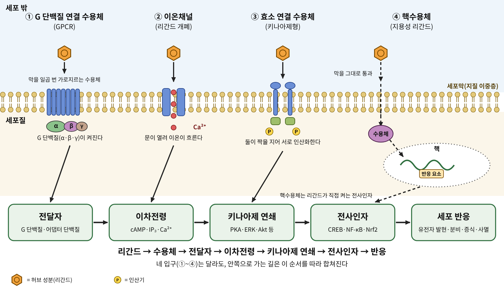

# 서장. 풀 한 줌이 세포에 닿기까지

<strong>그림 0-1. 세포신호의 공통 지도.</strong> 허브 성분(리간드)이 세포에 말을 거는 입구는 네 가지이다. 입구가 달라도 신호는 전달자, 이차전령, 키나아제 연쇄, 전사인자를 지나 세포 반응으로 모인다. 이 책의 모든 장은 이 지도의 한 구간을 확대해서 읽는다.

<ul class="mini-toc">
<li>쓴 껍질을 말려 가루로 만든 사제</li>
<li>한 줄의 처방과 낮은 온도</li>
<li>분자는 어디에 닿았는가</li>
<li>세포가 신호를 받는 네 개의 입구</li>
<li>이 책을 읽는 방법</li>
</ul>

## 이 장을 읽기 전에

허브를 먹으면 몸에서 무슨 일이 일어나는가. 이 질문에는 오래된 대답이 있다. "열이 내린다", "잠이 온다", "속이 편해진다" 같은 대답이다. 이 책은 그 대답을 부정하지 않는다. 다만 한 걸음 더 들어간다. 열이 내리는 동안 세포 안에서는 어떤 분자가 어떤 단백질에 닿았고, 그 접촉이 어떤 신호가 되어 어디까지 전해졌는가를 묻는다.

앞서 낸 《풀이 약이 되기까지》는 풀이 약이 되기까지의 역사와 지역별 전통을 다루었다. 이 책은 그 뒤의 이야기이다. 풀에서 분리된 분자가 사람의 세포에 어떻게 말을 거는지, 그 말이 어디까지 증명되었고 어디부터는 아직 논쟁인지를 장마다 한 가지 신호 경로를 중심으로 풀어 쓴다.

이 장에서는 이 책 전체의 길잡이가 되는 이야기 두 개를 먼저 읽는다. 버드나무 껍질과 개똥쑥이다. 두 이야기는 모두 "풀이 약이 되었다"로 끝나지 않는다. 이 풀들의 분자가 정확히 무엇에 닿아 효과를 내는지는 발견 뒤 수십 년이 지나서야 조금씩 밝혀졌고, 한쪽은 아직도 논쟁이 이어지고 있다. 그 점이 이 책이 던지는 질문의 모양을 보여 준다.

## 1. 쓴 껍질을 말려 가루로 만든 사제

1763년, 영국 왕립학회의 학술지에 짧은 논문이 한 편 실렸다. 제목은 〈학질 치료에서 버드나무 껍질이 거둔 성공에 대한 보고〉이다. 글쓴이 에드워드 스톤(Edward Stone)은 의사가 아니었다. 옥스퍼드셔의 작은 마을 치핑 노턴(Chipping Norton)에서 지역 영주의 사제로 일하던 사람이다(Stone, 1763; Wood, 2015).

스톤의 출발점은 맛이었다. 그는 흰버드나무(white willow, 학명 *Salix alba*)의 껍질이 당시 학질 치료약으로 귀하게 쓰이던 페루산 키나나무 껍질(Peruvian bark)만큼 쓰다는 것을 알아챘고, 쓴맛이 비슷하다면 쓰임새도 비슷할지 모른다고 생각했다. 여기에 자연이 만든 병에는 그 원인 가까이에 치료법이 있기 마련이라는 옛 격언이 보태졌다(Wood, 2015).

그는 먼저 자기 몸으로 시험했다. 버드나무 껍질 약 450그램을 빵 굽는 화덕 곁에 석 달 동안 두어 말린 뒤, 곱게 빻아 체로 쳤다. 처음에는 한 번에 20그레인(약 1.3그램)을 삼켰고, 이어 양을 늘렸다. 그가 권한 양은 한 번에 1드램(약 3.6그램) 남짓을 네 시간 간격으로 먹는 것이었다. 이 가루는 물이나 차, 약한 맥주에 타서 먹었다(Wood, 2015).

5년 동안 약 50명이 이 가루를 먹었다. 스톤의 보고에 따르면 그 대부분이 나았고, 나흘마다 열이 나는 학질(사일열)을 앓은 몇 명만 부분적으로 호전되었다. 키나나무 껍질을 버드나무 껍질 4에 1의 비율로 섞으면 열이 완전히 멎었다는 대목도 있다. 해설을 쓴 우드(James N. Wood)는 이 대목을 해당 환자들이 말라리아였음을 시사하는 것으로 읽는다(Wood, 2015).

이 보고는 현대의 시험 기준으로 보면 허술하다. 대조군이 없고, 환자 수가 적고, 병의 진단이 요즘 기준과 맞지 않는다. 그럼에도 이 논문이 중요한 이유는 한 가지이다. 이 논문은 "쓴 껍질이 열을 내린다"는 민간의 앎을 숫자와 용량이 붙은 기록으로 바꾸어 놓았다. 기록이 생기자 다음 사람이 이어받을 수 있었다.

다음 사람들은 화학자였다. 19세기 초에 유럽의 화학자들은 버드나무 껍질에서 유효 성분을 가려내려 애썼고, 1829년 앙리 르루(Henri Leroux)는 껍질 1.5킬로그램에서 정제한 살리신(salicin) 약 30그램을 얻었다(Wood, 2015). 몸 안에서 살리신이 살리실산(salicylic acid)으로 바뀐다는 사실은 이후에 밝혀졌다(Le 외, 2021).

## 2. 아스피린은 누가 만들었는가

1897년 독일 엘버펠트의 바이엘(Bayer) 연구소에서 한 가지 변형이 이루어졌다. 살리실산에 아세틸기를 붙인 아세틸살리실산(acetylsalicylic acid)이다. 이 물질이 1899년 아스피린이라는 이름으로 팔리기 시작했다(Sneader, 2000).

오래 알려진 이야기는 이렇다. 화학자 펠릭스 호프만(Felix Hoffmann)이 류머티즘을 앓는 아버지를 돕기 위해 이 물질을 만들었다는 것이다. 그런데 월터 스니더(Walter Sneader)는 이 이야기가 1934년의 한 각주에서 처음 나왔고, 정작 개발을 지휘했다고 주장한 사람은 아르투어 아이헨그륀(Arthur Eichengrün)이었다고 정리한다. 아이헨그륀은 1949년에야 이 주장을 공개적으로 발표했다. 스니더는 하인리히 드레저(Heinrich Dreser)가 아세틸살리실산을 약 18개월 동안 제쳐 두었다가 1898년 9월 27일에 다시 시험했다는 기록과 특허 문서를 근거로, 아이헨그륀의 설명이 더 설득력 있다는 결론에 이른다(Sneader, 2000).

이 장에서 이 논쟁의 승패를 가릴 필요는 없다. 다만 아스피린의 출생 기록 하나조차 이처럼 오래 다투었다는 점은 기억해 둘 만하다. 약의 기원을 둘러싼 이야기에는 늘 한 사람의 영웅이 등장하지만, 증거를 따라가면 여러 사람과 여러 해가 겹쳐 있다.

## 3. 분자는 어디에 닿았는가

아스피린은 판매 후 70년 넘게 "잘 듣는 약"이었지만 "어떻게 듣는 약"인지는 몰랐다. 1971년 영국의 약리학자 존 베인(John R. Vane)이 〈아스피린과 같은 약의 작용 기전으로서의 프로스타글란딘 합성 억제〉라는 논문을 냈다. 초록에 따르면 이 실험은 기니피그 폐를 이용했고, 아스피린과 살리실산나트륨 같은 약의 치료 효과 일부가 프로스타글란딘(prostaglandin) 합성을 막는 데서 나온다는 결론이었다(Vane, 1971). 베인의 연구진이 막았다고 본 효소가 지금 사이클로옥시제네이스(cyclooxygenase, COX)라 불리는 효소이다(Wood, 2015).

여기서 이 책의 질문이 처음으로 구체적인 모양을 얻는다. 풀의 성분(살리실산)이 몸의 효소(COX)에 닿아 그 활동을 바꾸고, 그 결과 염증 신호 물질(프로스타글란딘)이 줄어든다. 분자가 표적에 닿고, 표적이 하던 일이 달라지고, 그 변화가 세포 바깥의 반응으로 번지는 흐름이다. 이후 장들은 이 흐름을 다른 풀과 다른 표적에서 되풀이해서 읽는다.

그런데 이 이야기에는 반전이 있다. 2021년 독일 연구진은 버드나무 껍질 추출물에서 활성 성분을 활성 유도 분획(activity-guided fractionation) 방법으로 추적했다. 사람 말초혈액 단핵세포를 자극했을 때 나오는 프로스타글란딘 E2(PGE2)를 줄이는 성분을 찾는 실험이었다. 그 결과 PGE2 분비를 억제한 것은 아세틸살리코르틴(acetylsalicortin), 라시안드린(lasiandrin), 트레물라신(tremulacin) 같은 살리실산 계열 배당체들이었고, 같은 껍질의 폴리페놀은 이 활성과 관계가 없었다. 2′-O-아세틸살리신은 활성이 없었다(Antoniadou 외, 2021). 껍질 한 줌 속의 약효 분자는 살리신 하나로 설명되지 않는다.

## 4. 한 줄의 처방과 낮은 온도

두 번째 이야기는 개똥쑥(*Artemisia annua*)이다. 1967년 중국은 말라리아 치료제를 찾는 국가 규모의 연구 사업을 시작했고, 이 사업은 '523 프로젝트'라는 이름으로 불렸다. 도유유(屠呦呦, Tu Youyou)가 소속 연구소에서 이 사업의 연구 그룹 책임을 맡았다(Tu, 2011).

연구진은 중국의 약초 처방 2,000여 가지를 검토해 말라리아에 효과가 있을지 모르는 후보 640가지를 골랐고, 그 가운데 약 200종 식물에서 얻은 추출물 380여 가지를 생쥐 말라리아 모델에서 시험했다(Tu, 2011). 개똥쑥 추출물은 한때 가능성을 보였으나 다시 시험하면 같은 결과가 나오지 않았다.

전환점은 옛 책의 한 줄이었다. 도유유는 문헌을 다시 뒤지다가 4세기 갈홍(葛洪)의 《주후비급방(肘後備急方)》에서 청호(靑蒿)를 물에 담가 즙을 짜서 마시라는 처방을 찾았다. 그는 이 처방에서 "끓이지 않는다"는 점에 주목했다. 흔히 쓰는 추출 과정의 열이 활성 성분을 파괴하는 것은 아닐까 하는 추측이었다. 낮은 온도의 추출로 바꾸자 효과가 크게 좋아졌다(Tu, 2011).

1971년 10월 4일, 연구진은 독성이 없는 중성 추출물을 얻었다. 이 추출물은 *Plasmodium berghei*에 감염된 생쥐와 *Plasmodium cynomolgi*에 감염된 원숭이에서 기생충 혈증을 100% 막았다. 이어 연구진이 먼저 자신들이 먹어 안전성을 확인한 뒤 하이난에서 환자들에게 시험했고, 추출물을 먹은 환자들은 열과 기생충이 빠르게 사라졌다. 1972년에는 무색 결정 성분(C₁₅H₂₂O₅)이 분리되어 청호소(靑蒿素, qinghaosu), 곧 아르테미시닌(artemisinin)이라는 이름을 얻었다. 입체구조는 1975년에 규명되었고 1977년에 발표되었다. 더 안정하고 효과도 약 열 배 높은 유도체인 디하이드로아르테미시닌(dihydroartemisinin)이 뒤따라 개발되었다(Tu, 2011).

## 5. 이 이야기의 끝은 열려 있다

그렇다면 아르테미시닌은 말라리아 원충의 어디에 닿아 기생충을 죽이는가. 이 질문에는 오늘까지 합의된 대답이 없다.

아르테미시닌은 분자 안에 산소 두 개가 이어진 퍼옥사이드(peroxide) 다리를 가진다. 베르나르 뫼니에(Bernard Meunier)와 안 로베르(Anne Robert)는 이 다리가 철(II)을 품은 헴(heme)과 만나 깨지면서 탄소 중심 라디칼이 생기고, 그 라디칼이 헴을 공유결합으로 붙잡아 변형시킨다고 정리했다. 그래서 헴은 아르테미시닌을 "켜는 방아쇠"이자 "겨냥하는 표적"이 된다는 것이다. 암세포 독성 실험에서 퍼옥사이드 다리를 뺀 유사체의 활성이 50분의 1 이하로 떨어진다는 점이 이 다리의 중요성을 뒷받침한다(Meunier & Robert, 2010).

사람의 암세포에서도 비슷한 일이 일어난다. 채드윅(Amy E. Chadwick) 연구진은 헬라(HeLa) 세포에서 헴 합성을 억제하면 아르테미시닌 유도체의 독성이 크게 줄고, 미토콘드리아의 호흡 기능을 없애도 독성이 줄어든다는 것을 보였다. 이들의 결론은 세포 안의 헴이나 단백질에 결합한 철이 퍼옥사이드를 활성화시키고, 이어 미토콘드리아에서 생기는 활성산소가 세포 죽음을 끌어낸다는 것이다(Chadwick 외, 2010).

반면 리처드 헤인즈(Richard K. Haynes) 연구진은 이 가설들에 강하게 이의를 제기했다. 이들의 총설은 아르테미시닌 계열의 작용 기전에 대해 정확히 밝혀진 것이 널리 가정된 것보다 훨씬 적다고 지적하면서, 탄소 중심 라디칼 가설은 성립하기 어렵다고 결론짓고 헴 가설에도 풀리지 않는 모순이 있다고 논증한다(Haynes 외, 2014). 아르테미시닌은 말라리아 치료의 일차 약으로 쓰이지만, 그 분자가 정확히 어떤 표적에 어떻게 닿는지는 아직 논쟁이 진행 중인 문제이다.

<strong>표 0-1. 두 이야기의 비교: 분자 표적을 얼마나 알게 되었는가</strong>

| 구분 | 버드나무 껍질 | 개똥쑥 |
|---|---|---|
| 전통 기록의 모양 | 쓴맛을 근거로 한 경험적 시험(Stone, 1763) | 4세기 처방서의 한 줄(Tu, 2011) |
| 성분 분리 | 19세기 초 살리신 분리(Wood, 2015) | 1972년 아르테미시닌 결정(Tu, 2011) |
| 표적이 밝혀진 시점 | 1971년, COX 억제(Vane, 1971) | 반세기 뒤에도 논쟁 중(Haynes 외, 2014) |
| 남은 질문 | 껍질의 어떤 분자가 약효를 내는가(Antoniadou 외, 2021) | 퍼옥사이드가 무엇을 켜고 무엇을 겨냥하는가(Meunier & Robert, 2010; Chadwick 외, 2010) |

표 0-1. 두 이야기는 같은 질문의 서로 다른 단계를 보여 준다. 한쪽은 표적이 비교적 일찍 정리되었고, 다른 쪽은 약이 이미 쓰이는 지금도 표적을 두고 다툰다.

## 6. 세포가 신호를 받는 네 개의 입구

두 이야기를 같은 지도 위에 놓으려면 공통의 언어가 필요하다. 세포생물학 교과서는 세포가 바깥의 분자를 신호로 받는 방식을 대체로 몇 가지 수용체 유형으로 정리한다(Alberts 외, 2022). 이 책은 그 가운데 네 가지를 입구로 삼는다(그림 0-1).

첫째는 G 단백질 연결 수용체(G protein-coupled receptor, GPCR)이다. 막을 일곱 번 가로지르는 이 수용체는 리간드를 받으면 안쪽의 G 단백질을 켠다. 둘째는 이온채널(ion channel)이다. 리간드가 붙으면 채널의 문이 열려 칼슘이나 염소 같은 이온이 드나든다. 셋째는 효소 연결 수용체(enzyme-linked receptor)이다. 리간드가 붙으면 두 수용체가 짝을 지어 서로 인산화한다. 넷째는 핵수용체(nuclear receptor)이다. 지용성 분자는 막을 그대로 통과해 세포 안의 수용체에 붙고, 이 수용체는 핵에서 DNA의 특정 자리에 붙어 유전자 발현을 바꾼다.

입구가 어디든, 신호가 세포 안쪽으로 이어지는 순서는 닮아 있다. 리간드가 수용체에 붙고, 수용체가 전달자 단백질을 켜고, 전달자가 고리형 AMP(cAMP)나 칼슘 이온 같은 이차전령(second messenger)을 만들고, 이차전령이 키나아제(kinase)의 연쇄 반응을 일으키고, 마지막에 전사인자(transcription factor)가 유전자를 켜거나 끈다. 핵수용체는 이 사슬을 건너뛰어 리간드가 직접 전사인자를 켜는 경우에 해당한다(Alberts 외, 2022).

<strong>표 0-2. 네 입구와 이 책에서 만나는 장</strong>

| 입구 | 신호가 시작되는 방식 | 이 책에서 읽는 장 |
|---|---|---|
| ① GPCR | 리간드 → G 단백질 활성화 | 1장, 3장, 5장, 6장, 14장 |
| ② 이온채널 | 리간드 → 채널 개폐 → 이온 흐름 | 1장, 5장, 13장 |
| ③ 효소 연결 수용체 | 리간드 → 이량체화 → 인산화 | 7장, 13장, 14장 |
| ④ 핵수용체 | 리간드 → 핵에서 DNA 결합 | 3장, 4장, 9장, 14장 |

표 0-2. 같은 풀이 여러 입구를 동시에 건드리는 경우가 많으므로, 한 장이 한 입구만 다루지는 않는다. 장의 배치는 목차를 따른 것이며 집필 과정에서 조정될 수 있다.

버드나무 껍질의 이야기는 이 지도에서 효소 하나를 막는 이야기였다. 개똥쑥의 이야기는 아직 어느 입구에서 출발하는지조차 합의되지 않은 이야기이다. 이 책의 나머지 장들은 이 지도 위에 더 많은 풀을 올려놓는다.

## 7. 이 책을 읽는 방법

이 책은 풀 이야기를 할 때마다 세 가지를 구별해서 적는다. 첫째는 분자가 표적에 **닿는다**는 증거이다. 시험관에서 결합이나 효소 활성이 달라지는 것을 보인 결과가 여기에 속한다. 둘째는 그 접촉이 세포 안에서 신호를 **바꾼다**는 증거이다. 세포나 동물 실험이 여기에 속한다. 셋째는 그 변화가 사람의 몸에서 실제로 **일어난다**는 증거이다. 임상시험과 약동학 연구가 여기에 속한다.

세 단계의 증거는 서로 다른 무게를 가진다. 시험관에서 결합했다는 말이 사람에게 효과가 있다는 말은 아니다. 또 사람에게 효과가 있다는 말이 그 분자가 어떤 경로로 효과를 낸다는 말도 아니다. 17장과 18장에서 이 구분을 따로 한 번 더 점검한다.

아울러 이 책에는 두 가지 습관이 있다. 처음 나오는 용어는 정식 이름과 영어 이름을 함께 적는다. 그리고 중요한 연구가 나오면 연구자가 무엇을 궁금해했고 어떤 방법을 썼고 무엇이 나왔는지를 차례로 적는다. 방금 읽은 베인의 실험과 도유유의 추출 실험이 그 보기이다.

다음 장부터 1부는 풀의 분자가 몸에 들어가는 길, 곧 맛과 향, 장벽, 장내 미생물, 간을 따라간다. 2부는 세포 표면에서 세포 안으로 신호가 전해지는 길을, 3부는 핵과 소기관에서 일어나는 일을, 4부는 뇌와 대사, 심혈관, 암 같은 기관의 문제를, 5부는 분자 수준의 증거를 읽는 법을 다룬다.

## 참고문헌

- Alberts, B., Heald, R., Johnson, A., Morgan, D., Raff, M., Roberts, K., & Walter, P. (2022). *Molecular biology of the cell* (7th ed.). W. W. Norton & Company.
- Antoniadou, K., Herz, C., Le, N. P. K., Mittermeier-Kleßinger, V. K., Förster, N., Zander, M., Ulrichs, C., Mewis, I., Hofmann, T. F., Dawid, C., & Lamy, E. (2021). Identification of salicylates in willow bark (Salix cortex) for targeting peripheral inflammation. *International Journal of Molecular Sciences, 22*(20), Article 11138. https://doi.org/10.3390/ijms222011138
- Chadwick, A. E., Copple, I. M., Maggs, J. L., O'Neill, P. M., & Park, B. K. (2010). The role of heme and the mitochondrion in the chemical and molecular mechanisms of mammalian cell death induced by the artemisinin antimalarials. *Journal of Biological Chemistry*. https://doi.org/10.1074/jbc.m110.144188
- Haynes, R. K., Cheu, K.-W., N'Da, D. D., Coghi, P., & Monti, D. (2014). Considerations on the mechanism of action of artemisinin antimalarials: Part 1—The 'carbon radical' and 'heme' hypotheses. *Infectious Disorders - Drug Targets*. https://doi.org/10.2174/1871526513666131129155708
- Le, N. P. K., Herz, C., Gomes, J. V. D., Förster, N., Antoniadou, K., Mittermeier-Kleßinger, V. K., Mewis, I., Dawid, C., Ulrichs, C., & Lamy, E. (2021). Comparative anti-inflammatory effects of Salix cortex extracts and acetylsalicylic acid in SARS-CoV-2 peptide and LPS-activated human in vitro systems. *International Journal of Molecular Sciences, 22*(13), Article 6766. https://doi.org/10.3390/ijms22136766
- Meunier, B., & Robert, A. (2010). Heme as trigger and target for trioxane-containing antimalarial drugs. *Accounts of Chemical Research*. https://doi.org/10.1021/ar100070k
- Sneader, W. (2000). The discovery of aspirin: A reappraisal. *BMJ, 321*(7276), 1591–1594. https://doi.org/10.1136/bmj.321.7276.1591
- Stone, E. (1763). An account of the success of the bark of the willow in the cure of agues. *Philosophical Transactions of the Royal Society of London, 53*, 195–200. https://doi.org/10.1098/rstl.1763.0033
- Tu, Y. (2011). The discovery of artemisinin (qinghaosu) and gifts from Chinese medicine. *Nature Medicine, 17*(10), 1217–1220. https://doi.org/10.1038/nm.2471
- Vane, J. R. (1971). Inhibition of prostaglandin synthesis as a mechanism of action for aspirin-like drugs. *Nature New Biology, 231*(25), 232–235. https://doi.org/10.1038/newbio231232a0
- Wood, J. N. (2015). From plant extract to molecular panacea: A commentary on Stone (1763) "An account of the success of the bark of the willow in the cure of the agues." *Philosophical Transactions of the Royal Society B: Biological Sciences, 370*(1666), Article 20140317. https://doi.org/10.1098/rstb.2014.0317
