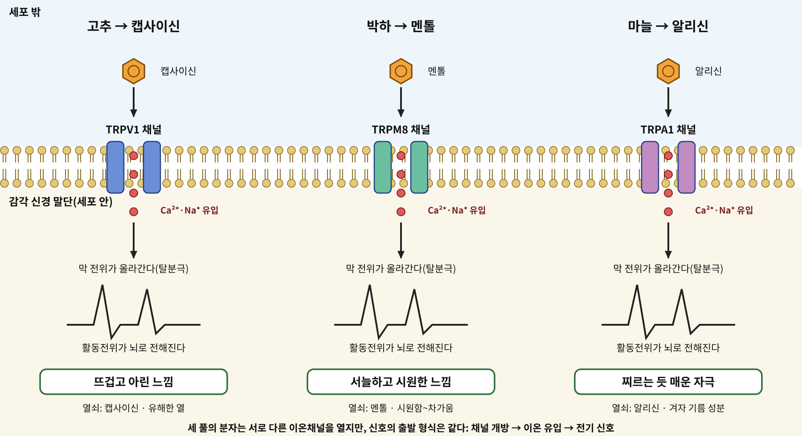
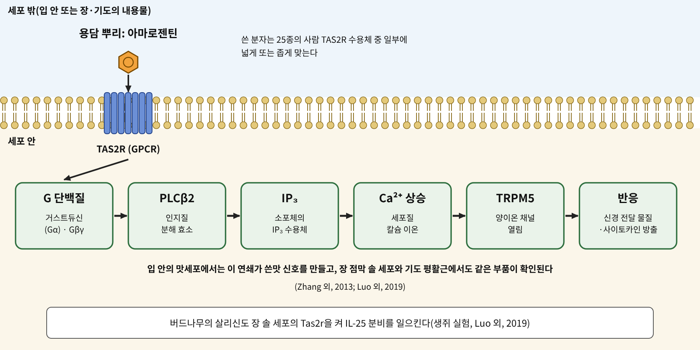

# 1장. 맛과 향이 먼저 말을 건다

<strong>그림 1-1. 혀와 입, 코의 감각을 여는 세 개의 채널.</strong> 고추의 캡사이신은 TRPV1에, 박하의 멘톨은 TRPM8에, 마늘의 알리신은 TRPA1에 닿는다. 세 채널은 모두 이온채널이며, 열리면 양이온이 감각 신경 안으로 들어와 신호가 시작된다.

<ul class="mini-toc">
<li>매운맛은 통증이다</li>
<li>박하와 멘톨</li>
<li>마늘이 찌르는 방식</li>
<li>용담과 쓴맛</li>
<li>입이 끝이 아니다</li>
</ul>

## 이 장을 읽기 전에

허브가 몸에 닿는 첫 순간은 삼키기 전이다. 입에 넣는 순간 혀와 입안, 코 안쪽의 감각 신경이 먼저 반응한다. 고추는 뜨겁고, 박하는 서늘하고, 날마늘은 찌르고, 용담 뿌리는 쓰다. 이 감각들은 막연한 인상이 아니라 특정 단백질에 특정 분자가 닿아서 생기는 신호이다.

이 장에서는 네 가지 풀을 통해 서장에서 그린 세포신호 지도의 두 입구, 곧 이온채널과 G 단백질 연결 수용체(GPCR)를 처음으로 만난다. 고추, 박하, 마늘은 이온채널을 열고, 용담의 쓴맛은 GPCR를 거친다. 그리고 마지막 절에서는 이 수용체들이 입 밖의 기관에도 있다는 이야기를 한다. 다만 입 밖에서 이 수용체들이 무슨 일을 하는지는 입안의 감각만큼 단단하게 밝혀져 있지 않다. 이 차이를 장 전체에서 구별해 적는다.

## 1. 매운맛은 통증이다

고추의 매운맛은 맛이 아니다. 혀의 맛봉오리가 받는 단맛, 쓴맛 같은 신호와 달리, 고추의 매움은 통증과 온도를 느끼는 감각 신경이 받는다. 이 신경이 무엇으로 캡사이신을 알아채는지를 처음 밝힌 사람들은 데이비드 줄리어스(David Julius)와 그의 연구진이다.

1990년대 후반의 질문은 단순했다. 캡사이신이 아프게 한다면, 그것을 받는 단백질은 무엇인가. 연구진은 통증을 전하는 감각 신경세포에서 유전자의 조각들을 모아 도서관처럼 만들었다. 그런 다음 평소에는 캡사이신에 반응하지 않는 세포에 이 조각들을 하나씩 넣어, 캡사이신을 주었을 때 칼슘이 세포 안으로 들어오는 세포를 찾았다. 반응하는 세포가 나올 때까지 조각을 줄여 나간 끝에 하나의 유전자가 남았다(Caterina 외, 1997).

이 유전자가 만드는 단백질은 이온채널이었다. 캡사이신이 붙으면 문이 열리고 칼슘을 포함한 양이온이 세포로 들어온다. 이 단백질은 뜨거운 온도에도 열린다. 연구진은 그것을 통증 경로에서 열에 반응하는 이온채널이라고 보고했다(Caterina 외, 1997). 이후 이 단백질에는 TRPV1이라는 이름이 붙었다. 줄리어스는 이 발견을 포함한 업적으로 2021년 노벨 생리의학상을 아르뎀 파타푸티안(Ardem Patapoutian)과 함께 받았다(Nobel Prize Outreach, 2021).

여기서 이 책의 첫 번째 구별이 필요하다. 시험관과 배양세포에서 캡사이신이 TRPV1을 연다는 사실은 매우 단단하다. 그러나 그 사실이 곧 "고추를 먹으면 건강에 좋다"는 말은 아니다. 고추의 약효를 다룬 총설들도 캡사이신의 작용을 설명하는 일과 사람에서의 이득을 입증하는 일을 나누어 다룬다(Fattori 외, 2016).

### 같은 채널이 상황에 따라 다르게 열린다

TRPV1이 흥미로운 이유는 문턱이 고정되어 있지 않다는 점이다. 염증이 생기면 같은 자극에도 더 쉽게 열린다. 몇 가지 알려진 조절은 다음과 같다.

세포막의 인지질인 PIP2(phosphatidylinositol-4,5-bisphosphate)는 TRPV1을 억제하는 쪽으로 작용한다. 포스포리파아제 C(PLC)가 PIP2를 분해하면 그 억제가 풀려, 화학적 자극이나 열에 대한 문턱이 낮아진다(Prescott & Julius, 2003). 단백질 키나아제 C(PKC)는 TRPV1의 특정 자리를 인산화해서 캡사이신이 만드는 전류를 키운다(Bhave 외, 2003). 염증 매개 물질인 프로스타글란딘 E2와 I2는 각각 EP1과 IP 수용체를 거쳐, 주로 PKC를 통해 TRPV1을 민감하게 만든다. 이때 TRPV1이 열리는 온도 문턱이 35 °C 아래로 내려가, 체온 근처의 온도만으로도 채널이 열릴 수 있었다(Moriyama 외, 2005).

이 사실은 서장에서 본 버드나무 껍질의 이야기와 이어진다. 아스피린 계열이 막는 효소 COX는 프로스타글란딘을 만든다(서장 참조). 프로스타글란딘이 TRPV1을 민감하게 만든다면, 프로스타글란딘이 줄어드는 일은 통증 신호의 문턱이 다시 올라가는 일과 닿아 있을 수 있다. 이 연결은 6장에서 염증 신호를 다룰 때 다시 확인한다. 여기서는 TRPV1이 외부 분자와 몸 안의 염증 신호가 만나는 자리라는 점만 기억하면 된다.

## 2. 박하와 멘톨

박하를 씹으면 입안이 서늘해진다. 실제로 온도가 내려간 것은 아니다. 멘톨(menthol)이 차가움을 느끼는 신경의 수용체를 열기 때문이다.

2002년 줄리어스 연구진은 삼차신경 감각세포에서 차가움과 멘톨에 반응하는 이온채널을 찾아냈다. 이 단백질은 CMR1이라는 이름으로 보고되었고 이후 TRPM8로 불린다. 이 연구는 TRP 채널이 온도 감각의 주된 감각기라는 생각을 넓혔다(McKemy 외, 2002). 같은 해 파타푸티안 연구진도 독립적으로 멘톨 수용체를 확인했다(Nobel Prize Outreach, 2021).

차가움을 느끼게 하는 것으로 끝나지 않는다. 박하의 진통 효과도 TRPM8과 관련이 있다. 쥐의 급성 통증과 염증성 통증 모델에서 멘톨의 진통 효과는 TRPM8을 없앤 쥐에서 사라졌다(Liu 외, 2013). 다시 말해 이 동물 모델에서 멘톨의 진통은 TRPM8을 거쳐서 일어났다.

다만 멘톨이 TRPM8에만 닿는 것은 아니다. 마늘 절에서 만날 TRPA1에도 멘톨은 닿는데, 농도에 따라 활성화와 억제를 오가는 두 얼굴의 작용을 한다(Karashima 외, 2007). 한 분자가 하나의 수용체만 건드린다는 가정은 이 책 전체에서 계속 조심해야 할 가정이다.

## 3. 마늘이 찌르는 방식

날마늘을 으깨면 매운 냄새가 퍼진다. 마늘에는 알린(alliin)이라는 무취의 물질이 있고, 마늘이 상하거나 으깨지면 효소가 이것을 알리신(allicin)으로 바꾼다. 이 알리신이 코와 입의 감각을 건드린다.

2005년 다이애나 바우티스타(Diana Bautista) 연구진은 마늘의 매운 성분이 TRPA1을 연다는 사실을 보였다. 알리신은 아프리카발톱개구리 난모세포에 발현시킨 TRPA1에서 반수 유효 농도(EC50)가 약 7.5 µM이었고, 마늘의 또 다른 성분인 디알릴 이황화물(DADS)은 약 192 µM이 필요했다. 쥐의 삼차신경 세포 가운데 약 30%가 알리신에 반응했고, 이 반응에는 TRPV1이 기여하지 않았다. 연구진은 마늘을 먹었을 때 생기는 혈관 확장이 신경에서 나오는 CGRP를 거치는 것으로 설명했으나, 이것이 전신의 혈압 강하로 이어지는지는 확립되지 않았다고 선을 그었다(Bautista 외, 2005).

TRPA1이 열리는 방식은 TRPV1과 다르다. 겨자와 고추냉이의 성분인 알릴 이소티오시아네이트(AITC)는 막을 통과하는 친전자성(electrophile) 분자로, 열쇠가 자물쇠에 맞는 식의 결합이 아니라 TRPA1 세포질 쪽 N 말단의 시스테인 잔기와 공유 결합으로 붙어서 채널을 연다. 구조가 다른 여러 티올 반응성 화합물이 같은 방식으로 TRPA1을 연다는 것도 확인되었다. 이 결합은 가역적이다(Hinman 외, 2006). 알리신과 같은 마늘 성분이 TRPA1에서 비슷한 방식으로 작용한다고 단정하려면 마늘 성분 자체로 확인한 근거가 더 필요하며, 이 장은 AITC로 확인된 기전을 마늘에 그대로 옮기지 않는다.

입안의 알싸한 감각과 먹은 뒤의 몸속 알리신은 다른 문제이다. 알리신은 으깬 마늘에서 효소 반응으로 생기며, 마늘 보충제나 조리한 마늘을 먹으면 이 반응이 위장 조건에서 억제될 수 있다. 호흡에서 알릴 메틸 설파이드를 측정한 시험에서 보충제의 알리신 생체이용률은 제품과 식사 조건에 따라 22%에서 111%까지 크게 달랐고, 삶은 마늘은 16%, 구운 마늘은 30%, 흑마늘은 5%로 낮았다(Lawson & Hunsaker, 2018). 같은 마늘이라도 어떻게 먹느냐에 따라 몸에 닿는 양이 다르다는 뜻이다.

## 4. 용담과 쓴맛

용담(Gentiana lutea) 뿌리는 오래도록 쓴맛 그 자체로 쓰여 왔다. 용담주의 쓴맛은 주로 겐티오피크로사이드(gentiopicroside)와 아마로겐틴(amarogentin)에서 나오며, 약전에서 뿌리는 위를 돕는 약재로 올라 있다. 이 두 성분의 쓴맛 지수는 크게 차이가 나며, 뿌리뿐 아니라 잎에서도 얻을 수 있어 야생 개체군 보호의 대안으로 논의된다(Fiorito 외, 2022).

쓴맛을 받는 수용체의 정체가 밝혀진 것은 2000년이다. 닉 라이바(Nick Ryba)와 찰스 주커(Charles Zuker) 연구진 등은 T2R이라는 수용체 가족이 쓴맛 수용체로 기능함을 보였다. 쥐의 mT2R-5는 사이클로헥시미드에, 사람의 hT2R-4와 쥐의 mT2R-8은 데나토늄과 PROP에 반응했고, 쓴맛 물질이 닿으면 맛세포의 G 단백질 거스트듀신(gustducin)이 켜졌다(Chandrashekar 외, 2000).

그림 1-2는 이 쓴맛 신호가 세포 안에서 이어지는 순서를 보여 준다. T2R(현재 표기로 TAS2R)는 GPCR이다. 쓴맛 분자가 닿으면 거스트듀신이 켜지고, 이것이 PLCβ2를 활성화해 IP₃를 만들며, IP₃가 소포체에서 칼슘을 풀어 세포 안 칼슘이 오르고, 이 칼슘이 TRPM5 채널을 열어 맛세포가 반응한다(Chandrashekar 외, 2000; Kaske 외, 2007; Zhang 외, 2013). 서장에서 그린 "수용체 → 전달자 → 이차전령 → 세포 반응"의 사슬이 맛세포 안에서 그대로 이어지는 셈이다.

<figure class="fig">

<figcaption><strong>그림 1-2. 쓴맛 수용체 TAS2R의 신호 전달.</strong> 쓴맛 분자가 GPCR인 TAS2R에 닿으면 G 단백질(거스트듀신)이 켜지고, PLCβ2, IP₃, 칼슘 상승, TRPM5 채널을 거쳐 반응이 일어난다. 같은 틀이 기도 평활근과 장 상피에서도 보고되었다(Zhang 외, 2013; Luo 외, 2019).</figcaption>
</figure>

### 쓴맛 수용체는 몇 개이고, 무엇을 알아채는가

사람에게는 약 25종의 TAS2R가 있다. 마이어호프(Wolfgang Meyerhof) 연구진은 사람 TAS2R 25종 전부를 104가지 화합물로 시험했다. 그 결과 5개의 고아 수용체에 대해 13개의 리간드를 새로 찾았고, 이미 알려진 수용체에 대해서도 64개의 새로운 리간드를 찾았다. 63개 화합물은 수용체 1~3종만 활성화했고, 일부 화합물은 최대 15종까지 활성화했다. 수용체 세 종이 시험한 화합물의 약 절반을 감지했다(Meyerhof 외, 2010). 쓴맛의 세계는 "수용체 하나에 쓴맛 하나"가 아니라 "소수의 폭넓은 수용체와 다수의 좁은 수용체가 겹쳐서" 이루어져 있다.

허브 성분도 이 틀에 들어간다. 허브의 쓴 성분도 이 틀에 들어간다. 천심련(*Andrographis paniculata*)의 안드로그라폴라이드와 용담의 아마로겐틴은 사람 TAS2R50을 활성화한다(Behrens 외, 2009).

### 쓴맛 수용체는 혀 밖에도 있다

쓴맛 신호가 입안에서만 쓰이는 것은 아니다. 기도의 평활근 세포에서는 같은 TAS2R–거스트듀신–PLCβ–IP₃ 수용체 경로가 확인되었고, 쓴맛 물질이 기관지를 확장시키는 결과가 보고되었다. 이때 확장은 Gβγ가 L형 전압 의존성 칼슘 채널을 억제하는 과정을 거치는 것으로 설명된다(Zhang 외, 2013). 또한 장 상피의 터프트 세포(tuft cell)에서는 기생충인 트리키넬라의 분비물과 살리신이 Tas2r를 통해 IL-25 분비를 일으킨다고 보고되었다(Luo 외, 2019). 살리신이 서장의 버드나무 껍질 성분이라는 점은 여기서 놀라운 접점이다. 다만 이 결과는 쥐의 장 조직과 세포에서 나온 것이며, 사람이 버드나무 껍질을 먹었을 때 같은 일이 일어난다는 증거는 아니다.

용담의 겐티오피크로사이드에는 쓴맛과 무관해 보이는 결과도 있다. 한 연구는 이 분자가 PAQR3라는 단백질에 직접 결합한다고 보고했다(Xiao 외, 2022). 이것은 TAS2R 경로와는 다른 작용이며, 한 분자가 여러 표적을 가질 수 있다는 앞의 주의를 다시 확인해 준다.

## 5. 입이 끝이 아니다

이 장에서 본 수용체들은 모두 입 밖에서도 발견된다. TRPV1과 TRPA1은 감각 신경 말단에, TAS2R은 기도와 장의 상피에 있다. 그렇다면 허브를 먹고 입 밖의 수용체가 반응하는 일도 상상할 수 있다. 하지만 입에 들어간 분자가 흡수되어 그 조직에 닿는 농도에 이르는지는 별개의 질문이다. 알리신의 생체이용률 결과가 보여 주듯이, 입안에서 분명한 자극이 곧 몸속 농도를 뜻하지는 않는다(Lawson & Hunsaker, 2018). 이 질문은 2장(장벽), 3장(장내 미생물), 4장(간)에서 이어서 다룬다.

<strong>표 1-1. 네 가지 풀, 분자, 수용체</strong>

| 풀 | 대표 분자 | 수용체 | 입구 | 입안 감각 | 핵심 근거 |
|---|---|---|---|---|---|
| 고추 | 캡사이신 | TRPV1 | 이온채널 | 뜨겁고 아림 | Caterina 외, 1997 |
| 박하 | 멘톨 | TRPM8 (TRPA1에도 작용) | 이온채널 | 서늘함 | McKemy 외, 2002; Karashima 외, 2007 |
| 마늘 | 알리신 | TRPA1 | 이온채널 | 찌르는 듯한 자극 | Bautista 외, 2005 |
| 용담 | 겐티오피크로사이드, 아마로겐틴 | TAS2R(예: TAS2R50) | GPCR | 쓴맛 | Chandrashekar 외, 2000; Behrens 외, 2009 |

표 1-1. 수용체 이름은 현재 통용되는 표기이다. 박하의 TRPA1 작용은 농도에 따라 활성화와 억제로 나뉜다.

<strong>표 1-2. 이 장의 주장은 어느 단계의 증거에 기대고 있는가</strong>

| 주장 | 닿는다(결합·채널 활성) | 바꾼다(세포·동물) | 일어난다(사람) |
|---|---|---|---|
| 캡사이신이 TRPV1을 연다 | 확립(Caterina 외, 1997) | 확립 | 입안 감각으로 경험 |
| 멘톨의 진통이 TRPM8을 거친다 | 확립(McKemy 외, 2002) | 동물 모델에서 확인(Liu 외, 2013) | 이 장에서는 다루지 않음 |
| 알리신이 TRPA1을 연다 | 확립(Bautista 외, 2005) | 신경 세포 반응 확인 | 혈압 강하는 확립되지 않음 |
| 용담 성분이 TAS2R를 켠다 | 일부 확인(Behrens 외, 2009) | 맛세포 신호로 설명(Chandrashekar 외, 2000) | 입 밖의 효과는 미확립 |
| 입 밖 TAS2R가 몸의 반응을 조절한다 | 쓴맛 물질로 확인 | 쥐 기도와 장에서 확인(Zhang 외, 2013; Luo 외, 2019) | 미확립 |

표 1-2. 서장에서 약속한 세 단계(닿는다, 바꾼다, 일어난다)에 이 장의 주장을 놓아 본 것이다. 칸이 비어 있거나 "미확립"인 곳이 이 분야의 현재 위치이다.

이 장의 요점은 하나로 줄일 수 있다. 입안의 감각은 분자와 수용체가 만나는 가장 단단한 증거를 가진 사건이다. 그러나 입을 지나 몸으로 들어가는 길에서 분자는 어떤 벽을 만나는가. 다음 장은 그 벽, 곧 장벽을 읽는다.

## 참고문헌

- Bautista, D. M., Movahed, P., Hinman, A., Axelsson, H. E., Sterner, O., Högestätt, E. D., Julius, D., Jordt, S.-E., & Zygmunt, P. M. (2005). Pungent products from garlic activate the sensory ion channel TRPA1. *Proceedings of the National Academy of Sciences, 102*(34), 12248–12252. https://doi.org/10.1073/pnas.0505356102
- Behrens, M., Brockhoff, A., Batram, C., Kuhn, C., Appendino, G., & Meyerhof, W. (2009). The human bitter taste receptor hTAS2R50 is activated by the two natural bitter terpenoids andrographolide and amarogentin. *Journal of Agricultural and Food Chemistry, 57*(21), 9860–9866. https://doi.org/10.1021/jf9014334
- Bhave, G., Hu, H.-J., Glauner, K. S., Zhu, W., Wang, H., Brasier, D. J., Oxford, G. S., & Gereau, R. W. (2003). Protein kinase C phosphorylation sensitizes but does not activate the capsaicin receptor transient receptor potential vanilloid 1 (TRPV1). *Proceedings of the National Academy of Sciences*. https://doi.org/10.1073/pnas.2032100100
- Caterina, M. J., Schumacher, M. A., Tominaga, M., Rosen, T. A., Levine, J. D., & Julius, D. (1997). The capsaicin receptor: A heat-activated ion channel in the pain pathway. *Nature, 389*(6653), 816–824. https://doi.org/10.1038/39807
- Chandrashekar, J., Mueller, K. L., Hoon, M. A., Adler, E., Feng, L., Guo, W., Zuker, C. S., & Ryba, N. J. P. (2000). T2Rs function as bitter taste receptors. *Cell, 100*(6), 703–711. https://doi.org/10.1016/S0092-8674(00)80706-0
- Fattori, V., Hohmann, M. S. N., Rossaneis, A. C., Pinho-Ribeiro, F. A., & Verri, W. A. (2016). Capsaicin: Current understanding of its mechanisms and therapy of pain and other pre-clinical and clinical uses. *Molecules, 21*(7), Article 844. https://doi.org/10.3390/molecules21070844
- Fiorito, S., Epifano, F., Palumbo, L., Collevecchio, C., Mascioli, F., Spogli, R., & Genovese, S. (2022). Leaves of yellow gentian (*Gentiana lutea*) as an alternative source of bitter secoiridoid glycosides. *Journal of Natural Products, 85*, 2232–2235. https://doi.org/10.1021/acs.jnatprod.2c00529
- Hinman, A., Chuang, H.-H., Bautista, D. M., & Julius, D. (2006). TRP channel activation by reversible covalent modification. *Proceedings of the National Academy of Sciences*. https://doi.org/10.1073/pnas.0609598103
- Karashima, Y., Damann, N., Prenen, J., Talavera, K., Segal, A., Voets, T., & Nilius, B. (2007). Bimodal action of menthol on the transient receptor potential channel TRPA1. *The Journal of Neuroscience*. https://doi.org/10.1523/jneurosci.2221-07.2007
- Kaske, S., Krasteva-Christ, G., König, P., Kummer, W., Hofmann, T., Gudermann, T., & Chubanov, V. (2007). TRPM5, a taste-signaling transient receptor potential ion-channel, is a ubiquitous signaling component in chemosensory cells. *BMC Neuroscience*. https://doi.org/10.1186/1471-2202-8-49
- Lawson, L. D., & Hunsaker, S. M. (2018). Allicin bioavailability and bioequivalence from garlic supplements and garlic foods. *Nutrients*. https://doi.org/10.3390/nu10070812
- Liu, B., Fan, L., Balakrishna, S., Sui, A., Morris, J. B., & Jordt, S.-E. (2013). TRPM8 is the principal mediator of menthol-induced analgesia of acute and inflammatory pain. *Pain*. https://doi.org/10.1016/j.pain.2013.06.043
- Luo, X., Chen, Z., Xue, J., Zhao, D.-X., Lu, C. H., Li, Y., Li, S.-M., Du, Y.-W., Liu, Q., Wang, P., Liu, M., & Huang, L. (2019). Infection by the parasitic helminth *Trichinella spiralis* activates a Tas2r-mediated signaling pathway in intestinal tuft cells. *Proceedings of the National Academy of Sciences*. https://doi.org/10.1073/pnas.1812901116
- McKemy, D. D., Neuhausser, W. M., & Julius, D. (2002). Identification of a cold receptor reveals a general role for TRP channels in thermosensation. *Nature, 416*(6876), 52–58. https://doi.org/10.1038/nature719
- Meyerhof, W., Batram, C., Kuhn, C., Brockhoff, A., Chudoba, E., Bufe, B., Appendino, G., & Behrens, M. (2010). The molecular receptive ranges of human TAS2R bitter taste receptors. *Chemical Senses, 35*(2), 157–170. https://doi.org/10.1093/chemse/bjp092
- Moriyama, T., Higashi, T., Togashi, K., Iida, T., Segi-Nishida, E., Sugimoto, Y., Tominaga, T., Narumiya, S., & Tominaga, M. (2005). Sensitization of TRPV1 by EP1 and IP reveals peripheral nociceptive mechanism of prostaglandins. *Molecular Pain*. https://doi.org/10.1186/1744-8069-1-3
- Nobel Prize Outreach. (2021). *The Nobel Prize in Physiology or Medicine 2021* [Press release]. https://www.nobelprize.org/prizes/medicine/2021/press-release/
- Prescott, E. D., & Julius, D. (2003). A modular PIP2 binding site as a determinant of capsaicin receptor sensitivity. *Science*. https://doi.org/10.1126/science.1083646
- Xiao, H., Sun, X., Lin, Z., Yang, Y., Zhang, M., Xu, Z., Liu, P., Liu, Z., & Huang, H. (2022). Gentiopicroside targets PAQR3 to activate the PI3K/AKT signaling pathway and ameliorate disordered glucose and lipid metabolism. *Acta Pharmaceutica Sinica B*. https://doi.org/10.1016/j.apsb.2021.12.023
- Zhang, C.-H., Lifshitz, L. M., Uy, K. F., Ikebe, M., Fogarty, K. E., & ZhuGe, R. (2013). The cellular and molecular basis of bitter tastant-induced bronchodilation. *PLoS Biology*. https://doi.org/10.1371/journal.pbio.1001501
