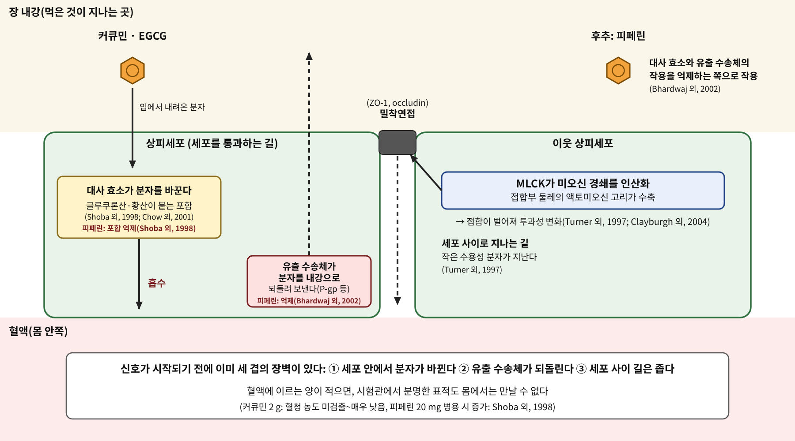

# 2장. 장벽을 넘는 분자

<strong>그림 2-1. 장 상피를 건너는 두 길과 그 앞의 장벽.</strong> 먹은 분자가 혈액에 이르려면 상피세포를 통과하거나 세포 사이의 밀착연접을 지나야 한다. 세포 안에서는 대사 효소가 분자를 바꾸고, 유출 수송체가 되돌려 보내기도 한다. 밀착연접의 투과성은 MLCK 신호로 조절된다.

<ul class="mini-toc">
<li>시험관의 분자, 혈액의 분자</li>
<li>커큐민은 어디로 사라지는가</li>
<li>후추가 열어 준 문</li>
<li>녹차의 카테킨</li>
<li>세포 사이의 문과 MLCK</li>
</ul>

## 이 장을 읽기 전에

1장에서 본 감각 수용체는 입안에서 분자를 곧바로 만난다. 그러나 몸속 대부분의 표적은 다르다. 삼킨 분자는 먼저 장 점막이라는 벽을 넘어야 하고, 그 벽을 넘은 뒤에도 간을 거쳐야 한다. 시험관에서 어떤 단백질에 분명히 닿는 분자라도 그 단백질이 있는 곳에 닿지 못하면 소용이 없다.

이 장은 세 가지 풀로 이 문제를 읽는다. 강황의 커큐민(curcumin)은 효과가 널리 보고되었지만 사람의 혈액에서는 좀처럼 잡히지 않는다. 후추의 피페린(piperine)은 그 문을 조금 열어 주는 분자로 알려져 있다. 녹차의 EGCG는 용량을 올리면 혈액 농도가 어떻게 달라지는지를 사람에서 잰 보기이다. 마지막으로 장 상피의 세포 사이 문(밀착연접)이 어떤 신호로 조절되는지 본다. 이 장에서 새로 만나는 세포신호는 MLCK에서 미오신 경쇄 인산화로 이어지는 경로이다.

## 1. 시험관의 분자, 혈액의 분자

허브 연구의 많은 논문은 배양 세포에 분자를 직접 넣어 시작한다. 이때 세포가 만나는 농도는 연구자가 정한다. 사람이 허브를 먹으면 사정이 다르다. 분자는 위와 장을 지나는 동안 분해되거나 바뀌고, 장 상피를 건너고, 간을 지난 뒤에야 혈액으로 간다. 카로티노이드와 폴리페놀을 다룬 한 입장 논문은 식물 이차대사물의 생체이용률에 영향을 미치는 요소로 식품 가공, 소화 중의 변화, 장 상피의 수송체를 통한 유입과 유출, 대장 발효, 흡수 뒤 대사를 꼽고, 이 각각에서 알려진 것이 부족하다고 정리했다(Bohn 외, 2015).

그래서 이 책은 같은 분자를 두 종류의 숫자로 구별한다. 하나는 세포 실험에서 효과가 나온 농도이고, 다른 하나는 사람 혈액에서 실제로 잰 농도이다. 두 숫자가 겹치는지가 이 장의 질문이다.

## 2. 커큐민은 어디로 사라지는가

강황(*Curcuma longa*)의 노란색은 커큐민에서 나온다. 그런데 사람에게 먹였을 때 혈액에서 잡히는 양은 놀랄 만큼 적다.

2001년 샤르마(Ricky A. Sharma) 연구진은 진행성 대장암 환자 15명에게 하루 440~2200 mg의 강황 추출물(커큐민 36~180 mg)을 최대 4개월 먹였다. 약은 잘 견뎌졌지만 혈액과 소변에서는 커큐민도 그 대사물도 검출되지 않았고, 커큐민은 대변에서 회수되었다. 한 환자의 대변에서는 커큐민 황산염이 확인되었다. 연구진은 커큐민의 경구 생체이용률이 낮고 장에서 대사될 수 있다고 결론지었다(Sharma 외, 2001).

용량을 더 올려도 마찬가지였다. 라오(Christopher D. Lao) 연구진은 건강한 자원자 24명에게 500 mg에서 12,000 mg까지 한 번에 먹게 했다. 500~8,000 mg을 먹은 사람의 혈청에서는 커큐민이 검출되지 않았고, 10,000 mg과 12,000 mg에서 두 명의 혈청에서 낮은 농도가 잡혔다. 부작용은 미미했다(Lao 외, 2006). 즉 안전성은 좋았지만 혈액으로 가는 양은 거의 없었다.

이 결과는 두 가지로 읽을 수 있다. 하나는 커큐민이 몸 전체의 표적에 작용한다는 서술이 근거를 잃는다는 해석이다. 다른 하나는 커큐민의 작용이 혈액이 아니라 장 안쪽에서 일어난다는 해석이다. 라오 연구진도 대장암 예방에서는 전신 생체이용률이 꼭 필요하지 않을 수 있다고 적었다(Lao 외, 2006). 어느 쪽이든 "커큐민이 혈중에서 이 단백질을 억제한다"는 문장은 사람의 혈중 농도 자료 없이 쓸 수 없다.

## 3. 후추가 열어 준 문

1998년 인도의 연구진은 후추의 매운 성분 피페린을 커큐민과 함께 먹이면 어떻게 되는지를 쥐와 사람에서 시험했다. 이들이 피페린을 고른 이유는 피페린이 간과 장벽에서의 글루쿠론산 포합(glucuronidation)을 막는 것으로 알려져 있었기 때문이다. 쥐에게 커큐민 2 g/kg을 단독으로 주었을 때 혈청 농도는 중간 정도였고, 피페린 20 mg/kg을 함께 주자 생체이용률이 154% 늘었다. 사람에서는 커큐민 2 g을 단독으로 먹으면 혈청에서 검출되지 않거나 아주 낮았다. 피페린 20 mg을 함께 먹자 먹은 뒤 0.25~1시간에 훨씬 높은 농도가 나타났고, 생체이용률 증가는 2000%로 보고되었다(Shoba 외, 1998).

이 논문은 피페린이 효소와 수송체를 막는다는 연구와 짝을 이룬다. 2002년 바르드와지(Rakesh K. Bhardwaj) 연구진은 사람 장 세포주 Caco-2의 단층에서 피페린이 P-당단백질(P-glycoprotein)을 통한 디곡신과 사이클로스포린 A의 수송을 막는다는 것을 보였다. IC50은 각각 15.5 µM과 74.1 µM이었다. 또 사람 간 마이크로솜에서 약물 대사 효소 CYP3A4가 베라파밀을 대사하는 반응도 피페린이 억제했다. 연구진은 피페린이 이 두 단백질을 모두 억제하므로, 식이 피페린이 이 단백질들의 기질인 약물의 혈장 농도를 올릴 수 있다고 보았다(Bhardwaj 외, 2002).

여기서 이 책이 반드시 구별해야 할 것이 있다. 위의 두 연구는 서로 다른 종류의 증거이다. 바르드와지 연구진은 피페린이 시험관에서 P-당단백질과 CYP3A4를 억제한다는 것을 보였다. 쇼바 연구진의 사람 시험은 피페린을 함께 먹었을 때 혈청 커큐민이 올랐음을 보였다. 둘을 이어 "피페린이 P-당단백질을 막아서 커큐민이 올랐다"고 쓰려면 한 단계가 더 필요하다. 쇼바 연구진은 피페린이 글루쿠론산 포합을 막는다고 알려져 있다는 점을 연구의 출발 가정으로 삼았을 뿐, 이 시험에서 기전을 따로 입증하지는 않았다(Shoba 외, 1998). 또 피페린은 다른 약의 농도도 올릴 수 있으므로, 같은 논리가 약물 상호작용으로도 이어진다는 점을 바르드와지 연구진이 이미 지적했다(Bhardwaj 외, 2002).

<strong>표 2-1. 커큐민과 피페린: 사람 혈액에서 무엇이 확인되었는가</strong>

| 연구 | 대상 | 먹은 양 | 혈액에서 관찰된 것 |
|---|---|---|---|
| Sharma 외, 2001 | 대장암 환자 15명 | 강황 추출물 440~2200 mg/일(커큐민 36~180 mg) | 혈액·소변에서 커큐민과 대사물 검출되지 않음, 대변에서 회수 |
| Lao 외, 2006 | 건강한 자원자 24명 | 단회 500~12,000 mg | 8,000 mg까지 혈청에서 검출되지 않음, 10,000 mg 이상에서 2명이 낮은 농도 |
| Shoba 외, 1998 | 건강한 자원자 | 커큐민 2 g 단독, 또는 피페린 20 mg 병용 | 단독 시 검출 안 됨 또는 매우 낮음, 병용 시 생체이용률 2000% 증가 보고 |

표 2-1. 세 연구는 제제와 대상이 서로 달라 직접 비교할 수 없다. 이 표는 "먹은 양이 곧 혈액 농도가 아니다"라는 점만 보여 준다.

## 4. 녹차의 카테킨

녹차(*Camellia sinensis*)의 대표 성분 EGCG는 커큐민과 다른 모습을 보인다. 2001년 차우(H.-H. Sherry Chow) 연구진은 건강한 자원자 20명에게 EGCG 또는 카테킨 혼합물 폴리페논 E를 200, 400, 600, 800 mg(EGCG 기준) 단회 투여하고 혈장을 쟀다. EGCG의 곡선 아래 면적(AUC)은 EGCG 단독 투여에서 200 mg일 때 22.5, 400 mg일 때 35.4, 600 mg일 때 101.9, 800 mg일 때 167.1(min·µg/mL)이었다. 용량이 네 배가 되는 동안 AUC는 일곱 배 넘게 늘었다(Chow 외, 2001).

이 비선형성을 두고 저자들은 용량이 높을 때 EGCG의 전신 이용 가능성이 높아지는 것이 포화되는 흡수 전 제거(presystemic elimination)를 반영할 수 있다고 제안했다. 또한 EGC와 EC는 EGCG를 투여했을 때 혈장에서 검출되지 않았고, 폴리페논 E를 먹었을 때는 EGC와 EC가 주로 글루쿠론산 또는 황산 포합체로 혈장과 소변에 나타났다(Chow 외, 2001). 같은 녹차 카테킨이라도 EGC와 EC는 주로 포합된 형태로 혈액과 소변에 나타났다는 뜻이다.

이 결과는 3절의 질문을 다른 방향으로 던진다. 커큐민은 먹은 양이 늘어도 혈액에 나타나지 않았다. EGCG는 양을 늘리자 혈액 농도가 더 빠르게 늘었다. 분자마다 장벽의 모양이 다르다. "허브 성분은 흡수가 안 된다"거나 "잘 된다"고 한 줄로 쓸 수 없는 이유이다.

## 5. 세포 사이의 문과 MLCK

지금까지는 분자가 세포를 통과하는 길을 보았다. 세포 사이로 지나는 길도 있다. 장 상피세포는 서로 맞닿은 윗부분을 밀착연접(tight junction)으로 봉하고 있어, 물에 녹는 분자가 세포 사이로 새어 나가는 일을 막는다. 이 문은 고정된 벽이 아니라 신호로 조절된다.

터너(Jerrold R. Turner) 연구진은 Na⁺-포도당 공동수송을 켰을 때 밀착연접의 투과성이 높아지는 현상을 분리해서 보았다. 이들은 장 수송체 SGLT1을 발현시킨 Caco-2 세포를 썼다. SGLT1을 켜자 상피 전기 저항이 약 22% 줄었고, 억제제 플로리진(phloridzin)으로 막으면 약 24% 늘었다. 변화는 크기에 따라 선택적이어서 작은 분자인 만니톨의 통과는 늘었으나 큰 분자인 이눌린은 그렇지 않았다. 미오신 경쇄 키나아제(MLCK) 억제제 ML-7과 ML-9는 이 효과를 막았고, 미오신 경쇄의 인산화는 SGLT1 활성화 뒤 약 2.08배로 올랐으며 ML-9가 그 상승을 막았다. 연구진은 접합부 둘레의 액토미오신 고리가 수축하여 밀착연접에 장력을 거는 것이 투과성을 조절하는 핵심 단계라고 제안했다(Turner 외, 1997).

후속 연구는 이 키나아제의 정체를 좁혔다. 클레이버그(Daniel R. Clayburgh) 연구진에 따르면 장 상피에서 긴 형태의 MLCK는 두 가지 접합 변이체로 존재하며, 간기 장 상피세포에서 MLC 키나아제 활성의 약 97%를 차지한다. 이 가운데 MLCK1은 잘 분화된 흡수 상피세포에 주로 있고 접합부 둘레의 액토미오신 고리에 자리한다. siRNA로 MLCK1을 줄이면 Na⁺-포도당 공동수송이 활발한 단층에서 투과성이 낮아졌다(Clayburgh 외, 2004).

이 신호는 서장에서 그린 지도의 "키나아제 연쇄" 구간에 해당한다. 단, 이 연쇄는 효소와 구조 단백질의 연쇄이다. 리간드가 수용체에 붙어 시작되는 일반적인 신호가 아니라, 영양소 수송이 밀착연접을 조절하는 방식이다.

허브 성분이 이 문을 조절한다는 보고도 있다. 감귤의 플라바논 배당체 헤스페리딘(hesperidin)은 Caco-2 단층의 상피 전기 저항을 올리고 형광 물질 투과를 줄였으며, 오클루딘(occludin), MarvelD3, JAM-1, 클라우딘-1, 클라우딘-4의 발현을 높이고 AMPK 인산화를 늘렸다(Park & Yu, 2023). 이 결과는 세포주에서 얻은 것이며, 헤스페리딘이 사람의 장벽 기능을 바꾼다는 증거는 아니다. 다만 허브 분자가 "통과 대상"이면서 동시에 "문의 신호를 바꾸는 쪽"일 수 있음을 보여 주는 한 보기이다.

<strong>표 2-2. 장벽의 네 단계와 이 장의 근거</strong>

| 단계 | 무엇이 일어나는가 | 이 장에서 읽은 근거 | 증거 수준 |
|---|---|---|---|
| ① 세포 안의 대사 | 글루쿠론산·황산 포합 | Shoba 외, 1998; Sharma 외, 2001; Chow 외, 2001 | 사람 혈액·대변 관찰 |
| ② 유출과 대사 효소 | P-당단백질, CYP3A4 | Bhardwaj 외, 2002 | 세포주·마이크로솜 |
| ③ 세포 사이 길 | MLCK, 액토미오신 수축 | Turner 외, 1997; Clayburgh 외, 2004 | 세포주 |
| ④ 문을 바꾸는 분자 | AMPK, 접합 단백질 발현 | Park & Yu, 2023 | 세포주 |

표 2-2. 사람에서 확인된 것은 ①의 결과(혈액 농도)이고, ②~④의 기전은 세포주와 마이크로솜에서 얻은 것이다. 기전이 사람의 혈액 농도 변화를 설명한다고 말하려면 둘을 한 연구에서 잇는 자료가 더 필요하다.

## 6. 장벽 앞에서 이 책이 지키는 규칙

이 장은 다음 장들에 적용될 규칙 하나를 정한다. 어떤 분자의 작용을 서술할 때 먼저 묻는다. 이 분자가 사람의 혈액이나 표적 조직에 닿는 농도는 얼마인가. 그 농도에서 시험관의 효과가 나오는가. 이 두 숫자가 없으면 이 책은 "작용한다"가 아니라 "시험관에서 작용했다"고 쓴다. 장 안쪽에서만 작용하는 분자는 그렇게 적는다.

다음 장은 장 안쪽에 사는 미생물이 삼킨 분자에 어떤 변화를 주는지를 본다.

## 참고문헌

- Bhardwaj, R. K., Glaeser, H., Becquemont, L., Klotz, U., Gupta, S. K., & Fromm, M. F. (2002). Piperine, a major constituent of black pepper, inhibits human P-glycoprotein and CYP3A4. *Journal of Pharmacology and Experimental Therapeutics, 302*(2), 645–650. https://doi.org/10.1124/jpet.102.034728
- Bohn, T., McDougall, G. J., Alegría, A., Alminger, M., Arrigoni, E., Aura, A.-M., Brito, C., Cilla, A., et al. (2015). Mind the gap—Deficits in our knowledge of aspects impacting the bioavailability of phytochemicals and their metabolites—A position paper focusing on carotenoids and polyphenols. *Molecular Nutrition & Food Research*. https://doi.org/10.1002/mnfr.201400745
- Chow, H.-H. S., Cai, Y., Alberts, D. S., Hakim, I., Dorr, R., Shahi, F., Crowell, J. A., Yang, C. S., & Hara, Y. (2001). Phase I pharmacokinetic study of tea polyphenols following single-dose administration of epigallocatechin gallate and Polyphenon E. *Cancer Epidemiology, Biomarkers & Prevention, 10*(1), 53–58.
- Clayburgh, D. R., Rosen, S., Witkowski, E. D., Wang, F., Blair, S., Dudek, S., Garcia, J. G. N., Alverdy, J. C., & Turner, J. R. (2004). A differentiation-dependent splice variant of myosin light chain kinase, MLCK1, regulates epithelial tight junction permeability. *Journal of Biological Chemistry, 279*(53), 55506–55513. https://doi.org/10.1074/jbc.M408822200
- Lao, C. D., Ruffin, M. T., Normolle, D., Heath, D. D., Murray, S. I., Bailey, J. M., Boggs, M. E., Crowell, J., et al. (2006). Dose escalation of a curcuminoid formulation. *BMC Complementary and Alternative Medicine, 6*, Article 10. https://doi.org/10.1186/1472-6882-6-10
- Park, H.-Y., & Yu, J.-H. (2023). Hesperidin enhances intestinal barrier function in Caco-2 cell monolayers via AMPK-mediated tight junction-related proteins. *FEBS Open Bio*. https://doi.org/10.1002/2211-5463.13564
- Sharma, R. A., McLelland, H. R., Hill, K. A., Ireson, C. R., Euden, S. A., Manson, M. M., Pirmohamed, M., Marnett, L. J., et al. (2001). Pharmacodynamic and pharmacokinetic study of oral Curcuma extract in patients with colorectal cancer. *Clinical Cancer Research*.
- Shoba, G., Joy, D., Joseph, T., Majeed, M., Rajendran, R., & Srinivas, P. S. S. R. (1998). Influence of piperine on the pharmacokinetics of curcumin in animals and human volunteers. *Planta Medica*. https://doi.org/10.1055/s-2006-957450
- Turner, J. R., et al. (1997). Physiological regulation of epithelial tight junctions is associated with myosin light-chain phosphorylation. *American Journal of Physiology—Cell Physiology*.
