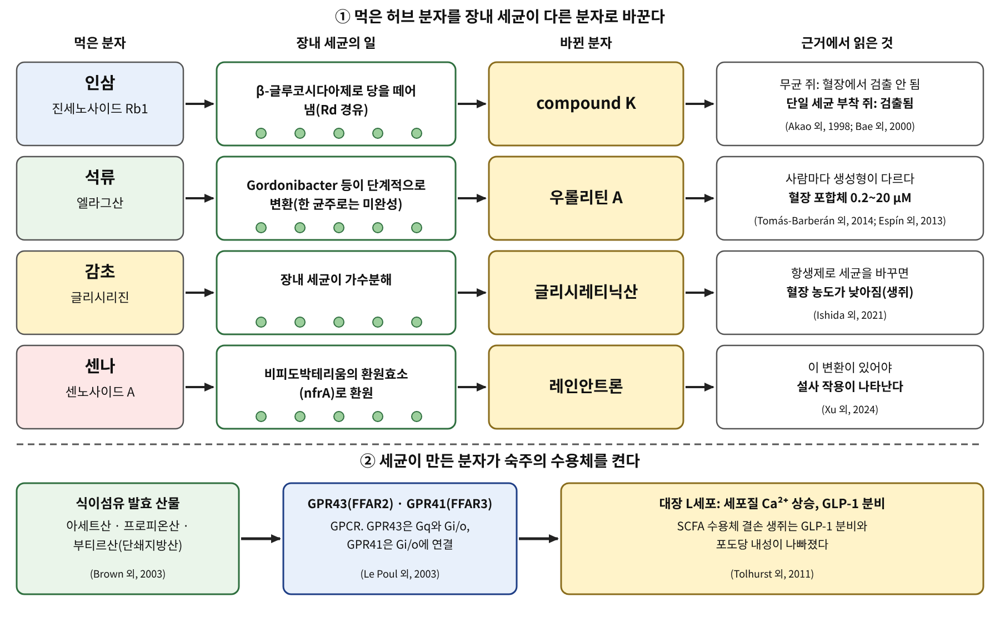

# 3장. 장내 미생물이라는 또 하나의 약제사

<strong>그림 3-1. 장내 세균이 허브 분자를 바꾸는 네 보기와, 세균 산물이 숙주 수용체를 켜는 경로.</strong> 위쪽은 인삼, 석류, 감초, 센나에서 먹은 분자와 몸에 작용하는 분자가 다른 경우이다. 아래쪽은 세균이 만든 단쇄지방산이 GPCR인 GPR43과 GPR41을 거쳐 장 호르몬 분비를 바꾸는 경로이다.

<ul class="mini-toc">
<li>먹은 분자와 작용하는 분자</li>
<li>인삼: 세균이 당을 떼어 낸 뒤에야</li>
<li>석류: 사람마다 다른 세 가지 유형</li>
<li>감초와 센나</li>
<li>세균이 만든 분자가 수용체를 켠다</li>
</ul>

## 이 장을 읽기 전에

2장에서 우리는 분자가 장 상피를 넘는 길을 보았다. 그런데 장 상피에 닿기 전에 분자를 먼저 만나는 쪽이 있다. 대장에 사는 수많은 세균이다. 이 세균들은 사람의 소화 효소가 자르지 못하는 결합을 자를 수 있고, 그 결과 입으로 들어온 분자와 혈액에 나타나는 분자가 서로 다른 경우가 생긴다.

이 장에서는 네 가지 풀로 이 현상을 읽는다. 인삼의 진세노사이드 Rb1, 석류의 엘라그산, 감초의 글리시리진, 센나의 센노사이드이다. 마지막 절에서는 세균이 만든 분자가 숙주의 수용체를 켜는 경로를 단쇄지방산으로 본다. 이 장에서 처음 만나는 세포신호는 GPR41과 GPR43이라는 두 GPCR이다. 서장의 지도에서 GPCR 입구를, 이번에는 세균의 산물이 여는 경우로 만난다.

## 1. 먹은 분자와 작용하는 분자

허브 논문은 대개 "A를 먹이자 B가 일어났다"로 쓰인다. 그런데 A와 B 사이에 장내 세균이 끼어 있으면 문장이 달라진다. 먹은 분자 A가 아니라 세균이 바꾼 분자 A′가 몸에 작용했을 수 있기 때문이다. 이때 "A가 작용한다"는 표현은 맞지 않다.

그래서 이 장은 두 질문을 구별한다. 하나는 이 분자가 장 안에서 무엇으로 바뀌는가이다. 다른 하나는 바뀐 분자가 사람의 혈액이나 조직에 닿는가이다. 그림 3-1의 위쪽 네 줄은 이 질문에 대해 네 풀의 논문이 각각 무엇을 보였는지를 요약한 것이다.

## 2. 인삼: 세균이 당을 떼어 낸 뒤에야

인삼(*Panax ginseng*)의 대표 사포닌인 진세노사이드 Rb1은 분자량이 크고 당이 여러 개 붙어 있다. 아카오(Teruaki Akao) 연구진은 이 분자가 사람의 장내 세균에 의해 진세노사이드 Rd와 F2를 거쳐 compound K로 바뀐다는 것을 보였다. 이들이 시험한 사람 유래 장내 세균 31 균주 가운데 Rb1을 Rd를 거쳐 compound K로 바꾼 것은 *Eubacterium* sp. A-44 하나였다(Akao 외, 1998).

이 연구에서 중요한 것은 쥐 실험이다. 무균 쥐에게 Rb1을 200 mg/kg 먹이자 혈장과 장관, 누적 대변 어디에서도 compound K도 다른 대사물도 검출되지 않았다. 먹인 Rb1의 대부분은 장관, 특히 맹장과 대변에서 회수되었고, 연구진은 Rb1 자체가 장에서 잘 흡수되지 않는다고 해석했다. 반면 A-44 한 균주만 정착시킨 쥐에서는 혈장에서 의미 있는 양의 compound K가 검출되었다(Akao 외, 1998). 저자들의 결론은 Rb1은 흡수가 잘 안 되지만 그 대사물 compound K는 장의 아래쪽에서 세균이 만들어 흡수된다는 것이다.

이 전환을 맡는 세균이 한 종류만은 아니다. 배(Eun-Ah Bae) 연구진은 사람 장내 미생물군과 Rb1, Rb2를 혐기적으로 함께 배양해 compound K와 프로토파낙사디올이 생기는 것을 확인했다. *Eubacterium*, *Streptococcus*, *Bifidobacterium*은 Rb1을 Rd를 거쳐 compound K로 바꾸었고, *Fusobacterium* K-60은 gypenoside XVII를 거쳐 바꾸었다(Bae 외, 2000). 같은 산물에 이르는 길이 세균에 따라 다르다는 뜻이다.

여기서 나온 질문은 이 책의 뒤쪽 장들과 이어진다. "인삼이 핵수용체에 작용한다"는 문장이 나오면, 작용하는 분자가 Rb1인지 compound K인지, 그 분자를 만드는 세균이 이 사람의 장에 있는지를 물어야 한다.

## 3. 석류: 사람마다 다른 세 가지 유형

석류(*Punica granatum*)의 엘라지탄닌과 엘라그산은 입으로 먹어도 거의 흡수되지 않는다. 에스핀(Juan Carlos Espín) 연구진의 총설은 엘라지탄닌과 엘라그산의 생체이용률이 매우 낮으며, 이 분자들이 장내 세균에 의해 훨씬 잘 흡수되는 우롤리틴(urolithin)으로 바뀐다고 정리했다. 우롤리틴은 혈장에서 글루쿠론산·황산 포합체로 0.2~20 µM 범위로 돌고, 항염과 항암 등의 효과는 주로 시험관 시험에서 보고되었으며 생체 시험은 아직 제한적이라고 했다(Espín 외, 2013).

이 전환이 세균의 일이라는 점은 2005년에 직접 보여졌다. 세르다(Begoña Cerdá) 연구진은 자원자 6명의 대변을 혐기 조건에서 배양하고 엘라그산, 엘라지탄닌인 푸니칼라진, 호두 추출물을 넣었다. 모든 대변 배양에서 엘라그산 등으로부터 우롤리틴 A가 만들어졌지만 생성 속도와 농도는 사람마다 크게 달랐다(Cerdá 외, 2005).

이 차이는 임상시험에서도 나타난다. 토마스-바르베란(Francisco A. Tomás-Barberán) 연구진은 여러 중재 시험에서 사람이 세 가지 유형으로 나뉜다고 정리했다. 유형 A는 우롤리틴 A 포합체만 만들며 시험에 따라 자원자의 25~80%였다. 유형 B는 우롤리틴 A에 더해 이소우롤리틴 A나 우롤리틴 B도 만들며 10~50%였다. 유형 0은 이 우롤리틴이 검출되지 않으며 5~25%였다. 이 유형은 먹은 것이 호두, 딸기, 석류 어느 것이든 나이나 성별, 건강 상태와 상관없이 일관되게 관찰되었고, 다만 대사증후군이나 대장암처럼 장내 미생물 불균형과 관련된 만성 질환이 있는 사람에서 유형 B의 비율이 더 높았다(Tomás-Barberán 외, 2014).

어떤 세균이 이 일을 하는지도 일부 밝혀졌다. 셀마(Maria Victoria Selma) 연구진은 사람 대변에서 *Gordonibacter urolithinfaciens*를 분리했고, 이 균과 *G. pamelaeae*가 엘라그산을 우롤리틴 M-5, M-6, 우롤리틴 C까지 순차적으로 바꾸는 것을 보였다. 하지만 순수 배양에서는 우롤리틴 A, 이소우롤리틴 A, 우롤리틴 B가 만들어지지 않았다. 마지막 단계에는 다른 세균이나 장 안의 생리 조건이 필요하다는 뜻이다(Selma 외, 2014).

<strong>표 3-1. 엘라그산을 우롤리틴으로 바꾸는 사람의 세 유형</strong>

| 유형 | 만드는 우롤리틴 | 시험별 자원자 비율 |
|---|---|---|
| 유형 A | 우롤리틴 A 포합체만 | 25~80% |
| 유형 B | 우롤리틴 A에 더해 이소우롤리틴 A, 우롤리틴 B | 10~50% |
| 유형 0 | 이 우롤리틴이 검출되지 않음 | 5~25% |

표 3-1. 출처: Tomás-Barberán 외, 2014. 비율은 여러 중재 시험에서 보고된 범위이다.

석류 연구에서 이 표가 가지는 뜻은 분명하다. 같은 석류를 같은 양 먹어도 우롤리틴이 혈액에 나타나는지는 사람마다 다르다. 그러니 석류의 효과를 사람에서 시험할 때 우롤리틴을 만드는 유형을 구분하지 않으면 결과가 평균에 묻힌다. 토마스-바르베란 연구진도 이 유형을 중재 시험에서 고려해야 하며, 이 변이가 건강 이득이나 질환 소인의 지표가 되는지는 더 연구해야 한다고 적었다(Tomás-Barberán 외, 2014).

## 4. 감초와 센나

감초(*Glycyrrhiza*)의 글리시리진(glycyrrhizin, 글리시리진산)도 같은 구조를 가진다. 글리시리진은 장내 세균에 의해 빠르게 18β-글리시레티닉산(GRA)으로 바뀌는 것으로 알려져 있고, 장에서 흡수되는 것도 GRA이다(Hendricks 외, 2012; Ishida 외, 2021). 이시다(Tomoaki Ishida) 연구진은 일본 한방약 억간산을 생쥐에게 먹이면서 항생제로 장내 세균을 바꾸었다. 아목시실린이나 반코마이신을 쓴 생쥐에서는 혈장 GRA 농도가 낮았고, 혈장 GRA가 낮은 생쥐는 *Bacteroides*와 *Firmicutes* 계열 세균이 적었다. 연구진은 특정 한 종이 아니라 여러 세균이 글리시리진의 약동학에 관여할 수 있다고 보았다(Ishida 외, 2021).

GRA가 장 안에서 무엇을 하는지도 일부 보고되었다. 헨드릭스(Jay M. Hendricks) 연구진은 생쥐에게 GRA를 입으로 먹였을 때 소장 점막에서 B세포를 불러 모으는 케모카인 유전자 발현 양상이 나타났고, 고립 림프 여포(isolated lymphoid follicle)와 비슷한 구조에서 B세포가 늘었다고 보고했다. 로타바이러스 감염 생쥐 모델에서는 바이러스 항원 배출 기간이 짧아졌다(Hendricks 외, 2012). 이 결과는 생쥐 실험이며, 사람이 감초를 먹었을 때 같은 일이 일어나는지는 이 연구가 다루지 않는다.

센나(*Senna*)의 센노사이드 A는 더 극단적인 보기이다. 센노사이드 A는 전구약물(prodrug)이어서, 장내 세균의 가수분해 효소와 환원 효소를 거쳐 레인안트론(rheinanthrone)으로 바뀐 뒤에야 설사 작용을 낸다. 가수분해 효소는 이미 알려져 있었지만 환원 효소는 알려지지 않았는데, 쉬(Yang Xu) 연구진이 광친화성 탐침으로 *Bifidobacterium pseudocatenulatum*의 nfrA를 센노사이드 A 환원 효소로 찾아냈다(Xu 외, 2024). 이어 자이(Chuanjia Zhai) 연구진은 사람 장내 미생물군에서 효소 활성으로 세균을 가려내는 방법으로 센노사이드 A를 환원하는 세균 집단을 찾았고, 계통이 서로 다른 세균들이 비슷한 대사 활동을 한다는 것을 보였다(Zhai 외, 2025). 센나의 설사 작용을 내는 분자는 장내 세균이 만든다.

## 5. 세균이 만든 분자가 수용체를 켠다

지금까지는 세균이 허브 분자를 바꾸는 이야기였다. 세균이 만든 분자가 숙주의 수용체를 직접 켜기도 한다. 대표적인 것이 식이섬유를 발효해 얻는 단쇄지방산(short-chain fatty acid, SCFA)인 아세트산, 프로피온산, 부티르산이다.

2003년 두 연구진이 각자 이 수용체를 찾았다. 브라운(Andrew J. Brown) 연구진은 효모 시스템에서 고아 GPCR인 GPR43의 작용제로 아세트산 음이온을 찾았고, 포름산, 프로피온산, 부티르산, 펜탄산도 작용제 활성이 있음을 확인했다. GPR41은 GPR43과 계열이 같으며 비슷한 분자로 켜지지만 탄소 사슬 길이에 대한 선택성이 달라, 펜탄산이 가장 강한 작용제였다(Brown 외, 2003). 르푸(Emmanuel Le Poul) 연구진은 같은 두 수용체를 SCFA 수용체로 확인하고, 프로피온산이 두 수용체에서 가장 강력하고 아세트산은 GPR43에, 부티르산과 이소부티르산은 GPR41에 더 선택적이라고 보고했다. 두 수용체는 모두 IP₃ 생성, 세포 안 칼슘 방출, ERK1/2 활성화, cAMP 축적 억제와 이어졌으나, GPR41은 Gi/o 가족에만, GPR43은 Gi/o와 Gq 둘 다에 연결되었다(Le Poul 외, 2003). 서장의 지도에서 말한 "G 단백질 → 이차전령"의 사슬이 여기서 그대로 나타난다.

이 수용체가 몸에서 하는 일의 하나가 장 호르몬 분비이다. 톨허스트(Gwen Tolhurst) 연구진은 SCFA가 생쥐 대장 배양에서 GLP-1 분비를 일으킨다는 것을 보였다. ffar2(GPR43)와 ffar3(GPR41)은 GLP-1을 분비하는 L세포에서 많이 발현되었고, SCFA는 L세포의 세포질 칼슘을 올렸다. ffar2나 ffar3가 없는 생쥐에서는 SCFA로 일어나는 GLP-1 분비가 줄었고 포도당 내성이 나빠졌다(Tolhurst 외, 2011). 두 수용체의 발현 부위는 연구에 따라 다르게 보고된다. 르푸 연구진은 GPR43이 백혈구에 선택적으로 발현된다고 했고(Le Poul 외, 2003), 톨허스트 연구진은 대장의 L세포에서 농축을 확인했다(Tolhurst 외, 2011).

SCFA 말고도 세균이 만든 분자가 장벽을 바꾼다는 보고가 있다. 시마다(Yosuke Shimada) 연구진은 무균 생쥐의 대장 상피에서 접합 분자의 발현이 낮고 대변 인돌이 일반 생쥐보다 27분의 1 수준임을 보였다. 인돌이 든 캡슐을 먹이자 밀착연접과 부착연접 관련 분자의 발현이 늘었고 DSS 유발 대장염에 대한 저항이 높아졌다(Shimada 외, 2013). 2장에서 본 밀착연접이 세균이 만든 분자로도 조절될 수 있다는 한 근거이다.

이 장에서 읽은 자료에는 인삼, 석류, 감초, 센나가 단쇄지방산이나 인돌을 늘린다고 직접 시험한 연구가 없다. 따라서 이 책은 위의 두 경로를 "세균이 만든 분자가 수용체를 켠다"는 일반 원리로만 소개하고, 특정 허브가 이 경로를 켠다고는 쓰지 않는다.

<strong>표 3-2. 장내 세균의 역할과 이 장에서 읽은 근거</strong>

| 풀 | 먹은 분자 → 바뀐 분자 | 확인된 것 | 증거 수준 |
|---|---|---|---|
| 인삼 | Rb1 → compound K | 무균 쥐에서는 혈장 compound K가 나타나지 않음(Akao 외, 1998) | 동물, 시험관 |
| 석류 | 엘라그산 → 우롤리틴 | 사람 세 유형, 혈장 포합체 0.2~20 µM(Tomás-Barberán 외, 2014; Espín 외, 2013) | 사람 중재 시험 포함 |
| 감초 | 글리시리진 → GRA | 항생제로 세균이 바뀌면 혈장 GRA 감소(Ishida 외, 2021) | 생쥐 |
| 센나 | 센노사이드 A → 레인안트론 | 환원 효소 nfrA 확인(Xu 외, 2024) | 시험관, 세균 |
| (일반) | 식이섬유 → SCFA → GPR41·43 | GLP-1 분비, 수용체 결손 생쥐(Tolhurst 외, 2011) | 세포, 생쥐 |

표 3-2. 서장의 세 단계 증거에서 "닿는다"와 "바꾼다"는 비교적 쌓여 있지만, 사람에서 "일어난다"는 석류의 유형 연구를 빼면 이 장에서는 거의 읽지 못했다.

## 6. 장내 세균 앞에서 이 책이 지키는 규칙

이 장은 앞 장의 규칙에 하나를 더한다. 어떤 허브가 어떻게 작용한다고 쓰기 전에 두 가지를 묻는다. 작용하는 분자는 먹은 분자인가, 세균이 바꾼 분자인가. 그리고 그 바뀐 분자를 만드는 세균이 모든 사람에게 있는가. 이 질문에 답하는 자료가 없으면 이 책은 "이 풀이 작용한다"가 아니라 "이 풀의 분자가 이 세균 효소로 바뀐다"고 쓴다.

다음 장은 장벽과 장내 세균을 지난 분자가 도착하는 곳, 곧 간이다. 장에서 흡수된 분자는 문맥을 따라 간으로 가고, 거기서 또 한 번 바뀐다.

## 참고문헌

- Akao, T., Kida, H., Kanaoka, M., Hattori, M., & Kobashi, K. (1998). Drug metabolism: Intestinal bacterial hydrolysis is required for the appearance of compound K in rat plasma after oral administration of ginsenoside Rb1 from *Panax ginseng*. *Journal of Pharmacy and Pharmacology*. https://doi.org/10.1111/j.2042-7158.1998.tb03327.x
- Bae, E.-A., Park, S.-Y., & Kim, D.-H. (2000). Constitutive β-glucosidases hydrolyzing ginsenoside Rb1 and Rb2 from human intestinal bacteria. *Biological and Pharmaceutical Bulletin*. https://doi.org/10.1248/bpb.23.1481
- Brown, A. J., Goldsworthy, S. M., Barnes, A. A., Eilert, M. M., Tcheang, L., Daniels, D., Muir, A. I., Wigglesworth, M. J., Kinghorn, I., Fraser, N. J., et al. (2003). The orphan G protein-coupled receptors GPR41 and GPR43 are activated by propionate and other short chain carboxylic acids. *Journal of Biological Chemistry*. https://doi.org/10.1074/jbc.m211609200
- Cerdá, B., Periago, P., Espín, J. C., & Tomás-Barberán, F. A. (2005). Identification of urolithin A as a metabolite produced by human colon microflora from ellagic acid and related compounds. *Journal of Agricultural and Food Chemistry*. https://doi.org/10.1021/jf050384i
- Espín, J. C., Larrosa, M., García-Conesa, M. T., & Tomás-Barberán, F. (2013). Biological significance of urolithins, the gut microbial ellagic acid-derived metabolites: The evidence so far. *Evidence-Based Complementary and Alternative Medicine*. https://doi.org/10.1155/2013/270418
- Hendricks, J. M., Hoffman, C., Pascual, D. W., & Hardy, M. E. (2012). 18β-Glycyrrhetinic acid delivered orally induces isolated lymphoid follicle maturation at the intestinal mucosa and attenuates rotavirus shedding. *PLoS ONE*. https://doi.org/10.1371/journal.pone.0049491
- Ishida, T., Jobu, K., Kawada, K., Morisawa, S., Kawazoe, T., Shiraishi, H., Fujita, H. M., Nishimura, S., Kanno, H., Nishiyama, M., et al. (2021). Impact of gut microbiota on the pharmacokinetics of glycyrrhizic acid in yokukansan, a kampo medicine. *Biological and Pharmaceutical Bulletin*. https://doi.org/10.1248/bpb.b21-00658
- Le Poul, E., Loison, C., Struyf, S., Springael, J.-Y., Lannoy, V., Decobecq, M.-E., Brézillon, S., Dupriez, V., Vassart, G., Van Damme, J., et al. (2003). Functional characterization of human receptors for short chain fatty acids and their role in polymorphonuclear cell activation. *Journal of Biological Chemistry*. https://doi.org/10.1074/jbc.m301403200
- Selma, M. V., Beltrán, D., García-Villalba, R., Espín, J. C., & Tomás-Barberán, F. A. (2014). Description of urolithin production capacity from ellagic acid of two human intestinal *Gordonibacter* species. *Food & Function*. https://doi.org/10.1039/c4fo00092g
- Shimada, Y., Kinoshita, M., Harada, K., Mizutani, M., Masahata, K., Kayama, H., & Takeda, K. (2013). Commensal bacteria-dependent indole production enhances epithelial barrier function in the colon. *PLoS ONE*. https://doi.org/10.1371/journal.pone.0080604
- Tolhurst, G., Heffron, H., Lam, Y. S., Parker, H. E., Habib, A. M., Diakogiannaki, E., Cameron, J., Grosse, J., Reimann, F., & Gribble, F. M. (2011). Short-chain fatty acids stimulate glucagon-like peptide-1 secretion via the G-protein–coupled receptor FFAR2. *Diabetes*. https://doi.org/10.2337/db11-1019
- Tomás-Barberán, F. A., García-Villalba, R., González-Sarrías, A., Selma, M. V., & Espín, J. C. (2014). Ellagic acid metabolism by human gut microbiota: Consistent observation of three urolithin phenotypes in intervention trials, independent of food source, age, and health status. *Journal of Agricultural and Food Chemistry*. https://doi.org/10.1021/jf5024615
- Xu, Y., Lv, S., Li, X., Zhai, C., Shi, Y., Li, X., Feng, Z., Luo, G., Wang, Y., & Gao, X. (2024). Photoaffinity probe-enabled discovery of sennoside A reductase in *Bifidobacterium pseudocatenulatum*. *Journal of Pharmaceutical Analysis*. https://doi.org/10.1016/j.jpha.2024.101108
- Zhai, C., Liu, X., Liu, Z., Ma, H., Li, H., Gong, Y., Li, X., Wang, Y., Zhang, N., Zhang, H., et al. (2025). In situ identifying sennoside A-reducing bacteria guilds in human gut microbiota via enzymatic activity visualization. *Gut Microbes*. https://doi.org/10.1080/19490976.2025.2560598
