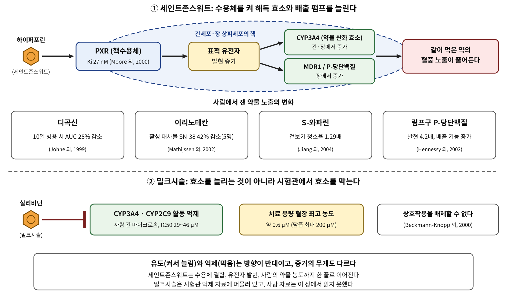

# 4장. 간과 수송체

<strong>그림 4-1. 수용체를 켜서 늘리는 것과 효소를 막는 것.</strong> 세인트존스워트의 하이퍼포린은 핵수용체 PXR에 붙어 약물 산화 효소와 배출 펌프의 발현을 늘리고, 같이 먹은 약의 혈중 노출을 줄인다. 밀크시슬의 실리비닌은 시험관에서 약물 산화 효소를 막는다.

<ul class="mini-toc">
<li>간은 두 번째 장벽이다</li>
<li>세인트존스워트와 PXR</li>
<li>사람의 약물 농도가 바뀌다</li>
<li>밀크시슬: 억제는 얼마나 단단한가</li>
<li>약과 허브를 같이 먹을 때</li>
</ul>

## 이 장을 읽기 전에

장 상피를 건너고 세균의 손을 거친 분자는 문맥을 따라 간으로 간다. 간에는 약물을 산화하고 포합해서 몸 밖으로 내보내는 효소와 수송체가 있다. 이 효소와 수송체는 늘 같은 양으로 있지 않다. 어떤 분자는 이들의 발현을 켜서 늘리고, 어떤 분자는 활동을 막는다. 그래서 허브 한 줄이 다른 약의 혈중 농도를 바꾼다.

이 장은 두 가지 풀로 이 현상을 읽는다. 세인트존스워트(*Hypericum perforatum*)는 핵수용체를 켜서 해독 프로그램을 늘리는 쪽이다. 밀크시슬(*Silybum marianum*)은 효소를 막는다고 보고되는 쪽인데, 그 증거가 얼마나 단단한지는 따져 보아야 한다. 이 장에서 처음 만나는 세포신호는 핵수용체 PXR이다. 서장의 지도에서 네 번째 입구, 곧 막을 지나 핵으로 직접 가는 입구이다.

## 1. 간은 두 번째 장벽이다

2장에서 본 장벽에는 대사 효소와 유출 수송체가 있었다. 간에도 같은 종류의 단백질이 있고 그 양이 훨씬 많다. 시토크롬 P450 3A4(CYP3A4)는 약물 산화 효소 가운데 대표 격이며, 모어(Linda B. Moore) 연구진은 이 효소가 모든 약의 50% 이상의 산화 대사에 관여한다고 적었다(Moore 외, 2000).

이 효소들의 양은 핵수용체가 정한다. 외부 분자가 핵수용체에 붙으면 수용체가 유전자의 발현을 바꾸고, 그 결과 효소와 수송체가 늘어난다. 이 순서는 서장에서 그린 지도의 "수용체에서 전사인자를 거쳐 세포 반응으로" 구간 그대로이다. 이 책에서 이 구조를 "해독 프로그램"이라 부른다. 몸이 낯선 분자를 만나면 그것을 더 빨리 내보내도록 설계를 바꾸는 프로그램이라는 뜻이다.

## 2. 세인트존스워트와 PXR

세인트존스워트는 우울증에 널리 쓰이는 허브이다. 임상 연구들은 이 허브가 복합 경구 피임약, 사이클로스포린, 인디나비르 같은 약의 대사를 높인다고 보고했다(Moore 외, 2000). 왜 그런지가 질문이었다.

모어 연구진은 이 질문에 세포 수준의 답을 내놓았다. 연구진은 세인트존스워트의 성분 하이퍼포린(hyperforin)이 PXR(pregnane X receptor)의 강력한 리간드이며 Ki가 27 nM임을 보였다. PXR은 CYP3A4의 발현을 조절하는 고아 핵수용체였다. 사람 일차 간세포를 하이퍼포린이나 세인트존스워트 추출물로 처리하자 CYP3A4 발현이 뚜렷이 유도되었다. 저자들은 이 결과가 세인트존스워트가 약물과 상호작용하는 분자 기전을 설명하며, 앞으로 더 많은 약과도 상호작용할 가능성을 시사한다고 결론 지었다(Moore 외, 2000).

이 수용체가 어떻게 하이퍼포린을 받는지는 구조로도 확인되었다. 왓킨스(Ryan E. Watkins) 연구진은 사람 PXR의 리간드 결합 부위에 하이퍼포린이 붙은 복합체를 2.1 Å 해상도로 풀었다. 하이퍼포린이 들어가면 PXR의 리간드 결합 주머니가 이전에 알려진 구조보다 250 ų 커지는 구조 변화가 일어났다. 연구진은 PXR이 구조의 유연성으로 더 다양한 화학 구조를 받아들이며, 결합 주머니의 특정 방향족 잔기를 바꾸면 수용체의 반응이 리간드마다 달라진다고 보고했다(Watkins 외, 2003). PXR은 임상에서 쓰는 여러 약으로도 켜지는 수용체이다(Watkins 외, 2003). 허브 분자와 약이 같은 수용체를 두고 만나는 것이다.

## 3. 사람의 약물 농도가 바뀌다

세포에서 수용체가 켜진다는 것과 사람의 약물 농도가 바뀐다는 것은 다른 증거이다. 이 둘을 잇는 연구가 여러 편 있다.

뒤르(Daniel Dürr) 연구진은 쥐와 사람에서 같은 질문을 물었다. 쥐에게 세인트존스워트 추출물을 14일 먹이자 장의 P-당단백질(MDR1) 발현이 3.8배, 간의 CYP3A2 발현이 2.5배 늘었다. 건강한 남자 8명에게 14일 먹인 뒤에는 디곡신 1회 투여 후의 노출이 18% 줄었고, 십이지장의 P-당단백질/MDR1과 CYP3A4 발현은 각각 1.4배와 1.5배, 간 CYP3A4의 기능 활성(에리스로마이신 호흡 검사)은 1.4배 늘었다(Dürr 외, 2000).

디곡신만의 결과가 아니다. 욘(Andreas Johne) 연구진은 건강한 자원자에게 하이페리쿰 추출물 LI160 900 mg/일을 10일 먹이자 디곡신의 AUC가 25% 줄었고, 최저 농도는 33%, 최고 농도는 26% 줄었다고 보고했다. 첫 투여 직후에는 변화가 없었고 며칠 지나면서 효과가 커졌다(Johne 외, 1999). 이 시간 경과는 약을 먹자마자 일어나는 억제보다 유전자 발현이 늘어나는 유도로 보는 해석과 맞는 모양이다.

헤네시(Martina Hennessy) 연구진은 건강한 자원자 15명에게 세인트존스워트 600 mg을 하루 세 번 16일 동안 먹이고(위약군 7명), 말초혈 림프구의 P-당단백질을 쟀다. 발현이 4.2배 늘었고 P-당단백질 매개 로다민 배출도 늘었다. 연구진은 임상에서 보는 상호작용의 크기가 시험관 예측보다 크다는 점에 주목해, P-당단백질 유도를 CYP3A4 유도에 더해지는 두 번째 기전일 수 있다고 해석했다(Hennessy 외, 2002).

암 환자 5명에게 이리노테칸 350 mg/m²를 정맥으로 주면서 세인트존스워트 900 mg을 18일 먹인 교차 시험에서는, 활성 대사물 SN-38의 혈장 노출이 42% 줄었다. 이리노테칸에서는 이 약의 항암 효과가 줄어들 수 있으므로 연구진은 환자들이 세인트존스워트를 피해야 한다고 권했다(Mathijssen 외, 2002). 다만 이 연구는 환자가 5명이며 비맹검 교차 시험이다.

와파린에서는 방향이 다르게 읽힌다. 장(Xuemin Jiang) 연구진은 건강한 남자 12명에게 와파린 25 mg 단회 투여를 세인트존스워트 14일 선처리와 병용했다. S-와파린의 겉보기 청소율은 1.29배(90% CI 1.16~1.46), R-와파린은 1.23배였으나, INR과 혈소판 응집은 달라지지 않았다(Jiang 외, 2004). 약물 농도는 변했지만 효과 지표는 이 시험에서 변하지 않은 것이다.

<strong>표 4-1. 세인트존스워트와 함께 먹은 약의 노출 변화</strong>

| 연구 | 대상 | 같이 먹은 약 | 관찰된 변화 |
|---|---|---|---|
| Johne 외, 1999 | 건강한 자원자 25명(위약 12명, 추출물 13명) | 디곡신 | 10일 병용 후 AUC 25% 감소 |
| Dürr 외, 2000 | 건강한 남자 8명 | 디곡신 | 노출 18% 감소, 십이지장 MDR1 1.4배, CYP3A4 1.5배 |
| Mathijssen 외, 2002 | 암 환자 5명 | 이리노테칸 | 활성 대사물 SN-38 노출 42% 감소 |
| Jiang 외, 2004 | 건강한 남자 12명 | 와파린 | S-와파린 겉보기 청소율 1.29배, INR 변화 없음 |

표 4-1. 시험마다 추출물과 기간이 달라 크기를 직접 비교할 수 없다. 공통점은 모두 약물 노출이 낮아지는 방향이라는 점이다.

## 4. 밀크시슬: 억제는 얼마나 단단한가

밀크시슬(*Silybum marianum*)은 오래전부터 간 보호 허브로 알려졌다. 그 추출물에서 얻은 성분들을 묶어 실리마린(silymarin)이라 하고, 실리마린에서 준정제한 분획을 실리비닌(silibinin)이라 부른다. 크롤(David J. Kroll) 연구진은 실리마린이 적어도 7종의 플라보노리그난과 1종의 플라보노이드로 이루어진 복합체이고, 추출물의 65~80%를 차지한다고 정리했다. 실리비닌은 한때 단일 화합물로 여겨졌으나 실리빈 A와 실리빈 B의 1:1 혼합물임이 밝혀졌다. 이 명칭을 구별하지 않으면 과거 문헌을 해석하기도, 임상 시험을 비교하기도 어렵다(Kroll 외, 2007).

시험관 연구는 억제를 보고했다. 베크만-크납(Svane Beckmann-Knopp) 연구진은 사람 간 마이크로솜에서 실리비닌이 대부분의 CYP 기질에서는 영향이 작았지만(IC50 > 200 µM), 데니트로니페디핀 산화(CYP3A4)는 IC50 29 µM과 46 µM로, S-와파린 7-수산화(CYP2C9)는 43 µM과 45 µM로 분명히 억제했다고 보고했다. 같은 CYP3A4라도 에리스로마이신 대사는 거의 막지 않았으니(IC50 > 200 µM), 억제의 크기는 기질에 따라 달랐다. 그러나 치료 용량에서 실리비닌의 혈장 최고 농도는 약 0.6 µM, 담즙 농도는 최대 200 µM이므로, CYP3A4나 CYP2C9로 대사되는 약과의 대사 상호작용을 배제할 수 없다고만 적었다(Beckmann-Knopp 외, 2000). 즉 억제가 일어나는 농도(수십 µM)와 혈장 농도(0.6 µM) 사이의 거리가 크다.

최근 연구는 성분과 대사물로 범위를 넓혔다. 파이살(Zelma Faisal) 연구진은 실리빈 A, 실리빈 B, 이소실리빈 A, 실리크리스틴, 2,3-데하이드로실리크리스틴과 그 황산 포합체를 사람 혈청 알부민과 CYP 2C9, 2C19, 2D6, 3A4에 대해 시험했다. 모든 성분이 알부민과 안정한 복합체를 만들었고, 일부 성분과 대사물이 CYP를 억제했다. 황산 포합체는 대체로 억제력이 약했으나 2,3-데하이드로실리크리스틴-19-O-황산은 CYP3A4를 가장 강하게 억제했다. 연구진은 고용량 실리마린을 약과 동시에 먹을 때 주의해야 한다고 결론 지었다(Faisal 외, 2021).

그런데 크롤 연구진은 밀크시슬 추출물의 약물 상호작용 가능성이 상당히 낮은 것으로 보인다고 평가했고, 다만 고용량 2상 시험에서는 주의가 필요하다고 덧붙였다(Kroll 외, 2007). 시험관의 억제 자료와 임상 평가가 같은 방향이 아닌 것이다. 이 장의 근거로는 어느 쪽이 맞다고 단정할 수 없다. 이 논쟁은 "억제"라는 단어를 "혈중에서 그 농도에 닿는가"라는 질문 없이는 쓸 수 없다는 점을 잘 보여 준다. 2장에서 본 원칙이 여기서 그대로 적용된다.

## 5. 약과 허브를 같이 먹을 때

세인트존스워트와 밀크시슬을 나란히 놓으면 차이가 보인다(그림 4-1). 세인트존스워트는 수용체와의 결합 상수, 간세포의 유전자 발현, 사람의 약물 농도 변화가 한 줄로 이어진다. 밀크시슬은 시험관의 억제 농도가 있으나, 혈장 농도에 닿는지와 사람의 약물 농도가 실제로 바뀌는지는 이 장에서 읽은 자료로는 연결되지 않는다.

<strong>표 4-2. 두 풀의 증거를 세 단계로 비교</strong>

| 단계 | 세인트존스워트 | 밀크시슬 |
|---|---|---|
| 닿는다(결합·효소 활성) | PXR 결합 Ki 27 nM, 결합 구조(Moore 외, 2000; Watkins 외, 2003) | CYP3A4·2C9 억제, IC50 29~46 µM(Beckmann-Knopp 외, 2000) |
| 바꾼다(세포·발현) | 사람 간세포 CYP3A4 유도(Moore 외, 2000) | 성분·대사물별 CYP 억제(Faisal 외, 2021) |
| 일어난다(사람) | 디곡신, 이리노테칸, 와파린 노출 변화(표 4-1) | 이 장에서는 읽지 못함 |

표 4-2. 같은 "약물 상호작용"이라도 증거가 어느 단계까지 쌓였는지가 다르다.

이 현상은 허브만의 일이 아니다. PXR은 임상에서 쓰는 약으로도 켜진다(Watkins 외, 2003). 허브가 다른 점은 추출물이 여러 성분의 복합체여서 같은 이름이라도 시험마다 분자 구성이 다를 수 있다는 점이다(Kroll 외, 2007). 이 책은 허브의 효과를 이야기할 때마다 "이 분자가 어떤 약과 같은 길을 지나는가"를 함께 적는다.

## 6. 간 앞에서 이 책이 지키는 규칙

이 장의 규칙은 두 가지이다. 첫째, 허브의 "작용"을 말할 때 그 허브가 다른 분자의 농도를 바꾸는 쪽인지를 먼저 확인한다. 둘째, "효소를 억제한다"는 문장은 억제 농도와 혈장 농도를 나란히 놓고 쓴다. 이 두 숫자가 없으면 이 책은 "시험관에서 억제했다"고만 쓴다.

여기까지가 1부이다. 맛과 향, 장벽, 장내 미생물, 간을 지나면서 허브의 분자는 입에서 혈액에 이르는 길 위에서 바뀌거나 걸러지거나, 다른 분자의 길을 바꾼다는 것을 보았다. 2부는 분자가 세포 표면에 닿아 세포 안으로 신호를 전하는 길을 다룬다.

## 참고문헌

- Beckmann-Knopp, S., Rietbrock, S., Weyhenmeyer, R., Böcker, R. H., Beckurts, K. T. E., Lang, W., Hunz, M., & Fuhr, U. (2000). Inhibitory effects of silibinin on cytochrome P-450 enzymes in human liver microsomes. *Pharmacology & Toxicology*. https://doi.org/10.1111/j.0901-9928.2000.860602.x
- Dürr, D., et al. (2000). St John's wort induces intestinal P-glycoprotein/MDR1 and intestinal and hepatic CYP3A4. *Clinical Pharmacology & Therapeutics*. https://doi.org/10.1067/mcp.2000.112240
- Faisal, Z., Mohos, V., Fliszár-Nyúl, E., Valentová, K., Káňová, K., Lemli, B., Kunsági-Máté, S., Poór, M., et al. (2021). Interaction of silymarin components and their sulfate metabolites with human serum albumin and cytochrome P450 (2C9, 2C19, 2D6, and 3A4) enzymes. *Biomedicine & Pharmacotherapy*. https://doi.org/10.1016/j.biopha.2021.111459
- Hennessy, M., Kelleher, D., Spiers, J. P., Barry, M., Kavanagh, P., Back, D., Mulcahy, F., & Feely, J. (2002). St John's wort increases expression of P-glycoprotein: Implications for drug interactions. *British Journal of Clinical Pharmacology*. https://doi.org/10.1046/j.0306-5251.2001.01516.x
- Jiang, X., Williams, K. M., Liauw, W. S., Ammit, A. J., Roufogalis, B. D., Duke, C. C., Day, R. O., & McLachlan, A. J. (2004). Effect of St John's wort and ginseng on the pharmacokinetics and pharmacodynamics of warfarin in healthy subjects. *British Journal of Clinical Pharmacology*. https://doi.org/10.1111/j.1365-2125.2003.02051.x
- Johne, A., et al. (1999). Pharmacokinetic interaction of digoxin with an herbal extract from St John's wort (*Hypericum perforatum*). *Clinical Pharmacology & Therapeutics*. https://doi.org/10.1053/cp.1999.v66.a101944
- Kroll, D. J., Shaw, H. S., & Oberlies, N. H. (2007). Milk thistle nomenclature: Why it matters in cancer research and pharmacokinetic studies. *Integrative Cancer Therapies*. https://doi.org/10.1177/1534735407301825
- Mathijssen, R. H. J., et al. (2002). Effects of St. John's wort on irinotecan metabolism. *Journal of the National Cancer Institute*. https://doi.org/10.1093/jnci/94.16.1247
- Moore, L. B., Goodwin, B., Jones, S. A., Wisely, G. B., Serabjit-Singh, C. J., Willson, T. M., Collins, J. L., & Kliewer, S. A. (2000). St. John's wort induces hepatic drug metabolism through activation of the pregnane X receptor. *Proceedings of the National Academy of Sciences*. https://doi.org/10.1073/pnas.130155097
- Watkins, R. E., Maglich, J. M., Moore, L. B., Wisely, G. B., Noble, S. M., Davis-Searles, P. R., Lambert, M. H., Kliewer, S. A., & Redinbo, M. R. (2003). 2.1 Å crystal structure of human PXR in complex with the St. John's wort compound hyperforin. *Biochemistry*. https://doi.org/10.1021/bi0268753
