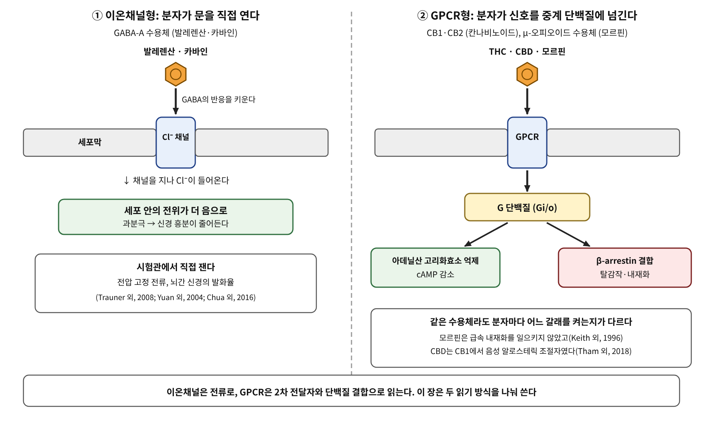

# 5장. 막 수용체와 이온채널

<strong>그림 5-1. 문을 직접 여는 수용체와 신호를 넘기는 수용체.</strong> 발레렌산과 카바인은 GABA-A 수용체의 Cl⁻ 채널에 작용해 GABA의 반응을 키운다. 칸나비노이드와 모르핀은 G 단백질 연결 수용체(GPCR)에 붙어 G 단백질과 β-arrestin의 갈래로 신호를 보낸다.

<ul class="mini-toc">
<li>세포 표면의 두 가지 입구</li>
<li>발레리안: 한 분자가 채널에 닿는다</li>
<li>카바: 추출물과 단일 성분 사이</li>
<li>대마: 한 풀에서 여러 표적으로</li>
<li>양귀비: 같은 수용체의 두 갈래</li>
</ul>

## 이 장을 읽기 전에

1부에서 허브의 분자는 입에서 혈액까지 가는 길 위에서 바뀌고 걸러졌다. 2부는 그 분자가 세포 표면에 닿는 순간부터 시작한다. 서장의 지도에서 막 위의 입구, 곧 세포막에 박힌 단백질이 분자를 받아 세포 안으로 신호를 넘기는 구간이다.

이 입구는 크게 두 종류이다. 하나는 이온채널형으로, 분자가 붙으면 채널의 문이 열리거나 열림이 달라져서 이온이 직접 드나든다. 다른 하나는 G 단백질 연결 수용체(GPCR)로, 분자가 붙으면 수용체가 세포 안의 중계 단백질에 신호를 넘긴다. 1장에서 본 TRP 채널과 쓴맛 수용체가 이 두 종류의 예였다. 이 장은 신경계에 작용하는 네 풀, 곧 발레리안, 카바, 대마, 양귀비를 이 두 입구로 읽는다.

## 1. 세포 표면의 두 가지 입구

이온채널형 수용체의 신호는 전류로 읽는다. 연구자는 채널을 세포에 발현시키고 전압을 고정해 전류가 얼마나 커지는지를 잰다. 반면 GPCR의 신호는 세포 안의 2차 전달자와 단백질 결합으로 읽는다. cAMP 농도를 재거나 β-arrestin이 수용체에 달라붙는 정도를 잰다(그림 5-1).

이 차이는 증거를 읽는 방식에도 영향을 준다. 채널은 분자가 붙었다는 사실이 곧 전류의 변화로 보이므로 "닿는다"와 "바꾼다"가 한 실험에서 나올 때가 많다. GPCR은 같은 수용체에 붙어도 어느 갈래를 켜는지가 분자마다 다를 수 있어서, 한 갈래의 결과를 수용체 전체의 결과로 일반화하기 어렵다. 이 장의 네 풀에서 두 경우를 모두 볼 수 있다.

## 2. 발레리안: 한 분자가 채널에 닿는다

발레리안(*Valeriana officinalis*)은 여러 문화의 전통 의학에서 가벼운 진정제와 수면 보조로 써 왔다. 호턴(Peter John Houghton)은 1999년 총설에서 이 풀의 특징적 성분으로 세스퀴터펜 발레렌산(valerenic acid)을 꼽았고, 휘발성 기름의 조성은 집단의 유전적 차이와 환경에 따라 크게 달라진다고 적었다. 같은 글은 발레렌산이 뇌에서 GABA의 효소 분해를 막아 진정을 일으킨다고 썼는데(Houghton, 1999), 이후 연구는 작용 지점을 GABA-A 수용체 자체로 옮겨 놓았다.

유안(Chun-Su Yuan) 연구진은 갓 태어난 쥐의 뇌간 표본에서 신경의 발화율을 쟀다. GABA-A 작용제 무시몰이 발화율을 낮추었고, 발레리안 추출물과 발레렌산도 발화율을 낮추었다. 발레렌산의 IC50는 23 ± 2.6 µM이었고, 억제 효과는 GABA-A 길항제 비쿠쿨린이 막았다. 추출물이나 발레렌산으로 미리 처리하면 무시몰의 효과도 줄었다(Yuan 외, 2004). 이 실험은 신경의 발화라는 세포 수준의 결과이다.

채널 수준의 증거는 트라우너(Gabriele Trauner) 연구진이 냈다. 연구진은 α1β2γ2S 서브유닛으로 이루어진 사람형 GABA-A 수용체를 개구리 알세포에 발현시키고 두 전극 전압 고정법으로 Cl⁻ 전류를 쟀다. 극성이 낮은 추출물은 전류를 뚜렷이 키웠고 극성이 높은 추출물은 효과가 없었으며, 활성이 높은 분획은 발레렌산 함량이 높았다. 세스퀴터펜산을 빼 내자 전류 증강이 사라졌다. 연구진은 이 증강의 크기가 추출물의 발레렌산 함량과 관련된다고 결론 지었다(Trauner 외, 2008). 이 연구에서 발레렌산은 "서브유닛 특이적 알로스테릭 조절자"로 소개된다. 알로스테릭 조절자란 GABA가 붙는 자리가 아닌 다른 자리에 붙어 GABA의 반응을 바꾸는 분자를 말한다.

동물 행동으로는 베커(Axel Becker) 연구진이 생쥐의 높은 십자 미로 시험에서 발레렌산을 먹였을 때 불안 행동이 줄고, 아세톡시발레렌산을 더하면 이 효과가 사라진다고 보고했다. 발레리안 추출물은 벤조디아제핀 결합 자리와는 친화력이 없었다(Becker 외, 2014). 즉 발레렌산은 벤조디아제핀과는 다른 자리에서 작용하는 것으로 읽힌다.

여기서 이 책이 확인하는 것은 세 가지이다. 분자가 채널에 닿는다(발레렌산, 알로스테릭 조절), 전류를 바꾼다(Trauner 외, 2008), 신경의 발화와 동물의 행동이 달라진다(Yuan 외, 2004; Becker 외, 2014). 이 장에서 읽은 자료에는 사람의 수면 시험이 없다. 세 번째 단계 가운데 "사람에게서 일어난다"는 이 장에서 확인하지 못했다.

## 3. 카바: 추출물과 단일 성분 사이

카바(*Piper methysticum*)는 의례 음료의 재료로 쓰여 온, 진정 성질이 알려진 풀이다. 주성분은 카바락톤이다. 카바락톤은 카바인(kavain), 디하이드로카바인, 메티스티신, 디하이드로메티스티신, 양고닌, 데메톡시양고닌 등으로 나뉜다. 딘(Long Doan Dinh) 연구진은 하와이 카바 재배종 4종의 잎과 뿌리 추출물을 GABA-A, 도파민 D2, μ·δ 오피오이드, 세로토닌, 히스타민 수용체 결합 시험에 넣었다. 가장 강한 결합 억제는 잎 추출물의 GABA-A(GABA 결합 자리)에서 나왔고 IC50가 약 3 µg/ml이었다. 그런데 잎 추출물에는 카바락톤이 뿌리보다 적었다. 연구진은 카바락톤이 아닌 다른 성분이 이 활성을 낼 수 있다고 적었다(Dinh 외, 2001). 이 결과는 추출물이 한 표적에만 작용하지 않고, 활성의 출처가 곧 카바락톤이라고 단정할 수 없다는 것을 보여 준다.

단일 성분의 채널 수준 증거는 2016년에 나왔다. 추아(Hue Chua) 연구진은 사람 GABA-A 수용체 9종을 개구리 알세포에 발현시켜 카바인을 시험했다. 300 µM 카바인은 시험한 9종 모두에서 GABA 반응을 키웠고 서브유닛 사이에 뚜렷한 차이가 없었다. 카바인 단독의 전류는 α1β2γ2L에서 10 mM GABA 전류의 1% 미만이었다. 한편 α4β2δ에서는 GABA의 최대 반응이 약 두 배로 커졌지만 α1β2γ2L에서는 달라지지 않았다. 벤조디아제핀 자리 길항제 플루마제닐이 효과를 막지 못했고, 디아제팜과 함께 쓰면 효과의 합이 단순 합산보다 작았다. 마취제 결합 자리의 변이 β3N265M에서는 증강이 약 260%에서 약 110%로 줄었다(Chua 외, 2016). 플루마제닐이 효과를 막지 못한 결과와 마취제 결합 자리 변이의 결과는, 카바인이 벤조디아제핀 자리가 아닌 다른 자리를 통해 작용할 가능성을 시사한다. 이 숫자는 모두 300 µM이라는 높은 농도에서 얻은 것이다.

뇌간 신경 수준에서는 유안 연구진이 카바락톤 300 µg/ml와 디하이드로카바인 300 µM이 신경 발화를 각각 39%와 32% 낮추고, 이 억제가 비쿠쿨린으로 일부 풀리며 GABA-B 길항제 사클로펜과 오피오이드 길항제 날록손으로는 줄지 않는다고 보고했다(Yuan 외, 2002).

카바에서 이 장이 가장 강조할 것은 증거의 단계가 중간에서 멈춘다는 점이다. 채널과 신경 발화에 대한 자료는 있지만, 이 두 연구가 쓴 농도가 사람의 혈중에서 도달하는지는 이 장에서 읽은 자료로 알 수 없다. 사람에게서의 안전성은 별개의 문제이다. 어니스트(E. Ernst)는 2007년 총설에서 카바가 간독성 보고 때문에 영국을 비롯한 여러 나라에서 금지되었다고 정리했다. 당시 간 손상 사례가 약 70건에서 약 100건으로 늘어 있었고, 인과성은 여전히 불확실했으며 금지는 영국 허가 당국이 재확인했다(Ernst, 2007). 안케와 람잔(Jennifer Anke & Iqbal Ramzan)은 간독성의 기전 가설들을 정리하고도 만족할 만한 답은 아직 없다고 썼다(Anke & Ramzan, 2004). 알메이다와 그림슬리(Joenie Almeida & Edwin Grimsley)는 알프라졸람을 복용하던 54세 남자가 카바를 함께 먹은 뒤 반혼수에 빠진 사례를 보고했다(Almeida & Grimsley, 1996). 이것은 한 환자의 증례 보고이다. 두 약이 모두 GABA-A와 관련된다고 해도, 이 증례만으로 같은 수용체에서의 가산 효과를 증명했다고 할 수는 없다.

<strong>표 5-1. 이온채널을 표적으로 하는 두 풀의 증거를 세 단계로 비교</strong>

| 단계 | 발레리안 | 카바 |
|---|---|---|
| 닿는다(결합·채널) | 발레렌산이 α1β2γ2S GABA-A에서 알로스테릭 조절(Trauner 외, 2008) | 카바인이 9종 GABA-A 서브유닛 조합에서 GABA 반응 증강, 300 µM(Chua 외, 2016); 잎 추출물 GABA 결합 IC50 약 3 µg/ml(Dinh 외, 2001) |
| 바꾼다(세포·신경) | 쥐 뇌간 신경 억제, 발레렌산 IC50 23 µM, 비쿠쿨린이 막음(Yuan 외, 2004) | 쥐 뇌간 신경 억제, 비쿠쿨린이 일부 풀어 줌(Yuan 외, 2002) |
| 일어난다(동물·사람) | 생쥐 불안 행동 감소, 아세톡시발레렌산이 상쇄(Becker 외, 2014); 사람 자료는 이 장에서 읽지 못함 | 사람 간독성 보고 약 100건, 인과성 불확실(Ernst, 2007); 알프라졸람 병용 증례 1건(Almeida & Grimsley, 1996) |

표 5-1. 두 풀 모두 채널 수준의 증거가 있지만, 세 번째 단계에서 발레리안은 동물 행동까지, 카바는 안전성 쪽의 보고까지만 읽었다.

## 4. 대마: 한 풀에서 여러 표적으로

대마(*Cannabis sativa*)의 성분은 CB1·CB2 수용체로 읽히곤 한다. CB1과 CB2는 GPCR이다. 그런데 한 성분이 한 수용체에만 붙는다고 보기 어렵다는 것이 이 풀의 교훈이다.

비소뇨(Tiziana Bisogno) 연구진은 칸나비디올(CBD)이 바닐로이드 수용체 VR1(TRPV1)을 자극한다고 보고했다. EC50는 3.2~3.5 µM이었고 최대 효과는 캡사이신과 비슷했다(Bisogno 외, 2001). 1장에서 본 TRP 채널이 여기서 다시 나온다. 시옹(Wei Xiong) 연구진은 CBD와 그 유도체가 만성 염증성·신경병성 통증을 설치류에서 줄이며, 척수 배각 신경세포의 글리신 전류를 키운다고 보고했다. 11종의 칸나비노이드에서 진통 효과의 크기는 α3 글리신 수용체의 증강과 양의 상관이 있었고 CB1·CB2 결합 친화력과는 상관이 없었다. α3 글리신 수용체가 없는 생쥐에서는 이 효과가 사라졌다(Xiong 외, 2012). 글리신 수용체도 Cl⁻ 채널이다. 곧 CBD의 이 작용은 이온채널형 입구에서 일어난다.

그렇다면 GPCR 쪽의 CBD는 어떤가. 탐(Mylyne Tham) 연구진은 사람 CB1 또는 CB2를 발현시킨 HEK293A 세포에서 CBD의 리간드 결합, cAMP, β-arrestin1 결합을 쟀다. CB1에서 CBD는 음성 알로스테릭 조절자였고, CB2에서는 부분 작용제였다. 구조가 거의 같은 유도체 CBD-DMH는 두 수용체에서 서로 다른 약리를 보였다(Tham 외, 2018). 한 분자가 같은 수용체에서도 서브타입과 읽는 갈래에 따라 작용제, 길항 조절자, 억제 조절자의 역할이 달라질 수 있다.

이 절의 요점은 "THC와 CBD는 CB1에 작용한다"는 한 줄이 충분하지 않다는 것이다. 이 장이 읽은 연구들에서 CBD는 TRPV1과 글리신 수용체, CB1과 CB2에 모두 닿는다. 사람에게서 어느 작용이 효과를 내는지는 이 장의 자료로는 정리되지 않는다.

## 5. 양귀비: 같은 수용체의 두 갈래

양귀비(*Papaver somniferum*)의 모르핀은 μ-오피오이드 수용체(μOR)를 통해 진통을 내는 GPCR 작용제이다. 이 수용체의 이야기는 "신호가 하나의 갈래가 아니다"에서 출발한다.

아비도르-라이스(Tomer Avidor-Reiss) 연구진은 μ-오피오이드 수용체와 아데닐산 고리화효소 V형을 함께 발현시킨 세포에서 오피오이드가 급성으로 효소 활성을 억제하고, 모르핀을 오래 주면 반대로 효소가 과활성화된다는 것을 보였다(Avidor-Reiss 외, 1996). cAMP 쪽의 갈래가 급성과 만성에서 다르게 나타난다는 뜻이다.

다른 갈래는 수용체 조절이다. 키스(Duane Keith) 연구진은 엔케팔린과 에토르핀이 오피오이드 수용체의 급속한 내재화를 일으키는 데 반해 모르핀은 일으키지 않았다고 보고했다(Keith 외, 1996). 장(Jie Zhang) 연구진은 이 차이가 작용제가 수용체의 GRK 의존적 인산화를 얼마나 촉진하는지와 관련된다고 보고했고(Zhang 외, 1998), 휘슬러와 폰 자스트로(Jennifer Whistler & Mark von Zastrow)는 모르핀이 활성화한 μ 수용체가 arrestin에 의한 탈감작을 피한다고 보고했다(Whistler & von Zastrow, 1998).

이 관찰이 1999년 보른(Laura Bohn) 연구진의 실험으로 이어졌다. β-arrestin2 유전자를 없앤 생쥐에서는 모르핀의 진통이 눈에 띄게 커지고 길어졌다. 연구진은 이를 μOR의 탈감작이 약해진 결과로 해석했고, β-arrestin2의 기능을 막으면 모르핀의 효과를 높일 길이 열릴 수 있다고 제안했다(Bohn 외, 1999). 이 해석은 한 걸음 더 나아가 β-arrestin2 신호가 호흡 억제와 변비 같은 부작용을 맡고 G 단백질 신호가 진통을 맡는다는 "편향 작용제" 가설로 이어졌다.

그러나 클리버(Andrea Kliewer) 연구진은 서로 다른 나라의 세 연구실이 컨소시엄을 이루어 같은 질문을 다시 물었다. β-arrestin2 결손 생쥐에서도 모르핀은 호흡 억제와 변비를 야생형과 구별되지 않게, 용량에 비례해 일으켰다. 연구진은 처음 제안을 지지하지 않는다고 결론 지었고, 그 가설로 만든 대표적 화합물들이 임상과 전임상 개발에서 실패했다고 적었다(Kliewer 외, 2020). 이 대목은 한 갈래를 한 효과와 짝지은 해석이 재현되지 않을 수 있다는 예이다.

<strong>표 5-2. GPCR형 두 풀에서 읽은 신호의 갈래</strong>

| 풀·분자 | 수용체 | 읽은 갈래 | 이 장에서 확인한 것 |
|---|---|---|---|
| 대마 CBD | CB1, CB2 | cAMP, β-arrestin1 결합 | CB1에서 음성 알로스테릭 조절자, CB2에서 부분 작용제(Tham 외, 2018) |
| 양귀비 모르핀 | μ-오피오이드 | cAMP | 급성 억제, 장기 노출 시 과활성화(Avidor-Reiss 외, 1996) |
| 양귀비 모르핀 | μ-오피오이드 | 수용체 내재화·탈감작 | 급속 내재화 없음(Keith 외, 1996); GRK 인산화 차이(Zhang 외, 1998) |
| 양귀비 모르핀 | μ-오피오이드 | β-arrestin2 | 진통 증강(Bohn 외, 1999); 호흡 억제는 무관(Kliewer 외, 2020) |

표 5-2. 같은 수용체의 신호를 갈래별로 잰 결과이며, 갈래와 효과를 일대일로 짝짓는 것은 이 자료로 지지되지 않는다.

## 6. 막 위의 입구 앞에서 이 책이 지키는 규칙

이 장의 규칙은 세 가지이다. 첫째, "수용체에 작용한다"고 쓰기 전에 그 수용체가 채널인지 GPCR인지를 먼저 밝히고, 어떤 단위(전류, cAMP, β-arrestin 결합)로 쟀는지를 적는다. 둘째, 한 분자는 여러 표적에 닿을 수 있으므로, 한 연구가 확인한 표적을 그 분자의 유일한 작용 지점으로 쓰지 않는다. 셋째, 시험관에서 쓴 농도가 사람의 혈중 농도에 닿는지를 확인할 수 없을 때는 그 사실을 문장에 적는다.

다음 장은 막에서 세포 안으로 신호가 전달되는 길, 곧 키나아제 연쇄를 다룬다.

## 참고문헌

- Almeida, J. C., & Grimsley, E. W. (1996). Coma from the health food store: Interaction between kava and alprazolam. *Annals of Internal Medicine*. https://doi.org/10.7326/0003-4819-125-11-199612010-00023
- Anke, J., & Ramzan, I. (2004). Kava hepatotoxicity: Are we any closer to the truth? *Planta Medica*. https://doi.org/10.1055/s-2004-815533
- Avidor-Reiss, T., Nevo, I., Levy, R., Pfeuffer, T., & Vogel, Z. (1996). Chronic opioid treatment induces adenylyl cyclase V superactivation. *Journal of Biological Chemistry*. https://doi.org/10.1074/jbc.271.35.21309
- Becker, A., Felgentreff, F., Schröder, H., Meier, B. H., & Brattström, A. (2014). The anxiolytic effects of a Valerian extract is based on valerenic acid. *BMC Complementary and Alternative Medicine*. https://doi.org/10.1186/1472-6882-14-267
- Bisogno, T., et al. (2001). Molecular targets for cannabidiol and its synthetic analogues: Effect on vanilloid VR1 receptors and on the cellular uptake and enzymatic hydrolysis of anandamide. *British Journal of Pharmacology*. https://doi.org/10.1038/sj.bjp.0704327
- Bohn, L. M., Lefkowitz, R. J., Gainetdinov, R. R., Peppel, K., Caron, M. G., & Lin, F.-T. (1999). Enhanced morphine analgesia in mice lacking β-arrestin 2. *Science*. https://doi.org/10.1126/science.286.5449.2495
- Chua, H. C., Christensen, E. T. H., Hoestgaard-Jensen, K., Hartiadi, L. Y., Ramzan, I., Jensen, A. A., Absalom, N. L., & Chebib, M. (2016). Kavain, the major constituent of the anxiolytic kava extract, potentiates GABAA receptors: Functional characteristics and molecular mechanism. *PLoS ONE*. https://doi.org/10.1371/journal.pone.0157700
- Dinh, L. D., Simmen, U., Büter, K. B., Büter, B., Lundstrom, K. H., & Schaffner, W. (2001). Interaction of various *Piper methysticum* cultivars with CNS receptors in vitro. *Planta Medica*. https://doi.org/10.1055/s-2001-14334
- Ernst, E. (2007). A re-evaluation of kava (*Piper methysticum*). *British Journal of Clinical Pharmacology*. https://doi.org/10.1111/j.1365-2125.2007.02932.x
- Houghton, P. J. (1999). The scientific basis for the reputed activity of valerian. *Journal of Pharmacy and Pharmacology*. https://doi.org/10.1211/0022357991772772
- Keith, D. E., Murray, S. R., Zaki, P. A., Chu, P. C., Lissin, D. V., Kang, L., et al. (1996). Morphine activates opioid receptors without causing their rapid internalization. *Journal of Biological Chemistry*. https://doi.org/10.1074/jbc.271.32.19021
- Kliewer, A., Gillis, A., Hill, R., Schmiedel, F., Bailey, C. P., Kelly, E., Henderson, G., Christie, M. J., & Schulz, S. (2020). Morphine-induced respiratory depression is independent of β-arrestin2 signalling. *British Journal of Pharmacology*. https://doi.org/10.1111/bph.15004
- Tham, M., Yilmaz, O., Alaverdashvili, M., Kelly, M. E. M., Denovan-Wright, E. M., & Laprairie, R. B. (2018). Allosteric and orthosteric pharmacology of cannabidiol and cannabidiol-dimethylheptyl at the type 1 and type 2 cannabinoid receptors. *British Journal of Pharmacology*. https://doi.org/10.1111/bph.14440
- Trauner, G., Khom, S., Baburin, I., Benedek, B., Hering, S., & Kopp, B. (2008). Modulation of GABAA receptors by valerian extracts is related to the content of valerenic acid. *Planta Medica*. https://doi.org/10.1055/s-2007-993761
- Whistler, J. L., & von Zastrow, M. (1998). Morphine-activated opioid receptors elude desensitization by β-arrestin. *Proceedings of the National Academy of Sciences*. https://doi.org/10.1073/pnas.95.17.9914
- Xiong, W., Cui, T., Cheng, K., Yang, F., Chen, S.-R., Willenbring, D., Guan, Y., Pan, H.-L., Ren, K., & Xu, Y. (2012). Cannabinoids suppress inflammatory and neuropathic pain by targeting α3 glycine receptors. *Journal of Experimental Medicine*. https://doi.org/10.1084/jem.20120242
- Yuan, C.-S., Dey, L., Wang, A., Mehendale, S., Xie, J.-T., Aung, H. H., & Ang-Lee, M. K. (2002). Kavalactones and dihydrokavain modulate GABAergic activity in a rat gastric-brainstem preparation. *Planta Medica*. https://doi.org/10.1055/s-2002-36338
- Yuan, C.-S., Mehendale, S., Xiao, Y., Aung, H. H., Xie, J.-T., & Ang-Lee, M. K. (2004). The gamma-aminobutyric acidergic effects of valerian and valerenic acid on rat brainstem neuronal activity. *Anesthesia & Analgesia*. https://doi.org/10.1213/01.ane.0000096189.70405.a5
- Zhang, J., Ferguson, S. S. G., Barak, L. S., Bodduluri, S. R., Laporte, S. A., Law, P.-Y., et al. (1998). Role for G protein-coupled receptor kinase in agonist-specific regulation of μ-opioid receptor responsiveness. *Proceedings of the National Academy of Sciences*. https://doi.org/10.1073/pnas.95.12.7157
