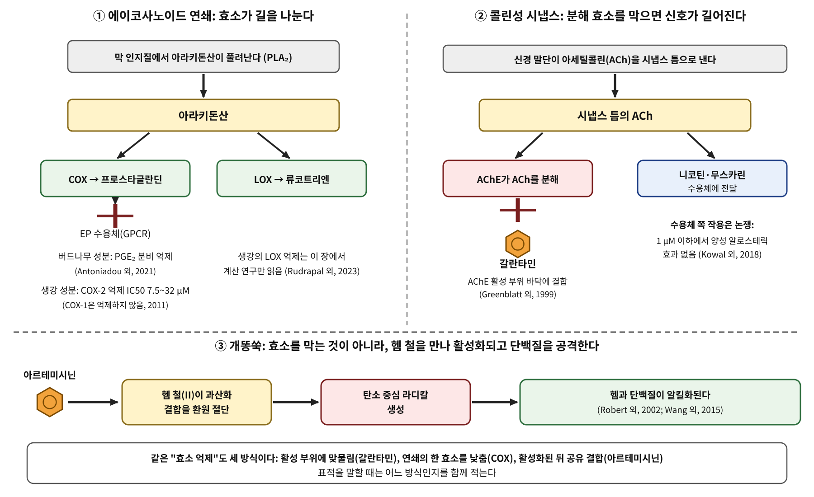

# 6장. 효소를 막는 풀

<strong>그림 6-1. 효소가 맡은 자리와 풀의 억제 지점.</strong> 버드나무와 생강의 성분은 아라키돈산 연쇄의 COX 단계에, 갈란타민은 시냅스의 아세틸콜린 분해 효소에 작용한다. 개똥쑥의 아르테미시닌은 효소를 막는 방식이 아니라 헴 철을 만나 활성화된 뒤 단백질을 공격한다.

<ul class="mini-toc">
<li>효소는 신호의 길이를 정한다</li>
<li>버드나무: 연쇄의 한 효소</li>
<li>생강: 억제 농도와 선택성</li>
<li>갈란투스: 활성 부위에 맞물리는 분자</li>
<li>개똥쑥: 막지 않고 활성화되는 분자</li>
</ul>

## 이 장을 읽기 전에

5장에서 본 수용체는 신호를 받는 입구였다. 신호는 받는 것만큼이나 끝내는 일도 중요하다. 끝내는 일을 맡은 단백질이 효소이다. 효소가 신호 분자를 만들거나 분해하는 속도가 신호의 크기와 길이를 정한다. 그래서 효소를 막는 분자는 입구를 직접 건드리지 않고도 신호를 바꾼다.

이 장은 효소를 막는다고 알려진 네 풀을 읽는다. 버드나무와 생강은 아라키돈산에서 염증 신호 분자가 만들어지는 연쇄를, 갈란투스는 시냅스에서 아세틸콜린이 분해되는 단계를 다룬다. 마지막 개똥쑥은 "막는다"는 말이 어울리지 않는 경우이다. 이 대비를 통해 이 책은 "효소를 억제한다"는 한 문장 아래 서로 다른 세 가지 방식이 섞여 있음을 보인다.

## 1. 효소는 신호의 길이를 정한다

세포막의 인지질에서 아라키돈산이 풀려나면 시클로옥시게나아제(COX)와 리폭시게나아제(LOX)가 이를 각각 프로스타글란딘과 류코트리엔으로 바꾼다. 로스(G. J. Roth) 연구진은 소와 양의 정낭 미세소체에 방사성 표지 아스피린을 넣으면 분자량 약 85,000의 단백질 하나가 아세틸화된다는 것을 보였다. 이 단백질이 프로스타글란딘 합성 효소(COX)이다(Roth 외, 1975). 루시도(Michael Lucido) 연구진은 아스피린이 COX의 활성 부위 Ser-530을 공유 결합으로 아세틸화하며, COX-1은 활성을 완전히 잃고 COX-2는 생성물이 달라진다는 결정 구조를 풀었다(Lucido 외, 2016). 아스피린이 이 연쇄의 효소를 영구히 바꾸는 약임을 먼저 알아 두면, 풀의 성분을 비교할 기준이 생긴다.

콜린성 시냅스의 효소는 아세틸콜린에스터라아제(AChE)이다. 츠올로비치(Mirjana Čolović) 연구진은 AChE가 여러 콜린성 경로에서 아세틸콜린을 빠르게 가수분해해 신호를 끝낸다고 정리했다. 이 효소가 억제되면 아세틸콜린이 쌓여 니코틴·무스카린 수용체가 과자극되고 신경전달이 흐트러진다. 억제제는 약이 되기도 독이 되기도 하는데, 알츠하이머병에 쓰는 도네페질, 리바스티그민, 갈란타민은 가역적 억제제이고 유기인 살충제나 신경가스는 비가역적이다(Čolović 외, 2013).

## 2. 버드나무: 연쇄의 한 효소

버드나무(*Salix*) 껍질은 통증과 열, 염증에 쓰여 온 약재이다. 이 약효는 부분적으로 아라키돈산에서 만들어지는 프로스타글란딘을 통한다고 알려져 있다. 안토니아두(Kyriaki Antoniadou) 연구진은 활성 분획 분리와 NMR·LC-MS/MS 구조 분석으로 사람 말초혈 단핵세포가 내놓는 PGE₂를 막는 성분을 찾았다. 2′-O-아세틸살리코르틴, 3′-O-아세틸살리코르틴, 2′,6′-O-디아세틸살리코르틴, 라시안드린, 트레물라신은 PGE₂ 분비를 억제했고, 2′-O-아세틸살리신과 신남루티노스 A는 억제하지 않았다. 폴리페놀은 활성에 관련이 없었고 살리실산계 성분이 관련이 있었다. 이 살리실산계 성분은 분해되면서 카테콜, 살리실산, 살리신 등이 된다(Antoniadou 외, 2021).

이 연구가 말하는 것은 "버드나무에서 PGE₂ 분비를 낮추는 분자가 어느 것인지"이다. 이 연구가 "그 분자가 COX 효소의 어느 자리에 어떻게 붙는지"까지 말한 것은 아니다. 읽은 초록은 세포에서의 PGE₂ 분비를 잰 결과이며, 효소 활성이나 결합 구조를 잰 것이 아니다.

사람 임상은 별도의 증거이다. 블라호얀니스(Julia Vlachojannis) 연구진은 버드나무 껍질 제제의 근골격계 통증 임상 시험을 체계적으로 검토했다. 네 시험이 확인되었고, 모두 에탄올 추출물이며 하루 살리신 환산 240 mg까지 최대 6주 투여했다. 요통에서는 용량에 따른 진통 효과가 있었고 로페콕시브에 비해 열등하지 않았다. 골관절염은 결과가 엇갈렸고, 류마티스 관절염의 한 시험은 효과가 없었으나 검정력이 크게 부족했다. 연구진은 요통에 대해서만 "중등도의 증거"가 있다고 결론 지었다(Vlachojannis 외, 2009).

그러므로 버드나무에서 이 책이 확인한 연결은 이렇다. 세포 수준에서 PGE₂ 분비를 막는 분자들이 있고(Antoniadou 외, 2021), 사람 요통에서 중등도의 증거가 있다(Vlachojannis 외, 2009). 이 둘 사이의 효소 수준 증거, 곧 어느 분자가 COX의 어디에 붙는지는 이 장에서 읽은 자료에 없다. 아스피린과 달리 버드나무 성분이 COX를 공유 결합으로 바꾼다는 근거는 이 장의 자료에서 찾지 못했다.

## 3. 생강: 억제 농도와 선택성

생강(*Zingiber officinale*)은 진저롤과 쇼가올의 풀이다. 2001년 *Bioorganic Chemistry*에 실린 연구는 생강 올레오레진의 매운 성분 17종과 합성 유사체를 무손상 세포에서 COX-2 활성에 시험했다. 모두 농도와 구조에 따라 COX-2를 억제했고 IC50는 1~25 µM이었다. [8]-파라돌, [8]-쇼가올과 두 합성 유사체가 특히 강했다. 구조 분석은 곁사슬의 지용성, 곁사슬의 하이드록시·카르보닐 위치, 방향족 고리의 치환 양상이 억제에 영향을 준다고 정리했다. 2011년 *Fitoterapia* 연구는 한외여과 LC-MS로 생강 추출물에서 COX-2 활성 부위에 붙는 화합물 10종을 찾았다. 정제 성분의 COX-2 IC50는 10-진저롤 32 µM, 8-쇼가올 17.5 µM, 10-쇼가올 7.5 µM이었고, COX-1 억제는 검출되지 않았다.

이 결과는 두 가지를 보여 준다. 첫째, 억제는 한 분자가 아니라 구조가 비슷한 분자군의 농도 의존적 현상이다. 둘째, COX-2만 억제하고 COX-1은 억제하지 않았다는 선택성이 보고되었다. 그러나 이 숫자들은 7.5~32 µM이다. 이 농도가 사람이 생강을 먹은 뒤 혈중이나 조직에서 도달하는 농도인지는 이 장에서 읽은 자료로는 알 수 없다. 2장에서 본 원칙을 여기에도 적용해야 한다.

LOX에 대해서는 사정이 다르다. 루드라팔(Mithun Rudrapal) 연구진은 인도 향신료 성분들이 COX와 5-LOX를 함께 억제할 가능성을 계산 연구로 보였다(Rudrapal 외, 2023). 이것은 계산 결과이고, 효소 활성을 잰 것이 아니다. 하타(Yukiko Hata) 연구진은 6-진저롤(0.3 mM)이 생쥐 장간막 정맥에서 PGF₂α로 유도되는 수축을 키우며, 이 효과가 내피에 의존하고 COX 억제제로는 막히지만 LOX 억제제로는 막히지 않는다고 보고했다(Hata 외, 1998). 같은 분자가 연쇄의 효소를 억제하는 것으로 보고되기도 하고, 혈관 수축을 키우는 쪽으로 보고되기도 하는 것이다. 이 책은 "생강은 COX와 LOX를 억제한다"고 한 줄로 쓰지 않는다. 이 장의 자료가 지지하는 것은 COX-2 억제 쪽이며, LOX 쪽은 계산 단계이다.

<strong>표 6-1. 아라키돈산 연쇄를 막는 두 풀의 증거를 세 단계로 비교</strong>

| 단계 | 버드나무 | 생강 |
|---|---|---|
| 닿는다(효소 결합·활성) | 이 장에서 읽지 못함 | COX-2 활성 부위 결합 성분 10종, 정제 성분 IC50 7.5~32 µM, COX-1은 억제 없음(Fitoterapia, 2011) |
| 바꾼다(세포) | 사람 단핵세포의 PGE₂ 분비 억제(Antoniadou 외, 2021) | 무손상 세포에서 COX-2 억제 IC50 1~25 µM(Bioorg Chem, 2001) |
| 일어난다(사람) | 요통에서 중등도의 증거, 살리신 환산 240 mg/일까지(Vlachojannis 외, 2009) | 이 장에서 읽지 못함 |

표 6-1. 두 풀은 증거가 쌓인 단계가 정반대이다. 버드나무는 가운데가 비어 있고 생강은 위쪽 두 단계에서 멈춘다.

## 4. 갈란투스: 활성 부위에 맞물리는 분자

갈란투스(*Galanthus*, 스노드롭)에서 얻은 알칼로이드 갈란타민(galanthamine)은 이 장의 네 풀 가운데 효소 수준의 그림이 가장 선명하다. 그린블랫(Harry Greenblatt) 연구진은 (−)-갈란타민이 붙은 AChE의 결정 구조를 2.3 Å 해상도로 풀었다. 갈란타민은 효소의 활성 부위 협곡 바닥에 결합해 콜린 결합 자리(Trp-84)와 아실 결합 주머니(Phe-288, Phe-290)에 닿는다. 하이드록시기는 Glu-199와 2.7 Å의 강한 수소결합을 만들고, 3차 아민의 N-메틸기는 협곡 위쪽 Asp-72와 비전형적 수소결합을 이루는 것으로 보였다. 연구진은 갈란타민의 비교적 단단한 결합이 중간 정도에서 약한 상호작용 여러 개의 합과, 분자가 단단하여 결합할 때 엔트로피 손실이 작다는 점에서 나온다고 해석했다(Greenblatt 외, 1999).

한 가지 주의할 점이 있다. 이 구조는 사람의 AChE가 아니라 전기가오리(*Torpedo californica*)의 효소를 쓴 것이다. 활성 부위의 큰 틀은 공유되지만 사람 효소에서의 결합을 이 구조 하나로 단정하지는 않는다.

수용체 쪽에는 논쟁이 있다. 갈란타민이 AChE를 억제할 뿐 아니라 니코틴 수용체를 양성 알로스테릭으로 조절한다는 보고가 있었다. 코왈(Natalia Kowal) 연구진은 사람 α4β2와 α7 니코틴 수용체를 개구리 알세포와 HEK293 세포에 발현시켜 이 주장을 다시 시험했다. 10 nM~1 µM에서는 어느 조합에서도 직접 작용이나 양성 조절 효과가 없었고, 10 µM 이상에서는 열린 채널 마개 막힘과 맞는 억제가 나타났다(Kowal 외, 2018). 이 연구는 갈란타민의 작용을 효소 억제로 읽는 쪽에 힘을 싣는다. 다만 이것이 수용체 효과가 전혀 없다는 증명은 아니며, 이 연구가 시험한 농도와 수용체 범위 안에서의 결과이다.

## 5. 개똥쑥: 막지 않고 활성화되는 분자

개똥쑥(*Artemisia annua*)의 아르테미시닌은 효소의 활성 부위에 열쇠처럼 들어맞는 분자가 아니다. 뫼니에(Bernard Meunier)와 로베르(Anne Robert)는 아르테미시닌의 과산화 결합이 철(II)-헴과 만나 환원 활성화되고, 이때 생기는 알콕시 라디칼이 탄소 중심 라디칼로 재배열되어 헴을 공유 결합으로 알킬화한다고 정리했다. 이 반응은 "열쇠와 자물쇠" 모델과 맞지 않는다는 것이 그들의 표현이다(Meunier & Robert, 2010). 로베르 연구진은 시험관에서 철(III)-프로토포르피린 IX와 글루타티온으로 철(II)-헴을 만들어 아르테미시닌과 반응시켰고, 헴의 알파·베타·델타 메소 위치가 알킬화된 유도체를 85% 수율로 얻었다(Robert 외, 2002). 사람 헤모글로빈의 헴 보결분자단도 시험관에서 메소 위치가 알킬화되었다(Selmeczi 외, 2003). 카난(R. Kannan) 연구진은 헤모글로빈에 결합한 헴이 유리 헴보다 아르테미시닌과 훨씬 빨리 반응한다고 보고했다(Kannan 외, 2005).

단백질 수준에서는 왕(Jigang Wang) 연구진이 알카인 표지 아르테미시닌 유사체로 열대열 말라리아 원충에서 공유 결합하는 단백질 124개를 찾았고, 활성화에는 유리 철(II)보다 헴이 주로 관여한다고 보고했다(Wang 외, 2015). 이 결과는 아르테미시닌이 하나의 효소를 막는 것이 아니라 넓은 범위의 단백질을 건드린다는 모델과 맞는다. 다만 이 합의가 완전하지는 않다. 스톡스(Paul Stocks) 연구진은 살아 있는 원충에서 킬레이트제를 쓴 실험으로, 아르테미시닌 유사체와 합성 엔도퍼옥사이드가 헴이 아니라 킬레이트 가능한 비헴 철에 의존해 활성화된다는 증거를 냈다(Stocks 외, 2007). 활성화를 헴이 맡는지 비헴 철이 맡는지는 이 장의 자료에서도 하나로 모이지 않는다.

사람 세포에서는 챗윅(Amy Chadwick) 연구진이 아르테미시닌 계열의 세포독성에서 헴이 엔도퍼옥사이드의 활성화를 담당한다는 것을 헴 합성 조절제와 철 함량 조절제로 보였다. 활발히 호흡하는 미토콘드리아는 활성화에는 관여하지 않지만 활성산소 생성과 미토콘드리아 기능 장애를 통한 세포 사멸에 필요했다. 아르테수네이트의 48시간 IC50는 HeLa 세포에서 6 ± 3 µM, 전자전달계가 없는 HeLa ρ⁰ 세포에서 34 ± 5 µM이었다(Chadwick 외, 2010). 하딩(Clare Harding) 연구진은 톡소포자충의 유전자 선별에서 헴 대사가 디하이드로아르테미시닌 감수성에 중심적 역할을 하며, 헴 합성을 화학적으로 낮추면 톡소포자충과 열대열 원충 모두 민감도가 낮아진다고 보고했다(Harding 외, 2020).

이 절의 요점은 방식의 차이이다. 갈란타민은 활성 부위에 가역적으로 맞물린다(Čolović 외, 2013; Greenblatt 외, 1999). 아르테미시닌은 헴 철을 만나야 활성화되고, 활성화된 뒤에는 공유 결합으로 다수의 단백질을 알킬화한다. 두 분자는 모두 "효소 표적 약"이라고 불릴 수 있지만 분자 수준에서는 전혀 다른 작용이다.

<strong>표 6-2. 효소를 건드리는 세 방식</strong>

| 방식 | 예 | 이 장에서 읽은 근거 | 사람 자료 |
|---|---|---|---|
| 활성 부위에 가역적으로 맞물림 | 갈란타민-AChE | 결정 구조 2.3 Å(Greenblatt 외, 1999), 승인 약물로 정리(Čolović 외, 2013) | 이 장에서 읽지 못함 |
| 연쇄 안의 한 효소를 낮춤 | 생강-COX-2, 버드나무-PGE₂ | IC50 1~32 µM(생강), PGE₂ 분비 억제(버드나무) | 버드나무 요통에서 중등도의 증거 |
| 활성화된 뒤 공유 결합 | 아르테미시닌-헴·단백질 | 헴 알킬화(Robert 외, 2002), 단백질 124개(Wang 외, 2015) | 이 장에서 읽지 못함 |

표 6-2. 같은 "효소 억제"여도 필요한 증거가 다르다. 맞물림은 구조로, 연쇄는 세포 반응으로, 공유 결합은 표지 단백질로 확인한다.

## 6. 효소 앞에서 이 책이 지키는 규칙

이 장의 규칙은 세 가지이다. 첫째, "효소를 억제한다"고 쓸 때는 가역적 맞물림인지, 연쇄의 효소 수준 감소인지, 활성화 후 공유 결합인지를 먼저 밝힌다. 둘째, 억제 농도는 반드시 적고, 그 농도가 사람의 혈중이나 조직에서 닿는지 확인하지 못하면 그 사실을 문장에 적는다. 셋째, 세포에서 프로스타글란딘이 줄었다는 결과를 효소 결합의 증거로 쓰지 않는다.

다음 장은 에너지 상태를 재는 AMPK와 인슐린 신호, mTOR 같은 에너지와 성장의 스위치를 다룬다.

## 참고문헌

- Antoniadou, K., Herz, C., Le, N. P. K., Mittermeier-Kleßinger, V. K., Förster, N., Zander, M., Ulrichs, C., & Mewis, I. (2021). Identification of salicylates in willow bark (Salix cortex) for targeting peripheral inflammation. *International Journal of Molecular Sciences*. https://doi.org/10.3390/ijms222011138
- Chadwick, A. E., Copple, I. M., Maggs, J. L., O'Neill, P. M., & Park, B. K. (2010). The role of heme and the mitochondrion in the chemical and molecular mechanisms of mammalian cell death induced by the artemisinin antimalarials. *Journal of Biological Chemistry*. https://doi.org/10.1074/jbc.M110.144188
- Čolović, M. B., Krstić, D. Z., Lazarević-Pašti, T. D., Bondžić, A. M., & Vasić, V. (2013). Acetylcholinesterase inhibitors: Pharmacology and toxicology. *Current Neuropharmacology*. https://doi.org/10.2174/1570159X11311030006
- Greenblatt, H. M., Kryger, G., Lewis, T., Silman, I., & Sussman, J. L. (1999). Structure of acetylcholinesterase complexed with (−)-galanthamine at 2.3 Å resolution. *FEBS Letters*. https://doi.org/10.1016/S0014-5793(99)01637-3
- Harding, C. R., Sidik, S. M., Petrova, B., Gnädig, N. F., Okombo, J., Herneisen, A. L., Ward, K. E., Markus, B. M., et al. (2020). Genetic screens reveal a central role for heme metabolism in artemisinin susceptibility. *Nature Communications*. https://doi.org/10.1038/s41467-020-18624-0
- Hata, Y., Pancho, L. R., Nojima, H., et al. (1998). Endothelium-dependent potentiation of prostaglandin F2α-induced contractions by (±)-[6]-gingerol is inhibited by cyclooxygenase- but not lipoxygenase-inhibitors in mouse mesenteric veins. *Biological and Pharmaceutical Bulletin*. https://doi.org/10.1248/bpb.21.792
- Kannan, R., Kumar, K., Sahal, D., Kukreti, S., & Chauhan, V. S. (2005). Reaction of artemisinin with haemoglobin: Implications for antimalarial activity. *Biochemical Journal*. https://doi.org/10.1042/BJ20041170
- Kowal, N. M., Ahring, P. K., Liao, V. W. Y., Indurti, D. C., Harvey, B. S., O'Connor, S. M., Chebib, M., & Olafsdottir, E. S. (2018). Galantamine is not a positive allosteric modulator of human α4β2 or α7 nicotinic acetylcholine receptors. *British Journal of Pharmacology*. https://doi.org/10.1111/bph.14329
- Lucido, M. J., Orlando, B. J., Vecchio, A. J., et al. (2016). Crystal structure of aspirin-acetylated human cyclooxygenase-2: Insight into the formation of products with reversed stereochemistry. *Biochemistry*. https://doi.org/10.1021/acs.biochem.5b01378
- Meunier, B., & Robert, A. (2010). Heme as trigger and target for trioxane-containing antimalarial drugs. *Accounts of Chemical Research*. https://doi.org/10.1021/ar100070k
- (저자 확인 필요). (2001). Effect of ginger constituents and synthetic analogues on cyclooxygenase-2 enzyme in intact cells. *Bioorganic Chemistry*.
- (저자 확인 필요). (2011). Cyclooxygenase-2 inhibitors in ginger (*Zingiber officinale*). *Fitoterapia*.
- Robert, A., Coppel, Y., & Meunier, B. (2002). Alkylation of heme by the antimalarial drug artemisinin. *Chemical Communications*. https://doi.org/10.1039/b110817b
- Roth, G. J., Stanford, N., & Majerus, P. W. (1975). Acetylation of prostaglandin synthase by aspirin. *Proceedings of the National Academy of Sciences*. https://doi.org/10.1073/pnas.72.8.3073
- Rudrapal, M., Eltayb, W. A., Rakshit, G., et al. (2023). Dual synergistic inhibition of COX and LOX by potential chemicals from Indian daily spices investigated through detailed computational studies. *Scientific Reports*. https://doi.org/10.1038/s41598-023-35161-0
- Selmeczi, K., Robert, A., Claparols, C., et al. (2003). Alkylation of human hemoglobin A0 by the antimalarial drug artemisinin. *FEBS Letters*. https://doi.org/10.1016/S0014-5793(03)01448-0
- Stocks, P. A., Bray, P. G., Barton, V., Al-Helal, M., Jones, M., et al. (2007). Evidence for a common non-heme chelatable-iron-dependent activation mechanism for semisynthetic and synthetic endoperoxide antimalarial drugs. *Angewandte Chemie International Edition*. https://doi.org/10.1002/anie.200604697
- Vlachojannis, J., Cameron, M., & Chrubasik, S. (2009). A systematic review on the effectiveness of willow bark for musculoskeletal pain. *Phytotherapy Research*, *23*(7), 897–900.
- Wang, J., Zhang, C.-J., Chia, W. N., Loh, C.-S., Li, Z., Lee, Y. M., He, Y., et al. (2015). Haem-activated promiscuous targeting of artemisinin in *Plasmodium falciparum*. *Nature Communications*. https://doi.org/10.1038/ncomms10111
