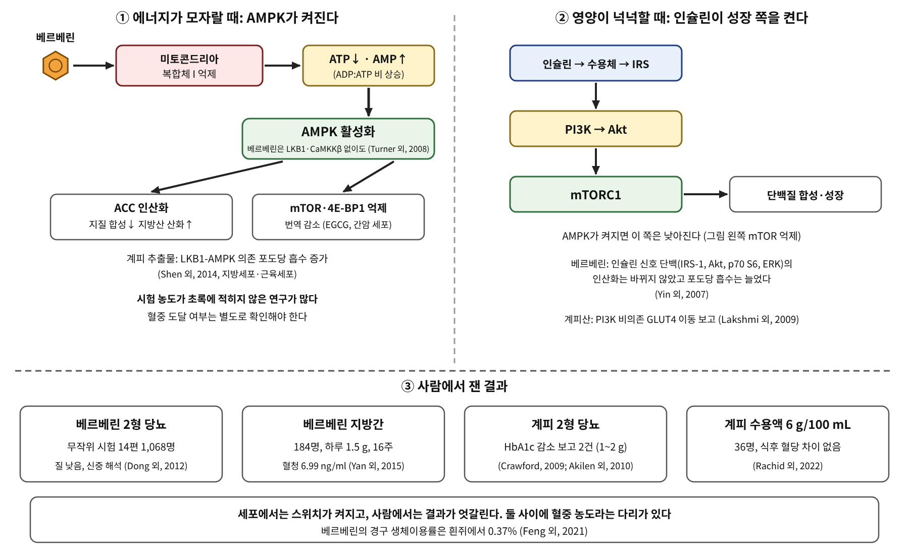

# 7장. 에너지와 성장의 스위치

<strong>그림 7-1. 에너지가 모자라면 AMPK가, 영양이 넉넉하면 인슐린-mTOR가 켜진다.</strong> 황련의 베르베린은 미토콘드리아 복합체 I를 억제해 AMPK를 켠다는 보고가 있고, 녹차의 EGCG와 계피 추출물도 세포에서 AMPK를 거친다고 보고되었다. 아래 칸은 사람에서 잰 결과로, 세포의 결과가 그대로 이어지지는 않는다.

<ul class="mini-toc">
<li>세포는 에너지를 재고 있다</li>
<li>황련: 에너지 스위치를 켜는 방식</li>
<li>사람에게 닿는가: 베르베린의 길</li>
<li>계피: 같은 스위치, 엇갈리는 사람 시험</li>
<li>녹차: AMPK와 mTOR 사이</li>
</ul>

## 이 장을 읽기 전에

6장의 효소는 신호 분자를 만들고 없애는 역할이었다. 이 장의 주인공도 효소이지만, 하나의 신호를 전하는 효소가 아니라 세포의 에너지 상태 전체를 읽는 효소이다. AMPK(AMP-activated protein kinase)는 세포의 에너지 센서이고, mTOR는 영양이 있을 때 단백질 합성과 성장을 켜는 쪽의 스위치이다. 인슐린은 PI3K와 Akt를 거쳐 mTORC1을 켜고, 에너지가 모자라면 AMPK가 켜져 이 성장 쪽을 낮춘다.

이 장은 이 스위치와 만나는 세 풀을 읽는다. 황련(*Coptis chinensis*)의 베르베린, 계피(*Cinnamomum*)의 추출물과 신남알데히드·계피산, 녹차의 EGCG이다. 질문은 같다. 세포에서 이 스위치가 켜진다는 보고가 사람에게 닿는가.

## 1. 세포는 에너지를 재고 있다

AMPK는 AMP와 ADP가 늘어난 에너지 부족 상태를 감지해 켜진다. 호들리(Simon Hawley) 연구진은 AMP에 반응하는 γ2 아단위 야생형과 AMP에 반응하지 않는 변이형(R531G)을 발현하는 세포주를 만들어, 여러 활성화 물질이 어떤 경로로 AMPK를 켜는지 구분했다. 올리고마이신 같은 미토콘드리아 독, 메트포르민, 페노바르비탈, 레스베라트롤, 베르베린은 야생형에서만 AMPK를 켰다. AICAR를 제외한 이 물질들은 모두 세포의 에너지 대사를 억제했고, ADP:ATP 비가 늘거나 산소 소비가 줄었다. 반면 A769662와 칼슘 이온운반체, 삼투압 스트레스, 케르세틴은 변이형에서도 활성화를 보였다. 연구진은 AMPK 활성화 방식이 적어도 여섯 가지로 구분된다고 정리했다(Hawley 외, 2010).

이 구분은 이 장의 읽는 법이다. "AMPK를 켠다"는 한 문장 아래 에너지 대사를 억제해서 간접적으로 켜는 경우와 에너지와 무관하게 직접 켜는 경우가 있다. 이 책은 어느 쪽인지를 밝히지 못하면 "AMPK가 켜졌다"고만 쓴다.

## 2. 황련: 에너지 스위치를 켜는 방식

황련은 베르베린(berberine)의 풀이다. 이 알칼로이드가 AMPK를 켠다는 보고는 2006년에 나왔다. 리(Yun Sok Lee) 연구진은 두 가지 인슐린 저항성 동물 모델에서 베르베린이 체중을 줄이고 포도당 내성을 개선하며, 3T3-L1 지방세포와 L6 근관세포에서 AMPK 활성을 높이고 GLUT4 이동을 PI3K와 무관하게 늘린다고 보고했다(Lee 외, 2006). 브뤼스크(Jean-Marie Brusq) 연구진은 사람 간암 세포 HepG2에서 베르베린이 콜레스테롤과 중성지방 합성을 억제하고, AMPK 인산화와 기질인 ACC의 인산화, 지방산 산화를 늘린다고 보고했다. 연구진은 고지혈 햄스터에서 베르베린이 LDL 콜레스테롤을 낮추고 간의 지방 축적을 줄였다고도 적었다(Brusq 외, 2006).

그렇다면 베르베린은 AMPK를 어떻게 켜는가. 터너(Nigel Turner) 연구진은 베르베린이 용량에 따라 L6 근관세포와 분리한 근육 미토콘드리아의 호흡을 억제하고, 그 억제가 호흡 복합체 I에 대한 특이적 작용이며 메트포르민, 로시글리타존과 비슷하다는 것을 보였다. AMPK 활성화는 LKB1이나 CaMKKβ의 활성에 의존하지 않았다. 이는 AMPK 인산화 수준에서의 조절과 일치한다고 연구진은 정리했다. 연구진은 더 생체이용률이 높은 유도체 디하이드로베르베린의 효과를 고지방식 설치류에서 시험하기도 했다(Turner 외, 2008). 호들리 연구진의 결과도 같은 방향이다. 베르베린은 AMP에 반응하지 않는 변이형 AMPK를 켜지 못했고 세포의 에너지 대사를 억제했다(Hawley 외, 2010).

한편 인(Jun Yin) 연구진은 다른 면을 보았다. 식이 비만 쥐에 5주 투여하자 공복 인슐린과 HOMA-IR이 각각 46%와 48% 줄었다. 여러 세포주에서 베르베린은 인슐린과 무관하게 포도당 소비와 흡수를 늘렸고, 인슐린 신호 단백질인 IRS-1, Akt, p70 S6, ERK의 인산화는 바꾸지 않은 채 인슐린에 의한 포도당 흡수만 키웠다. AMPK 인산화는 0.5시간에 늘어 16시간 이상 유지되었다(Yin 외, 2007). 샤(Xuan Xia) 연구진은 당뇨 쥐의 간에서 PEPCK와 G6Pase 같은 포도당 신생 유전자가 줄고, FoxO1, SREBP1, ChREBP 같은 전사인자 활성이 줄었다고 보고했다(Xia 외, 2011). 같은 분자가 같은 스위치 하나를 켜는 것만으로 설명되지 않고 하위 단계마다 여러 현상이 관찰되는 것이다.

## 3. 사람에게 닿는가: 베르베린의 길

시험관과 동물의 결과를 사람에게 잇는 첫 질문은 혈중 농도이다. 펭(Xinchi Feng) 연구진은 흰쥐에게 베르베린을 정맥과 경구로 투여해 베르베린과 대사물 9종의 약동학을 쟀다. 베르베린은 빠르게 대사되었고 대사물 9종이 모두 검출되었으며, 절대 생체이용률은 0.37 ± 0.11%였다(Feng 외, 2021). 토머스(Asha Mary Thomas) 연구진의 총설도 베르베린이 1상 임상시험에서 고용량까지 안전하지만 흡수가 나쁘고 대사가 빠르고 체내에서 빨리 제거되어 혈장과 조직 농도가 낮다고 정리했다(Thomas 외, 2021).

사람 환자의 자료는 얀(Hongmei Yan) 연구진이 냈다. 연구진은 비알코올성 지방간 환자 184명을 세 군으로 나누어, 생활습관 개입 단독, 생활습관 개입에 피오글리타존 15 mg, 생활습관 개입에 베르베린 0.5 g을 하루 세 번 16주 투여했다. 베르베린군은 간 지방 함량이 52.7% 줄어 생활습관 단독군의 36.4%보다 더 줄었고(p = 0.008), 체중, HOMA-IR, 혈중 지질도 더 개선되었다. 이상 반응은 주로 소화기에 경미하게 나타났다. 베르베린군의 혈청과 소변 베르베린 농도는 각각 6.99 ng/ml과 79.2 ng/ml이었다(Yan 외, 2015). 6.99 ng/ml을 분자량 약 336으로 환산하면 대략 20 nM이다. 이 환산은 이 책의 계산이다. 이 시험은 공개 시험이고 위약 대조가 없다. 연구진은 동물 실험에서 베르베린이 간에 유리하게 분포했다고 덧붙였다.

2형 당뇨는 동(Hui Dong) 연구진이 14편의 무작위 시험 1,068명을 메타분석했다. 생활습관 개입에 베르베린을 더하면 혈당과 이상지질혈증이 유의하게 개선되었다. 메트포르민, 글리피지드, 로시글리타존 같은 경구 혈당강하제와 비교하면 혈당 조절이 더 좋지는 않았고 가벼운 지질 개선이 있었다. 심각한 이상 반응은 없었으나, 연구진은 방법론적 질이 대체로 낮고 표본이 작으며 시험 수가 적어 근거를 신중하게 해석해야 한다고 결론 지었다(Dong 외, 2012).

<strong>표 7-1. 베르베린의 증거를 세 단계로 읽기</strong>

| 단계 | 읽은 결과 |
|---|---|
| 닿는다(분자 수준) | 호흡 복합체 I 억제, AMPK 활성화는 LKB1·CaMKKβ에 의존하지 않음(Turner 외, 2008); AMP에 반응하지 않는 변이형 AMPK는 켜지 못함(Hawley 외, 2010) |
| 바꾼다(세포·동물) | HepG2에서 지질 합성 억제와 ACC 인산화(Brusq 외, 2006); 쥐의 포도당 신생 유전자 감소(Xia 외, 2011); 인슐린 신호 단백 인산화는 불변(Yin 외, 2007) |
| 일어난다(사람) | 지방간 184명 공개 시험에서 간 지방 감소(Yan 외, 2015); 2형 당뇨 메타분석 14편, 질 낮음(Dong 외, 2012) |
| 연결: 혈중 농도 | 흰쥐 경구 생체이용률 0.37%(Feng 외, 2021); 지방간 시험 혈청 6.99 ng/ml, 약 20 nM로 환산 |

표 7-1. 세포 시험의 농도는 이 장이 읽은 초록에 적혀 있지 않아 혈청 농도와 직접 비교하지 못했다. 이 비교는 원문에서 확인할 과제이다.

## 4. 계피: 같은 스위치, 엇갈리는 사람 시험

계피는 오래전부터 혈당과 관련지어 말해 온 향신료이다. 세포 수준의 보고는 두 갈래이다. 신(Yan Shen) 연구진은 계피 추출물이 3T3-L1 지방세포와 C2C12 근관세포에서 AMPK와 ACC의 인산화를 촉진하고, AMPK 억제제와 LKB1 siRNA가 추출물에 의한 포도당 흡수를 막았다고 보고했다. 연구진은 지방세포에서 인슐린이 AMPK 활성화를 억제한다는 것도 처음 발견했다고 적었다(Shen 외, 2014). 반면 락슈미(B. S. Lakshmi) 연구진은 계피(*C. cassia*)에서 분리한 계피산이 L6 근관세포에서 GLUT4를 통해 포도당 수송을 조절하며 PI3K에 의존하지 않는다고 보고했다(Lakshmi 외, 2009). 두 연구는 같은 풀이지만 한 연구는 추출물 전체, 다른 연구는 단일 성분을 쓴다. 계피의 단일 성분이 신호 경로의 어디에 작용하는지가 추출물의 결과와 다를 수 있는 것이다.

사르토리우스(Tina Sartorius) 연구진은 뇌를 보았다. 이들은 계피 성분 중 유게놀이 별아교세포의 글리코젠 합성을 촉진하고 신남알데히드의 효과는 약했다고 보고했다. ob/ob 생쥐에 실론 계피 추출물을 6주 먹이자 뇌의 인슐린 민감도와 활성이 개선되었고 공복 혈당과 포도당 내성도 개선되었다(Sartorius 외, 2014). 이 결과는 "신남알데히드가 인슐린 신호의 주인공"이라는 흔한 서술과 다르다.

사람 시험에서는 결과가 엇갈린다. 크로퍼드(Paul Crawford)는 HbA1c가 7.0%를 넘는 2형 당뇨 환자 109명을 평소 진료만 받는 군과 평소 진료에 계피 캡슐 1 g을 90일 더하는 군으로 나누었다. 계피군은 HbA1c가 0.83% 낮아졌고 대조군은 0.37% 낮아졌다(Crawford, 2009). 아킬렌(Rajadurai Akilen) 연구진은 혈당이 잘 조절되지 않는 2형 당뇨 환자 58명에게 계피 2 g이나 위약을 12주 주었다. HbA1c는 계피군에서 8.22%에서 7.86%로, 위약군에서 8.55%에서 8.68%로 바뀌었고, 계피군의 수축기·이완기 혈압도 위약군에 비해 유의하게 낮아졌다. 그러나 공복 혈당, 허리둘레, 체질량지수의 변화는 위약군과 비교했을 때 유의하지 않았다(Akilen 외, 2010). 라키드(Ana Paula Rachid) 연구진은 2형 당뇨 성인 36명에게 경구 포도당 부하 직후 계피 수용액(6 g/100 mL)을 먹였으나, 식후 혈당의 곡선하면적과 최고 농도에서 대조군과 차이가 없었다(Rachid 외, 2022).

세 시험은 용량, 기간, 평가 지표, 대조 방식이 모두 다르다. 크로퍼드의 시험에는 위약이 없었다. 이 장의 자료에서 계피가 장기 혈당 지표를 낮출 가능성은 있어 보이지만, 단회 식후 혈당에서는 효과가 보이지 않았다. 세포의 AMPK 보고가 이 결과를 설명하는지는 이 장에서 확인하지 못했다.

## 5. 녹차: AMPK와 mTOR 사이

녹차의 EGCG는 2장에서 이미 농도가 용량에 비례하지 않는 분자로 만났다. 이 장에서는 에너지 스위치 쪽에서 본다. 황(Chi-Hung Huang) 연구진은 p53이 있는 간암 세포 HepG2와 없는 Hep3B에서 EGCG가 용량에 따라 증식을 억제하고, 두 세포 모두에서 AMPK를 켠다고 보고했다. AMPK 활성화는 하위의 mTOR와 4E-BP1을 억제하고 mRNA 번역을 전반적으로 낮추었다. 연구진은 열량 제한에서 AMPK가 켜진다는 점을 들어 EGCG가 열량 제한과 비슷한 작용을 한다고 풀이했다(Huang 외, 2009).

흘처(Marianna Holczer) 연구진은 HEK293T 세포에서 EGCG가 소포체 스트레스를 받은 세포의 생존을 자가포식을 통해 늘린다고 보고했다. 이 자가포식은 mTOR에 의존하고 PKA에는 의존하지 않았으며 ULK1이 필요했다(Holczer 외, 2018). 두 연구 모두 세포 수준이다. 두 연구가 쓴 EGCG 농도가 사람의 혈중에서 닿을 수 있는 농도인지는 이 장에서 확인하지 못했고, 2장에서 본 EGCG의 용량과 노출의 비선형성을 함께 생각해야 한다.

<strong>표 7-2. 세 풀의 증거가 멈춘 지점</strong>

| 풀 | 닿는다·바꾼다(세포·동물) | 사람 | 이 장에서 확인하지 못한 것 |
|---|---|---|---|
| 황련(베르베린) | 복합체 I 억제, AMPK 활성화(Turner 외, 2008; Hawley 외, 2010) | 지방간 184명 공개 시험, 당뇨 메타분석 14편(질 낮음) | 세포 시험 농도와 혈청 농도의 직접 비교 |
| 계피 | LKB1-AMPK 경로(Shen 외, 2014), 계피산의 PI3K 비의존 GLUT4(Lakshmi 외, 2009) | HbA1c 감소 2건, 식후 혈당 차이 없음 1건 | 세포 결과와 사람 결과의 연결 |
| 녹차(EGCG) | HepG2에서 AMPK 활성화와 mTOR 억제(Huang 외, 2009) | 이 장에서 읽지 못함 | 사람 혈중 농도에서의 작용 |

표 7-2. 세 풀 모두 "스위치가 켜진다"는 세포 수준의 보고는 있으나 사람과의 연결은 풀마다 다른 지점에서 끊긴다.

## 6. 스위치 앞에서 이 책이 지키는 규칙

이 장의 규칙은 세 가지이다. 첫째, "AMPK를 켠다"고 쓸 때는 에너지 대사를 억제해서 켜는지 직접 켜는지를 밝힌다. 둘째, 세포 시험의 농도와 사람의 혈중 농도가 함께 적히지 않은 문장은 "세포에서"로 한정한다. 셋째, 추출물의 결과를 단일 성분의 결과로, 단일 성분의 결과를 추출물의 결과로 옮겨 쓰지 않는다.

2부의 마지막 장인 8장은 NF-κB를 중심으로 염증의 신호망을 읽는다.

## 참고문헌

- Akilen, R., Tsiami, A., Devendra, D., & Robinson, N. (2010). Glycated haemoglobin and blood pressure-lowering effect of cinnamon in multi-ethnic type 2 diabetic patients in the UK: A randomized, placebo-controlled, double-blind clinical trial. *Diabetic Medicine*. https://doi.org/10.1111/j.1464-5491.2010.03079.x
- Brusq, J.-M., Ancellin, N., Grondin, P., Guillard, R., Martin, S., Saintillan, Y., & Issandou, M. (2006). Inhibition of lipid synthesis through activation of AMP kinase: An additional mechanism for the hypolipidemic effects of berberine. *Journal of Lipid Research*. https://doi.org/10.1194/jlr.M600020-JLR200
- Crawford, P. (2009). Effectiveness of cinnamon for lowering hemoglobin A1C in patients with type 2 diabetes: A randomized, controlled trial. *Journal of the American Board of Family Medicine*. https://doi.org/10.3122/jabfm.2009.05.080093
- Dong, H., Wang, N., Zhao, L., & Lu, F. (2012). Berberine in the treatment of type 2 diabetes mellitus: A systemic review and meta-analysis. *Evidence-Based Complementary and Alternative Medicine*. https://doi.org/10.1155/2012/591654
- Feng, X., Wang, K., Cao, S., Ding, L., & Qiu, F. (2021). Pharmacokinetics and excretion of berberine and its nine metabolites in rats. *Frontiers in Pharmacology*. https://doi.org/10.3389/fphar.2020.594852
- Hawley, S. A., Ross, F. A., Chevtzoff, C., Green, K. A., Evans, A., Fogarty, S., Towler, M. C., et al. (2010). Use of cells expressing γ subunit variants to identify diverse mechanisms of AMPK activation. *Cell Metabolism*. https://doi.org/10.1016/j.cmet.2010.04.001
- Holczer, M., Besze, B., Zámbó, V., Csala, M., Bánhegyi, G., & Kapuy, O. (2018). Epigallocatechin-3-gallate (EGCG) promotes autophagy-dependent survival via influencing the balance of mTOR-AMPK pathways upon endoplasmic reticulum stress. *Oxidative Medicine and Cellular Longevity*. https://doi.org/10.1155/2018/6721530
- Huang, C.-H., Tsai, S.-J., Wang, Y.-J., Pan, M.-H., Kao, J.-Y., & Way, T.-D. (2009). EGCG inhibits protein synthesis, lipogenesis, and cell cycle progression through activation of AMPK in p53 positive and negative human hepatoma cells. *Molecular Nutrition & Food Research*. https://doi.org/10.1002/mnfr.200800592
- Lakshmi, B. S., Sujatha, S., Anand, S., Sangeetha, K. N., Narayanan, R. B., Katiyar, C., et al. (2009). Cinnamic acid, from the bark of *Cinnamomum cassia*, regulates glucose transport via activation of GLUT4 on L6 myotubes in a phosphatidylinositol 3-kinase-independent manner. *Journal of Diabetes*. https://doi.org/10.1111/j.1753-0407.2009.00022.x
- Lee, Y. S., Kim, W. S., Kim, K. H., Yoon, M. J., Cho, H. J., Shen, Y., Ye, J.-M., et al. (2006). Berberine, a natural plant product, activates AMP-activated protein kinase with beneficial metabolic effects in diabetic and insulin-resistant states. *Diabetes*. https://doi.org/10.2337/db06-0006
- Rachid, A. P., Moncada, M., de Mesquita, M. F., Brito, J., Bernardo, A., & Silva, M. L. (2022). Effect of aqueous cinnamon extract on the postprandial glycemia levels in patients with type 2 diabetes mellitus: A randomized controlled trial. *Nutrients*. https://doi.org/10.3390/nu14081576
- Sartorius, T., Peter, A., Schulz, N., Drescher, A., Bergheim, I., Machann, J., Schick, F., et al. (2014). Cinnamon extract improves insulin sensitivity in the brain and lowers liver fat in mouse models of obesity. *PLoS ONE*. https://doi.org/10.1371/journal.pone.0092358
- Shen, Y., Honma, N., Kobayashi, K., Jia, L. N., Hosono, T., Shindo, K., Ariga, T., et al. (2014). Cinnamon extract enhances glucose uptake in 3T3-L1 adipocytes and C2C12 myocytes by inducing LKB1-AMP-activated protein kinase signaling. *PLoS ONE*. https://doi.org/10.1371/journal.pone.0087894
- Thomas, A. M., Kamble, S., Deshkar, S. S., Kothapalli, L., & Chitlange, S. S. (2021). Bioavailability of berberine: Challenges and solutions. *Istanbul Journal of Pharmacy*. https://doi.org/10.26650/istanbuljpharm.2020.0056
- Turner, N., Li, J.-Y., Gosby, A., To, S. W.-C., Cheng, Z., Miyoshi, H., Taketo, M. M., et al. (2008). Berberine and its more biologically available derivative, dihydroberberine, inhibit mitochondrial respiratory complex I. *Diabetes*. https://doi.org/10.2337/db07-1552
- Xia, X., Yan, J., Shen, Y., Tang, K., Yin, J., Zhang, Y., & Yang, D. (2011). Berberine improves glucose metabolism in diabetic rats by inhibition of hepatic gluconeogenesis. *PLoS ONE*. https://doi.org/10.1371/journal.pone.0016556
- Yan, H., Xia, M., Wang, Y., Chang, X., Yao, X., Rao, S., Zeng, M., et al. (2015). Efficacy of berberine in patients with non-alcoholic fatty liver disease. *PLoS ONE*. https://doi.org/10.1371/journal.pone.0134172
- Yin, J., Gao, Z., Liu, D., Liu, Z., & Ye, J. (2007). Berberine improves glucose metabolism through induction of glycolysis. *American Journal of Physiology-Endocrinology and Metabolism*. https://doi.org/10.1152/ajpendo.00211.2007
