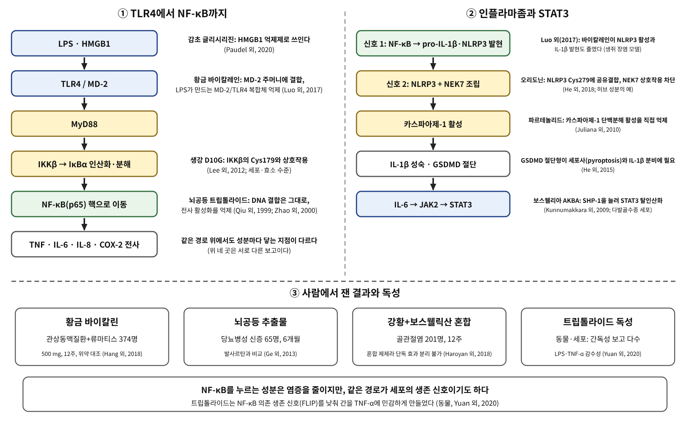

# 8장. 염증의 신호망

<strong>그림 8-1. 염증 신호는 세포 표면의 수용체에서 NF-κB로, 다시 인플라마좀과 STAT3로 이어진다.</strong> 황금의 바이칼레인, 감초의 글리시리진, 뇌공등의 트립톨라이드, 보스웰리아의 AKBA는 이 망의 서로 다른 지점에서 작용한다고 보고되었다. 아래 칸은 사람에서 잰 결과와 독성 보고로, 세포의 결과가 그대로 이어지지는 않는다.

<ul class="mini-toc">
<li>신호는 수용체에서 핵으로 간다</li>
<li>황금: 수용체 가까이에서</li>
<li>감초: 수용체에 닿기 전의 신호</li>
<li>뇌공등: 강한 억제와 독성</li>
<li>인플라마좀과 STAT3: 보스웰리아</li>
</ul>

## 이 장을 읽기 전에

7장의 스위치는 세포의 에너지 상태를 읽었다. 이 장의 신호망은 세포가 위험을 읽는 방식이다. 세균의 지질다당체(LPS)나 손상된 세포가 내놓은 단백질이 세포 표면의 수용체에 닿으면, 신호가 세포 안으로 전해져 전사인자 NF-κB를 핵으로 보낸다. NF-κB는 TNF, IL-6, IL-8, COX-2 같은 염증 유전자의 전사를 켠다. 6장에서 본 COX-2와 프로스타글란딘이 이 경로의 아래쪽 산물이다.

이 장은 이 신호망과 만나는 네 풀을 읽는다. 황금(*Scutellaria baicalensis*)의 바이칼린과 바이칼레인, 감초(*Glycyrrhiza*)의 글리시리진, 뇌공등(*Tripterygium wilfordii*)의 트립톨라이드, 보스웰리아(*Boswellia serrata*)의 보스웰릭산이다. 이 장이 읽은 근거의 대부분은 세포와 동물이고, 사람 시험은 적다. 어디서 끊기는지를 장마다 밝히는 방식은 앞 장과 같다.

## 1. 신호는 수용체에서 핵으로 간다

경로의 뼈대는 다음과 같다. LPS는 TLR4와 MD-2 복합체에 닿고, 어댑터 단백질 MyD88을 거쳐 IKKβ를 켠다. IKKβ가 IκBα를 인산화하면 IκBα가 분해되고, 풀려난 NF-κB(p65)가 핵으로 들어간다. 이 뼈대는 이 장이 읽은 연구들이 공통으로 쓰는 틀이다.

뼈대가 중요한 이유는 허브 성분의 작용 지점이 여럿이기 때문이다. 같은 "NF-κB 억제"라는 문장 아래, 수용체 복합체에 결합하는 경우, 수용체에 닿는 신호 분자를 막는 경우, 키나아제를 막는 경우, 핵 안에서 전사 활성화를 막는 경우가 섞여 있다. 이 책은 어느 지점인지를 밝히지 못하면 "NF-κB 신호가 줄었다"고만 쓴다.

## 2. 황금: 수용체 가까이에서

황금의 뿌리에는 바이칼린(baicalin)과 그 비당체 바이칼레인(baicalein)이 있다. 루오(Xiaoping Luo) 연구진은 바이칼레인이 TNBS로 유발한 생쥐 장염을 줄이고, 점막의 TLR4와 MyD88 발현이 줄면서 NF-κB와 p38 MAPK 활성이 줄었다고 보고했다. LPS로 자극한 대식세포에서도 같은 신호가 내려갔고, 상류에서는 바이칼레인이 MD-2의 소수성 주머니에 결합해 LPS가 유도하는 MD-2/TLR4 복합체 형성을 막았다. 또 NLRP3 인플라마좀 활성과 하류의 IL-1β 발현도 용량에 따라 줄였다(Luo 외, 2017). 이 연구는 수용체 가까운 지점의 결합을 보였다는 점에서 이 장의 기준이 되는 보고이다.

사람 시험은 바이칼린에서 나왔다. 항(Yuan-xing Hang) 연구진은 관상동맥질환과 류마티스 관절염을 함께 가진 환자 374명을 바이칼린 500 mg 또는 위약으로 무작위 배정해 매일 12주 투여했다. 중성지방, 총콜레스테롤, LDL-콜레스테롤, CT-1, hs-CRP가 위약군에 비해 유의하게 개선되었고, EULAR 반응이 양호하거나 중등도인 환자는 바이칼린군 71%, 위약군 53%였다(Hang 외, 2018). 이 시험은 바이칼린이 염증 표지자를 낮췄다는 것까지를 보인다. 바이칼린이 TLR4에 닿았는지는 보이지 않는다. 또 바이칼린은 장에서 비당체로 바뀌어 흡수된다는 서술이 흔하지만, 이 장은 그 단계의 원문을 읽지 못했으므로 사람 혈중에서 어느 형태가 얼마나 있는지를 쓰지 않는다.

## 3. 감초: 수용체에 닿기 전의 신호

감초의 글리시리진(glycyrrhizin)은 다른 쪽에서 작용한다고 말해 왔다. HMGB1은 손상된 세포가 내놓는 단백질로, 세포 밖에서 RAGE와 TLR4에 결합해 염증 신호를 낸다. 파우델(Yam Nath Paudel) 연구진의 총설은 글리시리진을 HMGB1의 약리학적 억제제로 소개하고, 외상성 뇌손상, 신경염증, 발작, 알츠하이머병, 파킨슨병, 다발성 경화증의 전임상 모델에서 신경 손상이 줄었다고 정리했다. 효과는 주로 HMGB1의 발현과 이동을 막고 염증 사이토카인을 낮추는 것으로 설명되었다(Paudel 외, 2020).

동물 모델의 개별 보고도 같은 방향이다. 비탈리(Roberta Vitali) 연구진은 글리시리진산 이칼륨이 세포에서 HMGB1의 분비와 TNF-α, IL-1β, IL-6 발현을 줄이고, DSS 장염 생쥐에서 장염의 중증도와 대장 조직의 TNF-α, IL-1β, IL-6, RAGE, TLR4 mRNA를 줄였다고 보고했다(Vitali 외, 2013). 정(Lei Zheng) 연구진은 흉부에 방사선을 쬔 생쥐에서 글리시리진이 혈장의 HMGB1과 폐세척액의 TNF-α, IL-1β, IL-6를 낮추고, 폐 조직과 대식세포주에서 NF-κB, JNK, ERK1/2 활성을 낮췄다고 보고했다(Zheng 외, 2019).

여기서 이 책이 확인한 것은 세 가지이다. 글리시리진이 HMGB1의 억제제로 쓰인다는 것, 그 투여로 HMGB1 하류의 지표가 줄었다는 것, 그리고 이 결과가 모두 동물과 세포의 것이라는 것이다. 이 장이 읽은 초록은 글리시리진이 HMGB1에 어떻게 결합하는지, 사람 몸에서 어느 농도가 되는지를 보여 주지 않는다. 그래서 "글리시리진이 사람의 HMGB1을 막는다"는 문장은 이 장에서 쓰지 않는다.

## 4. 뇌공등: 강한 억제와 독성

뇌공등(*Tripterygium wilfordii*)의 트립톨라이드는 이 장에서 가장 강한 억제와 가장 분명한 독성이 함께 보고된 성분이다. 치우(Daoming Qiu) 연구진은 PG490(트립톨라이드)이 사람 말초혈 림프구의 IL-2 발현을 억제하고(PMA와 항CD3 자극에서 IC50 10 ng/ml), 해당 DNA 서열에 대한 NF-AT의 결합은 막지만 NF-κB 부위의 DNA 결합은 막지 않는다고 보고했다. 그러면서도 NF-κB 표적 서열의 전사 활성화는 모든 자극에서 완전히 막았고, 사람 기관지 상피 세포의 IL-8 발현도 막았다. 같은 조건에서 사이클로스포린 A는 IL-8을 막지 못해 작용 방식이 다르다고 연구진은 정리했다(Qiu 외, 1999). 자오(Guohua Zhao) 연구진은 기관지 상피 세포에서 IC50 약 20~50 ng/ml로 IL-6와 IL-8 발현을 막고, NF-κB의 DNA 결합이 아닌 전사 활성화를 막는다고 보고했다(Zhao 외, 2000). 공(Yuntao Gong) 연구진은 LPS를 처리한 소교세포에서도 NF-κB의 DNA 결합이 아니라 전사 활성이 줄었고, COX-2 발현과 PGE₂ 생성이 함께 줄었다고 보고했다(Gong 외, 2008).

같은 억제가 독성의 뒷면이 될 수 있다. 리(Kye Young Lee) 연구진은 PG490이 TNF-α가 유도하는 NF-κB 활성과 IAP 단백질(c-IAP1, c-IAP2)의 유도를 막아 종양 세포를 TNF-α에 의한 세포사에 민감하게 한다고 보고했다(Lee 외, 1999). 이 논문은 종양 세포를 다루었다. 정상 간에서는 위안(Ziqiao Yuan) 연구진은 트립톨라이드를 투여한 생쥐와 간세포가 LPS와 TNF-α에 민감해지고, 트립톨라이드가 LPS와 TNF-α가 켜는 NF-κB 의존 생존 신호, 특히 FLIP을 억제했다고 보고했다. TNF-α 억제제 에타너셉트가 이 독성 반응을 막았고, FLIP 과발현이 간 손상을 줄였다(Yuan 외, 2020). 리(Jia Li) 연구진은 트립톨라이드가 HepG2 세포에서 산화 스트레스와 세포 손상을 일으키며, Nrf2 활성화가 이를 막는다고 보고했다(Li 외, 2014). 간독성의 기전이 한 가지가 아니라는 뜻이다.

사람 시험은 뇌공등 추출물에서 나왔다. 게(Yongchun Ge) 연구진은 단백뇨가 있는 당뇨병성 신증 환자 65명을 뇌공등 추출물(하루 120 mg을 3개월, 이어서 60 mg을 3개월) 또는 발사르탄 160 mg으로 무작위 배정했다. 24시간 소변 단백은 추출물군에서 4.99에서 2.99 g으로 줄었고, 발사르탄군에서는 유의하게 줄지 않았다. 평균 eGFR 감소는 발사르탄군이 더 컸지만 p = 0.067이었다(Ge 외, 2013). 이 시험은 이 장이 읽은 초록 범위에서 추출물의 효과를 보였다. 그러나 표본이 작고 공개 시험이며, 안전성과 이상 반응의 구체적 자료는 이 장에서 읽지 못했다.

<strong>표 8-1. 신호망의 지점별로 읽은 허브 성분</strong>

| 풀·성분 | 보고된 작용 지점 | 근거의 수준 |
|---|---|---|
| 황금 바이칼레인 | MD-2 결합, MD-2/TLR4 복합체 억제(Luo 외, 2017) | 생쥐 장염, 대식세포 |
| 감초 글리시리진 | HMGB1 억제제로 쓰임, 하류 NF-κB 감소(Paudel 외, 2020; Zheng 외, 2019) | 동물·세포 |
| 생강 D10G | IKKβ의 Cys179와 상호작용(Lee 외, 2012) | 세포·효소 |
| 뇌공등 트립톨라이드 | NF-κB 전사 활성화 억제, DNA 결합은 유지(Qiu 외, 1999; Zhao 외, 2000) | 세포 |
| 보스웰리아 AKBA | SHP-1 유도로 STAT3 탈인산화(Kunnumakkara 외, 2009) | 다발골수종 세포 |

표 8-1. 같은 NF-κB 경로 안에서도 성분마다 닿는 지점이 다르며, 대부분 세포와 동물 수준의 보고이다.

## 5. 인플라마좀과 STAT3: 보스웰리아

인플라마좀은 일반적으로 두 단계로 설명된다. NF-κB가 IL-1β 전구체와 NLRP3의 발현을 올리는 신호 1이 먼저 오고, 두 번째 신호로 NLRP3가 조립되어 카스파아제-1을 켜는 단백질 복합체가 만들어진다(이 장이 읽은 초록은 신호 1을 직접 다루지 않았다). 카스파아제-1은 IL-1β를 성숙시키고 GSDMD를 잘라, 절단된 GSDMD가 세포사(pyroptosis)와 IL-1β 분비에 필요하다. 허(Wanting He) 연구진은 GSDMD가 인플라마좀 반응에서 pyroptosis와 IL-1β 분비에 필요하다는 것을 유전자 결손 실험으로 보였다(He 외, 2015).

이 층에서 허브 성분이 직접 닿는다고 보고된 사례는 아직 많지 않다. 허(Hongbin He) 연구진은 오리도닌이 NLRP3 NACHT 도메인의 시스테인 279와 공유결합을 이루어 NLRP3와 NEK7의 상호작용을 막고 인플라마좀의 조립과 활성을 억제한다고 보고했다(He 외, 2018). 줄리아나(Christine Juliana) 연구진은 파르테놀리드가 카스파아제-1의 단백분해 활성을 직접 억제하고, 합성 IKKβ 억제제 Bay 11-7082가 NF-κB 억제와 무관하게 NLRP3 인플라마좀을 억제한다고 보고했다(Juliana 외, 2010). 이 두 연구는 이 책의 배정 풀이 아닌 성분의 사례이다. 배정 풀에서는 앞서 본 바이칼레인이 인플라마좀 활성을 줄였다고 보고되었다(Luo 외, 2017).

보스웰리아는 이 장에서 세 번째 지점을 보여 준다. 쿠누마카라(Ajaikumar Kunnumakkara) 연구진은 *Boswellia serrata*에서 처음 분리된 AKBA(acetyl-11-keto-β-boswellic acid)가 사람 다발골수종 세포에서 구성적 STAT3 활성과 IL-6가 유도한 STAT3 활성을 억제한다고 보고했다. Jak2와 Src의 인산화가 줄었고, 단백질 티로신 탈인산화효소 SHP-1이 늘어난 것이 STAT3 탈인산화를 설명할 수 있었으며, SHP-1 유전자를 siRNA로 없애자 AKBA의 효과가 사라졌다(Kunnumakkara 외, 2009). 이는 암세포주에서의 결과이고 염증 질환의 결과가 아니다.

보스웰릭산이 5-LOX를 억제한다는 서술은 흔하다. 이 장이 코퍼스에서 읽은 것은 11-케토-β-보스웰릭산을 "선택적 5-LOX 억제제"로 쓴 흰쥐 심근 허혈 재관류 보고의 초록 한 편이며(Nassar 외, 2013), 효소 수준에서 5-LOX 억제를 직접 잰 원 논문은 읽지 못했다. 그래서 이 책은 보스웰릭산의 5-LOX 억제를 이 장에서 확인된 사실로 쓰지 않고 verify 목록에 올렸다.

사람 시험은 단일 성분이 아니라 혼합 제제에서 나왔다. 하로얀(Armine Haroyan) 연구진은 골관절염 환자 201명에게 강황 커큐미노이드 제제(CuraMed) 또는 커큐미노이드와 보스웰릭산 150 mg을 포함한 제제(Curamin)를 하루 세 번 12주 투여해 위약과 비교했다. 두 제제 모두 위약에 비해 통증 관련 증상을 줄였고, 보스웰릭산을 포함한 제제의 효과가 더 컸으며 내약성이 좋았다(Haroyan 외, 2018). 이 시험은 보스웰릭산의 효과가 아니라 커큐민과 보스웰릭산을 함께 쓴 제제의 효과를 보인다. 두 성분의 기여를 나누지 못한다.

<strong>표 8-2. 사람에서 읽은 시험과 한계</strong>

| 시험 | 대상·투여 | 읽은 결과 | 이 장이 말하지 않는 것 |
|---|---|---|---|
| 바이칼린(Hang 외, 2018) | CAD+RA 374명, 500 mg, 12주, 위약 | 지질·CT-1·hs-CRP 개선, EULAR 반응 71% 대 53% | TLR4 경로가 줄었는지 |
| 뇌공등 추출물(Ge 외, 2013) | 당뇨병성 신증 65명, 6개월, 발사르탄 대조 | 24시간 소변 단백 감소 | 장기 안전성, 이상 반응 |
| 강황+보스웰릭산(Haroyan 외, 2018) | 골관절염 201명, 12주, 위약 | 혼합 제제가 통증 증상 감소 | 보스웰릭산 단독 효과 |

표 8-2. 사람의 결과는 경로의 변화가 아니라 임상 지표이며, 경로와의 연결은 읽은 범위에서 확인되지 않는다.

## 6. 염증 앞에서 이 책이 지키는 규칙

이 장의 규칙은 세 가지이다. 첫째, "NF-κB를 억제한다"고 쓸 때는 수용체, 신호 분자, 키나아제, 핵 안의 전사 활성화 중 어느 지점인지를 밝히고, 밝히지 못하면 "신호가 줄었다"고만 쓴다. 둘째, 억제가 세포의 생존 신호도 함께 낮출 수 있음을 트립톨라이드의 사례처럼 독성과 함께 적는다. 셋째, 혼합 제제의 결과를 단일 성분의 결과로 옮겨 쓰지 않는다.

이 장이 확정하지 못한 것도 분명하다. 글리시리진이 HMGB1에 어떻게 닿는지, 바이칼린이 사람 혈중에서 어떤 형태로 있는지, 보스웰릭산의 5-LOX 억제가 효소 수준에서 어떻게 측정되었는지는 이 장에서 확인하지 못했다.

2부는 여기서 끝난다. 3부의 첫 장인 9장은 세포 안에서 호르몬 신호를 읽는 핵 수용체를 다룬다.

## 참고문헌

- Ge, Y., Xie, H., Li, S., Jin, B., Hou, J., Zhang, H., Shi, M., & Liu, Z. (2013). Treatment of diabetic nephropathy with *Tripterygium wilfordii* Hook F extract: A prospective, randomized, controlled clinical trial. *Journal of Translational Medicine*. https://doi.org/10.1186/1479-5876-11-134
- Gong, Y., Xue, B., Jiao, J., Jing, L., & Wang, X. (2008). Triptolide inhibits COX-2 expression and PGE2 release by suppressing the activity of NF-κB and JNK in LPS-treated microglia. *Journal of Neurochemistry*. https://doi.org/10.1111/j.1471-4159.2008.05653.x
- Hang, Y., Qin, X., Ren, T., & Cao, J. (2018). Baicalin reduces blood lipids and inflammation in patients with coronary artery disease and rheumatoid arthritis: A randomized, double-blind, placebo-controlled trial. *Lipids in Health and Disease*. https://doi.org/10.1186/s12944-018-0797-2
- Haroyan, A., Mukuchyan, V., Mkrtchyan, N., Minasyan, N., Gasparyan, S., Sargsyan, A., Narimanyan, M., & Hovhannisyan, A. (2018). Efficacy and safety of curcumin and its combination with boswellic acid in osteoarthritis: A comparative, randomized, double-blind, placebo-controlled study. *BMC Complementary and Alternative Medicine*. https://doi.org/10.1186/s12906-017-2062-z
- He, H., Jiang, H., Chen, Y., Ye, J., Wang, A., Wang, C., Liu, Q., et al. (2018). Oridonin is a covalent NLRP3 inhibitor with strong anti-inflammasome activity. *Nature Communications*. https://doi.org/10.1038/s41467-018-04947-6
- He, W., Wan, H., Hu, L., Chen, P., Wang, X., Huang, Z., Yang, Z.-H., et al. (2015). Gasdermin D is an executor of pyroptosis and required for interleukin-1β secretion. *Cell Research*. https://doi.org/10.1038/cr.2015.139
- Juliana, C., Fernandes-Alnemri, T., Wu, J., Datta, P., Solorzano, L., Yu, J.-W., Meng, R., et al. (2010). Anti-inflammatory compounds parthenolide and Bay 11-7082 are direct inhibitors of the inflammasome. *Journal of Biological Chemistry*. https://doi.org/10.1074/jbc.m109.082305
- Kunnumakkara, A. B., Nair, A. S., Sung, B., Pandey, M. K., & Aggarwal, B. B. (2009). Boswellic acid blocks signal transducers and activators of transcription 3 signaling, proliferation, and survival of multiple myeloma via the protein tyrosine phosphatase SHP-1. *Molecular Cancer Research*. https://doi.org/10.1158/1541-7786.mcr-08-0154
- Lee, H. Y., Park, S. H., Lee, M., Kim, H.-J., Ryu, S. Y., Kim, N. D., Hwang, B. Y., et al. (2012). 1-Dehydro-[10]-gingerdione from ginger inhibits IKKβ activity for NF-κB activation and suppresses NF-κB-regulated expression of inflammatory genes. *British Journal of Pharmacology*. https://doi.org/10.1111/j.1476-5381.2012.01980.x
- Lee, K. Y., Chang, W., Qiu, D., Kao, P. N., & Rosen, G. D. (1999). PG490 (triptolide) cooperates with tumor necrosis factor-α to induce apoptosis in tumor cells. *Journal of Biological Chemistry*. https://doi.org/10.1074/jbc.274.19.13451
- Li, J., Shen, F., Guan, C., Wang, W., Sun, X., Fu, X., Huang, M., et al. (2014). Activation of Nrf2 protects against triptolide-induced hepatotoxicity. *PLoS ONE*. https://doi.org/10.1371/journal.pone.0100685
- Luo, X., Yu, Z., Deng, C., Zhang, J., Ren, G., Sun, A., Mani, S., et al. (2017). Baicalein ameliorates TNBS-induced colitis by suppressing TLR4/MyD88 signaling cascade and NLRP3 inflammasome activation in mice. *Scientific Reports*. https://doi.org/10.1038/s41598-017-12562-6
- Nassar, N. N., Elshazly, S. M., & Abd El Motteleb, D. M. (2013). The protective effect of 11-keto-β-boswellic acid a selective 5-LOX inhibitor on myocardial ischemia reperfusion injury in rats. *The FASEB Journal*. https://doi.org/10.1096/fasebj.27.1_supplement.652.3
- Paudel, Y. N., Angelopoulou, E., Semple, B. D., Piperi, C., Othman, I., & Shaikh, M. F. (2020). Potential neuroprotective effect of the HMGB1 inhibitor glycyrrhizin in neurological disorders. *ACS Chemical Neuroscience*. https://doi.org/10.1021/acschemneuro.9b00640
- Qiu, D., Zhao, G., Aoki, Y., Shi, L., Uyei, A., Nazarian, S., Ng, J. C.-H., & Kao, P. N. (1999). Immunosuppressant PG490 (triptolide) inhibits T-cell interleukin-2 expression at the level of purine-box/nuclear factor of activated T-cells and NF-κB transcriptional activation. *Journal of Biological Chemistry*. https://doi.org/10.1074/jbc.274.19.13443
- Vitali, R., Palone, F., Cucchiara, S., Negroni, A., Cavone, L., Costanzo, M., Aloi, M., et al. (2013). Dipotassium glycyrrhizate inhibits HMGB1-dependent inflammation and ameliorates colitis in mice. *PLoS ONE*. https://doi.org/10.1371/journal.pone.0066527
- Yuan, Z., Yuan, Z., Hasnat, M., Zhang, H., Liang, P., Sun, L., Jiang, Z., & Zhang, L. (2020). A new perspective of triptolide-associated hepatotoxicity: The relevance of NF-κB and NF-κB-mediated cellular FLICE-inhibitory protein. *Acta Pharmaceutica Sinica B*. https://doi.org/10.1016/j.apsb.2020.02.009
- Zhao, G., Vaszar, L. T., Qiu, D., Shi, L., & Kao, P. N. (2000). Anti-inflammatory effects of triptolide in human bronchial epithelial cells. *American Journal of Physiology-Lung Cellular and Molecular Physiology*. https://doi.org/10.1152/ajplung.2000.279.5.l958
- Zheng, L., Zhu, Q., Xu, C., Li, M., Li, H., Yi, P., Xu, F., Cao, L., & Chen, J. (2019). Glycyrrhizin mitigates radiation-induced acute lung injury by inhibiting the HMGB1/TLR4 signalling pathway. *Journal of Cellular and Molecular Medicine*. https://doi.org/10.1111/jcmm.14703
